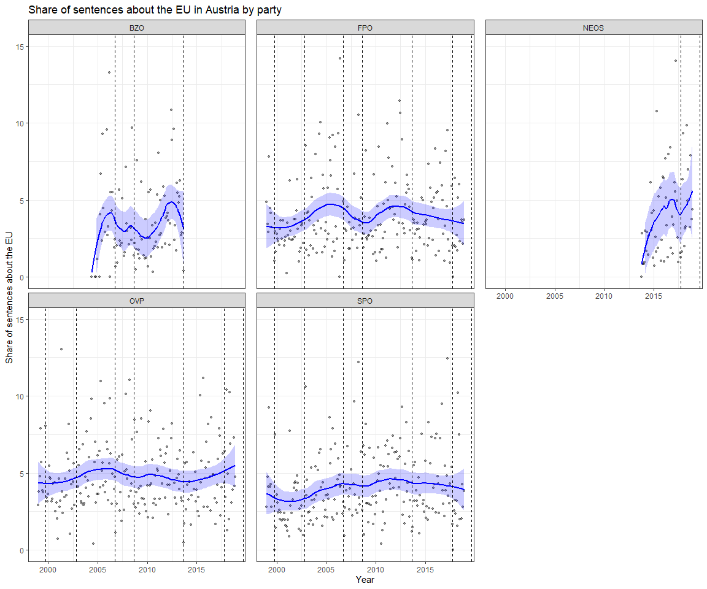
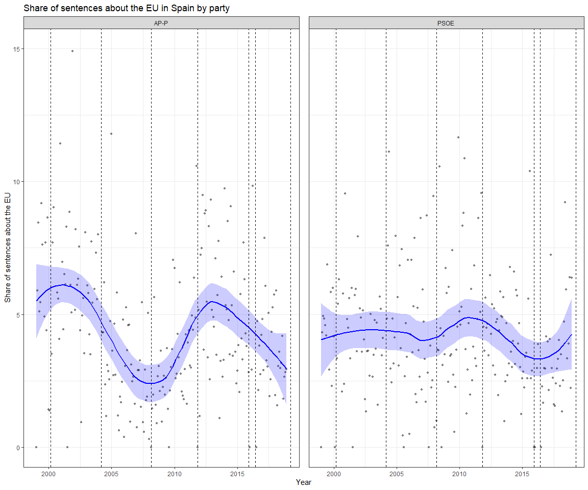
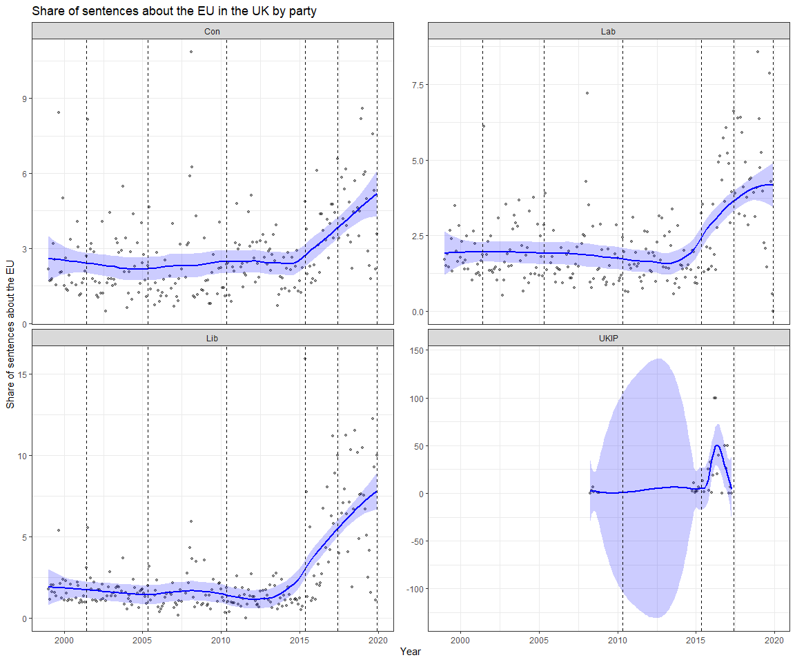
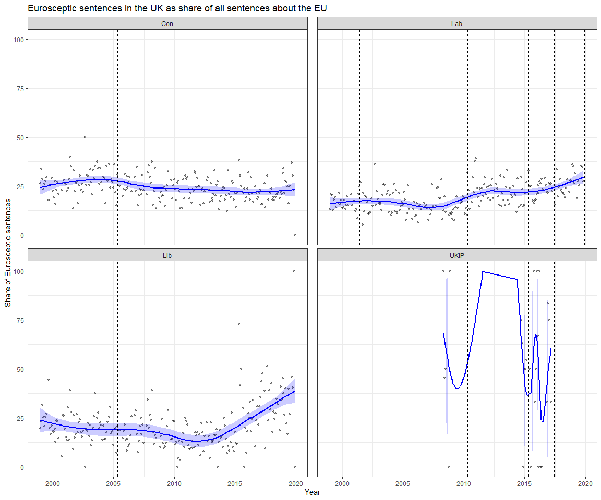

Regressions
================
Duarte Amaro
2025-06-17

# Descriptive Statistics

## Salience

### Plotting the frequency of speeches by party and country:

``` r
data_monthly <- read_csv("data_monthly.csv") |>
  mutate(year_month = factor(year_month))
```

    ## Rows: 6686 Columns: 25
    ## ── Column specification ────────────────────────────────────────────────────────
    ## Delimiter: ","
    ## chr  (11): country, name_short, name, name_english, year_month, last_electio...
    ## dbl  (13): partyfacts_id, parlgov_id, prop_eu_mention, prop_euroscepticism, ...
    ## date  (1): election_date
    ## 
    ## ℹ Use `spec()` to retrieve the full column specification for this data.
    ## ℹ Specify the column types or set `show_col_types = FALSE` to quiet this message.

``` r
data_yearly <- read_csv("data_yearly.csv")
```

    ## Rows: 643 Columns: 5
    ## ── Column specification ────────────────────────────────────────────────────────
    ## Delimiter: ","
    ## chr (1): country
    ## dbl (4): partyfacts_id, year, prop_eu_mention, prop_euroscepticism
    ## 
    ## ℹ Use `spec()` to retrieve the full column specification for this data.
    ## ℹ Specify the column types or set `show_col_types = FALSE` to quiet this message.

``` r
data_monthly |>
  mutate(next_election_year_month = as.Date(paste(next_election_year_month, "-01", sep = "")),
         year_month = as.Date(paste(year_month, "-01", sep = ""))
         ) |>
  filter(country == "AUS") |>
  ggplot(aes(x = year_month, y = prop_eu_mention)) +
  geom_point(alpha = 0.4, size = 1) +
  geom_smooth(alpha = 0.2, colour = "blue", fill = "blue",
              span = 0.5) +
  geom_vline(aes(xintercept = next_election_year_month), linetype = "dashed", color = "black") +
  facet_wrap(~name_short) +
  ylim(0, 15) +
  labs(x = "Year",
       y = "Share of sentences about the EU",
       title = "Share of sentences about the EU in Austria by party") +
  theme(panel.spacing.x = unit(5, "mm"))
```

    ## `geom_smooth()` using method = 'loess' and formula = 'y ~ x'

    ## Warning: Removed 5 rows containing non-finite outside the scale range
    ## (`stat_smooth()`).

    ## Warning: Removed 5 rows containing missing values or values outside the scale range
    ## (`geom_point()`).

<!-- -->

``` r
data_monthly |>
  mutate(next_election_year_month = as.Date(paste(next_election_year_month, "-01", sep = "")),
         year_month = as.Date(paste(year_month, "-01", sep = ""))
         ) |>
  filter(country == "DEU") |>
  ggplot(aes(x = year_month, y = prop_eu_mention)) +
  geom_point(alpha = 0.4, size = 1) +
  geom_smooth(alpha = 0.2, colour = "blue", fill = "blue",
              span = 0.5) +
  geom_vline(aes(xintercept = next_election_year_month), linetype = "dashed", color = "black") +
  facet_wrap(~name_short) +
  ylim(0, 15) +
  labs(x = "Year",
       y = "Share of sentences about the EU",
       title = "Share of sentences about the EU in Germany by party") +
  theme(panel.spacing.x = unit(5, "mm"))
```

    ## `geom_smooth()` using method = 'loess' and formula = 'y ~ x'

    ## Warning: Removed 4 rows containing non-finite outside the scale range
    ## (`stat_smooth()`).

    ## Warning: Removed 4 rows containing missing values or values outside the scale range
    ## (`geom_point()`).

<!-- -->

``` r
data_monthly |> 
  mutate(next_election_year_month = as.Date(paste(next_election_year_month, "-01", sep = "")),
         year_month = as.Date(paste(year_month, "-01", sep = ""))
         ) |>
  filter(country == "DNK") |>
  ggplot(aes(x = year_month, y = prop_eu_mention)) +
  #geom_path(group=1, alpha = 0.4) +
  geom_point(alpha = 0.4, size = 1) +
  geom_smooth(alpha = 0.2, colour = "blue", fill = "blue",
              span = 0.5) +
  geom_vline(aes(xintercept = next_election_year_month), linetype = "dashed", color = "black") +
  facet_wrap(~name_short) +
  ylim(0, 15) +
  labs(x = "Year",
       y = "Share of sentences about the EU",
       title = "Share of sentences about the EU in Denmark by party") +
  theme(panel.spacing.x = unit(5, "mm"))
```

    ## `geom_smooth()` using method = 'loess' and formula = 'y ~ x'

    ## Warning: Removed 11 rows containing non-finite outside the scale range
    ## (`stat_smooth()`).

    ## Warning: Removed 11 rows containing missing values or values outside the scale range
    ## (`geom_point()`).

    ## Warning: Removed 32 rows containing missing values or values outside the scale range
    ## (`geom_smooth()`).

<!-- -->

``` r
data_monthly |>
  mutate(next_election_year_month = as.Date(paste(next_election_year_month, "-01", sep = "")),
         year_month = as.Date(paste(year_month, "-01", sep = ""))
         ) |>
  filter(country == "ESP") |>
  ggplot(aes(x = year_month, y = prop_eu_mention)) +
  geom_point(alpha = 0.4, size = 1) +
  geom_smooth(alpha = 0.2, colour = "blue", fill = "blue",
              span = 0.5) +
  geom_vline(aes(xintercept = next_election_year_month), linetype = "dashed", color = "black") +
  facet_wrap(~name_short) +
  ylim(0, 15) +
  labs(x = "Year",
       y = "Share of sentences about the EU",
       title = "Share of sentences about the EU in Spain by party") +
  theme(panel.spacing.x = unit(5, "mm"))
```

    ## `geom_smooth()` using method = 'loess' and formula = 'y ~ x'

    ## Warning: Removed 2 rows containing non-finite outside the scale range
    ## (`stat_smooth()`).

    ## Warning: Removed 2 rows containing missing values or values outside the scale range
    ## (`geom_point()`).

<!-- -->

``` r
data_monthly |>
  mutate(next_election_year_month = as.Date(paste(next_election_year_month, "-01", sep = "")),
         year_month = as.Date(paste(year_month, "-01", sep = ""))
         ) |>
  filter(country == "NLD") |>
  ggplot(aes(x = year_month, y = prop_eu_mention)) +
  #geom_path(group=1, alpha = 0.4) +
  geom_point(alpha = 0.4, size = 1) +
  geom_smooth(alpha = 0.2, colour = "blue", fill = "blue",
              span = 0.5) +
  geom_vline(aes(xintercept = next_election_year_month), linetype = "dashed", color = "black") +
  facet_wrap(~name_short) +
  ylim(0, 15) +
  labs(x = "Year",
       y = "Share of sentences about the EU",
       title = "Share of sentences about the EU in the Netherlands by party") +
  theme(panel.spacing.x = unit(5, "mm"))
```

    ## `geom_smooth()` using method = 'loess' and formula = 'y ~ x'

    ## Warning: Removed 5 rows containing non-finite outside the scale range
    ## (`stat_smooth()`).

    ## Warning: Removed 5 rows containing missing values or values outside the scale range
    ## (`geom_point()`).

    ## Warning: Removed 17 rows containing missing values or values outside the scale range
    ## (`geom_smooth()`).

<!-- -->

``` r
data_monthly |>
  mutate(next_election_year_month = as.Date(paste(next_election_year_month, "-01", sep = "")),
         year_month = as.Date(paste(year_month, "-01", sep = ""))
         ) |>
  filter(country == "SWE") |>
  ggplot(aes(x = year_month, y = prop_eu_mention)) +
  geom_point(alpha = 0.4, size = 1) +
  geom_smooth(alpha = 0.2, colour = "blue", fill = "blue",
              span = 0.5) +
  geom_vline(aes(xintercept = next_election_year_month),
             linetype = "dashed", color = "black") +
  facet_wrap(~name_short) +
  ylim(0, 15) +
  labs(x = "Year",
       y = "Share of sentences about the EU",
       title = "Share of sentences about the EU in Sweden by party") +
  theme(panel.spacing.x = unit(5, "mm"))
```

    ## `geom_smooth()` using method = 'loess' and formula = 'y ~ x'

    ## Warning: Removed 3 rows containing non-finite outside the scale range
    ## (`stat_smooth()`).

    ## Warning: Removed 3 rows containing missing values or values outside the scale range
    ## (`geom_point()`).

<!-- -->

``` r
data_monthly |>
  mutate(next_election_year_month = as.Date(paste(next_election_year_month, "-01", sep = "")),
         year_month = as.Date(paste(year_month, "-01", sep = ""))
         ) |>
  filter(country == "GBR") |>
  ggplot(aes(x = year_month, y = prop_eu_mention)) +
  geom_point(alpha = 0.4, size = 1) +
  geom_smooth(alpha = 0.2, colour = "blue", fill = "blue",
              span = 0.5) +
  geom_vline(aes(xintercept = next_election_year_month), linetype = "dashed", color = "black") +
  facet_wrap(~name_short, scales = "free_y") +
  #ylim(0, 50) +
  labs(x = "Year",
       y = "Share of sentences about the EU",
       title = "Share of sentences about the EU in the UK by party") +
  theme(panel.spacing.x = unit(5, "mm"))
```

    ## `geom_smooth()` using method = 'loess' and formula = 'y ~ x'

<!-- -->

``` r
data_monthly |>
  ggplot(aes(x = reorder(name_short, prop_eu_mention),
             y = prop_eu_mention,
             colour = country,
             fill = country)) +
  geom_boxplot(alpha = 0.2) +
  #facet_wrap(~ country, scales = "free")
  coord_flip() +
  scale_color_brewer(name = "", palette = "Dark2") +
  scale_fill_brewer(name = "", palette = "Dark2") +
  labs(x = "", y = "Share of sentences about the EU",
       title = "Monthly share of sentences about the EU by party")
```

<!-- -->

## Position

### Share of Eurosceptic sentences by country by party for each country:

``` r
data_monthly |>
  mutate(next_election_year_month = as.Date(paste(next_election_year_month, "-01", sep = "")),
         year_month = as.Date(paste(year_month, "-01", sep = ""))
         ) |>
  filter(country == "AUS") |>
  ggplot(aes(x = year_month, y = prop_euroscepticism)) +
  geom_point(alpha = 0.4, size = 1) +
  geom_smooth(alpha = 0.2, colour = "blue", fill = "blue",
              span = 0.5) +
  geom_vline(aes(xintercept = next_election_year_month), linetype = "dashed", color = "black") +
  facet_wrap(~name_short) +
  #ylim(0, 60) +
  labs(x = "Year",
        y = "Share of Eurosceptic sentences",
       title = "Eurosceptic sentences in Austria as share of all sentences about the EU") +
  theme(panel.spacing.x = unit(5, "mm"))
```

    ## `geom_smooth()` using method = 'loess' and formula = 'y ~ x'

    ## Warning: Removed 10 rows containing non-finite outside the scale range
    ## (`stat_smooth()`).

    ## Warning: Removed 10 rows containing missing values or values outside the scale range
    ## (`geom_point()`).

<!-- -->

``` r
data_monthly |>
  mutate(next_election_year_month = as.Date(paste(next_election_year_month, "-01", sep = "")),
         year_month = as.Date(paste(year_month, "-01", sep = ""))
         ) |>
  filter(country == "DEU") |>
  ggplot(aes(x = year_month, y = prop_euroscepticism)) +
  #geom_path(group=1, alpha = 0.4) +
  geom_point(alpha = 0.4, size = 1) +
  geom_smooth(alpha = 0.2, colour = "blue", fill = "blue",
              span = 0.5) +
  geom_vline(aes(xintercept = next_election_year_month), linetype = "dashed", color = "black") +
  facet_wrap(~name_short) +
  #ylim(0, 15) +
  labs(x = "Year",
        y = "Share of Eurosceptic sentences",
       title = "Eurosceptic sentences in Germany as share of all sentences about the EU") +
  theme(panel.spacing.x = unit(5, "mm"))
```

    ## `geom_smooth()` using method = 'loess' and formula = 'y ~ x'

    ## Warning: Removed 10 rows containing non-finite outside the scale range
    ## (`stat_smooth()`).
    ## Removed 10 rows containing missing values or values outside the scale range
    ## (`geom_point()`).

<!-- -->

``` r
data_monthly |>
  mutate(next_election_year_month = as.Date(paste(next_election_year_month, "-01", sep = "")),
         year_month = as.Date(paste(year_month, "-01", sep = ""))
         ) |>
  filter(country == "DNK") |>
  ggplot(aes(x = year_month, y = prop_euroscepticism)) +
  #geom_path(group=1, alpha = 0.4) +
  geom_point(alpha = 0.4, size = 1) +
  geom_smooth(alpha = 0.2, colour = "blue", fill = "blue",
              span = 0.5) +
  geom_vline(aes(xintercept = next_election_year_month), linetype = "dashed", color = "black") +
  facet_wrap(~name_short) +
  #ylim(0, 15) +
  labs(x = "Year",
        y = "Share of Eurosceptic sentences",
       title = "Eurosceptic sentences in Denmark as share of all sentences about the EU") +
  theme(panel.spacing.x = unit(5, "mm"))
```

    ## `geom_smooth()` using method = 'loess' and formula = 'y ~ x'

    ## Warning: Removed 75 rows containing non-finite outside the scale range
    ## (`stat_smooth()`).

    ## Warning in sqrt(sum.squares/one.delta): NaNs produced

    ## Warning in stats::qt(level/2 + 0.5, pred$df): NaNs produced

    ## Warning: Removed 75 rows containing missing values or values outside the scale range
    ## (`geom_point()`).

    ## Warning in max(ids, na.rm = TRUE): no non-missing arguments to max; returning
    ## -Inf

<!-- -->

``` r
data_monthly |> 
  mutate(next_election_year_month = as.Date(paste(next_election_year_month, "-01", sep = "")),
         year_month = as.Date(paste(year_month, "-01", sep = ""))
         ) |>
  filter(country == "ESP") |>
  ggplot(aes(x = year_month, y = prop_euroscepticism)) +
  #geom_path(group=1, alpha = 0.4) +
  geom_point(alpha = 0.4, size = 1) +
  geom_smooth(alpha = 0.2, colour = "blue", fill = "blue",
              span = 0.5) +
  geom_vline(aes(xintercept = next_election_year_month), linetype = "dashed", color = "black") +
  facet_wrap(~name_short) +
  #ylim(0, 15) +
  labs(x = "Year",
        y = "Share of Eurosceptic sentences",
       title = "Eurosceptic sentences in Spain as share of all sentences about the EU") +
  theme(panel.spacing.x = unit(5, "mm"))
```

    ## `geom_smooth()` using method = 'loess' and formula = 'y ~ x'

    ## Warning: Removed 17 rows containing non-finite outside the scale range
    ## (`stat_smooth()`).

    ## Warning: Removed 17 rows containing missing values or values outside the scale range
    ## (`geom_point()`).

<!-- -->

``` r
data_monthly |>
  mutate(next_election_year_month = as.Date(paste(next_election_year_month, "-01", sep = "")),
         year_month = as.Date(paste(year_month, "-01", sep = ""))
         ) |>
  filter(country == "NLD") |>
  ggplot(aes(x = year_month, y = prop_euroscepticism)) +
  #geom_path(group=1, alpha = 0.4) +
  geom_point(alpha = 0.4, size = 1) +
  geom_smooth(alpha = 0.2, colour = "blue", fill = "blue",
              span = 0.5) +
  geom_vline(aes(xintercept = next_election_year_month), linetype = "dashed", color = "black") +
  facet_wrap(~name_short) +
  #ylim(0, 15) +
  labs(x = "Year",
        y = "Share of Eurosceptic sentences",
       title = "Eurosceptic sentences in the Netherlands as share of all sentences about the EU") +
  theme(panel.spacing.x = unit(5, "mm"))
```

    ## `geom_smooth()` using method = 'loess' and formula = 'y ~ x'

    ## Warning: Removed 45 rows containing non-finite outside the scale range
    ## (`stat_smooth()`).

    ## Warning: Removed 45 rows containing missing values or values outside the scale range
    ## (`geom_point()`).

<!-- -->

``` r
data_monthly |>
  mutate(next_election_year_month = as.Date(paste(next_election_year_month, "-01", sep = "")),
         year_month = as.Date(paste(year_month, "-01", sep = ""))
         ) |>
  filter(country == "SWE") |>
  ggplot(aes(x = year_month, y = prop_euroscepticism)) +
  #geom_path(group=1, alpha = 0.4) +
  geom_point(alpha = 0.4, size = 1) +
  geom_smooth(alpha = 0.2, colour = "blue", fill = "blue",
              span = 0.5) +
  geom_vline(aes(xintercept = next_election_year_month), linetype = "dashed", color = "black") +
  facet_wrap(~name_short) +
  #ylim(0, 15) +
  labs(x = "Year",
        y = "Share of Eurosceptic sentences",
       title = "Eurosceptic sentences in Sweden as share of all sentences about the EU") +
  theme(panel.spacing.x = unit(5, "mm"))
```

    ## `geom_smooth()` using method = 'loess' and formula = 'y ~ x'

    ## Warning: Removed 28 rows containing non-finite outside the scale range
    ## (`stat_smooth()`).

    ## Warning: Removed 28 rows containing missing values or values outside the scale range
    ## (`geom_point()`).

<!-- -->

``` r
data_monthly |>
  mutate(next_election_year_month = as.Date(paste(next_election_year_month, "-01", sep = "")),
         year_month = as.Date(paste(year_month, "-01", sep = ""))
         ) |>
  filter(country == "GBR") |>
  ggplot(aes(x = year_month, y = prop_euroscepticism)) +
  #geom_path(group=1, alpha = 0.4) +
  geom_point(alpha = 0.4, size = 1) +
  geom_smooth(alpha = 0.2, colour = "blue", fill = "blue",
              span = 0.5) +
  geom_vline(aes(xintercept = next_election_year_month), linetype = "dashed", color = "black") +
  facet_wrap(~name_short) +
  ylim(0, 100) +
  labs(x = "Year",
        y = "Share of Eurosceptic sentences",
       title = "Eurosceptic sentences in the UK as share of all sentences about the EU") +
  theme(panel.spacing.x = unit(5, "mm"))
```

    ## `geom_smooth()` using method = 'loess' and formula = 'y ~ x'

    ## Warning: Removed 6 rows containing non-finite outside the scale range
    ## (`stat_smooth()`).

    ## Warning: Removed 6 rows containing missing values or values outside the scale range
    ## (`geom_point()`).

    ## Warning: Removed 24 rows containing missing values or values outside the scale range
    ## (`geom_smooth()`).

<!-- -->

``` r
data_monthly |>
  group_by(country, name_short) |>
  mutate(mean_euroscepticism = mean(prop_euroscepticism, na.rm = TRUE)) |>
  ungroup() |>
  arrange(mean_euroscepticism) |>
  ggplot(aes(x = reorder(name_short, mean_euroscepticism),
             y = prop_euroscepticism,
             colour = country,
             fill = country)) +
  geom_boxplot(alpha = 0.2) +
  #facet_wrap(~ country, scales = "free")
  coord_flip() +
  scale_color_brewer(name = "", palette = "Dark2") +
  scale_fill_brewer(name = "", palette = "Dark2") +
  labs(x = "", y = "Share of Eurosceptic sentences",
       title = "Monthly share of Eurosceptic sentences by party")
```

    ## Warning: Removed 191 rows containing non-finite outside the scale range
    ## (`stat_boxplot()`).

<!-- -->

## Plotting salience against position

``` r
data_monthly |>
  ggplot(aes(x = prop_eu_mention, y = prop_euroscepticism)) +
  geom_point(alpha = 0.1) +
  geom_smooth(colour = "blue", fill = "blue", alpha = 0.2) +
  facet_wrap(~ country, scales = "free") +
  labs(x = "Share of sentences about the EU",
       y = "Share of Eurosceptic sentences",
       title = "Overall share of Eurosceptic sentences against monthly share of sentences about the EU") +
  theme(panel.spacing.x = unit(5, "mm"))
```

    ## `geom_smooth()` using method = 'gam' and formula = 'y ~ s(x, bs = "cs")'

    ## Warning: Removed 191 rows containing non-finite outside the scale range
    ## (`stat_smooth()`).

    ## Warning: Removed 191 rows containing missing values or values outside the scale range
    ## (`geom_point()`).

<!-- -->

# Regressions

## Using RRP voteshare in the last election

### Pooled

``` r
reg_data <- read_csv("reg_data.csv") |>
  mutate(year_month = factor(year_month),
         parlgov_id = factor(parlgov_id))
```

    ## Rows: 3278 Columns: 23
    ## ── Column specification ────────────────────────────────────────────────────────
    ## Delimiter: ","
    ## chr  (7): country, name_short, name, name_english, year_month, family_name, ...
    ## dbl (16): parlgov_id, prop_eu_mention, prop_euroscepticism, time_from_last, ...
    ## 
    ## ℹ Use `spec()` to retrieve the full column specification for this data.
    ## ℹ Specify the column types or set `show_col_types = FALSE` to quiet this message.

``` r
m1 <- lm(data = reg_data,
             prop_euroscepticism ~ as.numeric(year_month) + 
               lag_prop_euroscepticism + country + 
               time_to_next + time_to_next_ep + vote_share + 
               change_voteshare + rrp_voteshare + cabinet_party)

m2 <- lm(data = reg_data,
             prop_euroscepticism ~ as.numeric(year_month) + 
               lag_prop_euroscepticism + country + 
               time_to_next + time_to_next_ep + vote_share + 
               change_voteshare + rrp_voteshare + cabinet_party +
               parlgov_id)

m3 <- lm(data = reg_data,
             prop_euroscepticism ~ as.numeric(year_month) + 
               lag_prop_euroscepticism + country +
               time_to_next + time_to_next_ep + vote_share + 
               change_voteshare + rrp_voteshare + cabinet_party +
               time_to_next*rrp_voteshare + parlgov_id)

m4 <- lm(data = reg_data,
             prop_euroscepticism ~ as.numeric(year_month) + 
               lag_prop_euroscepticism + country +
               time_to_next + time_to_next_ep + vote_share + 
               change_voteshare + rrp_voteshare + cabinet_party + family_name +
               family_name*rrp_voteshare + parlgov_id)

m5 <- lm(data = reg_data,
             prop_euroscepticism ~ as.numeric(year_month) + 
               lag_prop_euroscepticism + country +
               time_to_next + time_to_next_ep + vote_share + 
               change_voteshare + rrp_voteshare + cabinet_party + family_2 +
               family_2*rrp_voteshare + parlgov_id)

m6 <- lm(data = reg_data,
             prop_euroscepticism ~ as.numeric(year_month) + 
               lag_prop_euroscepticism + country +
               time_to_next + time_to_next_ep + vote_share + 
               change_voteshare + rrp_voteshare + cabinet_party + parlgov_id +
               change_voteshare*rrp_voteshare)

m7 <- lm(data = reg_data,
             prop_euroscepticism ~ as.numeric(year_month) + 
               lag_prop_euroscepticism + country +
               log(time_to_next + 1) + log(time_to_next_ep + 1) + vote_share + 
               change_voteshare + rrp_voteshare + cabinet_party + parlgov_id)

stargazer::stargazer(m1, m2, m7, m3, m4, m5, m6,
                     omit.labels = c("Party", "Country"),
                     type = "text", title = "Table 1: Regression Using RRP Vote Share",
                     #out = "table.html",
                     dep.var.labels = "Share of Eurosceptic sentences",
                      covariate.labels = c("Time", "Lagged Euroscepticism",
                                          "Time to next election (months)",
                                          "Time to next EP election (months)",
                                          "Log time to next election (months)",
                                          "Log time to next EP election (months)",
                                           "Party size (vote share)",
                                           "Change in vote share",
                                           "RRP vote share",
                                           "Party in Government",
                                           "Liberal Party",
                                          "Social Democratic Party",
                                          "Centre-Right Party",
                                          "Time to next election * RRP vote share",
                                          "RRP vote share * Liberal",
                                          "RRP vote share * Social Democrat",
                                          "RRP vote share * Centre-Right",
                                          "RRP vote share * Change in vote share"
                                           ),
                     omit = c("parlgov_id", "country"),
                     omit.stat = c("f", "ser"))
```

    ## 
    ## Table 1: Regression Using RRP Vote Share
    ## ============================================================================================================
    ##                                                                 Dependent variable:                         
    ##                                        ---------------------------------------------------------------------
    ##                                                           Share of Eurosceptic sentences                    
    ##                                           (1)       (2)       (3)       (4)       (5)       (6)       (7)   
    ## ------------------------------------------------------------------------------------------------------------
    ## Time                                   0.008***  0.007***  0.007***  0.007***  0.007***  0.007***  0.007*** 
    ##                                         (0.002)   (0.002)   (0.002)   (0.002)   (0.002)   (0.002)   (0.002) 
    ##                                                                                                             
    ## Lagged Euroscepticism                  0.109***  0.087***  0.088***  0.087***  0.086***  0.087***  0.087*** 
    ##                                         (0.018)   (0.018)   (0.018)   (0.018)   (0.018)   (0.018)   (0.018) 
    ##                                                                                                             
    ## Time to next election (months)          -0.002    -0.003              -0.009    -0.003    -0.003    -0.003  
    ##                                         (0.009)   (0.009)             (0.013)   (0.009)   (0.009)   (0.009) 
    ##                                                                                                             
    ## Time to next EP election (months)       -0.008    -0.008              -0.009    -0.008    -0.008    -0.008  
    ##                                         (0.007)   (0.007)             (0.007)   (0.007)   (0.007)   (0.007) 
    ##                                                                                                             
    ## Log time to next election (months)                          -0.174                                          
    ##                                                             (0.148)                                         
    ##                                                                                                             
    ## Log time to next EP election (months)                       -0.071                                          
    ##                                                             (0.131)                                         
    ##                                                                                                             
    ## Party size (vote share)                -0.111*** -0.143*** -0.145*** -0.143*** -0.147*** -0.140*** -0.143***
    ##                                         (0.029)   (0.036)   (0.036)   (0.036)   (0.037)   (0.037)   (0.036) 
    ##                                                                                                             
    ## Change in vote share                    0.065**   0.063**   0.063**   0.064**   0.064**   0.061**   0.071** 
    ##                                         (0.026)   (0.028)   (0.028)   (0.028)   (0.028)   (0.028)   (0.036) 
    ##                                                                                                             
    ## RRP vote share                           0.021     0.010     0.010    -0.004    -0.033     0.024     0.005  
    ##                                         (0.036)   (0.036)   (0.036)   (0.042)   (0.049)   (0.048)   (0.039) 
    ##                                                                                                             
    ## Party in Government                    -3.214*** -3.041*** -3.024*** -3.050*** -3.033*** -3.032*** -3.063***
    ##                                         (0.301)   (0.317)   (0.316)   (0.317)   (0.317)   (0.317)   (0.323) 
    ##                                                                                                             
    ## Liberal Party                                                                    0.605                      
    ##                                                                                 (0.976)                     
    ##                                                                                                             
    ## Social Democratic Party                                                          1.229                      
    ##                                                                                 (1.253)                     
    ##                                                                                                             
    ## Centre-Right Party                                                                         0.755            
    ##                                                                                           (1.060)           
    ##                                                                                                             
    ## Time to next election * RRP vote share                                 0.001                                
    ##                                                                       (0.001)                               
    ##                                                                                                             
    ## RRP vote share * Liberal                                                         0.133                      
    ##                                                                                 (0.085)                     
    ##                                                                                                             
    ## RRP vote share * Social Democrat                                                 0.058                      
    ##                                                                                 (0.061)                     
    ##                                                                                                             
    ## RRP vote share * Centre-Right                                                             -0.026            
    ##                                                                                           (0.057)           
    ##                                                                                                             
    ## RRP vote share * Change in vote share                                                               -0.001  
    ##                                                                                                     (0.003) 
    ##                                                                                                             
    ## Constant                               15.886*** 16.546*** 16.987*** 16.673*** 17.652*** 15.934*** 16.599***
    ##                                         (1.352)   (1.529)   (1.627)   (1.542)   (1.680)   (1.807)   (1.537) 
    ##                                                                                                             
    ## ------------------------------------------------------------------------------------------------------------
    ## Party                                     No        No        No        No        No        No        No    
    ## Country                                   Yes       Yes       Yes       Yes       Yes       Yes       Yes   
    ## ------------------------------------------------------------------------------------------------------------
    ## Observations                             3,153     3,153     3,153     3,153     3,153     3,153     3,153  
    ## R2                                       0.405     0.416     0.416     0.416     0.417     0.416     0.416  
    ## Adjusted R2                              0.402     0.412     0.412     0.412     0.412     0.412     0.412  
    ## ============================================================================================================
    ## Note:                                                                            *p<0.1; **p<0.05; ***p<0.01

``` r
# modelsummary(list(m1, m2, m3, m4, m5, m6),
#              output = "markdown",
#              stars = TRUE,
#              coef_omit = "parlgov_id|country",
#              title = "Table 1: Regression Using RRP Vote Share",
#              coef_rename = c("as.numeric(year_month)" = "Time", 
#                              "lag_prop_euroscepticism" = "Lagged Euroscepticism", 
#                             "time_to_next" = "Time to next election (months)",
#                                         "time_to_next_ep" =  "Time to next EP election (months)",
#                                          "vote_share" = "Party size (vote share)",
#                                           "change_voteshare" = "Change in vote share",
#                                           "rrp_voteshare" = "RRP vote share",
#                                           "cabinet_party" = "Party in Government",
#                                           "family_nameLib" = "Liberal Party",
#                                         "family_nameSocDem" =  "Social Democratic Party",
#                                         "family_2Centre-right" =  "Centre-Right Party")
#              )
```

### Per country

``` r
m_aus1 <- lm(data = reg_data |> filter(country == "AUS"),
             prop_euroscepticism ~ as.numeric(year_month) + 
               lag_prop_euroscepticism + 
               time_to_next + time_to_next_ep + vote_share + 
               change_voteshare + rrp_voteshare + cabinet_party +
               parlgov_id)

m_aus2 <- lm(data = reg_data |> filter(country == "AUS"),
             prop_euroscepticism ~ as.numeric(year_month) + 
               lag_prop_euroscepticism + 
               time_to_next + time_to_next_ep + vote_share + 
               change_voteshare + rrp_voteshare + cabinet_party +
               parlgov_id + time_to_next*rrp_voteshare)

m_aus3 <- lm(data = reg_data |> filter(country == "AUS"),
             prop_euroscepticism ~ as.numeric(year_month) + 
               lag_prop_euroscepticism + 
               time_to_next + time_to_next_ep + vote_share + 
               change_voteshare + rrp_voteshare + cabinet_party +
               parlgov_id + change_voteshare*rrp_voteshare)

m_deu1 <- lm(data = reg_data |> filter(country == "DEU"),
             prop_euroscepticism ~ as.numeric(year_month) + 
               lag_prop_euroscepticism + 
               time_to_next + time_to_next_ep + vote_share + 
               change_voteshare + rrp_voteshare + cabinet_party +
               parlgov_id)

m_deu2 <- lm(data = reg_data |> filter(country == "DEU"),
             prop_euroscepticism ~ as.numeric(year_month) + 
               lag_prop_euroscepticism + 
               time_to_next + time_to_next_ep + vote_share + 
               change_voteshare + rrp_voteshare + cabinet_party +
               parlgov_id + time_to_next*rrp_voteshare)

m_deu3 <- lm(data = reg_data |> filter(country == "DEU"),
             prop_euroscepticism ~ as.numeric(year_month) + 
               lag_prop_euroscepticism + 
               time_to_next + time_to_next_ep + vote_share + 
               change_voteshare + rrp_voteshare + cabinet_party +
               parlgov_id + change_voteshare*rrp_voteshare)

m_den1 <- lm(data = reg_data |> filter(country == "DNK"),
             prop_euroscepticism ~ as.numeric(year_month) + 
               lag_prop_euroscepticism + 
               time_to_next + time_to_next_ep + vote_share + 
               change_voteshare + rrp_voteshare + cabinet_party +
               parlgov_id)

m_den2 <- lm(data = reg_data |> filter(country == "DNK"),
             prop_euroscepticism ~ as.numeric(year_month) + 
               lag_prop_euroscepticism + 
               time_to_next + time_to_next_ep + vote_share + 
               change_voteshare + rrp_voteshare + cabinet_party +
               parlgov_id + time_to_next*rrp_voteshare)

m_den3 <- lm(data = reg_data |> filter(country == "DNK"),
             prop_euroscepticism ~ as.numeric(year_month) + 
               lag_prop_euroscepticism + 
               time_to_next + time_to_next_ep + vote_share + 
               change_voteshare + rrp_voteshare + cabinet_party +
               parlgov_id + change_voteshare*rrp_voteshare)

m_swe1 <- lm(data = reg_data |> filter(country == "SWE"),
             prop_euroscepticism ~ as.numeric(year_month) + 
               lag_prop_euroscepticism + 
               time_to_next + time_to_next_ep + vote_share + 
               change_voteshare + rrp_voteshare + cabinet_party +
               parlgov_id)

m_swe2 <- lm(data = reg_data |> filter(country == "SWE"),
             prop_euroscepticism ~ as.numeric(year_month) + 
               lag_prop_euroscepticism + 
               time_to_next + time_to_next_ep + vote_share + 
               change_voteshare + rrp_voteshare + cabinet_party +
               parlgov_id + time_to_next*rrp_voteshare)

m_swe3 <- lm(data = reg_data |> filter(country == "SWE"),
             prop_euroscepticism ~ as.numeric(year_month) + 
               lag_prop_euroscepticism + 
               time_to_next + time_to_next_ep + vote_share + 
               change_voteshare + rrp_voteshare + cabinet_party +
               parlgov_id + change_voteshare*rrp_voteshare)

m_esp1 <- lm(data = reg_data |> filter(country == "ESP"),
             prop_euroscepticism ~ as.numeric(year_month) + 
               lag_prop_euroscepticism + 
               time_to_next + time_to_next_ep + vote_share + 
               change_voteshare + rrp_voteshare + cabinet_party +
               parlgov_id)

m_esp2 <- lm(data = reg_data |> filter(country == "ESP"),
             prop_euroscepticism ~ as.numeric(year_month) + 
               lag_prop_euroscepticism + 
               time_to_next + time_to_next_ep + vote_share + 
               change_voteshare + rrp_voteshare + cabinet_party +
               parlgov_id + time_to_next*rrp_voteshare)

m_esp3 <- lm(data = reg_data |> filter(country == "ESP"),
             prop_euroscepticism ~ as.numeric(year_month) + 
               lag_prop_euroscepticism + 
               time_to_next + time_to_next_ep + vote_share + 
               change_voteshare + rrp_voteshare + cabinet_party +
               parlgov_id + change_voteshare*rrp_voteshare)

m_nld1 <- lm(data = reg_data |> filter(country == "NLD"),
             prop_euroscepticism ~ as.numeric(year_month) + 
               lag_prop_euroscepticism + 
               time_to_next + time_to_next_ep + vote_share + 
               change_voteshare + rrp_voteshare + cabinet_party +
               parlgov_id)

m_nld2 <- lm(data = reg_data |> filter(country == "NLD"),
             prop_euroscepticism ~ as.numeric(year_month) + 
               lag_prop_euroscepticism + 
               time_to_next + time_to_next_ep + vote_share + 
               change_voteshare + rrp_voteshare + cabinet_party +
               parlgov_id + time_to_next*rrp_voteshare)

m_nld3 <- lm(data = reg_data |> filter(country == "NLD"),
             prop_euroscepticism ~ as.numeric(year_month) + 
               lag_prop_euroscepticism + 
               time_to_next + time_to_next_ep + vote_share + 
               change_voteshare + rrp_voteshare + cabinet_party +
               parlgov_id + change_voteshare*rrp_voteshare)

m_uk1 <- lm(data = reg_data |> filter(country == "GBR"),
             prop_euroscepticism ~ as.numeric(year_month) + 
               lag_prop_euroscepticism + 
               time_to_next + time_to_next_ep + vote_share + 
               change_voteshare + rrp_voteshare + cabinet_party +
               parlgov_id)

m_uk2 <- lm(data = reg_data |> filter(country == "GBR"),
             prop_euroscepticism ~ as.numeric(year_month) + 
               lag_prop_euroscepticism + 
               time_to_next + time_to_next_ep + vote_share + 
               change_voteshare + rrp_voteshare + cabinet_party +
               parlgov_id + time_to_next*rrp_voteshare)

m_uk3 <- lm(data = reg_data |> filter(country == "GBR"),
             prop_euroscepticism ~ as.numeric(year_month) + 
               lag_prop_euroscepticism + 
               time_to_next + time_to_next_ep + vote_share + 
               change_voteshare + rrp_voteshare + cabinet_party +
               parlgov_id + change_voteshare*rrp_voteshare)

stargazer::stargazer(m_aus1, m_deu1,m_den1, m_swe1, m_esp1, m_nld1, m_uk1,
                     omit.labels = c("Party", "Country"),
                     type = "text", title = "Table 2: Regression Using RRP Vote Share Per Country",
                     #out = "table.html",
                     dep.var.labels = "Share of Eurosceptic sentences",
                     column.labels = c("AUS", "DEU", "DNK", "SWE", "ESP", "NLD", "GBR"),
                     covariate.labels = c("Time", "Lagged Euroscepticism",
                                          "Time to next election (months)",
                                          "Time to next EP election (months)",
                                           "Party size (vote share)",
                                           "Change in vote share",
                                           "RRP vote share",
                                           "Party in Government"
                                           ),
                     omit = c("parlgov_id", "country"),
                     omit.stat = c("f", "ser"))
```

    ## 
    ## Table 2: Regression Using RRP Vote Share Per Country
    ## =======================================================================================================
    ##                                                            Dependent variable:                         
    ##                                   ---------------------------------------------------------------------
    ##                                                      Share of Eurosceptic sentences                    
    ##                                      AUS       DEU       DNK       SWE       ESP       NLD       GBR   
    ##                                      (1)       (2)       (3)       (4)       (5)       (6)       (7)   
    ## -------------------------------------------------------------------------------------------------------
    ## Time                                0.002    0.011*     0.003    -0.007   0.016***   0.014**   -0.0004 
    ##                                    (0.008)   (0.006)   (0.016)   (0.010)   (0.005)   (0.006)   (0.006) 
    ##                                                                                                        
    ## Lagged Euroscepticism              -0.001   0.231***    0.078    -0.097*    0.058     0.056     0.044  
    ##                                    (0.048)   (0.047)   (0.053)   (0.049)   (0.050)   (0.039)   (0.049) 
    ##                                                                                                        
    ## Time to next election (months)     -0.019   -0.053***   0.028    0.038**   -0.0002   -0.011     0.010  
    ##                                    (0.025)   (0.018)   (0.048)   (0.017)   (0.019)   (0.023)   (0.018) 
    ##                                                                                                        
    ## Time to next EP election (months)  -0.011     0.013    -0.014   -0.028**   -0.006    -0.012    -0.008  
    ##                                    (0.021)   (0.013)   (0.033)   (0.012)   (0.014)   (0.018)   (0.016) 
    ##                                                                                                        
    ## Party size (vote share)           -0.420**   -0.164*   -0.322   -0.206***   0.049     0.043     0.210  
    ##                                    (0.163)   (0.084)   (0.248)   (0.065)   (0.065)   (0.081)   (0.168) 
    ##                                                                                                        
    ## Change in vote share                0.088    0.137**    0.135    -0.085    -0.004    -0.059     0.084  
    ##                                    (0.093)   (0.063)   (0.190)   (0.055)   (0.052)   (0.063)   (0.091) 
    ##                                                                                                        
    ## RRP vote share                     -0.131   0.319***   -0.106    -0.202               0.118    0.220*  
    ##                                    (0.100)   (0.102)   (0.260)   (0.141)             (0.089)   (0.125) 
    ##                                                                                                        
    ## Party in Government               -2.978**  -3.398*** -2.621**  -1.283**  -3.167*** -4.540*** -6.743***
    ##                                    (1.209)   (0.762)   (1.265)   (0.644)   (0.776)   (0.822)   (1.145) 
    ##                                                                                                        
    ## Constant                          32.297*** 16.010*** 27.011*** 15.161***   2.505   12.614*** 18.588***
    ##                                    (7.450)   (3.318)   (8.001)   (1.831)   (2.838)   (2.159)   (5.845) 
    ##                                                                                                        
    ## -------------------------------------------------------------------------------------------------------
    ## Party                                Yes       Yes       Yes       Yes       Yes       Yes       Yes   
    ## Country                              No        No        No        No        No        No        No    
    ## -------------------------------------------------------------------------------------------------------
    ## Observations                         432       426       374       403       413       669       436   
    ## R2                                  0.074     0.321     0.040     0.218     0.126     0.128     0.327  
    ## Adjusted R2                         0.054     0.306     0.016     0.201     0.109     0.115     0.313  
    ## =======================================================================================================
    ## Note:                                                                       *p<0.1; **p<0.05; ***p<0.01

``` r
stargazer::stargazer(m_aus2, m_deu2,m_den2, m_swe2, m_esp2, m_nld2, m_uk2,
                     omit.labels = c("Party", "Country"),
                     type = "text", title = "Table 3: Interaction between RRP Vote Share and Time to Next Election Per Country",
                     #out = "table.html",
                     dep.var.labels = "Share of Eurosceptic sentences",
                     column.labels = c("AUS", "DEU", "DNK", "SWE", "ESP", "NLD", "GBR"),
                      covariate.labels = c("Time", "Lagged Euroscepticism",
                                          "Time to next election (months)",
                                          "Time to next EP election (months)",
                                           "Party size (vote share)",
                                           "Change in vote share",
                                           "RRP vote share",
                                           "Party in Government",
                                          "Time to next election * RRP vote share"
                                           ),
                     omit = c("parlgov_id", "country"),
                     omit.stat = c("f", "ser"))
```

    ## 
    ## Table 3: Interaction between RRP Vote Share and Time to Next Election Per Country
    ## ============================================================================================================
    ##                                                                 Dependent variable:                         
    ##                                        ---------------------------------------------------------------------
    ##                                                           Share of Eurosceptic sentences                    
    ##                                           AUS       DEU       DNK       SWE       ESP       NLD       GBR   
    ##                                           (1)       (2)       (3)       (4)       (5)       (6)       (7)   
    ## ------------------------------------------------------------------------------------------------------------
    ## Time                                     0.001    0.011*     0.005    -0.007   0.016***    0.004    -0.002  
    ##                                         (0.008)   (0.006)   (0.016)   (0.010)   (0.005)   (0.007)   (0.006) 
    ##                                                                                                             
    ## Lagged Euroscepticism                   -0.003   0.233***    0.072   -0.098**    0.058     0.058     0.041  
    ##                                         (0.049)   (0.047)   (0.053)   (0.050)   (0.050)   (0.038)   (0.049) 
    ##                                                                                                             
    ## Time to next election (months)          -0.075    -0.042    -0.217    0.046*    -0.0002  -0.118**   -0.011  
    ##                                         (0.096)   (0.026)   (0.187)   (0.025)   (0.019)   (0.051)   (0.033) 
    ##                                                                                                             
    ## Time to next EP election (months)       -0.016     0.012    -0.032   -0.026**   -0.006    -0.014    -0.010  
    ##                                         (0.022)   (0.013)   (0.035)   (0.013)   (0.014)   (0.018)   (0.017) 
    ##                                                                                                             
    ## Party size (vote share)                -0.437***  -0.159*   -0.311   -0.207***   0.049     0.051     0.236  
    ##                                         (0.165)   (0.084)   (0.247)   (0.065)   (0.065)   (0.081)   (0.172) 
    ##                                                                                                             
    ## Change in vote share                     0.106    0.129**    0.125    -0.084    -0.004    -0.057     0.077  
    ##                                         (0.098)   (0.065)   (0.189)   (0.055)   (0.052)   (0.062)   (0.091) 
    ##                                                                                                             
    ## RRP vote share                          -0.182    0.421**   -0.555    -0.167              -0.021     0.155  
    ##                                         (0.132)   (0.206)   (0.421)   (0.160)             (0.106)   (0.151) 
    ##                                                                                                             
    ## Party in Government                    -3.112**  -3.391*** -2.690**  -1.288**  -3.167*** -4.588*** -6.913***
    ##                                         (1.230)   (0.763)   (1.265)   (0.645)   (0.776)   (0.820)   (1.167) 
    ##                                                                                                             
    ## Time to next election * RRP vote share   0.002    -0.003     0.018    -0.001              0.012**    0.006  
    ##                                         (0.004)   (0.006)   (0.013)   (0.003)             (0.005)   (0.008) 
    ##                                                                                                             
    ## Constant                               34.346*** 15.563*** 33.099*** 14.926***   2.505   14.913*** 18.304***
    ##                                         (8.189)   (3.411)   (9.170)   (1.902)   (2.838)   (2.361)   (5.859) 
    ##                                                                                                             
    ## ------------------------------------------------------------------------------------------------------------
    ## Party                                     Yes       Yes       Yes       Yes       Yes       Yes       Yes   
    ## Country                                   No        No        No        No        No        No        No    
    ## ------------------------------------------------------------------------------------------------------------
    ## Observations                              432       426       374       403       413       669       436   
    ## R2                                       0.075     0.321     0.044     0.219     0.126     0.136     0.328  
    ## Adjusted R2                              0.053     0.305     0.018     0.199     0.109     0.121     0.312  
    ## ============================================================================================================
    ## Note:                                                                            *p<0.1; **p<0.05; ***p<0.01

``` r
stargazer::stargazer(m_aus3, m_deu3, m_den3, m_swe3, m_esp3, m_nld3, m_uk3,
                     omit.labels = c("Party", "Country"),
                     type = "text", title = "Table 4: Interaction between RRP Vote Share and Change in Vote Share Per Country",
                     #out = "table.html",
                     dep.var.labels = "Share of Eurosceptic sentences",
                     column.labels = c("AUS", "DEU", "DNK", "SWE", "ESP", "NLD", "GBR"),
                      covariate.labels = c("Time", "Lagged Euroscepticism",
                                          "Time to next election (months)",
                                          "Time to next EP election (months)",
                                           "Party size (vote share)",
                                           "Change in vote share",
                                           "RRP vote share",
                                           "Party in Government",
                                          "RRP vote share * Change in vote share"
                                            ),
                     omit = c("parlgov_id", "country"),
                     omit.stat = c("f", "ser"))
```

    ## 
    ## Table 4: Interaction between RRP Vote Share and Change in Vote Share Per Country
    ## ===========================================================================================================
    ##                                                                Dependent variable:                         
    ##                                       ---------------------------------------------------------------------
    ##                                                          Share of Eurosceptic sentences                    
    ##                                          AUS       DEU       DNK       SWE       ESP       NLD       GBR   
    ##                                          (1)       (2)       (3)       (4)       (5)       (6)       (7)   
    ## -----------------------------------------------------------------------------------------------------------
    ## Time                                    0.002    0.012*    -0.001    -0.011   0.016***   0.014**   -0.0001 
    ##                                        (0.008)   (0.007)   (0.017)   (0.011)   (0.005)   (0.007)   (0.006) 
    ##                                                                                                            
    ## Lagged Euroscepticism                  -0.002   0.231***    0.077   -0.099**    0.058     0.056     0.043  
    ##                                        (0.048)   (0.047)   (0.053)   (0.050)   (0.050)   (0.039)   (0.049) 
    ##                                                                                                            
    ## Time to next election (months)         -0.022   -0.053***   0.027    0.034*    -0.0002   -0.011     0.011  
    ##                                        (0.027)   (0.018)   (0.048)   (0.018)   (0.019)   (0.023)   (0.019) 
    ##                                                                                                            
    ## Time to next EP election (months)      -0.013     0.014    -0.014   -0.028**   -0.006    -0.013    -0.008  
    ##                                        (0.022)   (0.013)   (0.033)   (0.012)   (0.014)   (0.018)   (0.016) 
    ##                                                                                                            
    ## Party size (vote share)               -0.443**   -0.162*   -0.408    -0.154*    0.049     0.043     0.194  
    ##                                        (0.178)   (0.084)   (0.268)   (0.081)   (0.065)   (0.081)   (0.174) 
    ##                                                                                                            
    ## Change in vote share                    0.148     0.158    -0.450    -0.127*   -0.004    -0.043     0.072  
    ##                                        (0.210)   (0.103)   (0.732)   (0.068)   (0.052)   (0.130)   (0.098) 
    ##                                                                                                            
    ## RRP vote share                         -0.141    0.292**   -0.039    -0.068               0.116     0.202  
    ##                                        (0.105)   (0.147)   (0.272)   (0.189)             (0.090)   (0.136) 
    ##                                                                                                            
    ## Party in Government                   -3.003**  -3.439***  -1.984   -2.028**  -3.167*** -4.551*** -6.711***
    ##                                        (1.213)   (0.780)   (1.481)   (0.956)   (0.776)   (0.827)   (1.150) 
    ##                                                                                                            
    ## RRP vote share * Change in vote share  -0.003    -0.005     0.042     0.019              -0.001     0.011  
    ##                                        (0.010)   (0.018)   (0.051)   (0.018)             (0.010)   (0.034) 
    ##                                                                                                            
    ## Constant                              33.293*** 15.991*** 28.834*** 14.465***   2.505   12.619*** 19.051***
    ##                                        (8.074)   (3.322)   (8.302)   (1.946)   (2.838)   (2.161)   (6.014) 
    ##                                                                                                            
    ## -----------------------------------------------------------------------------------------------------------
    ## Party                                    Yes       Yes       Yes       Yes       Yes       Yes       Yes   
    ## Country                                  No        No        No        No        No        No        No    
    ## -----------------------------------------------------------------------------------------------------------
    ## Observations                             432       426       374       403       413       669       436   
    ## R2                                      0.074     0.321     0.041     0.221     0.126     0.128     0.327  
    ## Adjusted R2                             0.052     0.305     0.015     0.201     0.109     0.114     0.312  
    ## ===========================================================================================================
    ## Note:                                                                           *p<0.1; **p<0.05; ***p<0.01

``` r
bind_rows(
  plot_predictions(m_aus1, condition = "rrp_voteshare", draw = FALSE) |>
    mutate(country = "Austria"),
  plot_predictions(m_deu1, condition = "rrp_voteshare", draw = FALSE) |>
    mutate(country = "Germany"),
  plot_predictions(m_swe1, condition = "rrp_voteshare", draw = FALSE) |>
    mutate(country = "Sweden"),
  plot_predictions(m_den1, condition = "rrp_voteshare", draw = FALSE) |>
    mutate(country = "Denmark"),
  plot_predictions(m_nld1, condition = "rrp_voteshare", draw = FALSE) |>
    mutate(country = "Netherlands"),
  plot_predictions(m_uk1, condition = "rrp_voteshare", draw = FALSE) |>
    mutate(country = "UK")
) |>
  ggplot(
    aes(
      x = rrp_voteshare,
      y = estimate,
      ymin = conf.low,
      ymax = conf.high,
      colour = country,
      fill = country
    )
  ) +
  geom_ribbon(alpha = 0.2, colour = NA) +
  geom_line()
```

<!-- -->

## Using Polled RRP Vote Intention

### Pooled

``` r
mp1 <- lm(data = reg_data,
             prop_euroscepticism ~ as.numeric(year_month) + 
               lag_prop_euroscepticism + country + 
               time_to_next + time_to_next_ep + vote_share + 
               change_voteshare + lag_rrp_polled_voteshare + cabinet_party)

mp2 <- lm(data = reg_data,
             prop_euroscepticism ~ as.numeric(year_month) + 
               lag_prop_euroscepticism + country + 
               time_to_next + time_to_next_ep + vote_share + 
               change_voteshare + lag_rrp_polled_voteshare + cabinet_party +
               parlgov_id)

mp3 <- lm(data = reg_data,
             prop_euroscepticism ~ as.numeric(year_month) + 
               lag_prop_euroscepticism + country + 
               log(time_to_next + 1) + log(time_to_next_ep + 1) + vote_share + 
               change_voteshare + lag_rrp_polled_voteshare + cabinet_party +
               parlgov_id)

mp4 <- lm(data = reg_data,
             prop_euroscepticism ~ as.numeric(year_month) + 
               lag_prop_euroscepticism + country +
               time_to_next + time_to_next_ep + vote_share + 
               change_voteshare + lag_rrp_polled_voteshare + cabinet_party +
               time_to_next*lag_rrp_polled_voteshare + parlgov_id)

mp5 <- lm(data = reg_data,
             prop_euroscepticism ~ as.numeric(year_month) + 
               lag_prop_euroscepticism + country +
               time_to_next + time_to_next_ep + vote_share + 
               change_voteshare + lag_rrp_polled_voteshare + cabinet_party + family_name +
               family_name*lag_rrp_polled_voteshare)

mp6 <- lm(data = reg_data,
             prop_euroscepticism ~ as.numeric(year_month) + 
               lag_prop_euroscepticism + country +
               time_to_next + time_to_next_ep + vote_share + 
               change_voteshare + lag_rrp_polled_voteshare + cabinet_party + family_2 +
               family_2*lag_rrp_polled_voteshare )

mp7 <- lm(data = reg_data,
             prop_euroscepticism ~ as.numeric(year_month) + 
               lag_prop_euroscepticism + country +
               time_to_next + time_to_next_ep + vote_share + 
               change_voteshare + lag_rrp_polled_voteshare + cabinet_party + parlgov_id +
               change_voteshare*lag_rrp_polled_voteshare + parlgov_id)

stargazer::stargazer(mp1, mp2, mp3, mp4, mp5, mp6, mp7,
                     omit.labels = c("Party", "Country"),
                     type = "text", title = "Table 5: Regression Using Polled RRP Vote",
                     dep.var.labels = "Share of Eurosceptic sentences",
                    covariate.labels = c("Time", "Lagged Euroscepticism",
                                          "Time to next election (months)",
                                          "Time to next EP election (months)",
                                          "Log time to next election (months)",
                                          "Log time to next EP election (months)",
                                           "Party size (vote share)",
                                           "Change in vote share",
                                           "Polled RRP Vote",
                                           "Party in Government",
                                         "Time to next election * Polled RRP vote share",
                                           "Liberal Party",
                                          "Social Democratic Party",
                                          "Polled RRP vote share * Liberal",
                                          "RRP vote share * Social Democrat",
                                         "Centre-Right Party",
                                          "Polled RRP vote share * Centre-Right",
                                          "Polled RRP vote share * Change in vote share"
                                           ),
                     omit = c("parlgov_id", "country"),
                     omit.stat = c("f", "ser"))
```

    ## 
    ## Table 5: Regression Using Polled RRP Vote
    ## ===================================================================================================================
    ##                                                                        Dependent variable:                         
    ##                                               ---------------------------------------------------------------------
    ##                                                                  Share of Eurosceptic sentences                    
    ##                                                  (1)       (2)       (3)       (4)       (5)       (6)       (7)   
    ## -------------------------------------------------------------------------------------------------------------------
    ## Time                                           0.006**    0.005     0.005     0.005     0.004    0.006*     0.005  
    ##                                                (0.003)   (0.003)   (0.003)   (0.003)   (0.003)   (0.003)   (0.003) 
    ##                                                                                                                    
    ## Lagged Euroscepticism                         0.097***  0.088***  0.089***  0.088***  0.087***  0.095***  0.088*** 
    ##                                                (0.020)   (0.020)   (0.020)   (0.020)   (0.020)   (0.020)   (0.020) 
    ##                                                                                                                    
    ## Time to next election (months)                 -0.005    -0.006              -0.013    -0.006    -0.005    -0.006  
    ##                                                (0.010)   (0.010)             (0.016)   (0.010)   (0.010)   (0.010) 
    ##                                                                                                                    
    ## Time to next EP election (months)              -0.008    -0.008              -0.008    -0.008    -0.008    -0.008  
    ##                                                (0.008)   (0.008)             (0.008)   (0.008)   (0.008)   (0.008) 
    ##                                                                                                                    
    ## Log time to next election (months)                                 -0.277                                          
    ##                                                                    (0.173)                                         
    ##                                                                                                                    
    ## Log time to next EP election (months)                              -0.065                                          
    ##                                                                    (0.152)                                         
    ##                                                                                                                    
    ## Party size (vote share)                       -0.104*** -0.148*** -0.151*** -0.147*** -0.149*** -0.121*** -0.149***
    ##                                                (0.032)   (0.040)   (0.040)   (0.040)   (0.033)   (0.032)   (0.040) 
    ##                                                                                                                    
    ## Change in vote share                            0.036     0.047     0.047     0.048    0.051*     0.046     0.041  
    ##                                                (0.028)   (0.031)   (0.031)   (0.031)   (0.029)   (0.029)   (0.039) 
    ##                                                                                                                    
    ## Polled RRP Vote                                 0.038     0.035     0.034     0.021    -0.032     0.057     0.037  
    ##                                                (0.035)   (0.035)   (0.035)   (0.042)   (0.040)   (0.039)   (0.036) 
    ##                                                                                                                    
    ## Party in Government                           -2.877*** -2.685*** -2.660*** -2.695*** -2.670*** -2.743*** -2.666***
    ##                                                (0.340)   (0.359)   (0.358)   (0.360)   (0.349)   (0.344)   (0.367) 
    ##                                                                                                                    
    ## Time to next election * Polled RRP vote share                                 0.001                                
    ##                                                                              (0.001)                               
    ##                                                                                                                    
    ## Liberal Party                                                                          -1.863*                     
    ##                                                                                        (1.051)                     
    ##                                                                                                                    
    ## Social Democratic Party                                                                 0.339                      
    ##                                                                                        (0.419)                     
    ##                                                                                                                    
    ## Polled RRP vote share * Liberal                                                       0.260***                     
    ##                                                                                        (0.073)                     
    ##                                                                                                                    
    ## RRP vote share * Social Democrat                                                       0.082**                     
    ##                                                                                        (0.033)                     
    ##                                                                                                                    
    ## Centre-Right Party                                                                               -0.337            
    ##                                                                                                  (0.411)           
    ##                                                                                                                    
    ## Polled RRP vote share * Centre-Right                                                             -0.034            
    ##                                                                                                  (0.031)           
    ##                                                                                                                    
    ## Polled RRP vote share * Change in vote share                                                                0.001  
    ##                                                                                                            (0.003) 
    ##                                                                                                                    
    ## Constant                                      15.387*** 16.188*** 16.898*** 16.295*** 17.516*** 16.051*** 16.206***
    ##                                                (1.358)   (1.580)   (1.714)   (1.592)   (1.459)   (1.417)   (1.582) 
    ##                                                                                                                    
    ## -------------------------------------------------------------------------------------------------------------------
    ## Party                                            No        No        No        No        No        No        No    
    ## Country                                          Yes       Yes       Yes       Yes       Yes       Yes       Yes   
    ## -------------------------------------------------------------------------------------------------------------------
    ## Observations                                    2,572     2,572     2,572     2,572     2,572     2,572     2,572  
    ## R2                                              0.308     0.313     0.314     0.313     0.315     0.309     0.313  
    ## Adjusted R2                                     0.304     0.308     0.308     0.308     0.310     0.305     0.308  
    ## ===================================================================================================================
    ## Note:                                                                                   *p<0.1; **p<0.05; ***p<0.01

``` r
plot_slopes(mp5, variables = "lag_rrp_polled_voteshare", 
            by = "family_name") +
  geom_hline(yintercept = 0, linetype = "dashed", color = "black") +
  labs(title = "Effect of Polled RRP Vote Share on Euroscepticism by Party Family",
            xlab = "Polled RRP Vote Share (%)",
            ylab = "Euroscepticism (Share of Eurosceptic Sentences)")
```

<!-- -->
\### Per country

``` r
mp_aus1 <- lm(data = reg_data |> filter(country == "AUS"),
             prop_euroscepticism ~ as.numeric(year_month) + 
               lag_prop_euroscepticism + 
               time_to_next + time_to_next_ep + vote_share + 
               change_voteshare + lag_rrp_polled_voteshare + cabinet_party +
               parlgov_id)

mp_aus2 <- lm(data = reg_data |> filter(country == "AUS"),
             prop_euroscepticism ~ as.numeric(year_month) + 
               lag_prop_euroscepticism + 
               time_to_next + time_to_next_ep + vote_share + 
               change_voteshare + lag_rrp_polled_voteshare + cabinet_party +
               parlgov_id + time_to_next*lag_rrp_polled_voteshare)

mp_aus3 <- lm(data = reg_data |> filter(country == "AUS"),
             prop_euroscepticism ~ as.numeric(year_month) + 
               lag_prop_euroscepticism + 
               time_to_next + time_to_next_ep + vote_share + 
               change_voteshare + lag_rrp_polled_voteshare + cabinet_party +
               parlgov_id + change_voteshare*lag_rrp_polled_voteshare)

mp_deu1 <- lm(data = reg_data |> filter(country == "DEU"),
             prop_euroscepticism ~ as.numeric(year_month) + 
               lag_prop_euroscepticism + 
               time_to_next + time_to_next_ep + vote_share + 
               change_voteshare + lag_rrp_polled_voteshare + cabinet_party +
               parlgov_id)

mp_deu2 <- lm(data = reg_data |> filter(country == "DEU"),
             prop_euroscepticism ~ as.numeric(year_month) + 
               lag_prop_euroscepticism + 
               time_to_next + time_to_next_ep + vote_share + 
               change_voteshare + lag_rrp_polled_voteshare + cabinet_party +
               parlgov_id + time_to_next*lag_rrp_polled_voteshare)

mp_deu3 <- lm(data = reg_data |> filter(country == "DEU"),
             prop_euroscepticism ~ as.numeric(year_month) + 
               lag_prop_euroscepticism + 
               time_to_next + time_to_next_ep + vote_share + 
               change_voteshare + lag_rrp_polled_voteshare + cabinet_party +
               parlgov_id + change_voteshare*lag_rrp_polled_voteshare)

mp_den1 <- lm(data = reg_data |> filter(country == "DNK"),
             prop_euroscepticism ~ as.numeric(year_month) + 
               lag_prop_euroscepticism + 
               time_to_next + time_to_next_ep + vote_share + 
               change_voteshare + lag_rrp_polled_voteshare + cabinet_party +
               parlgov_id)

mp_den2 <- lm(data = reg_data |> filter(country == "DNK"),
             prop_euroscepticism ~ as.numeric(year_month) + 
               lag_prop_euroscepticism + 
               time_to_next + time_to_next_ep + vote_share + 
               change_voteshare + lag_rrp_polled_voteshare + cabinet_party +
               parlgov_id + time_to_next*lag_rrp_polled_voteshare)

mp_den3 <- lm(data = reg_data |> filter(country == "DNK"),
             prop_euroscepticism ~ as.numeric(year_month) + 
               lag_prop_euroscepticism + 
               time_to_next + time_to_next_ep + vote_share + 
               change_voteshare + lag_rrp_polled_voteshare + cabinet_party +
               parlgov_id + change_voteshare*lag_rrp_polled_voteshare)

mp_swe1 <- lm(data = reg_data |> filter(country == "SWE"),
             prop_euroscepticism ~ as.numeric(year_month) + 
               lag_prop_euroscepticism + 
               time_to_next + time_to_next_ep + vote_share + 
               change_voteshare + lag_rrp_polled_voteshare + cabinet_party +
               parlgov_id)

mp_swe2 <- lm(data = reg_data |> filter(country == "SWE"),
             prop_euroscepticism ~ as.numeric(year_month) + 
               lag_prop_euroscepticism + 
               time_to_next + time_to_next_ep + vote_share + 
               change_voteshare + lag_rrp_polled_voteshare + cabinet_party +
               parlgov_id + time_to_next*lag_rrp_polled_voteshare)

mp_swe3 <- lm(data = reg_data |> filter(country == "SWE"),
             prop_euroscepticism ~ as.numeric(year_month) + 
               lag_prop_euroscepticism + 
               time_to_next + time_to_next_ep + vote_share + 
               change_voteshare + lag_rrp_polled_voteshare + cabinet_party +
               parlgov_id + change_voteshare*lag_rrp_polled_voteshare)

mp_esp1 <- lm(data = reg_data |> filter(country == "ESP"),
             prop_euroscepticism ~ as.numeric(year_month) + 
               lag_prop_euroscepticism + 
               time_to_next + time_to_next_ep + vote_share + 
               change_voteshare + lag_rrp_polled_voteshare + cabinet_party +
               parlgov_id)

mp_esp2 <- lm(data = reg_data |> filter(country == "ESP"),
             prop_euroscepticism ~ as.numeric(year_month) + 
               lag_prop_euroscepticism + 
               time_to_next + time_to_next_ep + vote_share + 
               change_voteshare + lag_rrp_polled_voteshare + cabinet_party +
               parlgov_id + time_to_next*lag_rrp_polled_voteshare)

mp_esp3 <- lm(data = reg_data |> filter(country == "ESP"),
             prop_euroscepticism ~ as.numeric(year_month) + 
               lag_prop_euroscepticism + 
               time_to_next + time_to_next_ep + vote_share + 
               change_voteshare + lag_rrp_polled_voteshare + cabinet_party +
               parlgov_id + change_voteshare*lag_rrp_polled_voteshare)

mp_nld1 <- lm(data = reg_data |> filter(country == "NLD"),
             prop_euroscepticism ~ as.numeric(year_month) + 
               lag_prop_euroscepticism + 
               time_to_next + time_to_next_ep + vote_share + 
               change_voteshare + lag_rrp_polled_voteshare + cabinet_party +
               parlgov_id)

mp_nld2 <- lm(data = reg_data |> filter(country == "NLD"),
             prop_euroscepticism ~ as.numeric(year_month) + 
               lag_prop_euroscepticism + 
               time_to_next + time_to_next_ep + vote_share + 
               change_voteshare + lag_rrp_polled_voteshare + cabinet_party +
               parlgov_id + time_to_next*lag_rrp_polled_voteshare)

mp_nld3 <- lm(data = reg_data |> filter(country == "NLD"),
             prop_euroscepticism ~ as.numeric(year_month) + 
               lag_prop_euroscepticism + 
               time_to_next + time_to_next_ep + vote_share + 
               change_voteshare + lag_rrp_polled_voteshare + cabinet_party +
               parlgov_id + change_voteshare*lag_rrp_polled_voteshare)

stargazer::stargazer(mp_aus1, mp_deu1,mp_den1, mp_swe1, mp_esp1, mp_nld1,
                     omit.labels = c("Party", "Country"),
                     type = "text", title = "Table 6: Regression Using Polled RRP Vote Per Country",
                     #out = "table.html",
                     dep.var.labels = "Share of Eurosceptic sentences",
                     column.labels = c("AUS", "DEU", "DNK", "SWE", "ESP", "NLD"),
                     covariate.labels = c("Time", "Lagged Euroscepticism",
                                          "Time to next election (months)",
                                          "Time to next EP election (months)",
                                           "Party size (vote share)",
                                           "Change in vote share",
                                           "Polled RRP Vote",
                                           "Party in Government"
                                           ),
                     omit = c("parlgov_id", "country"),
                     omit.stat = c("f", "ser"))
```

    ## 
    ## Table 6: Regression Using Polled RRP Vote Per Country
    ## ===========================================================================================
    ##                                                      Dependent variable:                   
    ##                                   ---------------------------------------------------------
    ##                                                Share of Eurosceptic sentences              
    ##                                     AUS       DEU      DNK       SWE       ESP       NLD   
    ##                                     (1)       (2)      (3)       (4)       (5)       (6)   
    ## -------------------------------------------------------------------------------------------
    ## Time                               -0.003    0.010    -0.025   -0.015*  0.014***  0.028*** 
    ##                                   (0.010)   (0.007)  (0.017)   (0.008)   (0.005)   (0.010) 
    ##                                                                                            
    ## Lagged Euroscepticism              0.010   0.238***   0.072    -0.095*    0.049     0.055  
    ##                                   (0.052)   (0.047)  (0.054)   (0.050)   (0.050)   (0.041) 
    ##                                                                                            
    ## Time to next election (months)     -0.023  -0.043**   0.031    0.029*     0.012    -0.033  
    ##                                   (0.028)   (0.018)  (0.049)   (0.015)   (0.019)   (0.025) 
    ##                                                                                            
    ## Time to next EP election (months)  -0.028    0.011    -0.020  -0.033***   0.002    -0.020  
    ##                                   (0.025)   (0.013)  (0.035)   (0.012)   (0.014)   (0.019) 
    ##                                                                                            
    ## Party size (vote share)            -0.087  -0.179**   -0.329  -0.187***   0.104     0.030  
    ##                                   (0.193)   (0.085)  (0.253)   (0.063)   (0.068)   (0.083) 
    ##                                                                                            
    ## Change in vote share               0.120    0.133**   0.148    -0.072    -0.042    -0.077  
    ##                                   (0.104)   (0.066)  (0.186)   (0.053)   (0.053)   (0.066) 
    ##                                                                                            
    ## Polled RRP Vote                   0.238**   0.177**  0.672**   -0.060   4.645***   -0.117  
    ##                                   (0.098)   (0.081)  (0.335)   (0.072)   (1.361)   (0.091) 
    ##                                                                                            
    ## Party in Government               -3.412** -3.215*** -2.625** -1.467**  -3.265*** -4.427***
    ##                                   (1.370)   (0.769)  (1.301)   (0.616)   (0.784)   (0.874) 
    ##                                                                                            
    ## Constant                          15.407*  16.809*** 20.178** 15.492***  -0.067   14.054***
    ##                                   (8.237)   (3.419)  (8.458)   (1.826)   (2.998)   (2.257) 
    ##                                                                                            
    ## -------------------------------------------------------------------------------------------
    ## Party                               Yes       Yes      Yes       Yes       Yes       Yes   
    ## Country                              No       No        No       No        No        No    
    ## -------------------------------------------------------------------------------------------
    ## Observations                        368       422      362       401       405       614   
    ## R2                                 0.078     0.313    0.051     0.218     0.149     0.125  
    ## Adjusted R2                        0.055     0.298    0.026     0.201     0.129     0.110  
    ## ===========================================================================================
    ## Note:                                                           *p<0.1; **p<0.05; ***p<0.01

``` r
stargazer::stargazer(mp_aus2, mp_deu2,mp_den2, mp_swe2, mp_esp2, mp_nld2,
                     omit.labels = c("Party", "Country"),
                     type = "text", title = "Table 7: Interaction between Polled RRP Vote and Time to Next Election Per Country",
                     #out = "table.html",
                     dep.var.labels = "Share of Eurosceptic sentences",
                     column.labels = c("AUS", "DEU", "DNK", "SWE", "ESP", "NLD"),
                      covariate.labels = c("Time", "Lagged Euroscepticism",
                                          "Time to next election (months)",
                                          "Time to next EP election (months)",
                                           "Party size (vote share)",
                                           "Change in vote share",
                                           "Polled RRP Vote",
                                           "Party in Government",
                                          "Time to next election * Polled RRP Vote"
                                           ),
                     omit = c("parlgov_id", "country"),
                     omit.stat = c("f", "ser"))
```

    ## 
    ## Table 7: Interaction between Polled RRP Vote and Time to Next Election Per Country
    ## ==================================================================================================
    ##                                                            Dependent variable:                    
    ##                                         ----------------------------------------------------------
    ##                                                       Share of Eurosceptic sentences              
    ##                                           AUS       DEU       DNK       SWE       ESP       NLD   
    ##                                           (1)       (2)       (3)       (4)       (5)       (6)   
    ## --------------------------------------------------------------------------------------------------
    ## Time                                     -0.004    0.010    -0.024    -0.014*  0.014***   0.019*  
    ##                                         (0.010)   (0.007)   (0.017)   (0.008)   (0.005)   (0.011) 
    ##                                                                                                   
    ## Lagged Euroscepticism                    0.006   0.238***    0.069    -0.097*    0.055     0.060  
    ##                                         (0.052)   (0.047)   (0.054)   (0.050)   (0.050)   (0.041) 
    ##                                                                                                   
    ## Time to next election (months)           -0.107   -0.040*   -0.195    0.038*     0.014   -0.130** 
    ##                                         (0.102)   (0.021)   (0.209)   (0.022)   (0.019)   (0.053) 
    ##                                                                                                   
    ## Time to next EP election (months)        -0.038    0.011    -0.023   -0.030**    0.004    -0.021  
    ##                                         (0.027)   (0.014)   (0.035)   (0.013)   (0.014)   (0.019) 
    ##                                                                                                   
    ## Party size (vote share)                  -0.094  -0.178**   -0.315   -0.189***  0.132*     0.031  
    ##                                         (0.194)   (0.086)   (0.253)   (0.063)   (0.069)   (0.083) 
    ##                                                                                                   
    ## Change in vote share                     0.141    0.128*     0.163    -0.073    -0.061    -0.073  
    ##                                         (0.107)   (0.068)   (0.186)   (0.053)   (0.053)   (0.065) 
    ##                                                                                                   
    ## Polled RRP Vote                          0.172     0.208     0.321    -0.030    -1.993   -0.221** 
    ##                                         (0.125)   (0.134)   (0.461)   (0.088)   (3.225)   (0.104) 
    ##                                                                                                   
    ## Party in Government                     -3.541** -3.202*** -2.706**  -1.458**  -3.278*** -4.418***
    ##                                         (1.379)   (0.772)   (1.303)   (0.617)   (0.780)   (0.872) 
    ##                                                                                                   
    ## Time to next election * Polled RRP Vote  0.004    -0.001     0.016    -0.001    1.227**   0.008** 
    ##                                         (0.005)   (0.004)   (0.015)   (0.002)   (0.541)   (0.004) 
    ##                                                                                                   
    ## Constant                                17.553** 16.691*** 24.674*** 15.207***  -1.261   16.491***
    ##                                         (8.612)   (3.448)   (9.377)   (1.892)   (3.029)   (2.548) 
    ##                                                                                                   
    ## --------------------------------------------------------------------------------------------------
    ## Party                                     Yes       Yes       Yes       Yes       Yes       Yes   
    ## Country                                    No       No        No        No        No        No    
    ## --------------------------------------------------------------------------------------------------
    ## Observations                              368       422       362       401       405       614   
    ## R2                                       0.080     0.313     0.054     0.219     0.160     0.131  
    ## Adjusted R2                              0.054     0.296     0.027     0.199     0.138     0.115  
    ## ==================================================================================================
    ## Note:                                                                  *p<0.1; **p<0.05; ***p<0.01

``` r
stargazer::stargazer(mp_aus3, mp_deu3, mp_den3, mp_swe3, mp_esp3, mp_nld3,
                     omit.labels = c("Party", "Country"),
                     type = "text", title = "Table 8: Interaction between Polled RRP Vote and Change in Vote Share Per Country",
                     #out = "table.html",
                     dep.var.labels = "Share of Eurosceptic sentences",
                     column.labels = c("AUS", "DEU", "DNK", "SWE", "ESP", "NLD"),
                      covariate.labels = c("Time", "Lagged Euroscepticism",
                                          "Time to next election (months)",
                                          "Time to next EP election (months)",
                                           "Party size (vote share)",
                                           "Change in vote share",
                                           "Polled RRP Vote",
                                           "Party in Government",
                                          "Polled RRP Vote * Change in vote share"
                                            ),
                     omit = c("parlgov_id", "country"),
                     omit.stat = c("f", "ser"))
```

    ## 
    ## Table 8: Interaction between Polled RRP Vote and Change in Vote Share Per Country
    ## ==================================================================================================
    ##                                                            Dependent variable:                    
    ##                                        -----------------------------------------------------------
    ##                                                      Share of Eurosceptic sentences               
    ##                                           AUS       DEU       DNK       SWE       ESP       NLD   
    ##                                           (1)       (2)       (3)       (4)       (5)       (6)   
    ## --------------------------------------------------------------------------------------------------
    ## Time                                    -0.002     0.012    -0.028   -0.016**   0.013**  0.028*** 
    ##                                         (0.010)   (0.008)   (0.018)   (0.008)   (0.005)   (0.010) 
    ##                                                                                                   
    ## Lagged Euroscepticism                    0.005   0.238***    0.069   -0.098**    0.048     0.054  
    ##                                         (0.052)   (0.047)   (0.054)   (0.050)   (0.050)   (0.041) 
    ##                                                                                                   
    ## Time to next election (months)          -0.033   -0.045**    0.034    0.030**    0.012    -0.034  
    ##                                         (0.029)   (0.018)   (0.049)   (0.015)   (0.019)   (0.025) 
    ##                                                                                                   
    ## Time to next EP election (months)       -0.035     0.013    -0.020   -0.032***   0.003    -0.020  
    ##                                         (0.025)   (0.014)   (0.035)   (0.012)   (0.014)   (0.019) 
    ##                                                                                                   
    ## Party size (vote share)                 -0.175   -0.174**   -0.470*  -0.146**    0.087     0.027  
    ##                                         (0.201)   (0.086)   (0.283)   (0.072)   (0.071)   (0.084) 
    ##                                                                                                   
    ## Change in vote share                    0.398*    0.153**   -0.811    -0.104*   -0.047    -0.130  
    ##                                         (0.207)   (0.075)   (0.880)   (0.060)   (0.053)   (0.122) 
    ##                                                                                                   
    ## Polled RRP Vote                         0.202**   0.159*    0.727**   -0.013     3.213    -0.123  
    ##                                         (0.101)   (0.087)   (0.338)   (0.083)   (2.256)   (0.091) 
    ##                                                                                                   
    ## Party in Government                    -3.759*** -3.328***  -1.599   -1.993*** -3.035*** -4.480***
    ##                                         (1.386)   (0.794)   (1.594)   (0.765)   (0.836)   (0.880) 
    ##                                                                                                   
    ## Polled RRP Vote * Change in vote share  -0.017    -0.006     0.076     0.011     0.560     0.004  
    ##                                         (0.011)   (0.010)   (0.069)   (0.009)   (0.704)   (0.007) 
    ##                                                                                                   
    ## Constant                               18.995**  16.650*** 23.438*** 14.697***   0.570   14.235***
    ##                                         (8.539)   (3.433)   (8.947)   (1.950)   (3.105)   (2.285) 
    ##                                                                                                   
    ## --------------------------------------------------------------------------------------------------
    ## Party                                     Yes       Yes       Yes       Yes       Yes       Yes   
    ## Country                                   No        No        No        No        No        No    
    ## --------------------------------------------------------------------------------------------------
    ## Observations                              368       422       362       401       405       614   
    ## R2                                       0.084     0.313     0.054     0.221     0.150     0.125  
    ## Adjusted R2                              0.058     0.296     0.027     0.201     0.129     0.109  
    ## ==================================================================================================
    ## Note:                                                                  *p<0.1; **p<0.05; ***p<0.01

``` r
bind_rows(
  plot_predictions(mp_aus1, condition = "lag_rrp_polled_voteshare", draw = FALSE) |>
    mutate(country = "Austria"),
  plot_predictions(mp_deu1, condition = "lag_rrp_polled_voteshare", draw = FALSE) |>
    mutate(country = "Germany"),
  plot_predictions(mp_swe1, condition = "lag_rrp_polled_voteshare", draw = FALSE) |>
    mutate(country = "Sweden"),
  plot_predictions(mp_den1, condition = "lag_rrp_polled_voteshare", draw = FALSE) |>
    mutate(country = "Denmark"),
  plot_predictions(mp_nld1, condition = "lag_rrp_polled_voteshare", draw = FALSE) |>
    mutate(country = "Netherlands"),
  plot_predictions(mp_esp1, condition = "lag_rrp_polled_voteshare", draw = FALSE) |>
    mutate(country = "Spain")
) |>
  ggplot(
    aes(
      x = lag_rrp_polled_voteshare,
      y = estimate,
      ymin = conf.low,
      ymax = conf.high,
      colour = country,
      fill = country
    )
  ) +
  geom_ribbon(alpha = 0.2, colour = NA) +
  geom_line()
```

<!-- -->

``` r
plot_slopes(mp_nld2, variables = "lag_rrp_polled_voteshare", 
            by = "family_name") +
  geom_hline(yintercept = 0, linetype = "dashed", color = "black") +
  labs(title = "Effect of Polled RRP Vote Share on Euroscepticism by Party Family",
            xlab = "Polled RRP Vote Share (%)",
            ylab = "Euroscepticism (Share of Eurosceptic Sentences)")
```

<!-- -->

# Election window regression

``` r
# reg2_data <- reg_data |>
#   filter((time_from_last <= 12 | time_to_next <= 12)) |>
#   group_by(country, name_short, year_month) |> 
#   mutate(
#     prop_eu_mention = 100*mean(eu_mention),
#     prop_euroscepticism = 100*mean(eu_stance, na.rm = TRUE)
#   ) |> 
#   ungroup() |>
#   dplyr::select(country, parlgov_id, name_short, 
#                 name, name_english, year_month, 
#                 last_election_year_month, next_election_year_month,
#                 time_from_last, time_to_next, time_to_next_ep, 
#                 prop_eu_mention, prop_euroscepticism, vote_share, 
#                 lag_rrp_voteshare, change_voteshare, cabinet_party) |>
#   distinct() |>
#   # I want to add a variable that measures whether last_election_year_month is the first, second, third, etc., election in the data for each country
#   group_by(country) |>
#   arrange(last_election_year_month) |>
#   mutate(
#     election_number = as.numeric(factor(last_election_year_month, 
#                                         levels = unique(last_election_year_month))) |>
#       as.factor()
#   ) |>
#   ungroup() |>
#   group_by(country, name_short) |>
#   mutate(
#     lag__prop_eu_mention = lag(prop_eu_mention, order_by = year_month),
#     change_eu_mention = prop_eu_mention - lag__prop_eu_mention,
#     
#     lag_prop_euroscepticism = lag(prop_euroscepticism, order_by = year_month),
#     change_euroscepticism = prop_euroscepticism - lag_prop_euroscepticism
#   ) |>
#   ungroup() |>
#   left_join(read_csv("view_party.csv") |>
#               filter(country_name_short %in% c("AUT", "DEU", "DNK", "ESP", "GBR", "NLD", "SWE")) |>
#               mutate(
#                 country = case_when(
#                   country_name_short == "AUT" ~ "AUS",
#                   is.na(country_name_short) ~ NA,
#                   .default = country_name_short)
#                 ) |>
#               rename(parlgov_id = party_id) |>
#               dplyr::select(c(country, family_name, parlgov_id))
#             ) |>
#   mutate(
#     family_name = case_when(
#       family_name %in% c("Conservative", "Christian democracy") ~ "Con/CD",
#       family_name == "Liberal" ~ "Lib",
#       family_name == "Social democracy" ~ "SocDem",
#       .default = NA
#     ) |> as.factor(),
#     family_2 = case_when(
#       family_name %in% c("Con/CD", "Lib") ~ "Centre-right",
#       family_name %in% c("SocDem") ~ "Centre-left",
#       .default = NA
#     ) |> as.factor()
#   ) |> 
#   left_join(polls, 
#             by = c("country", "year_month")) |>
#   mutate(parlgov_id = as.factor(parlgov_id))
# 
# m1 <- lm(data = reg2_data,
#              prop_euroscepticism ~ time_from_last + 
#                lag_prop_euroscepticism + country + election_number +
#                time_to_next + time_to_next_ep + vote_share + 
#                change_voteshare + lag_rrp_polled_voteshare + cabinet_party)
# 
# m2 <- lm(data = reg2_data,
#              prop_euroscepticism ~ time_from_last + 
#                lag_prop_euroscepticism + country + election_number +
#                time_to_next + time_to_next_ep + vote_share + 
#                change_voteshare + lag_rrp_polled_voteshare + cabinet_party +
#                parlgov_id)
# 
# m3 <- lm(data = reg2_data,
#              prop_euroscepticism ~ time_from_last + 
#                lag_prop_euroscepticism + country + election_number +
#                time_to_next + time_to_next_ep + vote_share + 
#                change_voteshare + lag_rrp_polled_voteshare + cabinet_party +
#                time_to_next*lag_rrp_polled_voteshare + parlgov_id)
# 
# m4 <- lm(data = reg2_data,
#              prop_euroscepticism ~ time_from_last + 
#                lag_prop_euroscepticism + country + election_number +
#                time_to_next + time_to_next_ep + vote_share + 
#                change_voteshare + lag_rrp_polled_voteshare + cabinet_party + family_name +
#                family_name*lag_rrp_polled_voteshare)
# 
# m5 <- lm(data = reg2_data,
#              prop_euroscepticism ~ time_from_last + 
#                lag_prop_euroscepticism + country + election_number +
#                time_to_next + time_to_next_ep + vote_share + 
#                change_voteshare + lag_rrp_polled_voteshare + cabinet_party + family_2 +
#                family_2*lag_rrp_polled_voteshare)
# 
# m6 <- lm(data = reg2_data,
#              prop_euroscepticism ~ time_from_last + 
#                lag_prop_euroscepticism + country + election_number +
#                time_to_next + time_to_next_ep + vote_share + 
#                change_voteshare + lag_rrp_polled_voteshare + cabinet_party + parlgov_id +
#                change_voteshare*lag_rrp_polled_voteshare)
# 
# 
# m7 <- lm(data = reg2_data,
#              prop_euroscepticism ~ time_from_last + 
#                lag_prop_euroscepticism + country + election_number +
#                poly(time_to_next, 2) + time_to_next_ep + vote_share + 
#                change_voteshare + lag_rrp_polled_voteshare + cabinet_party +
#                parlgov_id)
# 
# # m5 <- lm(data = reg2_data,
# #              change_euroscepticism ~ time_from_last + 
# #                country + election_number + time_to_next + time_to_next_ep + vote_share + 
# #                change_voteshare + lag_rrp_voteshare + cabinet_party)
# # 
# # m6 <- lm(data = reg2_data,
# #              change_euroscepticism ~ time_from_last + 
# #                country + election_number + time_to_next + time_to_next_ep + vote_share + 
# #                change_voteshare + lag_rrp_voteshare + cabinet_party +
# #                parlgov_id)
# # 
# # m7 <- lm(data = reg2_data,
# #              change_euroscepticism ~ time_from_last + 
# #                country + election_number + time_to_next + time_to_next_ep + vote_share + 
# #                change_voteshare + lag_rrp_voteshare + cabinet_party +
# #                time_to_next*lag_rrp_voteshare)
# # 
# # m8 <- lm(data = reg2_data,
# #              change_euroscepticism ~ time_from_last + 
# #                country + election_number + time_to_next + time_to_next_ep + vote_share + 
# #                change_voteshare + lag_rrp_voteshare + cabinet_party + family_name +
# #                family_name*lag_rrp_voteshare)
# 
# stargazer::stargazer(m1, m2, m3, m4, m5, m6, m7,
#                      omit.labels = c("Party", "Country"),
#                      type = "text", title = "Preliminary regression results",
#                      #out = "table.html",
#                      #dep.var.labels = "Share of Eurosceptic sentences",
#                      # covariate.labels = c("Time to next election (days)", 
#                      #                      "Time to next EP election (days)",
#                      #                      "Vote share (%)", 
#                      #                      "Change in vote share (%)",
#                      #                      "RRP vote share (%)"),
#                      omit = c("parlgov_id", "country"),
#                      omit.stat = c("f", "ser"))
# 
# #plot_slopes(m4, variables = "rrp_voteshare", condition = c("family_name") ) 
# 
# 
# # newdata <- data.frame(
# #   lag_prop_euroscepticism = rep(mean(reg2_data$lag_prop_euroscepticism, na.rm = TRUE), 25),
# #   country = rep(factor("AUS"), 25),
# #   election_number = c(rep(1, 12), rep(2, 13)) |> as.factor(),
# #   time_from_last = c(seq(32, (32+11), by = 1), seq(0, 12, by = 1)),
# #   time_to_next = c(seq(12, 0, by = -1), seq(41, (41-11), by = -1)),
# #   time_to_next_ep = rep(28, 25),
# #   vote_share = rep(mean(reg2_data$vote_share, na.rm = TRUE), 25),
# #   change_voteshare = rep(mean(reg2_data$change_voteshare, na.rm = TRUE), 25),
# #   rrp_voteshare = rep(mean(reg2_data$rrp_voteshare, na.rm = TRUE), 25),
# #   cabinet_party = rep(0, 25),
# #   family_name = rep(factor("Con/CD"), 25)
# # )
# # 
# # plot_predictions(m1,
# #                  newdata = newdata,
# #                  by = "time_from_last",
# #                  draw = FALSE
# #                  ) |> View()
# 
# 
# ## Run time_to_next*rr_polled_voteshare per country
```
