Regressions
================
Duarte Amaro
2026-03-10

``` r
data0 <- read_csv("data0.csv") |>
  mutate(partyfacts_id = as.factor(partyfacts_id))
```

    ## Rows: 30800030 Columns: 22
    ## ── Column specification ────────────────────────────────────────────────────────
    ## Delimiter: ","
    ## chr   (8): speaker, party, parliament, country, sentence, year_month, month,...
    ## dbl  (12): speechnumber, partyfacts_id, terms, speech_ID, EU, eu_mention, ye...
    ## lgl   (1): chair
    ## date  (1): date
    ## 
    ## ℹ Use `spec()` to retrieve the full column specification for this data.
    ## ℹ Specify the column types or set `show_col_types = FALSE` to quiet this message.

``` r
data0 |> 
  count(partyfacts_id) |> 
  full_join(data0 |> 
              count(partyfacts_id, eu_mention) |> 
              rename(n_eu = n)) |> 
  mutate(share = n_eu*100/n) |> 
  full_join(data0 |> 
              dplyr::select(party, country, partyfacts_id) |> 
              distinct()) |> 
  filter(eu_mention == 1)
```

    ## Joining with `by = join_by(partyfacts_id)`
    ## Joining with `by = join_by(partyfacts_id)`

    ## Warning in full_join(mutate(full_join(count(data0, partyfacts_id), rename(count(data0, : Detected an unexpected many-to-many relationship between `x` and `y`.
    ## ℹ Row 53 of `x` matches multiple rows in `y`.
    ## ℹ Row 18 of `y` matches multiple rows in `x`.
    ## ℹ If a many-to-many relationship is expected, set `relationship =
    ##   "many-to-many"` to silence this warning.

    ## # A tibble: 42 × 7
    ##    partyfacts_id       n eu_mention  n_eu share party   country
    ##    <fct>           <int>      <dbl> <int> <dbl> <chr>   <chr>  
    ##  1 45             618185          1 18627  3.01 D66     NLD    
    ##  2 53              52961          1  1452  2.74 KRF     DNK    
    ##  3 172             10910          1   182  1.67 RPF     NLD    
    ##  4 199            531581          1 17317  3.26 C       SWE    
    ##  5 211           1259898          1 57505  4.56 CDU/CSU DEU    
    ##  6 212            126545          1  3468  2.74 LA      DNK    
    ##  7 298            319526          1 11376  3.56 PVV     NLD    
    ##  8 379            851499          1 20478  2.40 S       DNK    
    ##  9 383           1096200          1 44615  4.07 SPD     DEU    
    ## 10 409            160219          1  7088  4.42 SD      SWE    
    ## # ℹ 32 more rows

``` r
data_trimester <- read_csv("data_trimester.csv") |>
  mutate(parlgov_id = as.factor(parlgov_id),
         partyfacts_id = as.factor(partyfacts_id))
```

    ## Rows: 2493 Columns: 42
    ## ── Column specification ────────────────────────────────────────────────────────
    ## Delimiter: ","
    ## chr   (7): country, name_short, name, name_english, tri, party_name_short, c...
    ## dbl  (28): partyfacts_id, parlgov_id, n_sentences, n_eu, share_eu, share_sup...
    ## date  (7): tri_date, last_election_date, next_election_date, next_election_d...
    ## 
    ## ℹ Use `spec()` to retrieve the full column specification for this data.
    ## ℹ Specify the column types or set `show_col_types = FALSE` to quiet this message.

``` r
data_yearly <- read_csv("data_yearly.csv") |>
  mutate(net_position = net_position/100)
```

    ## Rows: 643 Columns: 15
    ## ── Column specification ────────────────────────────────────────────────────────
    ## Delimiter: ","
    ## chr  (1): country
    ## dbl (14): partyfacts_id, year, count, count_mention, count_support, count_ne...
    ## 
    ## ℹ Use `spec()` to retrieve the full column specification for this data.
    ## ℹ Specify the column types or set `show_col_types = FALSE` to quiet this message.

``` r
reg_data_tri <- read_csv("reg_data_tri.csv") |>
  mutate(parlgov_id = as.factor(parlgov_id),
         log_time_to_next = log(time_to_next + 1),
         log_time_to_next_ep = log(time_to_next_ep + 1))
```

    ## Rows: 1205 Columns: 61
    ## ── Column specification ────────────────────────────────────────────────────────
    ## Delimiter: ","
    ## chr   (7): country, name_short, name, name_english, tri, family_name, family_2
    ## dbl  (53): parlgov_id, count, eu_count, prop_eu_mention, prop_support, prop_...
    ## date  (1): tri_date
    ## 
    ## ℹ Use `spec()` to retrieve the full column specification for this data.
    ## ℹ Specify the column types or set `show_col_types = FALSE` to quiet this message.

# Descriptive Statistics

## Salience

``` r
data_trimester |>
  filter(country == "AUS") |>
  ggplot(aes(x = tri_date, y = share_eu)) +
  geom_point(alpha = 0.4, size = 1) +
  geom_smooth(alpha = 0.2, colour = "blue", fill = "blue",
              span = 0.5) +
  geom_vline(aes(xintercept = next_election_date), linetype = "dashed", color = "black") +
  facet_wrap(~name_short) +
  #ylim(0, 0.15) +
  labs(x = "Year",
       y = "Share of sentences about the EU",
       title = "Share of sentences about the EU in Austria by party") +
  theme(panel.spacing.x = unit(5, "mm"))
```

    ## `geom_smooth()` using method = 'loess' and formula = 'y ~ x'

<!-- -->

``` r
data_trimester |>
  filter(country == "DEU") |>
  ggplot(aes(x = tri_date, y = share_eu)) +
  geom_point(alpha = 0.4, size = 1) +
  geom_smooth(alpha = 0.2, colour = "blue", fill = "blue",
              span = 0.5) +
  geom_vline(aes(xintercept = next_election_date), linetype = "dashed", color = "black") +
  facet_wrap(~name_short) +
  #ylim(0, 0.15) +
  labs(x = "Year",
       y = "Share of sentences about the EU",
       title = "Share of sentences about the EU in Germany by party") +
  theme(panel.spacing.x = unit(5, "mm"))
```

    ## `geom_smooth()` using method = 'loess' and formula = 'y ~ x'

    ## Warning in simpleLoess(y, x, w, span, degree = degree, parametric = parametric,
    ## : span too small.  fewer data values than degrees of freedom.

    ## Warning in simpleLoess(y, x, w, span, degree = degree, parametric = parametric,
    ## : pseudoinverse used at 17438

    ## Warning in simpleLoess(y, x, w, span, degree = degree, parametric = parametric,
    ## : neighborhood radius 93.825

    ## Warning in simpleLoess(y, x, w, span, degree = degree, parametric = parametric,
    ## : reciprocal condition number 0

    ## Warning in simpleLoess(y, x, w, span, degree = degree, parametric = parametric,
    ## : There are other near singularities as well. 8803.1

    ## Warning in predLoess(object$y, object$x, newx = if (is.null(newdata)) object$x
    ## else if (is.data.frame(newdata))
    ## as.matrix(model.frame(delete.response(terms(object)), : span too small.  fewer
    ## data values than degrees of freedom.

    ## Warning in predLoess(object$y, object$x, newx = if (is.null(newdata)) object$x
    ## else if (is.data.frame(newdata))
    ## as.matrix(model.frame(delete.response(terms(object)), : pseudoinverse used at
    ## 17438

    ## Warning in predLoess(object$y, object$x, newx = if (is.null(newdata)) object$x
    ## else if (is.data.frame(newdata))
    ## as.matrix(model.frame(delete.response(terms(object)), : neighborhood radius
    ## 93.825

    ## Warning in predLoess(object$y, object$x, newx = if (is.null(newdata)) object$x
    ## else if (is.data.frame(newdata))
    ## as.matrix(model.frame(delete.response(terms(object)), : reciprocal condition
    ## number 0

    ## Warning in predLoess(object$y, object$x, newx = if (is.null(newdata)) object$x
    ## else if (is.data.frame(newdata))
    ## as.matrix(model.frame(delete.response(terms(object)), : There are other near
    ## singularities as well. 8803.1

    ## Warning in max(ids, na.rm = TRUE): no non-missing arguments to max; returning
    ## -Inf

<!-- -->

``` r
data_trimester |> 
  filter(country == "DNK") |>
  ggplot(aes(x = tri_date, y = share_eu)) +
  #geom_path(group=1, alpha = 0.4) +
  geom_point(alpha = 0.4, size = 1) +
  geom_smooth(alpha = 0.2, colour = "blue", fill = "blue",
              span = 0.5) +
  geom_vline(aes(xintercept = next_election_date), linetype = "dashed", color = "black") +
  facet_wrap(~name_short) +
  #ylim(0, 0.15) +
  labs(x = "Year",
       y = "Share of sentences about the EU",
       title = "Share of sentences about the EU in Denmark by party") +
  theme(panel.spacing.x = unit(5, "mm"))
```

    ## `geom_smooth()` using method = 'loess' and formula = 'y ~ x'

    ## Warning in simpleLoess(y, x, w, span, degree = degree, parametric = parametric,
    ## : span too small.  fewer data values than degrees of freedom.

    ## Warning in simpleLoess(y, x, w, span, degree = degree, parametric = parametric,
    ## : pseudoinverse used at 10589

    ## Warning in simpleLoess(y, x, w, span, degree = degree, parametric = parametric,
    ## : neighborhood radius 184.19

    ## Warning in simpleLoess(y, x, w, span, degree = degree, parametric = parametric,
    ## : reciprocal condition number 0

    ## Warning in simpleLoess(y, x, w, span, degree = degree, parametric = parametric,
    ## : There are other near singularities as well. 1.363e+05

    ## Warning in predLoess(object$y, object$x, newx = if (is.null(newdata)) object$x
    ## else if (is.data.frame(newdata))
    ## as.matrix(model.frame(delete.response(terms(object)), : span too small.  fewer
    ## data values than degrees of freedom.

    ## Warning in predLoess(object$y, object$x, newx = if (is.null(newdata)) object$x
    ## else if (is.data.frame(newdata))
    ## as.matrix(model.frame(delete.response(terms(object)), : pseudoinverse used at
    ## 10589

    ## Warning in predLoess(object$y, object$x, newx = if (is.null(newdata)) object$x
    ## else if (is.data.frame(newdata))
    ## as.matrix(model.frame(delete.response(terms(object)), : neighborhood radius
    ## 184.19

    ## Warning in predLoess(object$y, object$x, newx = if (is.null(newdata)) object$x
    ## else if (is.data.frame(newdata))
    ## as.matrix(model.frame(delete.response(terms(object)), : reciprocal condition
    ## number 0

    ## Warning in predLoess(object$y, object$x, newx = if (is.null(newdata)) object$x
    ## else if (is.data.frame(newdata))
    ## as.matrix(model.frame(delete.response(terms(object)), : There are other near
    ## singularities as well. 1.363e+05

    ## Warning in max(ids, na.rm = TRUE): no non-missing arguments to max; returning
    ## -Inf

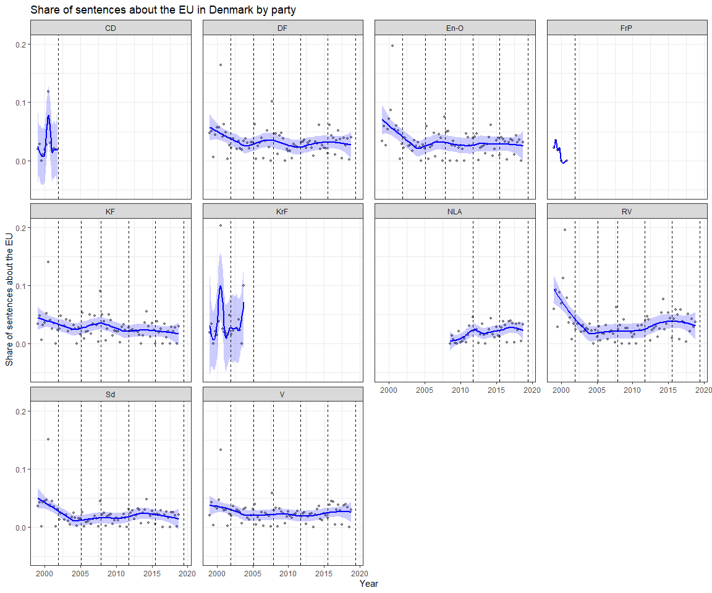<!-- -->

``` r
data_trimester |>
  filter(country == "ESP") |>
  ggplot(aes(x = tri_date, y = share_eu)) +
  geom_point(alpha = 0.4, size = 1) +
  geom_smooth(alpha = 0.2, colour = "blue", fill = "blue",
              span = 0.5) +
  geom_vline(aes(xintercept = next_election_date), linetype = "dashed", color = "black") +
  facet_wrap(~name_short) +
  #ylim(0, 0.15) +
  labs(x = "Year",
       y = "Share of sentences about the EU",
       title = "Share of sentences about the EU in Spain by party") +
  theme(panel.spacing.x = unit(5, "mm"))
```

    ## `geom_smooth()` using method = 'loess' and formula = 'y ~ x'

<!-- -->

``` r
data_trimester |>
  filter(country == "NLD") |>
  ggplot(aes(x = tri_date, y = share_eu)) +
  #geom_path(group=1, alpha = 0.4) +
  geom_point(alpha = 0.4, size = 1) +
  geom_smooth(alpha = 0.2, colour = "blue", fill = "blue",
              span = 0.5) +
  geom_vline(aes(xintercept = next_election_date), linetype = "dashed", color = "black") +
  facet_wrap(~name_short) +
  #ylim(0, 0.15) +
  labs(x = "Year",
       y = "Share of sentences about the EU",
       title = "Share of sentences about the EU in the Netherlands by party") +
  theme(panel.spacing.x = unit(5, "mm"))
```

    ## `geom_smooth()` using method = 'loess' and formula = 'y ~ x'

    ## Warning in stats::qt(level/2 + 0.5, pred$df): NaNs produced

    ## Warning in simpleLoess(y, x, w, span, degree = degree, parametric = parametric,
    ## : pseudoinverse used at 11048

    ## Warning in simpleLoess(y, x, w, span, degree = degree, parametric = parametric,
    ## : neighborhood radius 183

    ## Warning in simpleLoess(y, x, w, span, degree = degree, parametric = parametric,
    ## : reciprocal condition number 9.876e-17

    ## Warning in sqrt(sum.squares/one.delta): NaNs produced

    ## Warning in predLoess(object$y, object$x, newx = if (is.null(newdata)) object$x
    ## else if (is.data.frame(newdata))
    ## as.matrix(model.frame(delete.response(terms(object)), : pseudoinverse used at
    ## 11048

    ## Warning in predLoess(object$y, object$x, newx = if (is.null(newdata)) object$x
    ## else if (is.data.frame(newdata))
    ## as.matrix(model.frame(delete.response(terms(object)), : neighborhood radius 183

    ## Warning in predLoess(object$y, object$x, newx = if (is.null(newdata)) object$x
    ## else if (is.data.frame(newdata))
    ## as.matrix(model.frame(delete.response(terms(object)), : reciprocal condition
    ## number 9.876e-17

    ## Warning in stats::qt(level/2 + 0.5, pred$df): NaNs produced

    ## Warning in max(ids, na.rm = TRUE): no non-missing arguments to max; returning
    ## -Inf
    ## Warning in max(ids, na.rm = TRUE): no non-missing arguments to max; returning
    ## -Inf

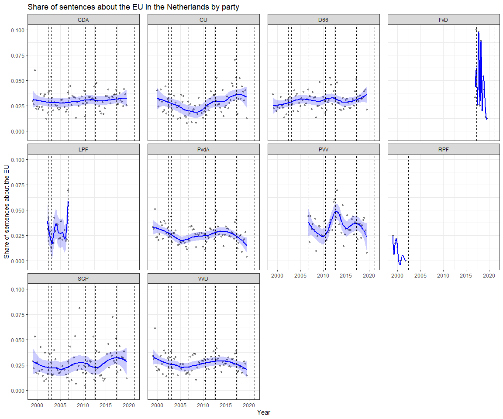<!-- -->

``` r
data_trimester |>
  filter(country == "SWE") |>
  ggplot(aes(x = tri_date, y = share_eu)) +
  geom_point(alpha = 0.4, size = 1) +
  geom_smooth(alpha = 0.2, colour = "blue", fill = "blue",
              span = 0.5) +
  geom_vline(aes(xintercept = next_election_date),
             linetype = "dashed", color = "black") +
  facet_wrap(~name_short) +
  #ylim(0, 0.15) +
  labs(x = "Year",
       y = "Share of sentences about the EU",
       title = "Share of sentences about the EU in Sweden by party") +
  theme(panel.spacing.x = unit(5, "mm"))
```

    ## `geom_smooth()` using method = 'loess' and formula = 'y ~ x'

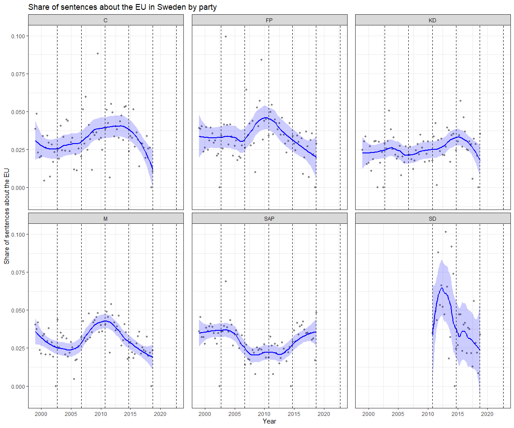<!-- -->

``` r
data_trimester |>
  filter(country == "GBR") |>
  ggplot(aes(x = tri_date, y = share_eu)) +
  geom_point(alpha = 0.4, size = 1) +
  geom_smooth(alpha = 0.2, colour = "blue", fill = "blue",
              span = 0.5) +
  geom_vline(aes(xintercept = next_election_date), linetype = "dashed", color = "black") +
  facet_wrap(~name_short, scales = "free_y") +
  #ylim(0, 50) +
  labs(x = "Year",
       y = "Share of sentences about the EU",
       title = "Share of sentences about the EU in the UK by party") +
  theme(panel.spacing.x = unit(5, "mm"))
```

    ## `geom_smooth()` using method = 'loess' and formula = 'y ~ x'

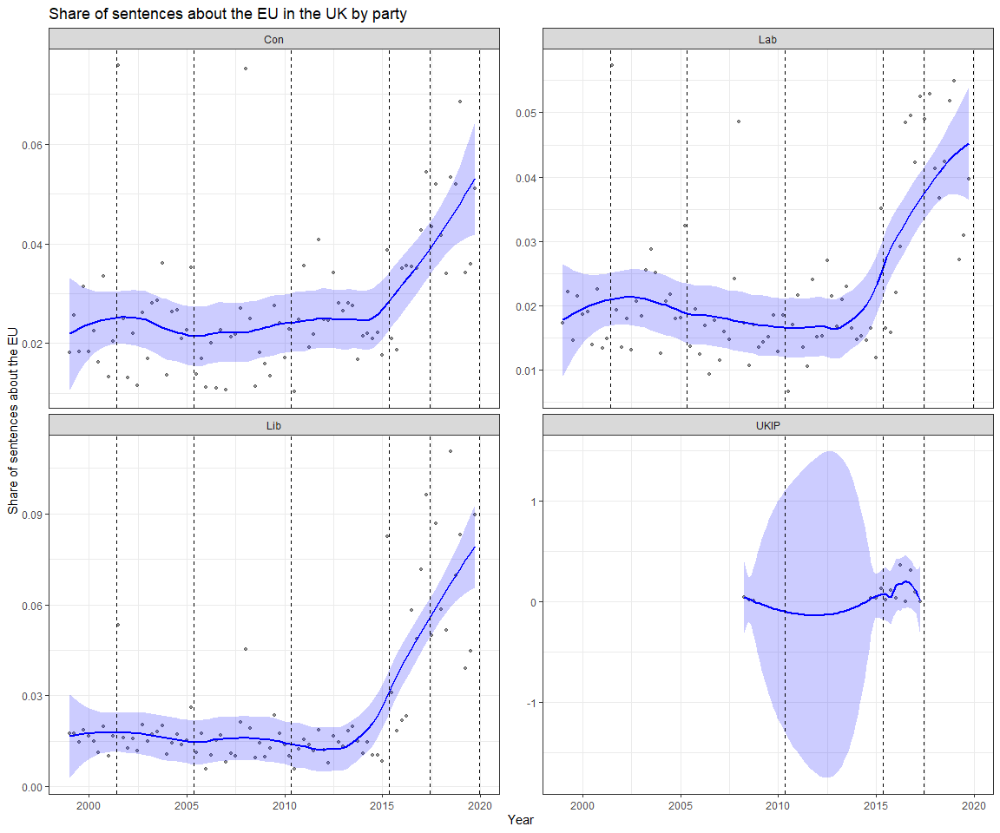<!-- -->

``` r
data_trimester |>
  ggplot(aes(x = reorder(name_short, share_eu),
             y = share_eu,
             colour = country,
             fill = country)) +
  geom_boxplot(alpha = 0.2) +
  #facet_wrap(~ country, scales = "free")
  coord_flip() +
  scale_color_brewer(name = "", palette = "Dark2") +
  scale_fill_brewer(name = "", palette = "Dark2") +
  labs(x = "", y = "Share of sentences about the EU",
       title = "Quarterly share of sentences about the EU by party")
```

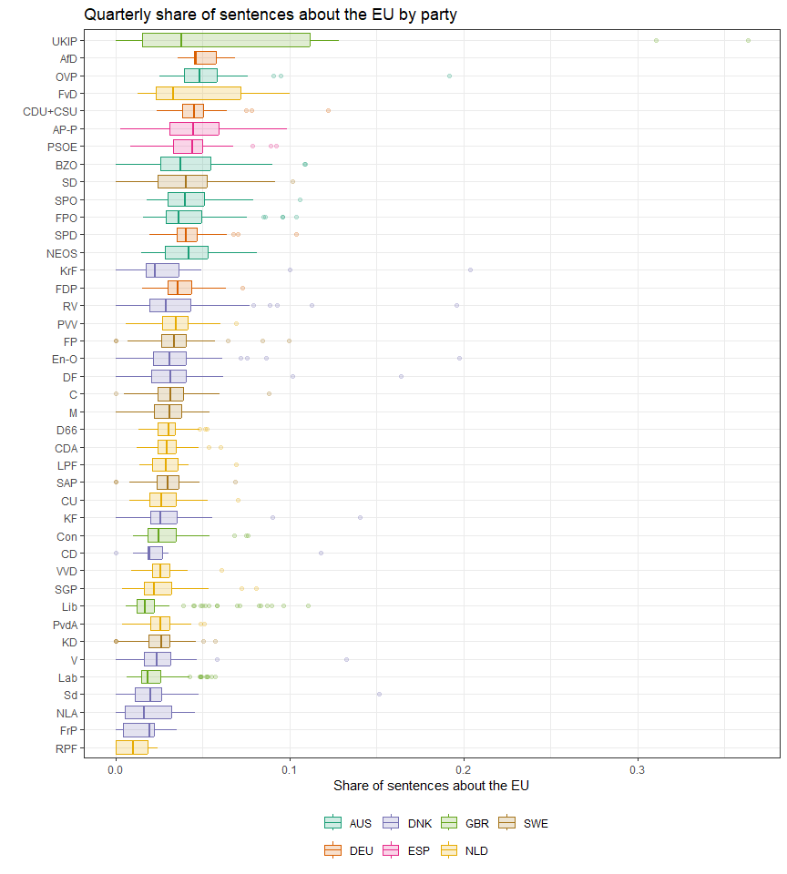<!-- -->

## Position

``` r
data_trimester |> 
  filter(parlgov_id %in% reg_data_tri$parlgov_id)  |>
  filter(country == "AUS") |>
  ggplot(aes(x = tri_date, y = net_position)) +
  geom_hline(aes(yintercept = 0), linetype = "dashed", color = "grey40") +
  geom_point(alpha = 0.4, size = 1) +
  geom_smooth(alpha = 0.2, colour = "blue", fill = "blue",
              span = 0.5) +
  geom_vline(aes(xintercept = next_election_date), linetype = "dashed", color = "black") +
  facet_grid( ~name_short, drop = TRUE) +
  ylim(-1, 1) +
  labs(x = "Year",
        y = "Net Position",
       title = "Net Position in Austria as share of all sentences about the EU"
       ) +
  theme(panel.spacing.x = unit(5, "mm"))
```

    ## `geom_smooth()` using method = 'loess' and formula = 'y ~ x'

<!-- -->

``` r
ggsave("austria_descriptives.png", device = "png", width = 12, height = 6)
```

    ## `geom_smooth()` using method = 'loess' and formula = 'y ~ x'

``` r
data_trimester |>
  filter(parlgov_id %in% reg_data_tri$parlgov_id)  |>
  filter(country == "DEU") |>
  ggplot(aes(x = tri_date, y = net_position)) +
  geom_hline(aes(yintercept = 0), linetype = "dashed", color = "grey40") +
  #geom_path(group=1, alpha = 0.4) +
  geom_point(alpha = 0.4, size = 1) +
  geom_smooth(alpha = 0.2, colour = "blue", fill = "blue",
              span = 0.5) +
  geom_vline(aes(xintercept = next_election_date), linetype = "dashed", color = "black") +
  facet_grid( ~name_short, drop = TRUE) +
  ylim(-1, 1) +
  labs(x = "Year",
        y = "Net Position",
       title = "Net Position in Germany as share of all sentences about the EU"
       ) +
  theme(panel.spacing.x = unit(5, "mm"))
```

    ## `geom_smooth()` using method = 'loess' and formula = 'y ~ x'

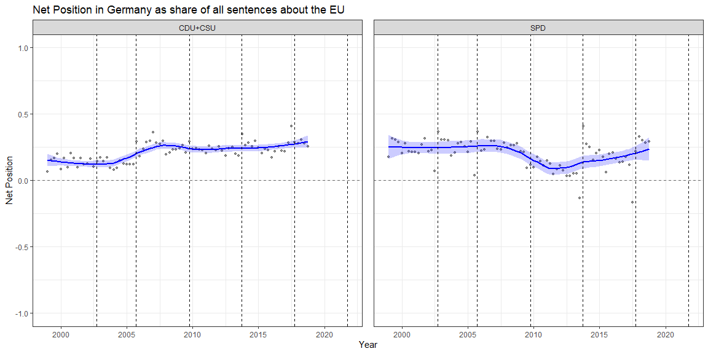<!-- -->

``` r
ggsave("germany_descriptives.png", device = "png", width = 12, height = 6)
```

    ## `geom_smooth()` using method = 'loess' and formula = 'y ~ x'

``` r
data_trimester |>
  filter(parlgov_id %in% reg_data_tri$parlgov_id)  |>
  filter(country == "DNK") |>
  ggplot(aes(x = tri_date, y = net_position)) +
  geom_hline(aes(yintercept = 0), linetype = "dashed", color = "grey40") +
  #geom_path(group=1, alpha = 0.4) +
  geom_point(alpha = 0.4, size = 1) +
  geom_smooth(alpha = 0.2, colour = "blue", fill = "blue",
              span = 0.5) +
  geom_vline(aes(xintercept = next_election_date), linetype = "dashed", color = "black") +
  facet_grid( ~name_short, drop = TRUE) +
  ylim(-1, 1) +
  labs(x = "Year",
        y = "Net Position",
       title = "Net Position in Denmark as share of all sentences about the EU"
       ) +
  theme(panel.spacing.x = unit(5, "mm"))
```

    ## `geom_smooth()` using method = 'loess' and formula = 'y ~ x'

    ## Warning: Removed 5 rows containing non-finite outside the scale range
    ## (`stat_smooth()`).

    ## Warning: Removed 5 rows containing missing values or values outside the scale range
    ## (`geom_point()`).

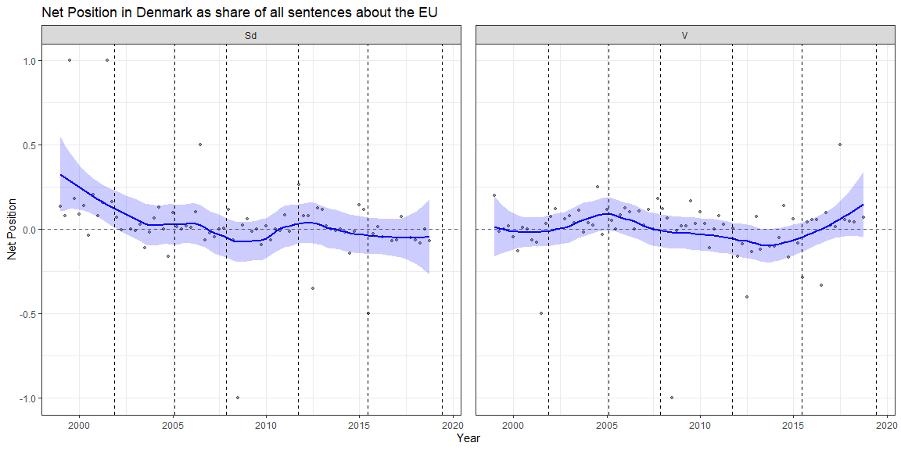<!-- -->

``` r
ggsave("denmark_descriptives.png", device = "png", width = 12, height = 6)
```

    ## `geom_smooth()` using method = 'loess' and formula = 'y ~ x'

    ## Warning: Removed 5 rows containing non-finite outside the scale range (`stat_smooth()`).
    ## Removed 5 rows containing missing values or values outside the scale range
    ## (`geom_point()`).

``` r
data_trimester |> 
  filter(parlgov_id %in% reg_data_tri$parlgov_id)  |>
  filter(country == "ESP") |>
  ggplot(aes(x = tri_date, y = net_position)) +
  geom_hline(aes(yintercept = 0), linetype = "dashed", color = "grey40") +
  #geom_path(group=1, alpha = 0.4) +
  geom_point(alpha = 0.4, size = 1) +
  geom_smooth(alpha = 0.2, colour = "blue", fill = "blue",
              span = 0.5) +
  geom_vline(aes(xintercept = next_election_date), linetype = "dashed", color = "black") +
  facet_grid( ~name_short, drop = TRUE) +
  ylim(-1, 1) +
  labs(x = "Year",
        y = "Net Position",
       title = "Net Position in Spain as share of all sentences about the EU"
       ) +
  theme(panel.spacing.x = unit(5, "mm"))
```

    ## `geom_smooth()` using method = 'loess' and formula = 'y ~ x'

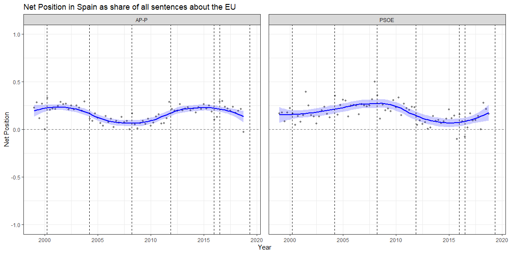<!-- -->

``` r
ggsave("spain_descriptives.png", device = "png", width = 12, height = 6)
```

    ## `geom_smooth()` using method = 'loess' and formula = 'y ~ x'

``` r
data_trimester |>
  filter(parlgov_id %in% reg_data_tri$parlgov_id)  |>
  filter(country == "NLD") |>
  ggplot(aes(x = tri_date, y = net_position)) +
  geom_hline(aes(yintercept = 0), linetype = "dashed", color = "grey40") +
  #geom_path(group=1, alpha = 0.4) +
  geom_point(alpha = 0.4, size = 1) +
  geom_smooth(alpha = 0.2, colour = "blue", fill = "blue",
              span = 0.5) +
  geom_vline(aes(xintercept = next_election_date), linetype = "dashed", color = "black") +
  facet_grid( ~name_short, drop = TRUE) +
  ylim(-1, 1) +
  labs(x = "Year",
        y = "Net Position",
       title = "Net Position in the Netherlands as share of all sentences about the EU"
       ) +
  theme(panel.spacing.x = unit(5, "mm"))
```

    ## `geom_smooth()` using method = 'loess' and formula = 'y ~ x'

<!-- -->

``` r
ggsave("netherlands_descriptives.png", device = "png", width = 12, height = 6)
```

    ## `geom_smooth()` using method = 'loess' and formula = 'y ~ x'

``` r
data_trimester |>
  filter(parlgov_id %in% reg_data_tri$parlgov_id)  |>
  filter(country == "SWE") |>
  ggplot(aes(x = tri_date, y = net_position)) +
  geom_hline(aes(yintercept = 0), linetype = "dashed", color = "grey40") +
  #geom_path(group=1, alpha = 0.4) +
  geom_point(alpha = 0.4, size = 1) +
  geom_smooth(alpha = 0.2, colour = "blue", fill = "blue",
              span = 0.5) +
  geom_vline(aes(xintercept = next_election_date), linetype = "dashed", color = "black") +
  facet_grid( ~name_short, drop = TRUE) +
  ylim(-1, 1) +
  labs(x = "Year",
        y = "Net Position",
       title = "Net Position in Sweden as share of all sentences about the EU"
       ) +
  theme(panel.spacing.x = unit(5, "mm"))
```

    ## `geom_smooth()` using method = 'loess' and formula = 'y ~ x'

    ## Warning: Removed 4 rows containing non-finite outside the scale range
    ## (`stat_smooth()`).

    ## Warning: Removed 4 rows containing missing values or values outside the scale range
    ## (`geom_point()`).

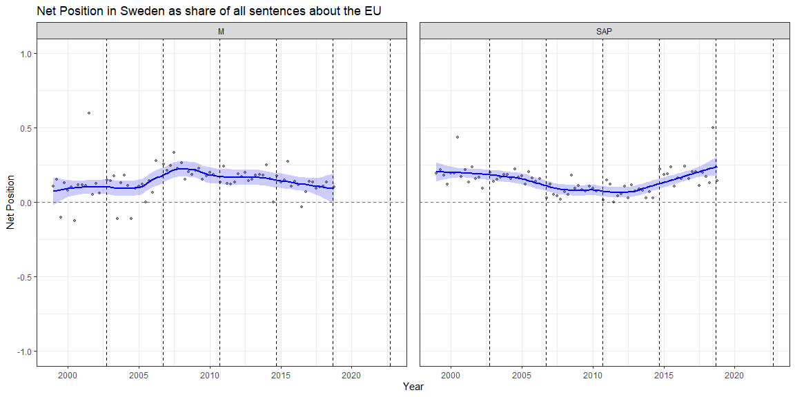<!-- -->

``` r
ggsave("sweden_descriptives.png", device = "png", width = 12, height = 6)
```

    ## `geom_smooth()` using method = 'loess' and formula = 'y ~ x'

    ## Warning: Removed 4 rows containing non-finite outside the scale range (`stat_smooth()`).
    ## Removed 4 rows containing missing values or values outside the scale range
    ## (`geom_point()`).

``` r
data_trimester |>
  filter(parlgov_id %in% reg_data_tri$parlgov_id)  |>
  filter(country == "GBR") |>
  ggplot(aes(x = tri_date, y = net_position)) +
  geom_hline(aes(yintercept = 0), linetype = "dashed", color = "grey40") +
  #geom_path(group=1, alpha = 0.4) +
  geom_point(alpha = 0.4, size = 1) +
  geom_smooth(alpha = 0.2, colour = "blue", fill = "blue",
              span = 0.5) +
  geom_vline(aes(xintercept = next_election_date), linetype = "dashed", color = "black") +
  facet_grid( ~name_short, drop = TRUE) +
  ylim(-1,1) +
  labs(x = "Year",
        y = "Net Position",
       title = "Net Position in the UK as share of all sentences about the EU"
       ) +
  theme(panel.spacing.x = unit(5, "mm"))
```

    ## `geom_smooth()` using method = 'loess' and formula = 'y ~ x'

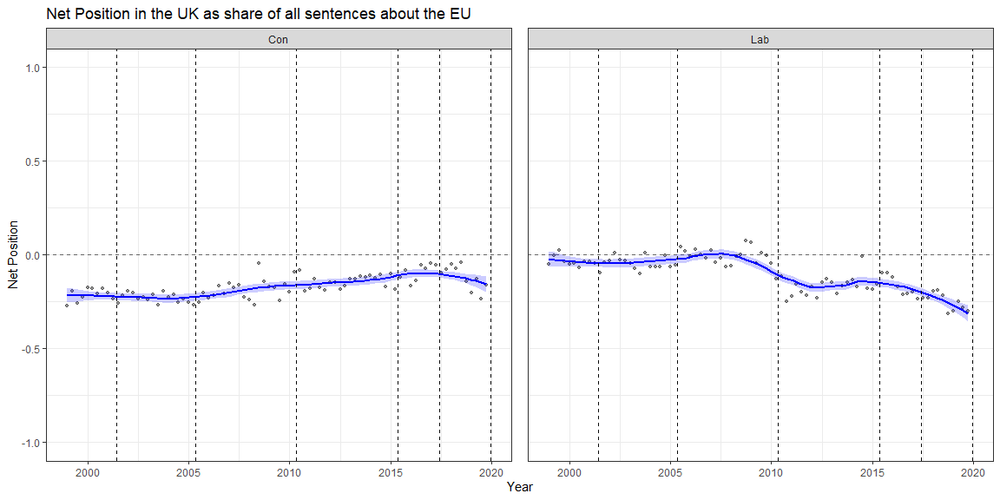<!-- -->

``` r
ggsave("uk_descriptives.png", device = "png", width = 12, height = 6)
```

    ## `geom_smooth()` using method = 'loess' and formula = 'y ~ x'

``` r
data_trimester |>
  filter(parlgov_id %in% reg_data_tri$parlgov_id)  |>
  group_by(country, name_short) |>
  mutate(mean_net_position = mean(net_position, na.rm = TRUE)) |>
  ungroup() |>
  arrange(mean_net_position) |>
  ggplot(aes(x = reorder(name_short, mean_net_position),
             y = net_position,
             colour = country,
             fill = country)) +
  geom_hline(aes(yintercept = 0), linetype = "dashed", color = "grey40") +
  geom_boxplot(alpha = 0.2) +
  #facet_wrap(~ country, scales = "free")
  coord_flip() +
  scale_color_brewer(name = "", palette = "Dark2") +
  scale_fill_brewer(name = "", palette = "Dark2") +
  labs(x = "", y = "Net Position",
       title = "Quarterly net position by party")
```

    ## Warning: Removed 9 rows containing non-finite outside the scale range
    ## (`stat_boxplot()`).

<!-- -->

``` r
ggsave("quarterly_boxplot.png", device = "png", width = 12, height = 6)
```

    ## Warning: Removed 9 rows containing non-finite outside the scale range
    ## (`stat_boxplot()`).

``` r
data_trimester |>
  group_by(country, name_short) |>
  mutate(mean_oppose = mean(share_opposition, na.rm = TRUE)) |>
  ungroup() |>
  arrange(mean_oppose) |> 
  ggplot(aes(x = reorder(name_short, mean_oppose),
             y = share_opposition,
             colour = country,
             fill = country)) +
  geom_boxplot(alpha = 0.2) +
  #facet_wrap(~ country, scales = "free")
  coord_flip() +
  scale_color_brewer(name = "", palette = "Dark2") +
  scale_fill_brewer(name = "", palette = "Dark2") +
  labs(x = "", y = "Share of Eurosceptic sentences",
       title = "Quarterly share of Eurosceptic sentences by party")
```

    ## Warning: Removed 49 rows containing non-finite outside the scale range
    ## (`stat_boxplot()`).

<!-- -->

# Validating Against CHES

``` r
## Getting ches and partyfacts codes:

partyfacts_to_ches <- read_csv("partyfacts-external-parties.csv") |> 
  filter((partyfacts_id %in% unique(data_yearly$partyfacts_id) | partyfacts_id == 540) & # For some reason, PartyFacts codes LibDems differently for ParlGov
           dataset_key == "ches" &
           year_last >= 1998) |>
  rename(ches_id = dataset_party_id,
         pf_country = country) |>
  mutate(ches_id = as.numeric(ches_id))
```

    ## Warning: One or more parsing issues, call `problems()` on your data frame for details,
    ## e.g.:
    ##   dat <- vroom(...)
    ##   problems(dat)

    ## Rows: 45385 Columns: 17
    ## ── Column specification ────────────────────────────────────────────────────────
    ## Delimiter: ","
    ## chr  (8): country, dataset_key, dataset_party_id, name_short, name, name_eng...
    ## dbl  (6): year_first, year_last, share, share_year, external_id, partyfacts_id
    ## dttm (3): created, modified, linked
    ## 
    ## ℹ Use `spec()` to retrieve the full column specification for this data.
    ## ℹ Specify the column types or set `show_col_types = FALSE` to quiet this message.

``` r
ches <- haven::read_dta("1999-2019_CHES_dataset_means(v3).dta") |>
  rename(ches_id = party_id,
         ches_country = country) |>
  dplyr::select(ches_country, ches_id, year, party, eu_position, eu_salience, eu_dissent, eu_blur)

joint_ches <- data_yearly |>
  left_join(partyfacts_to_ches, by = "partyfacts_id") |>
  left_join(ches, by = c("ches_id", "year")) |>
  mutate(
    standard_eu_mention = (prop_eu_mention - mean(prop_eu_mention, na.rm = TRUE))/sd(prop_eu_mention, na.rm = TRUE),
    standard_eu_stance = (net_position - mean(net_position, na.rm = TRUE))/sd(net_position, na.rm = TRUE),
    standard_eu_salience = (eu_salience - mean(eu_salience, na.rm = TRUE))/sd(eu_salience, na.rm = TRUE),
    standard_eu_position = (eu_position - mean(eu_position, na.rm = TRUE))/sd(eu_position, na.rm = TRUE)
  )


joint_ches |>
  filter(partyfacts_id %in% unique(data_trimester$partyfacts_id[data_trimester$parlgov_id %in% reg_data_tri$parlgov_id]))  |>
  filter(!is.na(eu_position)) |>
  ggplot(aes(x = eu_position, y = net_position)) +
  geom_point(alpha = 0.2) +
  geom_smooth(method = "lm", colour = "blue", fill = "blue", alpha = 0.2) +
  #ggrepel::geom_text_repel(aes(label = ifelse(abs(net_position-(-42 + 8.7*eu_position))>13.32,
    #                                           paste(party, year, sep = ", "),
                           #                    NA)),
       #                     size = 3, max.overlaps = 15) +
  ggpubr::stat_regline_equation(aes(label = paste(..eq.label.., ..rr.label.., sep = "~~~~~")),
                                label.x = 1.1, label.y = 0.32) +
  labs(x = "CHES Position",
       y = "Net Position",
       title = "CHES Position against Net Position")
```

    ## Warning: The dot-dot notation (`..eq.label..`) was deprecated in ggplot2 3.4.0.
    ## ℹ Please use `after_stat(eq.label)` instead.
    ## This warning is displayed once every 8 hours.
    ## Call `lifecycle::last_lifecycle_warnings()` to see where this warning was
    ## generated.

    ## `geom_smooth()` using formula = 'y ~ x'

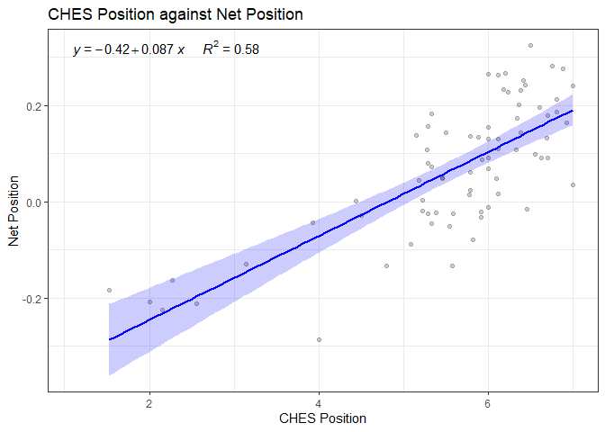<!-- -->

``` r
ggsave("ches_cross_verification.png", device = "png", width = 9.5, height = 6)
```

    ## `geom_smooth()` using formula = 'y ~ x'

``` r
joint_ches |>
  filter(!is.na(eu_position)) |>
  ggplot(aes(x = eu_position, y = net_position)) +
  geom_point(alpha = 0.2) +
  geom_smooth(method = "lm", colour = "blue", fill = "blue", alpha = 0.2) +
  #ggrepel::geom_text_repel(aes(label = ifelse(abs(net_position-(-31 + 6.4*eu_position))>16.68,
            #                                   paste(party, year, sep = ", "),
              #                                 NA)),
             #               size = 3, max.overlaps = 15) +
  ggpubr::stat_regline_equation(aes(label = paste(..eq.label.., ..rr.label.., sep = "~~~~~")),
                                label.x = 1.1, label.y = 0.32) +
  labs(x = "CHES Position",
       y = "Net Position",
       title = "CHES Position against Net Position (All Parties)")
```

    ## `geom_smooth()` using formula = 'y ~ x'

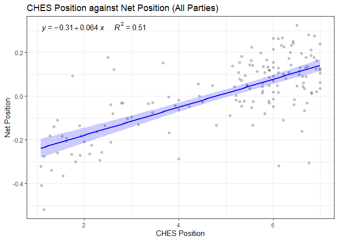<!-- -->

``` r
ggsave("ches_cross_verification_all.png", device = "png", width = 9.5, height = 6)
```

    ## `geom_smooth()` using formula = 'y ~ x'

# REGRESSIONS

## RRP VOTE SHARE

``` r
reg_data_tri <- read_csv("reg_data_tri.csv") |>
  mutate(parlgov_id = as.factor(parlgov_id),
         log_time_to_next = log(time_to_next + 1),
         log_time_to_next_ep = log(time_to_next_ep + 1))
```

    ## Rows: 1205 Columns: 61
    ## ── Column specification ────────────────────────────────────────────────────────
    ## Delimiter: ","
    ## chr   (7): country, name_short, name, name_english, tri, family_name, family_2
    ## dbl  (53): parlgov_id, count, eu_count, prop_eu_mention, prop_support, prop_...
    ## date  (1): tri_date
    ## 
    ## ℹ Use `spec()` to retrieve the full column specification for this data.
    ## ℹ Specify the column types or set `show_col_types = FALSE` to quiet this message.

``` r
tri_position_1 <- lm(data = reg_data_tri,
             net_position ~ date_numeric + 
               lag_net_position + country + 
               time_to_next + time_to_next_ep + vote_share + 
               change_voteshare + rrp_lag + cabinet_party + rrp_in_parliament)

tri_position_2 <- lm(data = reg_data_tri,
             net_position ~ date_numeric + 
               lag_net_position + 
               time_to_next + time_to_next_ep + vote_share + 
               change_voteshare + rrp_lag + cabinet_party + rrp_in_parliament +
               parlgov_id)

tri_position_3 <- lm(data = reg_data_tri,
             net_position ~ date_numeric + 
               lag_net_position + 
               time_to_next + time_to_next_ep + vote_share + 
               change_voteshare + rrp_lag + cabinet_party + rrp_in_parliament +
               parlgov_id + lag_eu_public_opinion)


tri_position_4 <- lm(data = reg_data_tri,
             net_position ~ date_numeric + 
               lag_net_position + 
               log_time_to_next + log_time_to_next_ep + vote_share + 
               change_voteshare + rrp_lag + cabinet_party + rrp_in_parliament +
               parlgov_id + lag_eu_public_opinion
         )

tri_position_5 <- lm(data = reg_data_tri,
             net_position ~ date_numeric + 
               lag_net_position + 
               log_time_to_next + log_time_to_next_ep + vote_share + 
               change_voteshare + rrp_lag + cabinet_party + rrp_in_parliament +
               parlgov_id + lag_eu_public_opinion + log_time_to_next*rrp_lag
         )

tri_position_6 <- lm(data = reg_data_tri,
             net_position ~ date_numeric + 
               lag_net_position +
               time_to_next + time_to_next_ep + vote_share + 
               change_voteshare + rrp_lag + cabinet_party + rrp_in_parliament +
               time_to_next*rrp_lag + parlgov_id + lag_eu_public_opinion
         )

tri_position_7 <- lm(data = reg_data_tri,
             net_position ~ date_numeric + 
               lag_net_position +
               time_to_next + time_to_next_ep + vote_share + 
               change_voteshare + rrp_lag + cabinet_party + rrp_in_parliament + parlgov_id +
               rrp_in_parliament*rrp_lag + parlgov_id + lag_eu_public_opinion
         )

modelsummary(list(tri_position_1, tri_position_2, tri_position_3,
                  tri_position_4, tri_position_5, tri_position_6, 
                  tri_position_7
                  ), 
             vcov = "robust", 
             stars = TRUE,
             coef_omit = "parlgov_id|country",
             coef_map = c(
               "(Intercept)" = "Constant",
               "date_numeric" = "Time",
               "lag_net_position" = "Lag Net Position",
               "time_to_next" = "Time to next election",
               "time_to_next_ep" = "Time to next EP election",
               "log_time_to_next" = "Log time to next election",
               "log_time_to_next_ep" = "Log time to next EP election",
               "vote_share" = "Vote share",
               "change_voteshare" = "Change in vote share",
               "rrp_lag" = "RRP Vote Share",
               "cabinet_party" = "Cabinet party",
               "rrp_in_parliament" = "RRP in Parliament",
               "lag_eu_public_opinion" = "Lag EU Public Opinion",
               "log_time_to_next:rrp_lag" = "Log time to next election * RRP vote share",
               "time_to_next:rrp_lag" = "Time to next election * RRP vote share",
               "rrp_lag:rrp_in_parliament" = "RRP vote share * RRP in Parliament"
             ),
             gof_map = tibble::tribble(~raw, ~clean, ~fmt,
                                       "nobs", "N", 0,
                                       "r.squared", "R^2", 2,
                                       "adj.r.squared", "Adj. R^2", 2),
             add_rows = tibble::tribble(
               ~term, ~tri_position_1, ~tri_position_2, ~tri_position_3, 
               ~tri_position_4, ~tri_position_5, ~tri_position_6, ~tri_position_7,
               "Party FE", "\\xmark", "\\cmark", "\\cmark", "\\cmark", "\\cmark", "\\cmark","\\cmark", 
               "Country FE", "\\cmark", "\\xmark", "\\xmark", "\\xmark", "\\xmark", "\\xmark", "\\xmark",
             ),
             #output = "table1.tex",
             output = "latex"
             )
```

    ## Warning: To compile a LaTeX document with this table, the following commands must be placed in the document preamble:
    ## 
    ## \usepackage{tabularray}
    ## \usepackage{float}
    ## \usepackage{graphicx}
    ## \usepackage{codehigh}
    ## \usepackage[normalem]{ulem}
    ## \UseTblrLibrary{booktabs}
    ## \UseTblrLibrary{siunitx}
    ## \newcommand{\tinytableTabularrayUnderline}[1]{\underline{#1}}
    ## \newcommand{\tinytableTabularrayStrikeout}[1]{\sout{#1}}
    ## \NewTableCommand{\tinytableDefineColor}[3]{\definecolor{#1}{#2}{#3}}
    ## 
    ## To disable `siunitx` and prevent `modelsummary` from wrapping numeric entries in `\num{}`, call:
    ## 
    ## options("modelsummary_format_numeric_latex" = "plain")
    ##  This warning appears once per session.

<table style="width:97%;">
<colgroup>
<col style="width: 19%" />
<col style="width: 11%" />
<col style="width: 11%" />
<col style="width: 11%" />
<col style="width: 11%" />
<col style="width: 11%" />
<col style="width: 11%" />
<col style="width: 11%" />
</colgroup>
<thead>
<tr>
<th></th>
<th><ol type="1">
<li></li>
</ol></th>
<th><ol start="2" type="1">
<li></li>
</ol></th>
<th><ol start="3" type="1">
<li></li>
</ol></th>
<th><ol start="4" type="1">
<li></li>
</ol></th>
<th><ol start="5" type="1">
<li></li>
</ol></th>
<th><ol start="6" type="1">
<li></li>
</ol></th>
<th><ol start="7" type="1">
<li></li>
</ol></th>
</tr>
</thead>
<tbody>
<tr>
<td>Constant</td>
<td>***</td>
<td></td>
<td></td>
<td></td>
<td></td>
<td></td>
<td></td>
</tr>
<tr>
<td></td>
<td>()</td>
<td>()</td>
<td>()</td>
<td>()</td>
<td>()</td>
<td>()</td>
<td>()</td>
</tr>
<tr>
<td>Time</td>
<td>**</td>
<td>**</td>
<td>**</td>
<td>**</td>
<td>**</td>
<td>**</td>
<td>**</td>
</tr>
<tr>
<td></td>
<td>()</td>
<td>()</td>
<td>()</td>
<td>()</td>
<td>()</td>
<td>()</td>
<td>()</td>
</tr>
<tr>
<td>Lag Net Position</td>
<td>**</td>
<td>+</td>
<td></td>
<td></td>
<td></td>
<td></td>
<td></td>
</tr>
<tr>
<td></td>
<td>()</td>
<td>()</td>
<td>()</td>
<td>()</td>
<td>()</td>
<td>()</td>
<td>()</td>
</tr>
<tr>
<td>Time to next election</td>
<td></td>
<td></td>
<td></td>
<td></td>
<td></td>
<td></td>
<td></td>
</tr>
<tr>
<td></td>
<td>()</td>
<td>()</td>
<td>()</td>
<td></td>
<td></td>
<td>()</td>
<td>()</td>
</tr>
<tr>
<td>Time to next EP election</td>
<td></td>
<td></td>
<td></td>
<td></td>
<td></td>
<td></td>
<td></td>
</tr>
<tr>
<td></td>
<td>()</td>
<td>()</td>
<td>()</td>
<td></td>
<td></td>
<td>()</td>
<td>()</td>
</tr>
<tr>
<td>Log time to next election</td>
<td></td>
<td></td>
<td></td>
<td></td>
<td></td>
<td></td>
<td></td>
</tr>
<tr>
<td></td>
<td></td>
<td></td>
<td></td>
<td>()</td>
<td>()</td>
<td></td>
<td></td>
</tr>
<tr>
<td>Log time to next EP election</td>
<td></td>
<td></td>
<td></td>
<td></td>
<td></td>
<td></td>
<td></td>
</tr>
<tr>
<td></td>
<td></td>
<td></td>
<td></td>
<td>()</td>
<td>()</td>
<td></td>
<td></td>
</tr>
<tr>
<td>Vote share</td>
<td>*</td>
<td>**</td>
<td>**</td>
<td>**</td>
<td>**</td>
<td>**</td>
<td>**</td>
</tr>
<tr>
<td></td>
<td>()</td>
<td>()</td>
<td>()</td>
<td>()</td>
<td>()</td>
<td>()</td>
<td>()</td>
</tr>
<tr>
<td>Change in vote share</td>
<td></td>
<td></td>
<td></td>
<td></td>
<td></td>
<td></td>
<td></td>
</tr>
<tr>
<td></td>
<td>()</td>
<td>()</td>
<td>()</td>
<td>()</td>
<td>()</td>
<td>()</td>
<td>()</td>
</tr>
<tr>
<td>RRP Vote Share</td>
<td>*</td>
<td>*</td>
<td>*</td>
<td>*</td>
<td></td>
<td></td>
<td>+</td>
</tr>
<tr>
<td></td>
<td>()</td>
<td>()</td>
<td>()</td>
<td>()</td>
<td>()</td>
<td>()</td>
<td>()</td>
</tr>
<tr>
<td>Cabinet party</td>
<td>***</td>
<td>***</td>
<td>***</td>
<td>***</td>
<td>***</td>
<td>***</td>
<td>***</td>
</tr>
<tr>
<td></td>
<td>()</td>
<td>()</td>
<td>()</td>
<td>()</td>
<td>()</td>
<td>()</td>
<td>()</td>
</tr>
<tr>
<td>RRP in Parliament</td>
<td>**</td>
<td>**</td>
<td>**</td>
<td>**</td>
<td>**</td>
<td>**</td>
<td>+</td>
</tr>
<tr>
<td></td>
<td>()</td>
<td>()</td>
<td>()</td>
<td>()</td>
<td>()</td>
<td>()</td>
<td>()</td>
</tr>
<tr>
<td>Lag EU Public Opinion</td>
<td></td>
<td></td>
<td>+</td>
<td>+</td>
<td>+</td>
<td>+</td>
<td>+</td>
</tr>
<tr>
<td></td>
<td></td>
<td></td>
<td>()</td>
<td>()</td>
<td>()</td>
<td>()</td>
<td>()</td>
</tr>
<tr>
<td>Log time to next election * RRP vote share</td>
<td></td>
<td></td>
<td></td>
<td></td>
<td></td>
<td></td>
<td></td>
</tr>
<tr>
<td></td>
<td></td>
<td></td>
<td></td>
<td></td>
<td>()</td>
<td></td>
<td></td>
</tr>
<tr>
<td>Time to next election * RRP vote share</td>
<td></td>
<td></td>
<td></td>
<td></td>
<td></td>
<td></td>
<td></td>
</tr>
<tr>
<td></td>
<td></td>
<td></td>
<td></td>
<td></td>
<td></td>
<td>()</td>
<td></td>
</tr>
<tr>
<td>RRP vote share * RRP in Parliament</td>
<td></td>
<td></td>
<td></td>
<td></td>
<td></td>
<td></td>
<td></td>
</tr>
<tr>
<td></td>
<td></td>
<td></td>
<td></td>
<td></td>
<td></td>
<td></td>
<td>()</td>
</tr>
<tr>
<td>N</td>
<td></td>
<td></td>
<td></td>
<td></td>
<td></td>
<td></td>
<td></td>
</tr>
<tr>
<td>R2</td>
<td></td>
<td></td>
<td></td>
<td></td>
<td></td>
<td></td>
<td></td>
</tr>
<tr>
<td>Adj. R2</td>
<td></td>
<td></td>
<td></td>
<td></td>
<td></td>
<td></td>
<td></td>
</tr>
<tr>
<td>Party FE</td>
<td>xmark</td>
<td>cmark</td>
<td>cmark</td>
<td>cmark</td>
<td>cmark</td>
<td>cmark</td>
<td>cmark</td>
</tr>
<tr>
<td>Country FE</td>
<td>cmark</td>
<td>xmark</td>
<td>xmark</td>
<td>xmark</td>
<td>xmark</td>
<td>xmark</td>
<td>xmark</td>
</tr>
</tbody><tfoot>
<tr>
<td colspan="8"><ul>
<li>p , * p , ** p , *** p |</li>
</ul></td>
</tr>
</tfoot>
&#10;</table>

``` r
## The coefficient estimate is -0.0023. This means that a standard deviation change in the RRP vote share 
## is associated with a -0.0185 change in net position, which is about 11 percent of its standard deviation.
```

## POLLED

``` r
tri_position_polled_1 <- lm(data = reg_data_tri,
             net_position ~ date_numeric + 
               lag_net_position + country + 
               time_to_next + time_to_next_ep + vote_share + 
               change_voteshare + lag_rrp_polled_voteshare + cabinet_party + rrp_in_parliament)

tri_position_polled_2 <- lm(data = reg_data_tri,
             net_position ~ date_numeric + 
               lag_net_position + 
               time_to_next + time_to_next_ep + vote_share + 
               change_voteshare + lag_rrp_polled_voteshare + cabinet_party + rrp_in_parliament +
               parlgov_id)

tri_position_polled_3 <- lm(data = reg_data_tri,
             net_position ~ date_numeric + 
               lag_net_position + 
               time_to_next + time_to_next_ep + vote_share + 
               change_voteshare + lag_rrp_polled_voteshare + cabinet_party + rrp_in_parliament +
               parlgov_id + lag_eu_public_opinion)

tri_position_polled_4 <- lm(data = reg_data_tri,
             net_position ~ date_numeric + 
               lag_net_position + 
               log_time_to_next + log_time_to_next_ep + vote_share + 
               change_voteshare + lag_rrp_polled_voteshare + cabinet_party + rrp_in_parliament +
               parlgov_id + lag_eu_public_opinion
         )

tri_position_polled_5 <- lm(data = reg_data_tri,
             net_position ~ date_numeric + 
               lag_net_position + 
               log_time_to_next + log_time_to_next_ep + vote_share + 
               change_voteshare + lag_rrp_polled_voteshare + cabinet_party + rrp_in_parliament +
               parlgov_id + lag_eu_public_opinion + log_time_to_next*lag_rrp_polled_voteshare
         )

tri_position_polled_6 <- lm(data = reg_data_tri,
             net_position ~ date_numeric + 
               lag_net_position +
               time_to_next + time_to_next_ep + vote_share + 
               change_voteshare + lag_rrp_polled_voteshare + cabinet_party + rrp_in_parliament +
               time_to_next*lag_rrp_polled_voteshare + parlgov_id + lag_eu_public_opinion 
         )

tri_position_polled_7 <- lm(data = reg_data_tri,
             net_position ~ date_numeric + 
               lag_net_position +
               time_to_next + time_to_next_ep + vote_share + 
               change_voteshare + lag_rrp_polled_voteshare + cabinet_party + rrp_in_parliament +
               rrp_in_parliament*lag_rrp_polled_voteshare + parlgov_id + lag_eu_public_opinion
         )

modelsummary(list(tri_position_polled_1, tri_position_polled_2, tri_position_polled_3,
                  tri_position_polled_4, tri_position_polled_5,
                  tri_position_polled_6, tri_position_polled_7
                  ), 
             vcov = "robust", 
             stars = TRUE,
             coef_omit = "parlgov_id|country",
             coef_map = c(
               "(Intercept)" = "Constant",
               "date_numeric" = "Time",
               "lag_net_position" = "Lag Net Position",
               "time_to_next" = "Time to next election",
               "time_to_next_ep" = "Time to next EP election",
               "log_time_to_next" = "Log time to next election",
               "log_time_to_next_ep" = "Log time to next EP election",
               "vote_share" = "Vote share",
               "change_voteshare" = "Change in vote share",
               "lag_rrp_polled_voteshare" = "RRP Polled Vote Share",
               "cabinet_party" = "Cabinet party",
               "rrp_in_parliament" = "RRP in Parliament",
               "lag_eu_public_opinion" = "Lag EU Public Opinion",
               "log_time_to_next:lag_rrp_polled_voteshare" = "Log time to next election * RRP Polled vote share",
               "time_to_next:lag_rrp_polled_voteshare" = "Time to next election * RRP Polled vote share",
               "lag_rrp_polled_voteshare:rrp_in_parliament" = "RRP Polled vote share * RRP in Parliament"
             ),
             gof_map = tibble::tribble(~raw, ~clean, ~fmt,
                                       "nobs", "N", 0,
                                       "r.squared", "R^2", 2,
                                       "adj.r.squared", "Adj. R^2", 2),
             add_rows = tibble::tribble(
               ~term, ~tri_position_polled_1, ~tri_position_polled_2, ~tri_position_polled_3,
               ~tri_position_polled_4, ~tri_position_polled_5,
               ~tri_position_polled_6, ~tri_position_polled_17,
               "Party FE", "\\xmark", "\\cmark", "\\cmark", "\\cmark", "\\cmark", "\\cmark","\\cmark", 
               "Country FE", "\\cmark", "\\xmark", "\\xmark", "\\xmark", "\\xmark", "\\xmark", "\\xmark",
             ),
             #output = "table2.tex",
             output = "latex"
             )
```

<table style="width:97%;">
<colgroup>
<col style="width: 22%" />
<col style="width: 10%" />
<col style="width: 10%" />
<col style="width: 10%" />
<col style="width: 10%" />
<col style="width: 10%" />
<col style="width: 10%" />
<col style="width: 10%" />
</colgroup>
<thead>
<tr>
<th></th>
<th><ol type="1">
<li></li>
</ol></th>
<th><ol start="2" type="1">
<li></li>
</ol></th>
<th><ol start="3" type="1">
<li></li>
</ol></th>
<th><ol start="4" type="1">
<li></li>
</ol></th>
<th><ol start="5" type="1">
<li></li>
</ol></th>
<th><ol start="6" type="1">
<li></li>
</ol></th>
<th><ol start="7" type="1">
<li></li>
</ol></th>
</tr>
</thead>
<tbody>
<tr>
<td>Constant</td>
<td>***</td>
<td></td>
<td>+</td>
<td>+</td>
<td>+</td>
<td>*</td>
<td>+</td>
</tr>
<tr>
<td></td>
<td>()</td>
<td>()</td>
<td>()</td>
<td>()</td>
<td>()</td>
<td>()</td>
<td>()</td>
</tr>
<tr>
<td>Time</td>
<td>**</td>
<td>*</td>
<td>**</td>
<td>**</td>
<td>**</td>
<td>**</td>
<td>**</td>
</tr>
<tr>
<td></td>
<td>()</td>
<td>()</td>
<td>()</td>
<td>()</td>
<td>()</td>
<td>()</td>
<td>()</td>
</tr>
<tr>
<td>Lag Net Position</td>
<td>***</td>
<td>+</td>
<td>+</td>
<td>+</td>
<td>+</td>
<td>+</td>
<td>+</td>
</tr>
<tr>
<td></td>
<td>()</td>
<td>()</td>
<td>()</td>
<td>()</td>
<td>()</td>
<td>()</td>
<td>()</td>
</tr>
<tr>
<td>Time to next election</td>
<td></td>
<td></td>
<td></td>
<td></td>
<td></td>
<td></td>
<td></td>
</tr>
<tr>
<td></td>
<td>()</td>
<td>()</td>
<td>()</td>
<td></td>
<td></td>
<td>()</td>
<td>()</td>
</tr>
<tr>
<td>Time to next EP election</td>
<td></td>
<td></td>
<td></td>
<td></td>
<td></td>
<td></td>
<td></td>
</tr>
<tr>
<td></td>
<td>()</td>
<td>()</td>
<td>()</td>
<td></td>
<td></td>
<td>()</td>
<td>()</td>
</tr>
<tr>
<td>Log time to next election</td>
<td></td>
<td></td>
<td></td>
<td></td>
<td></td>
<td></td>
<td></td>
</tr>
<tr>
<td></td>
<td></td>
<td></td>
<td></td>
<td>()</td>
<td>()</td>
<td></td>
<td></td>
</tr>
<tr>
<td>Log time to next EP election</td>
<td></td>
<td></td>
<td></td>
<td></td>
<td></td>
<td></td>
<td></td>
</tr>
<tr>
<td></td>
<td></td>
<td></td>
<td></td>
<td>()</td>
<td>()</td>
<td></td>
<td></td>
</tr>
<tr>
<td>Vote share</td>
<td>+</td>
<td>*</td>
<td>*</td>
<td>*</td>
<td>*</td>
<td>*</td>
<td>*</td>
</tr>
<tr>
<td></td>
<td>()</td>
<td>()</td>
<td>()</td>
<td>()</td>
<td>()</td>
<td>()</td>
<td>()</td>
</tr>
<tr>
<td>Change in vote share</td>
<td></td>
<td></td>
<td></td>
<td></td>
<td></td>
<td></td>
<td></td>
</tr>
<tr>
<td></td>
<td>()</td>
<td>()</td>
<td>()</td>
<td>()</td>
<td>()</td>
<td>()</td>
<td>()</td>
</tr>
<tr>
<td>RRP Polled Vote Share</td>
<td>*</td>
<td>*</td>
<td>**</td>
<td>**</td>
<td></td>
<td></td>
<td></td>
</tr>
<tr>
<td></td>
<td>()</td>
<td>()</td>
<td>()</td>
<td>()</td>
<td>()</td>
<td>()</td>
<td>()</td>
</tr>
<tr>
<td>Cabinet party</td>
<td>***</td>
<td>***</td>
<td>***</td>
<td>***</td>
<td>***</td>
<td>***</td>
<td>***</td>
</tr>
<tr>
<td></td>
<td>()</td>
<td>()</td>
<td>()</td>
<td>()</td>
<td>()</td>
<td>()</td>
<td>()</td>
</tr>
<tr>
<td>RRP in Parliament</td>
<td>***</td>
<td>***</td>
<td>**</td>
<td>**</td>
<td>**</td>
<td>**</td>
<td>**</td>
</tr>
<tr>
<td></td>
<td>()</td>
<td>()</td>
<td>()</td>
<td>()</td>
<td>()</td>
<td>()</td>
<td>()</td>
</tr>
<tr>
<td>Lag EU Public Opinion</td>
<td></td>
<td></td>
<td>*</td>
<td>*</td>
<td>*</td>
<td>**</td>
<td>*</td>
</tr>
<tr>
<td></td>
<td></td>
<td></td>
<td>()</td>
<td>()</td>
<td>()</td>
<td>()</td>
<td>()</td>
</tr>
<tr>
<td>Log time to next election * RRP Polled vote share</td>
<td></td>
<td></td>
<td></td>
<td></td>
<td></td>
<td></td>
<td></td>
</tr>
<tr>
<td></td>
<td></td>
<td></td>
<td></td>
<td></td>
<td>()</td>
<td></td>
<td></td>
</tr>
<tr>
<td>Time to next election * RRP Polled vote share</td>
<td></td>
<td></td>
<td></td>
<td></td>
<td></td>
<td></td>
<td></td>
</tr>
<tr>
<td></td>
<td></td>
<td></td>
<td></td>
<td></td>
<td></td>
<td>()</td>
<td></td>
</tr>
<tr>
<td>RRP Polled vote share * RRP in Parliament</td>
<td></td>
<td></td>
<td></td>
<td></td>
<td></td>
<td></td>
<td></td>
</tr>
<tr>
<td></td>
<td></td>
<td></td>
<td></td>
<td></td>
<td></td>
<td></td>
<td>()</td>
</tr>
<tr>
<td>N</td>
<td></td>
<td></td>
<td></td>
<td></td>
<td></td>
<td></td>
<td></td>
</tr>
<tr>
<td>R2</td>
<td></td>
<td></td>
<td></td>
<td></td>
<td></td>
<td></td>
<td></td>
</tr>
<tr>
<td>Adj. R2</td>
<td></td>
<td></td>
<td></td>
<td></td>
<td></td>
<td></td>
<td></td>
</tr>
<tr>
<td>Party FE</td>
<td>xmark</td>
<td>cmark</td>
<td>cmark</td>
<td>cmark</td>
<td>cmark</td>
<td>cmark</td>
<td>cmark</td>
</tr>
<tr>
<td>Country FE</td>
<td>cmark</td>
<td>xmark</td>
<td>xmark</td>
<td>xmark</td>
<td>xmark</td>
<td>xmark</td>
<td>xmark</td>
</tr>
</tbody><tfoot>
<tr>
<td colspan="8"><ul>
<li>p , * p , ** p , *** p |</li>
</ul></td>
</tr>
</tfoot>
&#10;</table>

``` r
plot_log_time <- plot_slopes(tri_position_polled_5, 
            variables = "lag_rrp_polled_voteshare", vcov = "robust",
            condition = "log_time_to_next", draw = F) |>
  bind_rows(plot_slopes(tri_position_5, 
            variables = "rrp_lag", vcov = "robust",
            condition = "log_time_to_next", draw = F)) |>
  mutate(time_to_next = expm1(log_time_to_next)) |> 
  ggplot(aes(x = time_to_next, 
             y = estimate, ymin = conf.low, ymax = conf.high,
             colour = term,
             fill = term)) +
  geom_ribbon(alpha = 0.2, colour = NA) +
  geom_line() + 
  geom_hline(aes(yintercept = 0), linetype = "dashed") +
  scale_color_brewer(name = "", palette = "Set1", labels = c("Polled RRP Vote Share", "Previous RRP Vote Share")) +
  scale_fill_brewer(name = "", palette = "Set1", labels = c("Polled RRP Vote Share", "Previous RRP Vote Share")) +
  labs(x = "Time to Next Election",
       y = "Marginal Effect",
       title = "Marginal Effect of RRP Support on Mainstream Parties' Net EU Positions by Time to Next Election",
       subtitle = "Models originally estimated with log time to next election")

plot_time <- plot_slopes(tri_position_6, variables = "rrp_lag", vcov = "robust",
            condition = "time_to_next", draw = F) |>
  bind_rows(plot_slopes(tri_position_polled_6, variables = "lag_rrp_polled_voteshare", vcov = "robust",
            condition = "time_to_next", draw = F)) |>
  ggplot(aes(x = time_to_next, 
             y = estimate, ymin = conf.low, ymax = conf.high,
             colour = term,
             fill = term)) +
  geom_ribbon(alpha = 0.2, colour = NA) +
  geom_line() + 
  geom_hline(aes(yintercept = 0), linetype = "dashed") +
  scale_color_brewer(name = "", palette = "Set1", labels = c("Polled RRP Vote Share", "Previous RRP Vote Share")) +
  scale_fill_brewer(name = "", palette = "Set1", labels = c("Polled RRP Vote Share", "Previous RRP Vote Share")) +
  labs(x = "Time to Next Election",
       y = "Marginal Effect",
       title = "Marginal Effect of RRP Support on Mainstream Parties' Net EU Positions by Time to Next Election",
       subtitle = "Model originally estimated with linear time to next elections")

cowplot::plot_grid(plot_time, plot_log_time,
                   labels = c("A", "B"),
                   nrow = 2)
```

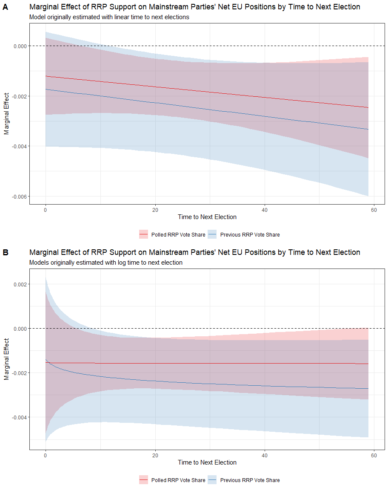<!-- -->

``` r
#ggsave("marginal_effects_time.png", device = "png", width = 9.5, height = 12)
```

``` r
n_rows <- c()

for (i in seq(20, 0, -5)) {
  
  add <- model.frame(tri_position_6) |>
    filter(time_to_next <= i) |>
    nrow()
  
  n_rows <- c(n_rows, add)
  
}

n_rows_p <- c()

for (i in seq(20, 0, -5)) {
  
  add <- model.frame(tri_position_polled_6) |>
    filter(time_to_next <= i) |>
    nrow()
  
  n_rows_p <- c(n_rows_p, add)
  
}

tibble("Polled/Actual" = rep("Actual", 5),
       "Time to Next Election <=" = seq(20, 0, -5),
       "Number of Obs" = n_rows) |>
  bind_rows(tibble("Polled/Actual" = rep("Polled", 5),
       "Time to Next Election <=" = seq(20, 0, -5),
       "Number of Obs" = n_rows_p)) |>
  kableExtra::kable(format = "latex")
```

``` r
plot_slopes(tri_position_7, variables = "rrp_lag", vcov = "robust",
            condition = "rrp_in_parliament", conf_level = 0.95, draw = F) |> 
  mutate(level = 0.95) |>
  bind_rows(
    plot_slopes(tri_position_polled_7, variables = "lag_rrp_polled_voteshare", vcov = "robust",
                condition = "rrp_in_parliament", conf_level = 0.95, draw = F) |>
      mutate(level = 0.95)) |>
  bind_rows(
    plot_slopes(tri_position_7, variables = "rrp_lag", vcov = "robust",
                condition = "rrp_in_parliament", conf_level = 0.90, draw = F) |>
      mutate(level = 0.90)) |>
  bind_rows(
    plot_slopes(tri_position_polled_7, variables = "lag_rrp_polled_voteshare", vcov = "robust",
                condition = "rrp_in_parliament", conf_level = 0.90, draw = F) |>
      mutate(level = 0.90)) |> 
  mutate(level = as.factor(level)) |>
  ggplot() +
  geom_pointrange(aes(x = rrp_in_parliament, 
             y = estimate, ymin = conf.low, ymax = conf.high, 
             color = term, shape = term, group = term, linewidth = level),
             position = position_dodge(width = 0.25)) +
  geom_hline(aes(yintercept = 0), linetype = "dashed") +
  scale_linewidth_manual(values = c(1.25, 0.5), guide = "none") +
  scale_color_brewer(name = "", palette = "Set1", labels = c("Polled RRP Vote Share", "Previous RRP Vote Share")) +
  scale_shape_discrete(name = "", labels = c("Polled RRP Vote Share", "Previous RRP Vote Share")) +
  scale_x_discrete(breaks = c(0, 1),
                     labels = c("No", "Yes")) +
  labs(x = "RRP in Parliament", y = "Marginal Effect",
       title = "Marginal Effect of RRP Support on Mainstream Parties' Net EU Positions by RRP in Parliament",
       caption = "Point estimates with 90% and 95% confidence intervals")
```

<!-- -->

``` r
#ggsave("marginal_effects_rrp_in_parl.png", device = "png", width = 9.5, height = 6)
```

``` r
tibble("Polled/Actual" = c("Actual", "Actual", "Polled", "Polled"),
       "RRP in Parliament" = c(0, 1, 0, 1),
       "Number of Obs" = c(as.numeric(nrow(model.frame(tri_position_7) |> 
                                             filter(rrp_in_parliament == 0))),
                           as.numeric(nrow(model.frame(tri_position_7) |> 
                                             filter(rrp_in_parliament == 1))),
                           as.numeric(nrow(model.frame(tri_position_polled_7) |> 
                                             filter(rrp_in_parliament == 0))),
                           as.numeric(nrow(model.frame(tri_position_polled_7) |> 
                                             filter(rrp_in_parliament == 1)))
                           )
       ) |>
  kableExtra::kable(format = "latex")
```

## BOTH POLLED & ACTUAL

``` r
tri_position_both_1 <- lm(data = reg_data_tri,
             net_position ~ date_numeric + 
               lag_net_position + country + 
               time_to_next + time_to_next_ep + vote_share + 
               change_voteshare + rrp_lag + lag_rrp_polled_voteshare + cabinet_party + rrp_in_parliament)

tri_position_both_2 <- lm(data = reg_data_tri,
             net_position ~ date_numeric + 
               lag_net_position + 
               time_to_next + time_to_next_ep + vote_share + 
               change_voteshare + rrp_lag + lag_rrp_polled_voteshare + cabinet_party + rrp_in_parliament +
               parlgov_id)

tri_position_both_3 <- lm(data = reg_data_tri,
             net_position ~ date_numeric + 
               lag_net_position + 
               time_to_next + time_to_next_ep + vote_share + 
               change_voteshare + rrp_lag + lag_rrp_polled_voteshare + cabinet_party + rrp_in_parliament +
               parlgov_id + lag_eu_public_opinion)

tri_position_both_4 <- lm(data = reg_data_tri,
             net_position ~ date_numeric + 
               lag_net_position + 
               log_time_to_next + log_time_to_next_ep + vote_share + 
               change_voteshare + rrp_lag + lag_rrp_polled_voteshare + cabinet_party + rrp_in_parliament +
               parlgov_id + lag_eu_public_opinion)

modelsummary(list(tri_position_both_1, tri_position_both_2, tri_position_both_3,
                  tri_position_both_4), vcov = "robust", 
             stars = TRUE,
             coef_omit = "parlgov_id|country",
             coef_map = c(
               "(Intercept)" = "Constant",
               "date_numeric" = "Time",
               "lag_net_position" = "Lag Net Position",
               "time_to_next" = "Time to next election",
               "time_to_next_ep" = "Time to next EP election",
               "log_time_to_next" = "Log time to next election",
               "log_time_to_next_ep" = "Log time to next EP election",
               "vote_share" = "Vote share",
               "change_voteshare" = "Change in vote share",
               "rrp_lag" = "RRP Vote Share",
               "lag_rrp_polled_voteshare" = "RRP Polled Vote Share",
               "cabinet_party" = "Cabinet Party",
               "rrp_in_parliament" = "RRP in Parliament",
               "lag_eu_public_opinion" = "Lag EU Public Opinion",
             "log_time_to_next:lag_rrp_polled_voteshare" = "Log time to next election * RRP Polled vote share",
             "time_to_next:lag_rrp_polled_voteshare" = "Time to next election * RRP Polled vote share"
             ),
             gof_map = tibble::tribble(~raw, ~clean, ~fmt,
                                       "nobs", "N", 0,
                                       "r.squared", "R$^2$", 2,
                                       "adj.r.squared", "Adj. R$^2$", 2),
             add_rows = tibble::tribble(
               ~term, ~tri_position_both_1, ~tri_position_both_2, ~tri_position_both_3,
                  ~tri_position_both_4,
               "Party FE", "\\xmark", "\\cmark", "\\cmark", "\\cmark",
               "Country FE", "\\cmark", "\\xmark", "\\xmark", "\\xmark",
             ),
             #output = "table2.tex",
             output = "latex"
             )
```

<table style="width:98%;">
<colgroup>
<col style="width: 25%" />
<col style="width: 18%" />
<col style="width: 18%" />
<col style="width: 18%" />
<col style="width: 18%" />
</colgroup>
<thead>
<tr>
<th></th>
<th><ol type="1">
<li></li>
</ol></th>
<th><ol start="2" type="1">
<li></li>
</ol></th>
<th><ol start="3" type="1">
<li></li>
</ol></th>
<th><ol start="4" type="1">
<li></li>
</ol></th>
</tr>
</thead>
<tbody>
<tr>
<td>Constant</td>
<td>***</td>
<td></td>
<td>*</td>
<td>*</td>
</tr>
<tr>
<td></td>
<td>()</td>
<td>()</td>
<td>()</td>
<td>()</td>
</tr>
<tr>
<td>Time</td>
<td>+</td>
<td>+</td>
<td>*</td>
<td>*</td>
</tr>
<tr>
<td></td>
<td>()</td>
<td>()</td>
<td>()</td>
<td>()</td>
</tr>
<tr>
<td>Lag Net Position</td>
<td>**</td>
<td></td>
<td></td>
<td></td>
</tr>
<tr>
<td></td>
<td>()</td>
<td>()</td>
<td>()</td>
<td>()</td>
</tr>
<tr>
<td>Time to next election</td>
<td></td>
<td></td>
<td></td>
<td></td>
</tr>
<tr>
<td></td>
<td>()</td>
<td>()</td>
<td>()</td>
<td></td>
</tr>
<tr>
<td>Time to next EP election</td>
<td></td>
<td></td>
<td></td>
<td></td>
</tr>
<tr>
<td></td>
<td>()</td>
<td>()</td>
<td>()</td>
<td></td>
</tr>
<tr>
<td>Log time to next election</td>
<td></td>
<td></td>
<td></td>
<td></td>
</tr>
<tr>
<td></td>
<td></td>
<td></td>
<td></td>
<td>()</td>
</tr>
<tr>
<td>Log time to next EP election</td>
<td></td>
<td></td>
<td></td>
<td></td>
</tr>
<tr>
<td></td>
<td></td>
<td></td>
<td></td>
<td>()</td>
</tr>
<tr>
<td>Vote share</td>
<td>*</td>
<td>*</td>
<td>*</td>
<td>*</td>
</tr>
<tr>
<td></td>
<td>()</td>
<td>()</td>
<td>()</td>
<td>()</td>
</tr>
<tr>
<td>Change in vote share</td>
<td></td>
<td></td>
<td></td>
<td></td>
</tr>
<tr>
<td></td>
<td>()</td>
<td>()</td>
<td>()</td>
<td>()</td>
</tr>
<tr>
<td>RRP Vote Share</td>
<td>*</td>
<td>*</td>
<td>*</td>
<td>*</td>
</tr>
<tr>
<td></td>
<td>()</td>
<td>()</td>
<td>()</td>
<td>()</td>
</tr>
<tr>
<td>RRP Polled Vote Share</td>
<td>*</td>
<td>*</td>
<td>**</td>
<td>**</td>
</tr>
<tr>
<td></td>
<td>()</td>
<td>()</td>
<td>()</td>
<td>()</td>
</tr>
<tr>
<td>Cabinet Party</td>
<td>***</td>
<td>***</td>
<td>***</td>
<td>***</td>
</tr>
<tr>
<td></td>
<td>()</td>
<td>()</td>
<td>()</td>
<td>()</td>
</tr>
<tr>
<td>RRP in Parliament</td>
<td>***</td>
<td>***</td>
<td>***</td>
<td>***</td>
</tr>
<tr>
<td></td>
<td>()</td>
<td>()</td>
<td>()</td>
<td>()</td>
</tr>
<tr>
<td>Lag EU Public Opinion</td>
<td></td>
<td></td>
<td>*</td>
<td>*</td>
</tr>
<tr>
<td></td>
<td></td>
<td></td>
<td>()</td>
<td>()</td>
</tr>
<tr>
<td>N</td>
<td></td>
<td></td>
<td></td>
<td></td>
</tr>
<tr>
<td>R$2$</td>
<td></td>
<td></td>
<td></td>
<td></td>
</tr>
<tr>
<td>Adj. R$2$</td>
<td></td>
<td></td>
<td></td>
<td></td>
</tr>
<tr>
<td>Party FE</td>
<td>xmark</td>
<td>cmark</td>
<td>cmark</td>
<td>cmark</td>
</tr>
<tr>
<td>Country FE</td>
<td>cmark</td>
<td>xmark</td>
<td>xmark</td>
<td>xmark</td>
</tr>
</tbody><tfoot>
<tr>
<td colspan="5"><ul>
<li>p , * p , ** p , *** p |</li>
</ul></td>
</tr>
</tfoot>
&#10;</table>

``` r
reg_data_tri <- reg_data_tri |> 
  mutate(diff_vote = rrp_lag - lag_rrp_polled_voteshare)

tri_position_both_1 <- lm(data = reg_data_tri,
             net_position ~ date_numeric + 
               lag_net_position + country + 
               time_to_next + time_to_next_ep + vote_share + 
               change_voteshare + diff_vote + cabinet_party)

tri_position_both_2 <- lm(data = reg_data_tri,
             net_position ~ date_numeric + 
               lag_net_position + 
               time_to_next + time_to_next_ep + vote_share + 
               change_voteshare + diff_vote + cabinet_party +
               parlgov_id)

tri_position_both_3 <- lm(data = reg_data_tri,
             net_position ~ date_numeric + 
               lag_net_position + 
               time_to_next + time_to_next_ep + vote_share + 
               change_voteshare + diff_vote + cabinet_party +
               parlgov_id + lag_eu_public_opinion)

tri_position_both_4 <- lm(data = reg_data_tri,
             net_position ~ date_numeric + 
               lag_net_position + 
               log_time_to_next + log_time_to_next_ep + vote_share + 
               change_voteshare + diff_vote + cabinet_party +
               parlgov_id + lag_eu_public_opinion)

tri_position_both_5 <- lm(data = reg_data_tri,
             net_position ~ date_numeric +
               lag_net_position + country +
               time_to_next + time_to_next_ep + vote_share +
               change_voteshare + diff_vote + cabinet_party + rrp_in_parliament +
               parlgov_id + lag_eu_public_opinion + diff_vote*rrp_in_parliament)

tri_position_both_6 <- lm(data = reg_data_tri,
             net_position ~ date_numeric +
               lag_net_position + country +
               time_to_next + time_to_next_ep + vote_share +
               change_voteshare + diff_vote + cabinet_party + rrp_in_parliament +
               parlgov_id + lag_eu_public_opinion + diff_vote*time_to_next)

modelsummary(list(tri_position_both_1, tri_position_both_2, tri_position_both_3,
                  tri_position_both_4, tri_position_both_5, tri_position_both_6), vcov = "robust", 
             stars = TRUE,
             coef_omit = "parlgov_id|country",
             # coef_map = c(
             #   "(Intercept)" = "Constant",
             #   "date_numeric" = "Time",
             #   "lag_net_position" = "Lag Net Position",
             #   "time_to_next" = "Time to next election",
             #   "time_to_next_ep" = "Time to next EP election",
             #   "log_time_to_next" = "Log time to next election",
             #   "log_time_to_next_ep" = "Log time to next EP election",
             #   "vote_share" = "Vote share",
             #   "change_voteshare" = "Change in vote share",
             #   "rrp_lag" = "RRP Vote Share",
             #   "lag_rrp_polled_voteshare" = "RRP Polled Vote Share",
             #   "cabinet_party" = "Cabinet Party",
             #   "rrp_in_parliament" = "RRP in Parliament",
             #   "lag_eu_public_opinion" = "Lag EU Public Opinion"#,
               # "log_time_to_next:lag_rrp_polled_voteshare" = "Log time to next election * RRP Polled vote share",
               # "time_to_next:lag_rrp_polled_voteshare" = "Time to next election * RRP Polled vote share",
               # #"family_name:rrp_lag" = "RRP vote share * Family Name",
               # #"family_2:rrp_lag" =  "RRP vote share * Family 2",
               # #"change_voteshare:rrp_lag" = "RRP vote share * Change in vote share",
               # "lag_rrp_polled_voteshare:cabinet_party" = "RRP Polled vote share * Cabinet Party",
               # "lag_rrp_polled_voteshare:rrp_in_parliament" = "RRP Polled vote share * RRP in Parliament"
             #),
             # gof_map = tibble::tribble(~raw, ~clean, ~fmt,
             #                           "nobs", "N", 0,
             #                           "r.squared", "R$^2$", 2,
             #                           "adj.r.squared", "Adj. R$^2$", 2),
             # add_rows = tibble::tribble(
             #   ~term, ~tri_position_both_1, ~tri_position_both_2, ~tri_position_both_3,
             #      ~tri_position_both_4,
             #   "Party FE", "No", "Yes", "Yes", "Yes", 
             #   "Country FE", "Yes", "Yes", "Yes", "Yes",
             # ),
             #output = "table2.tex",
             #output = "latex"
             )
```

<table style="width:95%;">
<colgroup>
<col style="width: 31%" />
<col style="width: 10%" />
<col style="width: 10%" />
<col style="width: 10%" />
<col style="width: 10%" />
<col style="width: 10%" />
<col style="width: 10%" />
</colgroup>
<thead>
<tr>
<th></th>
<th><ol type="1">
<li></li>
</ol></th>
<th><ol start="2" type="1">
<li></li>
</ol></th>
<th><ol start="3" type="1">
<li></li>
</ol></th>
<th><ol start="4" type="1">
<li></li>
</ol></th>
<th><ol start="5" type="1">
<li></li>
</ol></th>
<th><ol start="6" type="1">
<li></li>
</ol></th>
</tr>
</thead>
<tbody>
<tr>
<td>(Intercept)</td>
<td>0.125***</td>
<td>-0.021</td>
<td>-0.056</td>
<td>-0.061</td>
<td>0.114**</td>
<td>0.118**</td>
</tr>
<tr>
<td></td>
<td>(0.036)</td>
<td>(0.032)</td>
<td>(0.036)</td>
<td>(0.039)</td>
<td>(0.040)</td>
<td>(0.040)</td>
</tr>
<tr>
<td>date_numeric</td>
<td>0.000**</td>
<td>0.000**</td>
<td>0.000***</td>
<td>0.000***</td>
<td>0.000***</td>
<td>0.000***</td>
</tr>
<tr>
<td></td>
<td>(0.000)</td>
<td>(0.000)</td>
<td>(0.000)</td>
<td>(0.000)</td>
<td>(0.000)</td>
<td>(0.000)</td>
</tr>
<tr>
<td>lag_net_position</td>
<td>0.107***</td>
<td>0.054*</td>
<td>0.051*</td>
<td>0.051+</td>
<td>0.049+</td>
<td>0.049+</td>
</tr>
<tr>
<td></td>
<td>(0.031)</td>
<td>(0.026)</td>
<td>(0.026)</td>
<td>(0.026)</td>
<td>(0.026)</td>
<td>(0.026)</td>
</tr>
<tr>
<td>time_to_next</td>
<td>0.000</td>
<td>0.000</td>
<td>0.000</td>
<td></td>
<td>0.000</td>
<td>0.000</td>
</tr>
<tr>
<td></td>
<td>(0.000)</td>
<td>(0.000)</td>
<td>(0.000)</td>
<td></td>
<td>(0.000)</td>
<td>(0.000)</td>
</tr>
<tr>
<td>time_to_next_ep</td>
<td>0.000</td>
<td>0.000</td>
<td>0.000</td>
<td></td>
<td>0.000</td>
<td>0.000</td>
</tr>
<tr>
<td></td>
<td>(0.000)</td>
<td>(0.000)</td>
<td>(0.000)</td>
<td></td>
<td>(0.000)</td>
<td>(0.000)</td>
</tr>
<tr>
<td>vote_share</td>
<td>0.002*</td>
<td>0.002**</td>
<td>0.002**</td>
<td>0.002**</td>
<td>0.002**</td>
<td>0.002**</td>
</tr>
<tr>
<td></td>
<td>(0.001)</td>
<td>(0.001)</td>
<td>(0.001)</td>
<td>(0.001)</td>
<td>(0.001)</td>
<td>(0.001)</td>
</tr>
<tr>
<td>change_voteshare</td>
<td>0.000</td>
<td>-0.001</td>
<td>-0.001</td>
<td>-0.001</td>
<td>-0.001</td>
<td>-0.001</td>
</tr>
<tr>
<td></td>
<td>(0.001)</td>
<td>(0.001)</td>
<td>(0.001)</td>
<td>(0.001)</td>
<td>(0.001)</td>
<td>(0.001)</td>
</tr>
<tr>
<td>diff_vote</td>
<td>-0.001</td>
<td>-0.001</td>
<td>0.000</td>
<td>0.000</td>
<td>0.000</td>
<td>0.000</td>
</tr>
<tr>
<td></td>
<td>(0.001)</td>
<td>(0.001)</td>
<td>(0.001)</td>
<td>(0.001)</td>
<td>(0.001)</td>
<td>(0.001)</td>
</tr>
<tr>
<td>cabinet_party</td>
<td>0.084***</td>
<td>0.090***</td>
<td>0.091***</td>
<td>0.091***</td>
<td>0.093***</td>
<td>0.093***</td>
</tr>
<tr>
<td></td>
<td>(0.008)</td>
<td>(0.008)</td>
<td>(0.008)</td>
<td>(0.008)</td>
<td>(0.008)</td>
<td>(0.008)</td>
</tr>
<tr>
<td>lag_eu_public_opinion</td>
<td></td>
<td></td>
<td>0.081*</td>
<td>0.080*</td>
<td>0.067+</td>
<td>0.065+</td>
</tr>
<tr>
<td></td>
<td></td>
<td></td>
<td>(0.038)</td>
<td>(0.039)</td>
<td>(0.038)</td>
<td>(0.039)</td>
</tr>
<tr>
<td>log_time_to_next</td>
<td></td>
<td></td>
<td></td>
<td>0.001</td>
<td></td>
<td></td>
</tr>
<tr>
<td></td>
<td></td>
<td></td>
<td></td>
<td>(0.004)</td>
<td></td>
<td></td>
</tr>
<tr>
<td>log_time_to_next_ep</td>
<td></td>
<td></td>
<td></td>
<td>0.001</td>
<td></td>
<td></td>
</tr>
<tr>
<td></td>
<td></td>
<td></td>
<td></td>
<td>(0.003)</td>
<td></td>
<td></td>
</tr>
<tr>
<td>rrp_in_parliament</td>
<td></td>
<td></td>
<td></td>
<td></td>
<td>0.021*</td>
<td>0.021*</td>
</tr>
<tr>
<td></td>
<td></td>
<td></td>
<td></td>
<td></td>
<td>(0.009)</td>
<td>(0.008)</td>
</tr>
<tr>
<td>diff_vote × rrp_in_parliament</td>
<td></td>
<td></td>
<td></td>
<td></td>
<td>0.000</td>
<td></td>
</tr>
<tr>
<td></td>
<td></td>
<td></td>
<td></td>
<td></td>
<td>(0.001)</td>
<td></td>
</tr>
<tr>
<td>time_to_next × diff_vote</td>
<td></td>
<td></td>
<td></td>
<td></td>
<td></td>
<td>0.000</td>
</tr>
<tr>
<td></td>
<td></td>
<td></td>
<td></td>
<td></td>
<td></td>
<td>(0.000)</td>
</tr>
<tr>
<td>Num.Obs.</td>
<td>1168</td>
<td>1168</td>
<td>1168</td>
<td>1168</td>
<td>1168</td>
<td>1168</td>
</tr>
<tr>
<td>R2</td>
<td>0.628</td>
<td>0.645</td>
<td>0.647</td>
<td>0.647</td>
<td>0.648</td>
<td>0.648</td>
</tr>
<tr>
<td>R2 Adj.</td>
<td>0.624</td>
<td>0.639</td>
<td>0.639</td>
<td>0.639</td>
<td>0.640</td>
<td>0.640</td>
</tr>
<tr>
<td>AIC</td>
<td>-2087.2</td>
<td>-2126.0</td>
<td>-2127.6</td>
<td>-2127.7</td>
<td>-2126.8</td>
<td>-2127.2</td>
</tr>
<tr>
<td>BIC</td>
<td>-2006.2</td>
<td>-2004.5</td>
<td>-2001.0</td>
<td>-2001.1</td>
<td>-1990.1</td>
<td>-1990.5</td>
</tr>
<tr>
<td>Log.Lik.</td>
<td>1059.585</td>
<td>1087.005</td>
<td>1088.793</td>
<td>1088.832</td>
<td>1090.396</td>
<td>1090.591</td>
</tr>
<tr>
<td>F</td>
<td>311.126</td>
<td>247.028</td>
<td>235.361</td>
<td>238.806</td>
<td></td>
<td></td>
</tr>
<tr>
<td>RMSE</td>
<td>0.10</td>
<td>0.10</td>
<td>0.10</td>
<td>0.10</td>
<td>0.10</td>
<td>0.10</td>
</tr>
<tr>
<td>Std.Errors</td>
<td>HC3</td>
<td>HC3</td>
<td>HC3</td>
<td>HC3</td>
<td>HC3</td>
<td>HC3</td>
</tr>
</tbody><tfoot>
<tr>
<td colspan="7"><ul>
<li>p &lt; 0.1, * p &lt; 0.05, ** p &lt; 0.01, *** p &lt; 0.001</li>
</ul></td>
</tr>
</tfoot>
&#10;</table>

``` r
tibble(
  "SD RRP Vote Share" = sd(reg_data_tri$rrp_lag, na.rm = TRUE),
  "SD Net Position" = sd(reg_data_tri$net_position, na.rm = TRUE),
  "Coefficient" = coef(tri_position_3)["rrp_lag"],
  "Effect of SD change in RRP Vote Share" = coef(tri_position_3)["rrp_lag"]*sd(reg_data_tri$rrp_lag, na.rm = TRUE),
  "Effect of SD change in RRP Vote Share as % of SD Net Position" = abs((coef(tri_position_3)["rrp_lag"]*sd(reg_data_tri$rrp_lag, na.rm = TRUE)))/sd(reg_data_tri$net_position, na.rm = TRUE),
  "Difference in Net Position between VVD and PvdA" = mean(reg_data_tri$net_position[reg_data_tri$name_short == "VVD"], na.rm = TRUE) - mean(reg_data_tri$net_position[reg_data_tri$name_short == "PvdA"], na.rm = TRUE)
  ) |>
  pivot_longer(cols = everything(), names_to = "Metric", values_to = "Value") |>
  kableExtra::kable(format = "latex", digits = 3)
```

# VIF

``` r
vif(tri_position_1) |>
  as.data.frame() |>
  rownames_to_column("variable") |>
  mutate(model = "1") |>
  bind_rows(vif(tri_position_2) |>
              as.data.frame() |>
              rownames_to_column("variable") |>
              mutate(model = "2")) |>
  bind_rows(vif(tri_position_3) |>
              as.data.frame() |>
              rownames_to_column("variable") |>
              mutate(model = "3")) |>
  bind_rows(vif(tri_position_4) |>
              as.data.frame() |>
              rownames_to_column("variable") |>
              mutate(model = "4")) |>
  bind_rows(vif(tri_position_5) |>
              as.data.frame() |>
              rownames_to_column("variable") |>
              mutate(model = "5")) |>
  bind_rows(vif(tri_position_6) |>
              as.data.frame() |>
              rownames_to_column("variable") |>
              mutate(model = "6")) |>
  bind_rows(vif(tri_position_7) |>
              as.data.frame() |>
              rownames_to_column("variable") |>
              mutate(model = "7")) |>
  dplyr::select(variable, `GVIF^(1/(2*Df))`, model) |>
  kableExtra::kable("latex", digits = 2)
```

    ## there are higher-order terms (interactions) in this model
    ## consider setting type = 'predictor'; see ?vif
    ## there are higher-order terms (interactions) in this model
    ## consider setting type = 'predictor'; see ?vif
    ## there are higher-order terms (interactions) in this model
    ## consider setting type = 'predictor'; see ?vif

``` r
vif(tri_position_polled_1) |>
  as.data.frame() |>
  rownames_to_column("variable") |>
  mutate(model = "1") |>
  bind_rows(vif(tri_position_polled_2) |>
              as.data.frame() |>
              rownames_to_column("variable") |>
              mutate(model = "2")) |>
  bind_rows(vif(tri_position_polled_3) |>
              as.data.frame() |>
              rownames_to_column("variable") |>
              mutate(model = "3")) |>
  bind_rows(vif(tri_position_polled_4) |>
              as.data.frame() |>
              rownames_to_column("variable") |>
              mutate(model = "4")) |>
  bind_rows(vif(tri_position_polled_5) |>
              as.data.frame() |>
              rownames_to_column("variable") |>
              mutate(model = "5")) |>
  bind_rows(vif(tri_position_polled_6) |>
              as.data.frame() |>
              rownames_to_column("variable") |>
              mutate(model = "6")) |>
  bind_rows(vif(tri_position_polled_7) |>
              as.data.frame() |>
              rownames_to_column("variable") |>
              mutate(model = "7")) |>
  dplyr::select(variable, `GVIF^(1/(2*Df))`, model) |>
  kableExtra::kable("latex", digits = 2)
```

    ## there are higher-order terms (interactions) in this model
    ## consider setting type = 'predictor'; see ?vif
    ## there are higher-order terms (interactions) in this model
    ## consider setting type = 'predictor'; see ?vif
    ## there are higher-order terms (interactions) in this model
    ## consider setting type = 'predictor'; see ?vif

``` r
vif(tri_position_both_1) |>
  as.data.frame() |>
  rownames_to_column("variable") |>
  mutate(model = "1") |>
  bind_rows(vif(tri_position_both_2) |>
              as.data.frame() |>
              rownames_to_column("variable") |>
              mutate(model = "2")) |>
  bind_rows(vif(tri_position_both_3) |>
              as.data.frame() |>
              rownames_to_column("variable") |>
              mutate(model = "3")) |>
  bind_rows(vif(tri_position_both_4) |>
              as.data.frame() |>
              rownames_to_column("variable") |>
              mutate(model = "4")) |>
  dplyr::select(variable, `GVIF^(1/(2*Df))`, model) |>
  kableExtra::kable("latex", digits = 2)
```

# DIFFERENT STANDARD ERRORS

``` r
set.seed(50)
boot_vote_95 <- marginaleffects::avg_slopes(lm(data = reg_data_tri,
                                        net_position ~ date_numeric +
                                          lag_net_position +
                                          time_to_next + time_to_next_ep +
                                          vote_share + change_voteshare +
                                          rrp_lag + cabinet_party +
                                          rrp_in_parliament + parlgov_id +
                                          lag_eu_public_opinion),
                                     variables = "rrp_lag",
                                     conf_level = 0.95,
                                     vcov = TRUE) |>
       inferences(method = "boot", R = 1000)

set.seed(50)
boot_vote_90 <- marginaleffects::avg_slopes(lm(data = reg_data_tri,
                                        net_position ~ date_numeric +
                                          lag_net_position +
                                          time_to_next + time_to_next_ep +
                                          vote_share + change_voteshare +
                                          rrp_lag + cabinet_party +
                                          rrp_in_parliament + parlgov_id +
                                          lag_eu_public_opinion),
                                     variables = "rrp_lag",
                                     conf_level = 0.90,
                                     vcov = TRUE) |>
       inferences(method = "boot", R = 1000)

set.seed(50)
boot_poll_95 <- marginaleffects::avg_slopes(lm(data = reg_data_tri,
                                        net_position ~ date_numeric +
                                          lag_net_position +
                                          time_to_next + time_to_next_ep +
                                          vote_share + change_voteshare +
                                          lag_rrp_polled_voteshare + cabinet_party +
                                          rrp_in_parliament + parlgov_id +
                                          lag_eu_public_opinion),
                                     variables = "lag_rrp_polled_voteshare",
                                     conf_level = 0.95,
                                     vcov = TRUE) |>
       inferences(method = "boot", R = 1000)

set.seed(50)
boot_poll_90 <- marginaleffects::avg_slopes(lm(data = reg_data_tri,
                                        net_position ~ date_numeric +
                                          lag_net_position +
                                          time_to_next + time_to_next_ep +
                                          vote_share + change_voteshare +
                                          lag_rrp_polled_voteshare + cabinet_party +
                                          rrp_in_parliament + parlgov_id +
                                          lag_eu_public_opinion),
                                     variables = "lag_rrp_polled_voteshare",
                                     conf_level = 0.90,
                                     vcov = TRUE) |>
       inferences(method = "boot", R = 1000)

set.seed(50)
boot_vote_both_95 <- marginaleffects::avg_slopes(lm(data = reg_data_tri,
                                        net_position ~ date_numeric +
                                          lag_net_position +
                                          time_to_next + time_to_next_ep +
                                          vote_share + change_voteshare +
                                          rrp_lag + lag_rrp_polled_voteshare + cabinet_party +
                                          rrp_in_parliament + parlgov_id +
                                          lag_eu_public_opinion),
                                     variables = "rrp_lag",
                                     conf_level = 0.95,
                                     vcov = TRUE) |>
       inferences(method = "boot", R = 1000)

set.seed(50)
boot_vote_both_90 <- marginaleffects::avg_slopes(lm(data = reg_data_tri,
                                        net_position ~ date_numeric +
                                          lag_net_position +
                                          time_to_next + time_to_next_ep +
                                          vote_share + change_voteshare +
                                          rrp_lag + lag_rrp_polled_voteshare + cabinet_party +
                                          rrp_in_parliament + parlgov_id +
                                          lag_eu_public_opinion),
                                     variables = "rrp_lag",
                                     conf_level = 0.90,
                                     vcov = TRUE) |>
       inferences(method = "boot", R = 1000)

set.seed(50)
boot_poll_both_95 <- marginaleffects::avg_slopes(lm(data = reg_data_tri,
                                        net_position ~ date_numeric +
                                          lag_net_position +
                                          time_to_next + time_to_next_ep +
                                          vote_share + change_voteshare +
                                          rrp_lag + lag_rrp_polled_voteshare + cabinet_party +
                                          rrp_in_parliament + parlgov_id +
                                          lag_eu_public_opinion),
                                     variables = "lag_rrp_polled_voteshare",
                                     conf_level = 0.95,
                                     vcov = TRUE) |>
       inferences(method = "boot", R = 1000)

set.seed(50)
boot_poll_both_90 <- marginaleffects::avg_slopes(lm(data = reg_data_tri,
                                        net_position ~ date_numeric +
                                          lag_net_position +
                                          time_to_next + time_to_next_ep +
                                          vote_share + change_voteshare +
                                          rrp_lag + lag_rrp_polled_voteshare + cabinet_party +
                                          rrp_in_parliament + parlgov_id +
                                          lag_eu_public_opinion),
                                     variables = "lag_rrp_polled_voteshare",
                                     conf_level = 0.90,
                                     vcov = TRUE) |>
       inferences(method = "boot", R = 1000)

beepr::beep()

boot_sep <- bind_rows(
  marginaleffects::avg_slopes(lm(data = reg_data_tri,
                               net_position ~ date_numeric + 
                                 lag_net_position + 
                                 time_to_next + time_to_next_ep + vote_share + 
                                 change_voteshare + rrp_lag + 
                                 cabinet_party + rrp_in_parliament +
                                 parlgov_id + lag_eu_public_opinion),
                              variables = "rrp_lag",
                              conf_level = 0.95) |> 
    as.data.frame() |> 
    dplyr::select(term, estimate, conf.low, conf.high) |>
    mutate(se = "Default",
           level = as.factor(0.95),
           order = 1),
  
  marginaleffects::avg_slopes(lm(data = reg_data_tri,
                               net_position ~ date_numeric + 
                                 lag_net_position + 
                                 time_to_next + time_to_next_ep + vote_share + 
                                 change_voteshare + rrp_lag + 
                                 cabinet_party + rrp_in_parliament +
                                 parlgov_id + lag_eu_public_opinion),
                              variables = "rrp_lag",
                              conf_level = 0.90) |> 
    as.data.frame() |> 
    dplyr::select(term, estimate, conf.low, conf.high) |>
    mutate(se = "Default",
           level = as.factor(0.90),
           order = 1),
    marginaleffects::avg_slopes(lm(data = reg_data_tri,
                               net_position ~ date_numeric + 
                                 lag_net_position + 
                                 time_to_next + time_to_next_ep + vote_share + 
                                 change_voteshare + rrp_lag + 
                                 cabinet_party + rrp_in_parliament +
                                 parlgov_id + lag_eu_public_opinion), 
                            variables = "rrp_lag", 
                            vcov = "robust",
                            conf_level = 0.95) |> 
    as.data.frame() |> 
    dplyr::select(term, estimate, conf.low, conf.high) |>
    mutate(se = "Robust",
           level = as.factor(0.95),
           order = 2),
  marginaleffects::avg_slopes(lm(data = reg_data_tri,
                               net_position ~ date_numeric + 
                                 lag_net_position + 
                                 time_to_next + time_to_next_ep + vote_share + 
                                 change_voteshare + rrp_lag + 
                                 cabinet_party + rrp_in_parliament +
                                 parlgov_id + lag_eu_public_opinion), 
                            variables = "rrp_lag", 
                            vcov = "robust",
                            conf_level = 0.90) |> 
    as.data.frame() |> 
    dplyr::select(term, estimate, conf.low, conf.high) |>
    mutate(se = "Robust",
           level = as.factor(0.90),
           order = 2),
  marginaleffects::avg_slopes(lm(data = reg_data_tri,
                               net_position ~ date_numeric + 
                                 lag_net_position + 
                                 time_to_next + time_to_next_ep + vote_share + 
                                 change_voteshare + rrp_lag + 
                                 cabinet_party + rrp_in_parliament +
                                 parlgov_id + lag_eu_public_opinion), 
                            variables = "rrp_lag", 
                            vcov = "HAC",
                            conf_level = 0.95) |> 
    as.data.frame() |> 
    dplyr::select(term, estimate, conf.low, conf.high) |>
    mutate(se = "HAC",
           level = as.factor(0.95),
           order = 3),
  marginaleffects::avg_slopes(lm(data = reg_data_tri,
                               net_position ~ date_numeric + 
                                 lag_net_position + 
                                 time_to_next + time_to_next_ep + vote_share + 
                                 change_voteshare + rrp_lag + 
                                 cabinet_party + rrp_in_parliament +
                                 parlgov_id + lag_eu_public_opinion), 
                            variables = "rrp_lag", 
                            vcov = "HAC",
                            conf_level = 0.90) |> 
    as.data.frame() |> 
    dplyr::select(term, estimate, conf.low, conf.high) |>
    mutate(se = "HAC",
           level = as.factor(0.90),
           order = 3),
  boot_vote_95 |>
    as.data.frame() |>
    dplyr::select(term, estimate, conf.low = conf.low, conf.high = conf.high) |>
    mutate(se = "Bootstrap",
           level = as.factor(0.95),
           order = 4),
  boot_vote_90 |>
    as.data.frame() |>
    dplyr::select(term, estimate, conf.low = conf.low, conf.high = conf.high) |>
    mutate(se = "Bootstrap",
           level = as.factor(0.90),
           order = 4),
  marginaleffects::avg_slopes(lm(data = reg_data_tri,
                               net_position ~ date_numeric + 
                                 lag_net_position + 
                                 time_to_next + time_to_next_ep + vote_share + 
                                 change_voteshare + rrp_lag + 
                                 cabinet_party + rrp_in_parliament +
                                 parlgov_id + lag_eu_public_opinion), 
                            variables = "rrp_lag", 
                            vcov = clubSandwich::vcovCR(lm(data = reg_data_tri,
                               net_position ~ date_numeric + 
                                 lag_net_position +  
                                 time_to_next + time_to_next_ep + vote_share + 
                                 change_voteshare + rrp_lag + 
                                 cabinet_party + rrp_in_parliament +
                                 parlgov_id + lag_eu_public_opinion),
                               cluster = reg_data_tri$parlgov_id,
                               type = "CR2"),
                            conf_level = 0.95) |> 
    as.data.frame() |> 
    dplyr::select(term, estimate, conf.low, conf.high) |>
    mutate(se = "Party clustered (CR2)",
           level = as.factor(0.95),
           order = 5),
  marginaleffects::avg_slopes(lm(data = reg_data_tri,
                               net_position ~ date_numeric + 
                                 lag_net_position + 
                                 time_to_next + time_to_next_ep + vote_share + 
                                 change_voteshare + rrp_lag + 
                                 cabinet_party + rrp_in_parliament +
                                 parlgov_id + lag_eu_public_opinion), 
                            variables = "rrp_lag", 
                            vcov = clubSandwich::vcovCR(lm(data = reg_data_tri,
                               net_position ~ date_numeric + 
                                 lag_net_position +  
                                 time_to_next + time_to_next_ep + vote_share + 
                                 change_voteshare + rrp_lag + 
                                 cabinet_party + rrp_in_parliament +
                                 parlgov_id + lag_eu_public_opinion),
                               cluster = reg_data_tri$parlgov_id,
                               type = "CR2"),
                            conf_level = 0.90) |> 
    as.data.frame() |> 
    dplyr::select(term, estimate, conf.low, conf.high) |>
    mutate(se = "Party clustered (CR2)",
           level = as.factor(0.90),
           order = 5),
  # marginaleffects::avg_slopes(lm(data = reg_data_tri,
  #                              net_position ~ date_numeric + 
  #                                lag_net_position + country + 
  #                                time_to_next + time_to_next_ep + vote_share + 
  #                                change_voteshare + rrp_lag + 
  #                                cabinet_party + rrp_in_parliament +
  #                                parlgov_id + lag_eu_public_opinion), 
  #                           variables = "rrp_lag", 
  #                           vcov = clubSandwich::vcovCR(lm(data = reg_data_tri,
  #                              net_position ~ date_numeric + 
  #                                lag_net_position + country + 
  #                                time_to_next + time_to_next_ep + vote_share + 
  #                                change_voteshare + rrp_lag + 
  #                                cabinet_party + rrp_in_parliament +
  #                                parlgov_id + lag_eu_public_opinion),
  #                              cluster = reg_data_tri$country,
  #                              type = "CR2")) |> 
  #   as.data.frame() |> 
  #   dplyr::select(term, estimate, conf.low, conf.high) |>
  #   mutate(se = "Country clustered (CR2)",
  #          order = 6),
  marginaleffects::avg_slopes(lm(data = reg_data_tri,
                               net_position ~ date_numeric + 
                                 lag_net_position + 
                                 time_to_next + time_to_next_ep + vote_share + 
                                 change_voteshare + lag_rrp_polled_voteshare + 
                                 cabinet_party + rrp_in_parliament +
                                 parlgov_id + lag_eu_public_opinion),
                              variables = "lag_rrp_polled_voteshare",
                              conf_level = 0.95) |> 
    as.data.frame() |> 
    dplyr::select(term, estimate, conf.low, conf.high) |>
    mutate(se = "Default",
           level = as.factor(0.95),
           order = 1),
    marginaleffects::avg_slopes(lm(data = reg_data_tri,
                               net_position ~ date_numeric + 
                                 lag_net_position + 
                                 time_to_next + time_to_next_ep + vote_share + 
                                 change_voteshare + lag_rrp_polled_voteshare + 
                                 cabinet_party + rrp_in_parliament +
                                 parlgov_id + lag_eu_public_opinion),
                              variables = "lag_rrp_polled_voteshare",
                              conf_level = 0.90) |> 
    as.data.frame() |> 
    dplyr::select(term, estimate, conf.low, conf.high) |>
    mutate(se = "Default",
           level = as.factor(0.90),
           order = 1),
    marginaleffects::avg_slopes(lm(data = reg_data_tri,
                               net_position ~ date_numeric + 
                                 lag_net_position + 
                                 time_to_next + time_to_next_ep + vote_share + 
                                 change_voteshare + lag_rrp_polled_voteshare + 
                                 cabinet_party + rrp_in_parliament +
                                 parlgov_id + lag_eu_public_opinion), 
                            variables = "lag_rrp_polled_voteshare", 
                            vcov = "robust",
                            conf_level = 0.95) |> 
    as.data.frame() |> 
    dplyr::select(term, estimate, conf.low, conf.high) |>
    mutate(se = "Robust",
           level = as.factor(0.95),
           order = 2),
     marginaleffects::avg_slopes(lm(data = reg_data_tri,
                               net_position ~ date_numeric + 
                                 lag_net_position + 
                                 time_to_next + time_to_next_ep + vote_share + 
                                 change_voteshare + lag_rrp_polled_voteshare + 
                                 cabinet_party + rrp_in_parliament +
                                 parlgov_id + lag_eu_public_opinion), 
                            variables = "lag_rrp_polled_voteshare", 
                            vcov = "robust",
                            conf_level = 0.90) |> 
    as.data.frame() |> 
    dplyr::select(term, estimate, conf.low, conf.high) |>
    mutate(se = "Robust",
           level = as.factor(0.90),
           order = 2),
  marginaleffects::avg_slopes(lm(data = reg_data_tri,
                               net_position ~ date_numeric + 
                                 lag_net_position + 
                                 time_to_next + time_to_next_ep + vote_share + 
                                 change_voteshare + lag_rrp_polled_voteshare + 
                                 cabinet_party + rrp_in_parliament +
                                 parlgov_id + lag_eu_public_opinion), 
                            variables = "lag_rrp_polled_voteshare", 
                            vcov = "HAC",
                            conf_level = 0.95) |> 
    as.data.frame() |> 
    dplyr::select(term, estimate, conf.low, conf.high) |>
    mutate(se = "HAC",
           level = as.factor(0.95),
           order = 3),
  marginaleffects::avg_slopes(lm(data = reg_data_tri,
                               net_position ~ date_numeric + 
                                 lag_net_position + 
                                 time_to_next + time_to_next_ep + vote_share + 
                                 change_voteshare + lag_rrp_polled_voteshare + 
                                 cabinet_party + rrp_in_parliament +
                                 parlgov_id + lag_eu_public_opinion), 
                            variables = "lag_rrp_polled_voteshare", 
                            vcov = "HAC",
                            conf_level = 0.90) |> 
    as.data.frame() |> 
    dplyr::select(term, estimate, conf.low, conf.high) |>
    mutate(se = "HAC",
           level = as.factor(0.90),
           order = 3),
  boot_poll_95 |>
    as.data.frame() |>
    dplyr::select(term, estimate, conf.low = conf.low, conf.high = conf.high) |>
    mutate(se = "Bootstrap",
           level = as.factor(0.95),
           order = 4),
  boot_poll_90 |>
    as.data.frame() |>
    dplyr::select(term, estimate, conf.low = conf.low, conf.high = conf.high) |>
    mutate(se = "Bootstrap",
           level = as.factor(0.90),
           order = 4),
  marginaleffects::avg_slopes(lm(data = reg_data_tri,
                               net_position ~ date_numeric + 
                                 lag_net_position + 
                                 time_to_next + time_to_next_ep + vote_share + 
                                 change_voteshare + lag_rrp_polled_voteshare + 
                                 cabinet_party + rrp_in_parliament +
                                 parlgov_id + lag_eu_public_opinion), 
                            variables = "lag_rrp_polled_voteshare", 
                            vcov = clubSandwich::vcovCR(lm(data = reg_data_tri,
                               net_position ~ date_numeric + 
                                 lag_net_position + 
                                 time_to_next + time_to_next_ep + vote_share + 
                                 change_voteshare + lag_rrp_polled_voteshare + 
                                 cabinet_party + rrp_in_parliament +
                                 parlgov_id + lag_eu_public_opinion),
                               cluster = reg_data_tri$parlgov_id,
                               type = "CR2"),
                            conf_level = 0.95) |> 
    as.data.frame() |> 
    dplyr::select(term, estimate, conf.low, conf.high) |>
    mutate(se = "Party clustered (CR2)",
           level = as.factor(0.95),
           order = 5),
    marginaleffects::avg_slopes(lm(data = reg_data_tri,
                               net_position ~ date_numeric + 
                                 lag_net_position + 
                                 time_to_next + time_to_next_ep + vote_share + 
                                 change_voteshare + lag_rrp_polled_voteshare + 
                                 cabinet_party + rrp_in_parliament +
                                 parlgov_id + lag_eu_public_opinion), 
                            variables = "lag_rrp_polled_voteshare", 
                            vcov = clubSandwich::vcovCR(lm(data = reg_data_tri,
                               net_position ~ date_numeric + 
                                 lag_net_position + 
                                 time_to_next + time_to_next_ep + vote_share + 
                                 change_voteshare + lag_rrp_polled_voteshare + 
                                 cabinet_party + rrp_in_parliament +
                                 parlgov_id + lag_eu_public_opinion),
                               cluster = reg_data_tri$parlgov_id,
                               type = "CR2"),
                            conf_level = 0.90) |> 
    as.data.frame() |> 
    dplyr::select(term, estimate, conf.low, conf.high) |>
    mutate(se = "Party clustered (CR2)",
           level = as.factor(0.90),
           order = 5),
  # marginaleffects::avg_slopes(lm(data = reg_data_tri,
  #                              net_position ~ date_numeric + 
  #                                lag_net_position + country + 
  #                                time_to_next + time_to_next_ep + vote_share + 
  #                                change_voteshare + lag_rrp_polled_voteshare + 
  #                                cabinet_party + rrp_in_parliament +
  #                                parlgov_id + lag_eu_public_opinion), 
  #                           variables = "lag_rrp_polled_voteshare", 
  #                           vcov = clubSandwich::vcovCR(lm(data = reg_data_tri,
  #                              net_position ~ date_numeric + 
  #                                lag_net_position + country + 
  #                                time_to_next + time_to_next_ep + vote_share + 
  #                                change_voteshare + lag_rrp_polled_voteshare + 
  #                                cabinet_party + rrp_in_parliament +
  #                                parlgov_id + lag_eu_public_opinion),
  #                              cluster = reg_data_tri$country,
  #                              type = "CR2")) |> 
  #   as.data.frame() |> 
  #   dplyr::select(term, estimate, conf.low, conf.high) |>
  #   mutate(se = "Country clustered (CR2)",
  #          order = 6),
  ) |> 
  ggplot(aes(x = reorder(se, order), y = estimate, ymin = conf.low, ymax = conf.high, 
             colour = term, shape = term, group = term, linewidth = level)) + 
  geom_pointrange(position = position_dodge(0.25)) + 
  geom_hline(aes(yintercept = 0), linetype = "dashed") +
  scale_linewidth_manual(values = c(0.5, 1.25), guide = "none"
                         ) +
  scale_color_brewer(name = "", palette = "Set1", labels = c("Polled RRP Vote Share", "Previous RRP Vote Share")) +
  scale_shape_discrete(name = "", labels = c("Polled RRP Vote Share", "Previous RRP Vote Share")) +
  labs(x = "", y = "Marginal Effect",
       title = "Marginal Effect of RRP Support on Mainstream Parties' Net EU Positions",
       subtitle = "Models originally estimated with either polled or actual support",
       caption = "Point estimates with 90% and 95% confidence intervals") + 
  coord_flip()
```

    ## Registered S3 method overwritten by 'clubSandwich':
    ##   method    from    
    ##   bread.mlm sandwich

``` r
boot_both <- bind_rows(
  marginaleffects::avg_slopes(lm(data = reg_data_tri,
                               net_position ~ date_numeric + 
                                 lag_net_position + 
                                 time_to_next + time_to_next_ep + vote_share + 
                                 change_voteshare + rrp_lag + lag_rrp_polled_voteshare + 
                                 cabinet_party + rrp_in_parliament +
                                 parlgov_id + lag_eu_public_opinion),
                              variables = "rrp_lag",
                              conf_level = 0.95) |> 
    as.data.frame() |> 
    dplyr::select(term, estimate, conf.low, conf.high) |>
    mutate(se = "Default",
           level = as.factor(0.95),
           order = 1),
  marginaleffects::avg_slopes(lm(data = reg_data_tri,
                               net_position ~ date_numeric + 
                                 lag_net_position + 
                                 time_to_next + time_to_next_ep + vote_share + 
                                 change_voteshare + rrp_lag + lag_rrp_polled_voteshare + 
                                 cabinet_party + rrp_in_parliament +
                                 parlgov_id + lag_eu_public_opinion),
                              variables = "rrp_lag",
                              conf_level = 0.90) |> 
    as.data.frame() |> 
    dplyr::select(term, estimate, conf.low, conf.high) |>
    mutate(se = "Default",
           level = as.factor(0.90),
           order = 1),
    marginaleffects::avg_slopes(lm(data = reg_data_tri,
                               net_position ~ date_numeric + 
                                 lag_net_position + 
                                 time_to_next + time_to_next_ep + vote_share + 
                                 change_voteshare + rrp_lag + lag_rrp_polled_voteshare + 
                                 cabinet_party + rrp_in_parliament +
                                 parlgov_id + lag_eu_public_opinion), 
                            variables = "rrp_lag", 
                            conf_level = 0.95,
                            vcov = "robust") |> 
    as.data.frame() |> 
    dplyr::select(term, estimate, conf.low, conf.high) |>
    mutate(se = "Robust",
           level = as.factor(0.95),
           order = 2),
    marginaleffects::avg_slopes(lm(data = reg_data_tri,
                               net_position ~ date_numeric + 
                                 lag_net_position + 
                                 time_to_next + time_to_next_ep + vote_share + 
                                 change_voteshare + rrp_lag + lag_rrp_polled_voteshare + 
                                 cabinet_party + rrp_in_parliament +
                                 parlgov_id + lag_eu_public_opinion), 
                            variables = "rrp_lag", 
                            conf_level = 0.90,
                            vcov = "robust") |> 
    as.data.frame() |> 
    dplyr::select(term, estimate, conf.low, conf.high) |>
    mutate(se = "Robust",
           level = as.factor(0.90),
           order = 2),
  marginaleffects::avg_slopes(lm(data = reg_data_tri,
                               net_position ~ date_numeric + 
                                 lag_net_position + 
                                 time_to_next + time_to_next_ep + vote_share + 
                                 change_voteshare + rrp_lag + lag_rrp_polled_voteshare + 
                                 cabinet_party + rrp_in_parliament +
                                 parlgov_id + lag_eu_public_opinion), 
                            variables = "rrp_lag", 
                            conf_level = 0.95,
                            vcov = "HAC") |> 
    as.data.frame() |> 
    dplyr::select(term, estimate, conf.low, conf.high) |>
    mutate(se = "HAC",
           level = as.factor(0.95),
           order = 3),
  marginaleffects::avg_slopes(lm(data = reg_data_tri,
                               net_position ~ date_numeric + 
                                 lag_net_position + 
                                 time_to_next + time_to_next_ep + vote_share + 
                                 change_voteshare + rrp_lag + lag_rrp_polled_voteshare + 
                                 cabinet_party + rrp_in_parliament +
                                 parlgov_id + lag_eu_public_opinion), 
                            variables = "rrp_lag", 
                            conf_level = 0.90,
                            vcov = "HAC") |> 
    as.data.frame() |> 
    dplyr::select(term, estimate, conf.low, conf.high) |>
    mutate(se = "HAC",
           level = as.factor(0.90),
           order = 3),
  boot_vote_95 |> 
    as.data.frame() |> 
    dplyr::select(term, estimate, conf.low = conf.low, conf.high = conf.high) |>
    mutate(se = "Bootstrap",
           level = as.factor(0.95),
           order = 4),
  boot_vote_90 |> 
    as.data.frame() |> 
    dplyr::select(term, estimate, conf.low = conf.low, conf.high = conf.high) |>
    mutate(se = "Bootstrap",
           level = as.factor(0.90),
           order = 4),
  marginaleffects::avg_slopes(lm(data = reg_data_tri,
                               net_position ~ date_numeric + 
                                 lag_net_position + 
                                 time_to_next + time_to_next_ep + vote_share + 
                                 change_voteshare + rrp_lag + lag_rrp_polled_voteshare + 
                                 cabinet_party + rrp_in_parliament +
                                 parlgov_id + lag_eu_public_opinion), 
                            variables = "rrp_lag", 
                            conf_level = 0.95,
                            vcov = clubSandwich::vcovCR(lm(data = reg_data_tri,
                               net_position ~ date_numeric + 
                                 lag_net_position + 
                                 time_to_next + time_to_next_ep + vote_share + 
                                 change_voteshare + rrp_lag + 
                                 cabinet_party + rrp_in_parliament +
                                 parlgov_id + lag_eu_public_opinion),
                               cluster = reg_data_tri$parlgov_id,
                               type = "CR2")) |> 
    as.data.frame() |> 
    dplyr::select(term, estimate, conf.low, conf.high) |>
    mutate(se = "Party clustered (CR2)",
           level = as.factor(0.95),
           order = 5),
  marginaleffects::avg_slopes(lm(data = reg_data_tri,
                               net_position ~ date_numeric + 
                                 lag_net_position + 
                                 time_to_next + time_to_next_ep + vote_share + 
                                 change_voteshare + rrp_lag + lag_rrp_polled_voteshare + 
                                 cabinet_party + rrp_in_parliament +
                                 parlgov_id + lag_eu_public_opinion), 
                            variables = "rrp_lag", 
                            conf_level = 0.90,
                            vcov = clubSandwich::vcovCR(lm(data = reg_data_tri,
                               net_position ~ date_numeric + 
                                 lag_net_position + 
                                 time_to_next + time_to_next_ep + vote_share + 
                                 change_voteshare + rrp_lag + 
                                 cabinet_party + rrp_in_parliament +
                                 parlgov_id + lag_eu_public_opinion),
                               cluster = reg_data_tri$parlgov_id,
                               type = "CR2")) |> 
    as.data.frame() |> 
    dplyr::select(term, estimate, conf.low, conf.high) |>
    mutate(se = "Party clustered (CR2)",
           level = as.factor(0.90),
           order = 5),
  # marginaleffects::avg_slopes(lm(data = reg_data_tri,
  #                              net_position ~ date_numeric + 
  #                                lag_net_position + country + 
  #                                time_to_next + time_to_next_ep + vote_share + 
  #                                change_voteshare + rrp_lag + lag_rrp_polled_voteshare + 
  #                                cabinet_party + rrp_in_parliament +
  #                                parlgov_id + lag_eu_public_opinion), 
  #                           variables = "rrp_lag", 
  #                           vcov = clubSandwich::vcovCR(lm(data = reg_data_tri,
  #                              net_position ~ date_numeric + 
  #                                lag_net_position + country + 
  #                                time_to_next + time_to_next_ep + vote_share + 
  #                                change_voteshare + rrp_lag + lag_rrp_polled_voteshare + 
  #                                cabinet_party + rrp_in_parliament +
  #                                parlgov_id + lag_eu_public_opinion),
  #                              cluster = reg_data_tri$country,
  #                              type = "CR2")) |> 
  #   as.data.frame() |> 
  #   dplyr::select(term, estimate, conf.low, conf.high) |>
  #   mutate(se = "Country clustered (CR2)",
  #          order = 6),
  marginaleffects::avg_slopes(lm(data = reg_data_tri,
                               net_position ~ date_numeric + 
                                 lag_net_position +  
                                 time_to_next + time_to_next_ep + vote_share + 
                                 change_voteshare + rrp_lag + lag_rrp_polled_voteshare + 
                                 cabinet_party + rrp_in_parliament +
                                 parlgov_id + lag_eu_public_opinion),
                              variables = "lag_rrp_polled_voteshare",
                              conf_level = 0.95) |> 
    as.data.frame() |> 
    dplyr::select(term, estimate, conf.low, conf.high) |>
    mutate(se = "Default",
           level = as.factor(0.95),
           order = 1),
  marginaleffects::avg_slopes(lm(data = reg_data_tri,
                               net_position ~ date_numeric + 
                                 lag_net_position +  
                                 time_to_next + time_to_next_ep + vote_share + 
                                 change_voteshare + rrp_lag + lag_rrp_polled_voteshare + 
                                 cabinet_party + rrp_in_parliament +
                                 parlgov_id + lag_eu_public_opinion),
                              variables = "lag_rrp_polled_voteshare",
                              conf_level = 0.90) |> 
    as.data.frame() |> 
    dplyr::select(term, estimate, conf.low, conf.high) |>
    mutate(se = "Default",
           level = as.factor(0.90),
           order = 1),
    marginaleffects::avg_slopes(lm(data = reg_data_tri,
                               net_position ~ date_numeric + 
                                 lag_net_position +  
                                 time_to_next + time_to_next_ep + vote_share + 
                                 change_voteshare + rrp_lag + lag_rrp_polled_voteshare + 
                                 cabinet_party + rrp_in_parliament +
                                 parlgov_id + lag_eu_public_opinion), 
                            variables = "lag_rrp_polled_voteshare", 
                            conf_level = 0.95,
                            vcov = "robust") |> 
    as.data.frame() |> 
    dplyr::select(term, estimate, conf.low, conf.high) |>
    mutate(se = "Robust",
           level = as.factor(0.95),
           order = 2),
    marginaleffects::avg_slopes(lm(data = reg_data_tri,
                               net_position ~ date_numeric + 
                                 lag_net_position +  
                                 time_to_next + time_to_next_ep + vote_share + 
                                 change_voteshare + rrp_lag + lag_rrp_polled_voteshare + 
                                 cabinet_party + rrp_in_parliament +
                                 parlgov_id + lag_eu_public_opinion), 
                            variables = "lag_rrp_polled_voteshare", 
                            conf_level = 0.90,
                            vcov = "robust") |> 
    as.data.frame() |> 
    dplyr::select(term, estimate, conf.low, conf.high) |>
    mutate(se = "Robust",
           level = as.factor(0.90),
           order = 2),
  marginaleffects::avg_slopes(lm(data = reg_data_tri,
                               net_position ~ date_numeric + 
                                 lag_net_position +  
                                 time_to_next + time_to_next_ep + vote_share + 
                                 change_voteshare + rrp_lag + lag_rrp_polled_voteshare + 
                                 cabinet_party + rrp_in_parliament +
                                 parlgov_id + lag_eu_public_opinion), 
                            variables = "lag_rrp_polled_voteshare", 
                            conf_level = 0.95,
                            vcov = "HAC") |> 
    as.data.frame() |> 
    dplyr::select(term, estimate, conf.low, conf.high) |>
    mutate(se = "HAC",
           level = as.factor(0.95),
           order = 3),
  marginaleffects::avg_slopes(lm(data = reg_data_tri,
                               net_position ~ date_numeric + 
                                 lag_net_position +  
                                 time_to_next + time_to_next_ep + vote_share + 
                                 change_voteshare + rrp_lag + lag_rrp_polled_voteshare + 
                                 cabinet_party + rrp_in_parliament +
                                 parlgov_id + lag_eu_public_opinion), 
                            variables = "lag_rrp_polled_voteshare", 
                            conf_level = 0.90,
                            vcov = "HAC") |> 
    as.data.frame() |> 
    dplyr::select(term, estimate, conf.low, conf.high) |>
    mutate(se = "HAC",
           level = as.factor(0.90),
           order = 3),
  boot_poll_both_95 |> 
    as.data.frame() |> 
    dplyr::select(term, estimate, conf.low = conf.low, conf.high = conf.high) |>
    mutate(se = "Bootstrap",
           level = as.factor(0.95),
           order = 4),
  boot_poll_both_90 |> 
    as.data.frame() |> 
    dplyr::select(term, estimate, conf.low = conf.low, conf.high = conf.high) |>
    mutate(se = "Bootstrap",
           level = as.factor(0.90),
           order = 4),
  marginaleffects::avg_slopes(lm(data = reg_data_tri,
                               net_position ~ date_numeric + 
                                 lag_net_position +  
                                 time_to_next + time_to_next_ep + vote_share + 
                                 change_voteshare + rrp_lag + lag_rrp_polled_voteshare + 
                                 cabinet_party + rrp_in_parliament +
                                 parlgov_id + lag_eu_public_opinion), 
                            variables = "lag_rrp_polled_voteshare", 
                            conf_level = 0.95,
                            vcov = clubSandwich::vcovCR(lm(data = reg_data_tri,
                               net_position ~ date_numeric + 
                                 lag_net_position +  
                                 time_to_next + time_to_next_ep + vote_share + 
                                 change_voteshare + rrp_lag + lag_rrp_polled_voteshare + 
                                 cabinet_party + rrp_in_parliament +
                                 parlgov_id + lag_eu_public_opinion),
                               cluster = reg_data_tri$parlgov_id,
                               type = "CR2")) |> 
    as.data.frame() |> 
    dplyr::select(term, estimate, conf.low, conf.high) |>
    mutate(se = "Party clustered (CR2)",
           level = as.factor(0.95),
           order = 5),
  marginaleffects::avg_slopes(lm(data = reg_data_tri,
                               net_position ~ date_numeric + 
                                 lag_net_position +  
                                 time_to_next + time_to_next_ep + vote_share + 
                                 change_voteshare + rrp_lag + lag_rrp_polled_voteshare + 
                                 cabinet_party + rrp_in_parliament +
                                 parlgov_id + lag_eu_public_opinion), 
                            variables = "lag_rrp_polled_voteshare", 
                            conf_level = 0.90,
                            vcov = clubSandwich::vcovCR(lm(data = reg_data_tri,
                               net_position ~ date_numeric + 
                                 lag_net_position +  
                                 time_to_next + time_to_next_ep + vote_share + 
                                 change_voteshare + rrp_lag + lag_rrp_polled_voteshare + 
                                 cabinet_party + rrp_in_parliament +
                                 parlgov_id + lag_eu_public_opinion),
                               cluster = reg_data_tri$parlgov_id,
                               type = "CR2")) |> 
    as.data.frame() |> 
    dplyr::select(term, estimate, conf.low, conf.high) |>
    mutate(se = "Party clustered (CR2)",
           level = as.factor(0.90),
           order = 5),
  # marginaleffects::avg_slopes(lm(data = reg_data_tri,
  #                              net_position ~ date_numeric + 
  #                                lag_net_position + country + 
  #                                time_to_next + time_to_next_ep + vote_share + 
  #                                change_voteshare + lag_rrp_polled_voteshare + 
  #                                cabinet_party + rrp_lag + lag_rrp_polled_voteshare +
  #                                parlgov_id + lag_eu_public_opinion), 
  #                           variables = "lag_rrp_polled_voteshare", 
  #                           vcov = clubSandwich::vcovCR(lm(data = reg_data_tri,
  #                              net_position ~ date_numeric + 
  #                                lag_net_position + country + 
  #                                time_to_next + time_to_next_ep + vote_share + 
  #                                change_voteshare + lag_rrp_polled_voteshare + 
  #                                cabinet_party + rrp_lag + lag_rrp_polled_voteshare +
  #                                parlgov_id + lag_eu_public_opinion),
  #                              cluster = reg_data_tri$country,
  #                              type = "CR2")) |> 
  #   as.data.frame() |> 
  #   dplyr::select(term, estimate, conf.low, conf.high) |>
  #   mutate(se = "Country clustered (CR2)",
  #          order = 6),
  ) |> 
  ggplot(aes(x = reorder(se, order), y = estimate, ymin = conf.low, ymax = conf.high, 
             colour = term, shape = term, group = term, linewidth = level)) + 
  geom_pointrange(position = position_dodge(0.25)) + 
  geom_hline(aes(yintercept = 0), linetype = "dashed") +
  scale_linewidth_manual(values = c(0.5, 1.25), guide = "none"
                         ) +
  scale_color_brewer(name = "", palette = "Set1", labels = c("Polled RRP Vote Share", "Previous RRP Vote Share")) +
  scale_shape_discrete(name = "", labels = c("Polled RRP Vote Share", "Previous RRP Vote Share")) +
  labs(x = "", y = "Marginal Effect",
       title = "Marginal Effect of RRP Support on Mainstream Parties' Net EU Positions",
       subtitle = "Models originally estimated with both polled and actual support",
       caption = "Point estimates with 90% and 95% confidence intervals") + 
  coord_flip()

cowplot::plot_grid(boot_sep, boot_both,
                   labels = c("A", "B"),
                   nrow = 2)
```

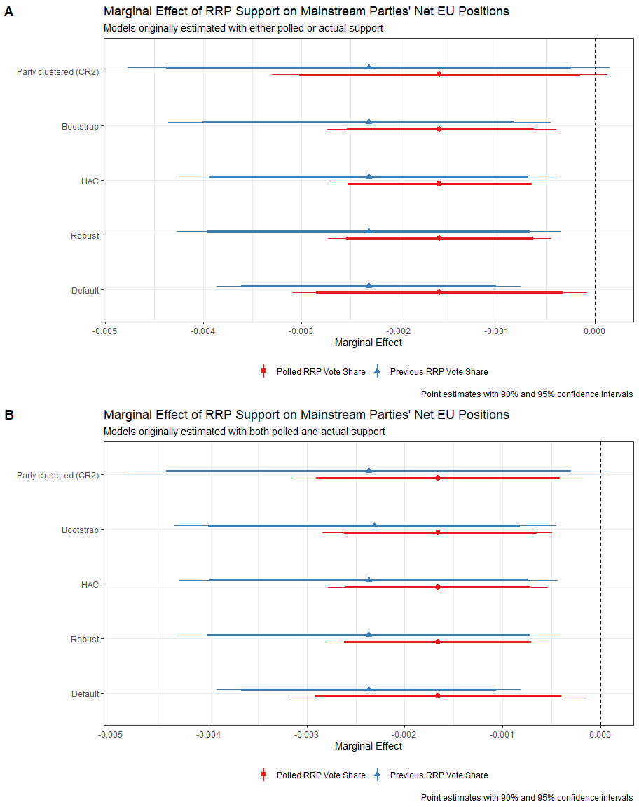<!-- -->

``` r
#ggsave("marginal_effects_SE.png", device = "png", width = 9.5, height = 12)
```
