Regression Prep
================
Duarte Amaro
2025-06-13

## Model structure and variables

The DV is EU position, measured as share of Eurosceptic sentences
aggregated at the party level.

The controls are RRP voteshare, own party vote loss, time to the next
parliamentary election, time to the next European election, party size
(in terms of vote share), current government participation, a proxy for
public support for the EU in the country, a recession dummy variable,
and coalition inclusion probabilities.

## Cleaning LLM-Classified Speeches

``` r
data0 <- read_csv("EU_Speeches_classified.csv") |>
  mutate(
    year = as.numeric(format(date, "%Y")),
    year_month = as.factor(format(date, "%Y-%m"))
  ) |>
  rename(country = iso3country,
         eu_stance = EU_2,
         partyfacts_id = party.facts.id)
```

    ## New names:
    ## Rows: 1484408 Columns: 14
    ## ── Column specification
    ## ──────────────────────────────────────────────────────── Delimiter: "," chr
    ## (5): speaker, party, parliament, iso3country, sentence dbl (7): ...1,
    ## speechnumber, party.facts.id, terms, speech_ID, EU, EU_2 lgl (1): chair date
    ## (1): date
    ## ℹ Use `spec()` to retrieve the full column specification for this data. ℹ
    ## Specify the column types or set `show_col_types = FALSE` to quiet this message.
    ## • `` -> `...1`

``` r
summary(data0)
```

    ##       ...1              date             speechnumber      speaker         
    ##  Min.   :      1   Min.   :1999-01-11   Min.   :   1.0   Length:1484408    
    ##  1st Qu.: 371103   1st Qu.:2004-04-27   1st Qu.:  67.0   Class :character  
    ##  Median : 742205   Median :2009-10-29   Median : 176.0   Mode  :character  
    ##  Mean   : 742205   Mean   :2009-07-09   Mean   : 215.5                     
    ##  3rd Qu.:1113306   3rd Qu.:2014-07-22   3rd Qu.: 325.0                     
    ##  Max.   :1484408   Max.   :2019-12-17   Max.   :2407.0                     
    ##                                                                            
    ##     party           partyfacts_id    chair             terms        
    ##  Length:1484408     Min.   :  45   Mode :logical   Min.   :    1.0  
    ##  Class :character   1st Qu.: 487   FALSE:1484408   1st Qu.:  207.0  
    ##  Mode  :character   Median :1178                   Median :  555.0  
    ##                     Mean   :1023                   Mean   :  773.7  
    ##                     3rd Qu.:1516                   3rd Qu.: 1036.0  
    ##                     Max.   :5855                   Max.   :19163.0  
    ##                                                                     
    ##   parliament          country            speech_ID         sentence        
    ##  Length:1484408     Length:1484408     Min.   :      1   Length:1484408    
    ##  Class :character   Class :character   1st Qu.:  59275   Class :character  
    ##  Mode  :character   Mode  :character   Median : 193010   Mode  :character  
    ##                                        Mean   : 314001                     
    ##                                        3rd Qu.: 462103                     
    ##                                        Max.   :1247692                     
    ##                                                                            
    ##        EU      eu_stance           year        year_month     
    ##  Min.   :1   Min.   :0.0000   Min.   :1999   2000-11:  13815  
    ##  1st Qu.:1   1st Qu.:0.0000   1st Qu.:2004   2011-11:  12282  
    ##  Median :1   Median :1.0000   Median :2009   2008-06:  11960  
    ##  Mean   :1   Mean   :0.7339   Mean   :2009   2011-03:  11833  
    ##  3rd Qu.:1   3rd Qu.:1.0000   3rd Qu.:2014   2005-06:  11719  
    ##  Max.   :1   Max.   :1.0000   Max.   :2019   2015-06:  10862  
    ##                                              (Other):1411937

``` r
sum(is.na(data0$eu_stance)) ## Confirming all speeches have been assigned EU stance
```

    ## [1] 0

``` r
nonEU_speeches <- read_csv("NonEU_Speeches.csv") |>
  mutate(
    eu_stance = 0,
    year = as.numeric(format(date, "%Y")),
    year_month = as.factor(format(date, "%Y-%m"))
  ) |>
  rename(country = iso3country,
         partyfacts_id = party.facts.id) |>
  dplyr::select(-"Unnamed: 0")
```

    ## New names:
    ## Rows: 18310060 Columns: 14
    ## ── Column specification
    ## ──────────────────────────────────────────────────────── Delimiter: "," chr
    ## (5): speaker, party, parliament, iso3country, sentence dbl (7): ...1,
    ## speechnumber, party.facts.id, terms, speech_ID, EU, Unnamed: 0 lgl (1): chair
    ## date (1): date
    ## ℹ Use `spec()` to retrieve the full column specification for this data. ℹ
    ## Specify the column types or set `show_col_types = FALSE` to quiet this message.
    ## • `` -> `...1`

``` r
nonEU_speeches_UK <- read_csv("UK_NonEU.csv") |>
  mutate(
    eu_stance = 0,
    year = as.numeric(format(date, "%Y")),
    year_month = as.factor(format(date, "%Y-%m"))
  ) |>
  rename(country = iso3country,
         partyfacts_id = party.facts.id)
```

    ## New names:
    ## Rows: 11431996 Columns: 13
    ## ── Column specification
    ## ──────────────────────────────────────────────────────── Delimiter: "," chr
    ## (5): speaker, party, parliament, iso3country, sentence dbl (6): ...1,
    ## speechnumber, party.facts.id, terms, speech_ID, EU lgl (1): chair date (1):
    ## date
    ## ℹ Use `spec()` to retrieve the full column specification for this data. ℹ
    ## Specify the column types or set `show_col_types = FALSE` to quiet this message.
    ## • `` -> `...1`

``` r
data0.2 <- data0 |>
  bind_rows(
    nonEU_speeches
  ) |>
  bind_rows(
    nonEU_speeches_UK
  )
```

## Cleaning ParlGov and merging with speeches

``` r
## Getting parlgov and partyfacts codes:

partyfacts_to_parlgov <- read_csv("partyfacts-external-parties.csv") |>
  filter((partyfacts_id %in% unique(data0$partyfacts_id) | partyfacts_id == 540) & # For some reason, PartyFacts codes LibDems differently for ParlGov
           dataset_key == "parlgov" &
           year_last >= 1998) |>
  rename(parlgov_id = dataset_party_id,
         parlgov_country = country)
```

    ## Warning: One or more parsing issues, call `problems()` on your data frame for details,
    ## e.g.:
    ##   dat <- vroom(...)
    ##   problems(dat)

    ## Rows: 45385 Columns: 17
    ## ── Column specification ────────────────────────────────────────────────────────
    ## Delimiter: ","
    ## chr  (8): country, dataset_key, dataset_party_id, name_short, name, name_eng...
    ## dbl  (6): year_first, year_last, share, share_year, external_id, partyfacts_id
    ## dttm (3): created, modified, linked
    ## 
    ## ℹ Use `spec()` to retrieve the full column specification for this data.
    ## ℹ Specify the column types or set `show_col_types = FALSE` to quiet this message.

``` r
## Merging partyfacts and parlgov codes with speeches

data <- data0.2 |> 
  dplyr::select(country, party, partyfacts_id) |> 
  distinct() |> 
  mutate(partyfacts_id = case_when(
    partyfacts_id == 1388 ~ 540, # LibDems in ParlGov
    .default = partyfacts_id
  )) |>
  full_join(partyfacts_to_parlgov, by = "partyfacts_id") |> 
  dplyr::select(country, partyfacts_id, parlgov_id, party, name_short, name, name_english) |>
  full_join(data0.2 |> 
  mutate(partyfacts_id = case_when(
    partyfacts_id == 1388 ~ 540, # LibDems in ParlGov
    .default = partyfacts_id
  )), by = c("country", "partyfacts_id", "party")) |>
  mutate(parlgov_id = as.numeric(parlgov_id))

nrow(data) == nrow(data0.2) # Confirming we don't have a many-to-many relationship and we keep the same number of rows
```

    ## [1] TRUE

``` r
## Getting election results from parlgov

parlgov_elections <- read_csv("view_election.csv") |>
  filter(country_name_short %in% c("AUT", "DEU", "DNK", "ESP", "GBR", "NLD", "SWE") &
           election_date > as.Date("1990-01-01")) |>
  mutate(
    country = case_when(
      country_name_short == "AUT" ~ "AUS",
      is.na(country_name_short) ~ NA,
      .default = country_name_short
    )
  ) |>
  dplyr::select(c(country, election_type, election_date, 
                  vote_share, party_name_short, party_name, 
                  party_name_english, party_id)) 
```

    ## Rows: 9016 Columns: 16
    ## ── Column specification ────────────────────────────────────────────────────────
    ## Delimiter: ","
    ## chr  (6): country_name_short, country_name, election_type, party_name_short,...
    ## dbl  (9): vote_share, seats, seats_total, left_right, country_id, election_i...
    ## date (1): election_date
    ## 
    ## ℹ Use `spec()` to retrieve the full column specification for this data.
    ## ℹ Specify the column types or set `show_col_types = FALSE` to quiet this message.

``` r
## Getting right-wing populist parties

rrp_results <- parlgov_elections |>
  left_join(read_csv("view_party.csv") |>
              filter(country_name_short %in% c("AUT", "DEU", "DNK", "ESP", "GBR", "NLD", "SWE")) |>
              mutate(
                country = case_when(
                  country_name_short == "AUT" ~ "AUS",
                  is.na(country_name_short) ~ NA,
                  .default = country_name_short)
                ) |>
              dplyr::select(c(country, family_name, party_id))
            ) |>
  filter(family_name == "Right-wing") 
```

    ## Rows: 1707 Columns: 23
    ## ── Column specification ────────────────────────────────────────────────────────
    ## Delimiter: ","
    ## chr  (8): country_name_short, country_name, party_name_short, party_name_eng...
    ## dbl (15): left_right, state_market, liberty_authority, eu_anti_pro, cmp, eup...
    ## 
    ## ℹ Use `spec()` to retrieve the full column specification for this data.
    ## ℹ Specify the column types or set `show_col_types = FALSE` to quiet this message.
    ## Joining with `by = join_by(country, party_id)`

``` r
tibble(rrp_results |> 
         dplyr::select(country, party_name_short, party_name_english) |>
         distinct())
```

    ## # A tibble: 25 × 3
    ##    country party_name_short party_name_english                                  
    ##    <chr>   <chr>            <chr>                                               
    ##  1 AUS     FPO              Freedom Party of Austria                            
    ##  2 AUS     BZO              Alliance for the Future of Austria                  
    ##  3 DEU     Rep              The Republicans                                     
    ##  4 DEU     BFB              Confederation of free citizens -- Offensive for Ger…
    ##  5 DEU     DVU              German People's Union                               
    ##  6 DEU     NPD              National Democratic Party                           
    ##  7 DEU     AfD              Alternative for Germany                             
    ##  8 DNK     DF               Danish People's Party                               
    ##  9 DNK     NB               The New Right                                       
    ## 10 DNK     SK               Hard Line                                           
    ## # ℹ 15 more rows

``` r
## Merging with election results to have sum RRP voteshare

parlgov_elections <- parlgov_elections |>
  left_join(
    rrp_results |> 
      group_by(election_date, election_type, country) |>
      mutate(rrp_voteshare = sum(vote_share, na.rm = TRUE)) |>
      ungroup() |> 
      dplyr::select(country, election_type, election_date, rrp_voteshare) |>
      distinct(),
    by = c("country", "election_type", "election_date")
    )

## Getting cabinet composition data

parlgov_cab <- read_csv("view_cabinet.csv") |>
      filter(country_name_short %in% c("AUT", "DEU", "DNK", "ESP", "GBR", "NLD", "SWE") &
               election_date > as.Date("1990-01-01")) |>
      mutate(
        country = case_when(
        country_name_short == "AUT" ~ "AUS",
        is.na(country_name_short) ~ NA,
        .default = country_name_short
        )
        ) |>
      dplyr::select(c(country, election_date, start_date, 
                      cabinet_name, cabinet_party, party_id,
                      cabinet_id)) 
```

    ## Rows: 12659 Columns: 19
    ## ── Column specification ────────────────────────────────────────────────────────
    ## Delimiter: ","
    ## chr   (6): country_name_short, country_name, cabinet_name, party_name_short,...
    ## dbl  (11): caretaker, cabinet_party, prime_minister, seats, election_seats_t...
    ## date  (2): election_date, start_date
    ## 
    ## ℹ Use `spec()` to retrieve the full column specification for this data.
    ## ℹ Specify the column types or set `show_col_types = FALSE` to quiet this message.

``` r
## Getting election dates

election_dates <- parlgov_elections |>
  dplyr::select(country, election_type, election_date) |>
  mutate(
    election_year_month = as.factor(format(election_date, "%Y-%m"))
  ) |>
  distinct()

## Calculating time to next election

data_election_dates <- data |>
  dplyr::select(country, year_month) |>
  distinct() |> # I now want to match the dates to the next closest election:
  left_join(election_dates |> 
              filter(election_type == "parliament") |>
              dplyr::select(country, election_year_month), 
            by = "country") |>
  mutate(
    time_to_last = round(as.numeric(difftime(as.Date(paste(year_month, "-01", sep = "")),
                                             as.Date(paste(election_year_month, "-01", sep = "")),
                                             units = "days"))/30)
    ) |>
  filter(time_to_last >= 0) |> 
  group_by(country, year_month) |>
  filter(time_to_last == min(time_to_last)) |>
  ungroup() |>
  rename(last_election_year_month = election_year_month) |>
  dplyr::select(-time_to_last) |>
  left_join(
    data |>
      dplyr::select(country, year_month) |>
      distinct() |> # I now want to match the dates to the next closest election:
      left_join(election_dates |> 
                  filter(election_type == "parliament") |>
                  dplyr::select(country, election_year_month), 
                by = "country") |>
      mutate(
        time_to_next = round(as.numeric(difftime(as.Date(paste(election_year_month, "-01", sep = "")),
                                                 as.Date(paste(year_month, "-01", sep = "")),
                                                 units = "days"))/30)
        ) |>
      filter(time_to_next >= 0) |> 
      group_by(country, year_month) |>
      filter(time_to_next == min(time_to_next)) |>
      ungroup() |>
      rename(next_election_year_month = election_year_month)) |>
  left_join(election_dates |> 
              filter(election_type == "ep") |>
              rename(election_year_month_ep = election_year_month) |>
              dplyr::select(country, election_year_month_ep) |>
              bind_rows(tibble(country = c("NLD", "GBR"), 
                               election_year_month_ep = c("2024-06", "2024-06"))), 
            by = "country") |> 
  mutate(
    time_to_next_ep = round(as.numeric(difftime(as.Date(paste(election_year_month_ep, "-01", sep = "")),
                                                as.Date(paste(year_month, "-01", sep = "")),
                                                units = "days")
                                  ) / 30)
  ) |> 
  filter(time_to_next_ep >= 0) |>
  group_by(country, year_month) |>
  filter(time_to_next_ep == min(time_to_next_ep)) |>
  ungroup() |>
  mutate(
    time_to_next_ep = case_when(
      country == "GBR" & election_year_month_ep == "2024-06" ~ NA,
      .default = time_to_next_ep
    ),
    election_year_month_ep = case_when(
      country == "GBR" & election_year_month_ep == "2024-06" ~ NA,
      .default = election_year_month_ep
    ),
  ) |>
  rename(next_election_year_month_ep = election_year_month_ep)
```

    ## Warning in left_join(distinct(dplyr::select(data, country, year_month)), : Detected an unexpected many-to-many relationship between `x` and `y`.
    ## ℹ Row 1 of `x` matches multiple rows in `y`.
    ## ℹ Row 57 of `y` matches multiple rows in `x`.
    ## ℹ If a many-to-many relationship is expected, set `relationship =
    ##   "many-to-many"` to silence this warning.

    ## Warning in left_join(distinct(dplyr::select(data, country, year_month)), : Detected an unexpected many-to-many relationship between `x` and `y`.
    ## ℹ Row 1 of `x` matches multiple rows in `y`.
    ## ℹ Row 57 of `y` matches multiple rows in `x`.
    ## ℹ If a many-to-many relationship is expected, set `relationship =
    ##   "many-to-many"` to silence this warning.

    ## Joining with `by = join_by(country, year_month)`

    ## Warning in left_join(left_join(dplyr::select(rename(ungroup(filter(group_by(filter(mutate(left_join(distinct(dplyr::select(data, : Detected an unexpected many-to-many relationship between `x` and `y`.
    ## ℹ Row 1 of `x` matches multiple rows in `y`.
    ## ℹ Row 38 of `y` matches multiple rows in `x`.
    ## ℹ If a many-to-many relationship is expected, set `relationship =
    ##   "many-to-many"` to silence this warning.

``` r
## Doing the same for cabinets (but we're only interested in keeping the current cabinet)

cab_dates <- parlgov_cab |>
  dplyr::select(country, start_date, cabinet_id) |>
  mutate(
    start_year_month = as.factor(format(start_date, "%Y-%m"))
  ) |>
  distinct()

data_cab_dates <- data |>
  dplyr::select(country, year_month) |>
  distinct() |> # I now want to match the dates to the next closest cabinet:
  left_join(cab_dates |> 
              dplyr::select(country, start_year_month, cabinet_id), 
            by = "country") |>
  mutate(
    time_to_next_cab = round(as.numeric(difftime(as.Date(paste(start_year_month, "-01", sep = "")),
                                                  as.Date(paste(year_month, "-01", sep = "")),
                                                  units = "days")
                                    )/30)
  ) |> 
  filter(time_to_next_cab <= 0) |> # We only want cabinets whose start date is in the past
  group_by(country, year_month) |>
  filter(time_to_next_cab == max(time_to_next_cab)) |> # But for any given date we just want to closest past cabinet
  ungroup() |> 
  dplyr::select(-time_to_next_cab) # The time difference variable isn't of interest
```

    ## Warning in left_join(distinct(dplyr::select(data, country, year_month)), : Detected an unexpected many-to-many relationship between `x` and `y`.
    ## ℹ Row 1 of `x` matches multiple rows in `y`.
    ## ℹ Row 85 of `y` matches multiple rows in `x`.
    ## ℹ If a many-to-many relationship is expected, set `relationship =
    ##   "many-to-many"` to silence this warning.

``` r
## Now to get a single data_dates dataframe:

data_dates <- data_election_dates |>
  full_join(data_cab_dates, by = c("country", "year_month"))

## Merging speeches with election results

vote_changes <- parlgov_elections |>  # Calculating change in voteshare
              filter(election_type == "parliament") |>
              dplyr::select(country, election_date, party_name_short, vote_share, party_id, rrp_voteshare) |>
              group_by(party_id) |>
              mutate(
                change_voteshare = vote_share - lag(vote_share, order_by = election_date)
                ) |>
              ungroup() |>
              mutate(last_election_year_month = as.factor(format(election_date, "%Y-%m"))) |>
              rename(parlgov_id = party_id)

data <- data |>
  left_join(data_dates, 
            by = c("country", "year_month")) |> 
  left_join(vote_changes,
            by = c("country", "parlgov_id", "last_election_year_month")
            ) |>
  left_join(parlgov_cab |>
              mutate(start_year_month = as.factor(format(start_date, "%Y-%m"))) |>
              rename(parlgov_id = party_id) |>
              dplyr::select(country, start_year_month, cabinet_id, cabinet_name, cabinet_party, parlgov_id),
            by = c("country", "start_year_month", "cabinet_id", "parlgov_id"))

nrow(data) == nrow(data0.2)
```

    ## [1] TRUE

The main control variables are now in the `data` dataframe, which
contains the speeches classified by LLMs, the party information, and the
election results.

The controls are RRP voteshare, own party vote loss, time to the next
parliamentary election, time to the next European election, party size
(in terms of vote share), current government participation, a proxy for
public support for the EU in the country, a recession dummy variable,
and coalition inclusion probabilities.

| Variable                                  | Variable name      |
|-------------------------------------------|--------------------|
| RRP vote share in the last election       | `rrp_voteshare`    |
| Own party vote share in the last election | `vote_share`       |
| Change in own party vote share            | `change_voteshare` |
| Time to the next parliamentary election   | `time_to_next`     |
| Time to the next European election        | `time_to_next_ep`  |
| Current government participation          | `cabinet_party`    |

Variable names in the dataset

## Plotting the frequency of speeches by country

``` r
## Per month:

data |>
  #filter(eu_stance == 1) |>
  group_by(country, year_month) |> 
  summarise(
    n = n(),
    prop_eu = 100*mean(eu_stance)
  ) |> 
  ungroup() |>
  left_join(data_dates, 
            by = c("country", "year_month")) |>
  ggplot(aes(x = year_month, y = prop_eu)) +
  geom_path(group=1) +
  geom_vline(aes(xintercept = next_election_year_month), linetype = "dashed", color = "black") +
  geom_vline(aes(xintercept = next_election_year_month_ep), linetype = "dotted", color = "blue") +
  facet_wrap(~country) +
  labs(x = "Year",
       y = "Share of sentences about the EU",
       title = "Share of sentences about the EU by country",
       subtitle = "Black dotted lines are parliamentary elections, dotted blue lines are European elections") +
  scale_x_discrete(breaks = c("1999-01", "2004-01", "2009-01", "2014-01", "2019-01"),
                    labels = c("1999", "2004", "2009", "2014", "2019")) +
  theme(panel.spacing.x = unit(5, "mm"))
```

    ## `summarise()` has grouped output by 'country'. You can override using the
    ## `.groups` argument.

    ## Warning: Removed 6 rows containing missing values or values outside the scale range
    ## (`geom_vline()`).

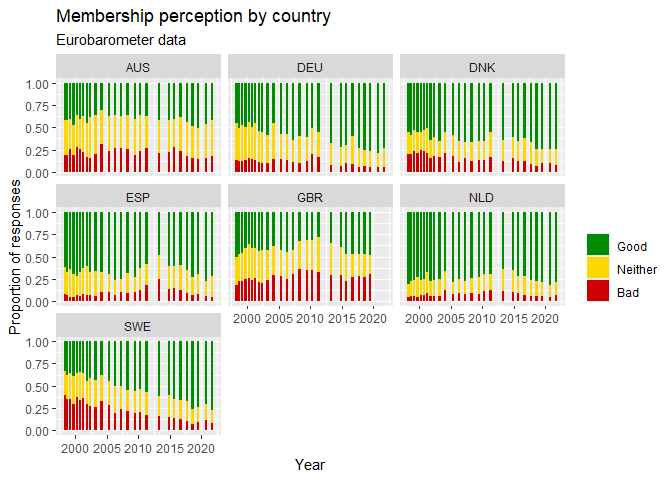<!-- -->

``` r
## Per year:

data |>
  dplyr::select(-year_month) |>
  #filter(eu_stance == 1) |>
  group_by(country, year) |> 
  summarise(
    n = n(),
    prop_eu = 100*mean(eu_stance)
  ) |> 
  ungroup() |>
  # left_join(data_dates, 
  #           by = c("country", "year")) |>
  ggplot(aes(x = year, y = prop_eu)) +
  geom_path(group=1) +  
  # geom_vline(aes(xintercept = election_year_month), linetype = "dashed", color = "black") +
  # geom_vline(aes(xintercept = election_year_month_ep), linetype = "dotted", color = "blue") +
  facet_wrap(~country) +
  labs(x = "Year",
       y = "Share of sentences about the EU",
       title = "Share of sentences about the EU by country",
       subtitle = "Black dotted lines are parliamentary elections, dotted blue lines are European elections") +
  theme(panel.spacing.x = unit(5, "mm"))
```

    ## `summarise()` has grouped output by 'country'. You can override using the
    ## `.groups` argument.

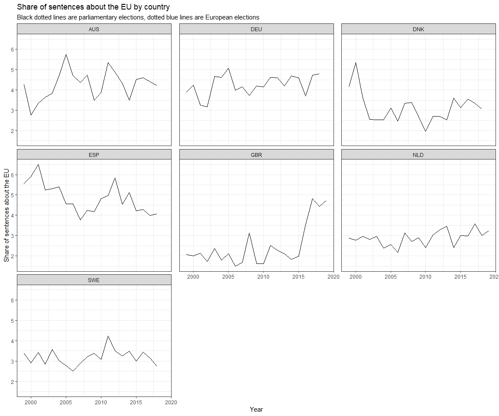<!-- -->

## Now doing the same by party for each country:

``` r
data |>
  filter(country == "AUS") |>
  group_by(name_short, year_month) |> 
  summarise(
    n = n(),
    prop_eu = 100*mean(eu_stance)
  ) |> 
  ungroup() |> 
  left_join(data_dates |>
              filter(country == "AUS"), 
            by = c("year_month")) |>
  ggplot(aes(x = year_month, y = prop_eu)) +
  geom_path(group=1) +  
  geom_vline(aes(xintercept = next_election_year_month), linetype = "dashed", color = "black") +
  geom_vline(aes(xintercept = next_election_year_month_ep), linetype = "dotted", color = "blue") +
  facet_wrap(~ name_short) +
  labs(x = "Year",
       y = "Share of sentences about the EU",
       title = "Share of sentences about the EU in Austria by party") +
  scale_x_discrete(breaks = c("1999-01", "2004-01", "2009-01", "2014-01", "2019-01"),
                   labels = c("1999", "2004", "2009", "2014", "2019")) +
  theme(panel.spacing.x = unit(5, "mm"))
```

    ## `summarise()` has grouped output by 'name_short'. You can override using the
    ## `.groups` argument.

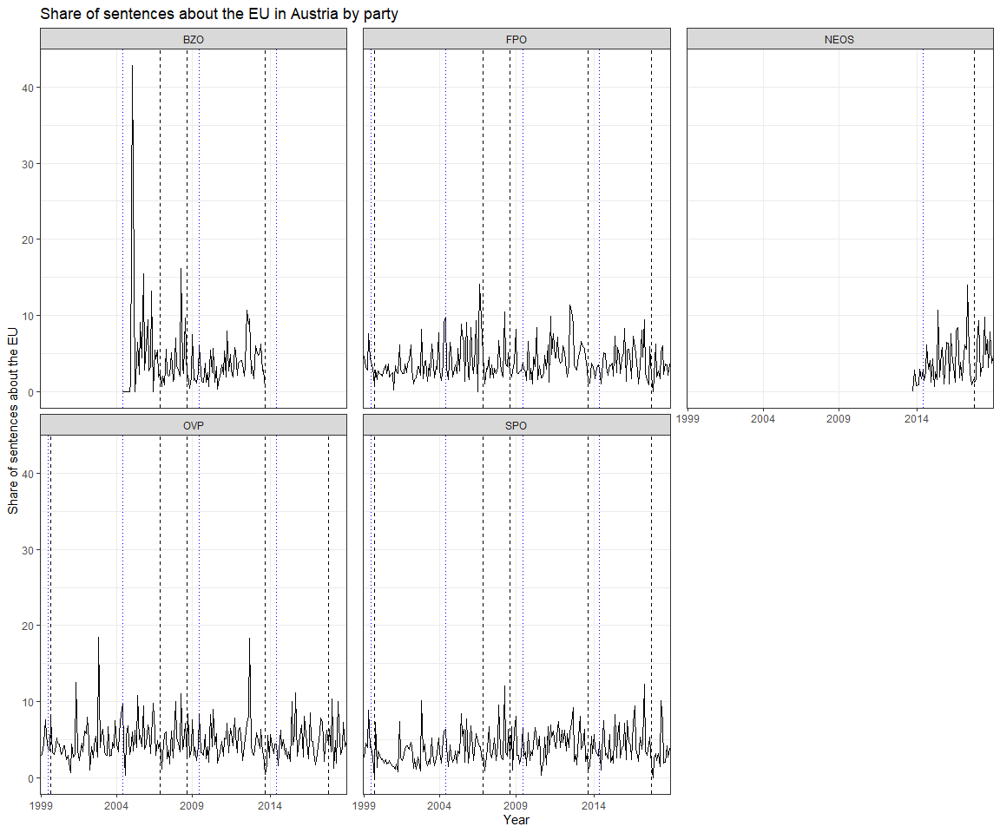<!-- -->

``` r
data |>
  filter(country == "DEU") |>
  group_by(name_short, year_month) |> 
  summarise(
    n = n(),
    prop_eu = 100*mean(eu_stance)
  ) |> 
  ungroup() |> 
  left_join(data_dates |>
              filter(country == "DEU"), 
            by = c("year_month")) |>
  ggplot(aes(x = year_month, y = prop_eu)) +
  geom_path(group=1) +  
  geom_vline(aes(xintercept = next_election_year_month), linetype = "dashed", color = "black") +
  geom_vline(aes(xintercept = next_election_year_month_ep), linetype = "dotted", color = "blue") + 
  facet_wrap(~ name_short) +
  labs(x = "Year",
       y = "Share of sentences about the EU",
       title = "Share of sentences about the EU in Germany by party") +
  scale_x_discrete(breaks = c("1999-01", "2004-01", "2009-01", "2014-01", "2019-01"),
                   labels = c("1999", "2004", "2009", "2014", "2019")) +
  theme(panel.spacing.x = unit(5, "mm"))
```

    ## `summarise()` has grouped output by 'name_short'. You can override using the
    ## `.groups` argument.

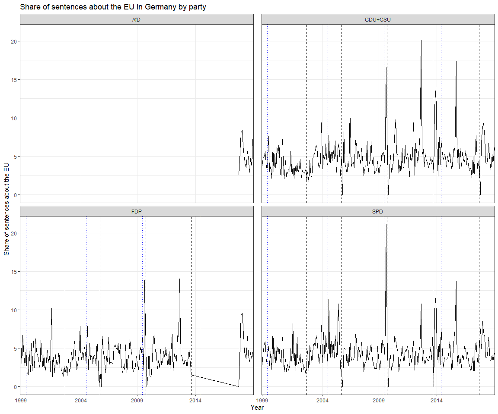<!-- -->

``` r
data |>
  filter(country == "DNK") |>
  group_by(name_short, year_month) |> 
  summarise(
    n = n(),
    prop_eu = 100*mean(eu_stance)
  ) |> 
  ungroup() |> 
  left_join(data_dates |>
              filter(country == "DNK"), 
            by = c("year_month")) |>
  ggplot(aes(x = year_month, y = prop_eu)) +
  geom_path(group=1) +  
  geom_vline(aes(xintercept = next_election_year_month), linetype = "dashed", color = "black") +
  geom_vline(aes(xintercept = next_election_year_month_ep), linetype = "dotted", color = "blue") +
  facet_wrap(~ name_short) +
  labs(x = "Year",
       y = "Share of sentences about the EU",
       title = "Share of sentences about the EU in Denmark by party") +
  scale_x_discrete(breaks = c("1999-01", "2004-01", "2009-01", "2014-01", "2019-01"),
                   labels = c("1999", "2004", "2009", "2014", "2019")) +
  theme(panel.spacing.x = unit(5, "mm"))
```

    ## `summarise()` has grouped output by 'name_short'. You can override using the
    ## `.groups` argument.

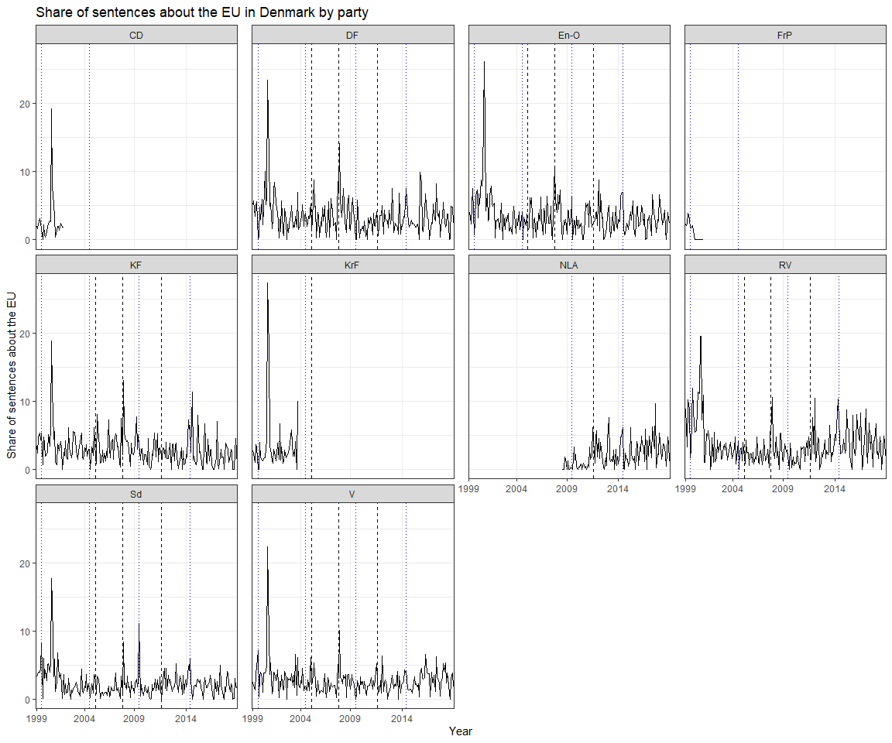<!-- -->

``` r
data |>
  filter(country == "ESP") |>
  group_by(name_short, year_month) |> 
  summarise(
    n = n(),
    prop_eu = 100*mean(eu_stance)
  ) |> 
 ungroup() |> 
left_join(data_dates |>
            filter(country == "ESP"), 
          by = c("year_month")) |>
  ggplot(aes(x = year_month, y = prop_eu)) +
  geom_path(group=1) +  
  geom_vline(aes(xintercept = next_election_year_month), linetype = "dashed", color = "black") +
  geom_vline(aes(xintercept = next_election_year_month_ep), linetype = "dotted", color = "blue") +
  facet_wrap(~ name_short, ncol = 1) +
  labs(x = "Year",
       y = "Share of sentences about the EU",
       title = "Share of sentences about the EU in Spain by party") +
  scale_x_discrete(breaks = c("1999-01", "2004-01", "2009-01", "2014-01", "2019-01"),
                   labels = c("1999", "2004", "2009", "2014", "2019")) +
  theme(panel.spacing.x = unit(5, "mm"))
```

    ## `summarise()` has grouped output by 'name_short'. You can override using the
    ## `.groups` argument.

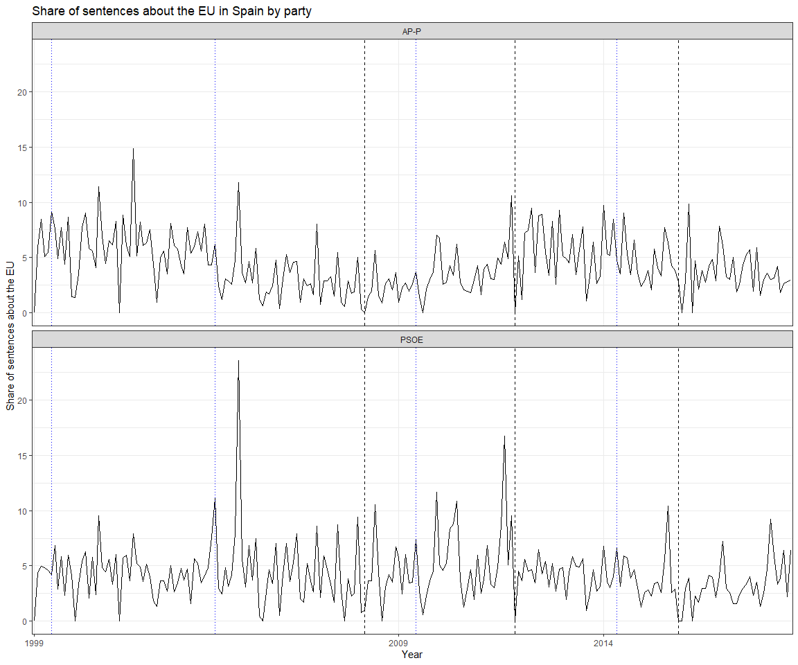<!-- -->

``` r
data |>
  filter(country == "GBR") |>
  group_by(name_short, year_month) |> 
  summarise(
    n = n(),
    prop_eu = 100*mean(eu_stance)
  ) |> 
  ungroup() |> 
  left_join(data_dates |>
              filter(country == "GBR"), 
            by = c("year_month")) |>
  ggplot(aes(x = year_month, y = prop_eu)) +
  geom_path(group=1) +  
  geom_vline(aes(xintercept = next_election_year_month), linetype = "dashed", color = "black") +
  geom_vline(aes(xintercept = next_election_year_month_ep), linetype = "dotted", color = "blue") + 
  facet_wrap(~ name_short) +
  labs(x = "Year",
       y = "Share of sentences about the EU",
       title = "Share of sentences about the EU in the UK by party") +
  scale_x_discrete(breaks = c("1999-01", "2004-01", "2009-01", "2014-01", "2019-01"),
                   labels = c("1999", "2004", "2009", "2014", "2019")) +
  theme(panel.spacing.x = unit(5, "mm"))
```

    ## `summarise()` has grouped output by 'name_short'. You can override using the
    ## `.groups` argument.

    ## Warning: Removed 18 rows containing missing values or values outside the scale range
    ## (`geom_vline()`).

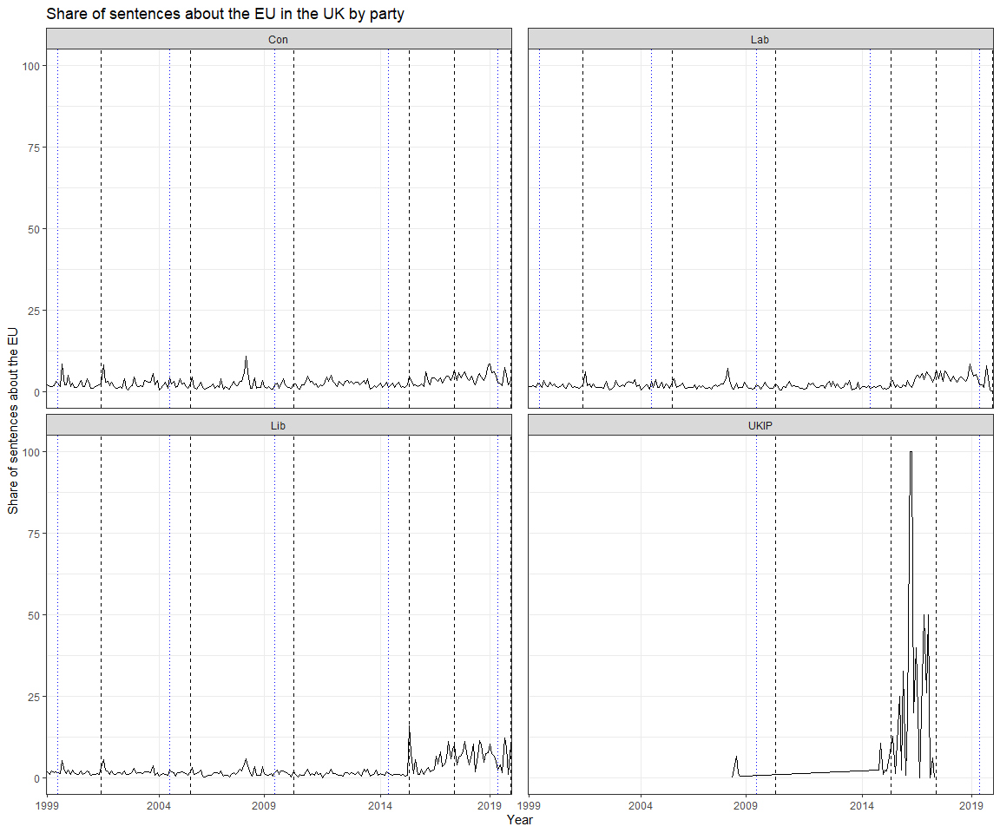<!-- -->

``` r
data |>
  filter(country == "NLD") |>
  group_by(name_short, year_month) |> 
  summarise(
    n = n(),
    prop_eu = 100*mean(eu_stance)
  ) |> 
  ungroup() |> 
  left_join(data_dates |>
              filter(country == "NLD"), 
            by = c("year_month")) |>
  ggplot(aes(x = year_month, y = prop_eu)) +
  geom_path(group=1) +  
  geom_vline(aes(xintercept = next_election_year_month), linetype = "dashed", color = "black") +
  geom_vline(aes(xintercept = next_election_year_month_ep), linetype = "dotted", color = "blue") +
  facet_wrap(~ name_short) +
  labs(x = "Year",
       y = "Share of sentences about the EU",
       title = "Share of sentences about the EU in the Netherlands by party") +
  scale_x_discrete(breaks = c("1999-01", "2004-01", "2009-01", "2014-01", "2019-01"),
                   labels = c("1999", "2004", "2009", "2014", "2019")) +
  theme(panel.spacing.x = unit(5, "mm"))
```

    ## `summarise()` has grouped output by 'name_short'. You can override using the
    ## `.groups` argument.

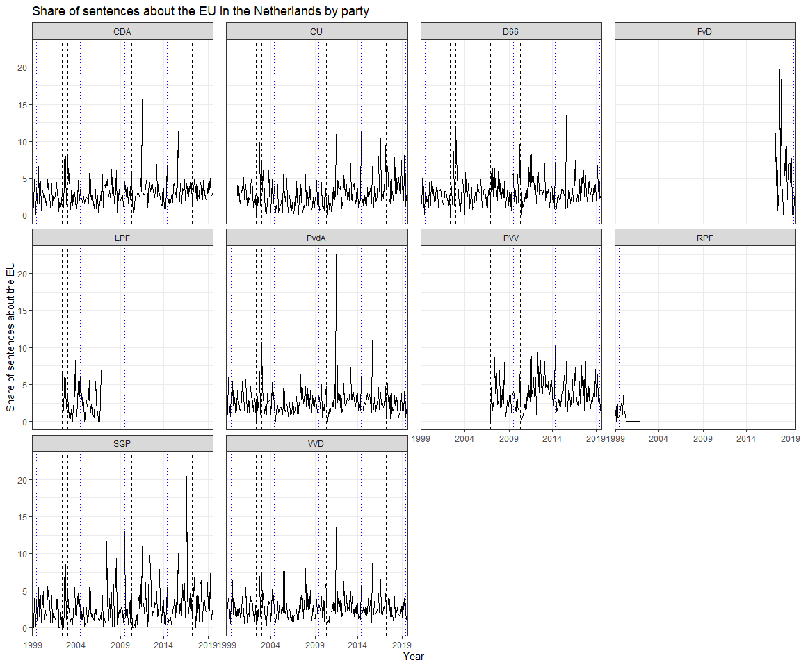<!-- -->

``` r
data |>
  filter(country == "SWE") |>
  group_by(name_short, year_month) |> 
  summarise(
    n = n(),
    prop_eu = 100*mean(eu_stance)
  ) |> 
  ungroup() |> 
  left_join(data_dates |>
              filter(country == "SWE"), 
            by = c("year_month")) |>
  ggplot(aes(x = year_month, y = prop_eu)) +
  geom_path(group=1) +  
  geom_vline(aes(xintercept = next_election_year_month), linetype = "dashed", color = "black") +
  geom_vline(aes(xintercept = next_election_year_month_ep), linetype = "dotted", color = "blue") +
  facet_wrap(~ name_short) +
  labs(x = "Year",
       y = "Share of sentences about the EU",
       title = "Share of sentences about the EU in Sweden by party") +
  scale_x_discrete(breaks = c("1999-01", "2004-01", "2009-01", "2014-01", "2019-01"),
                   labels = c("1999", "2004", "2009", "2014", "2019")) +
  theme(panel.spacing.x = unit(5, "mm"))
```

    ## `summarise()` has grouped output by 'name_short'. You can override using the
    ## `.groups` argument.

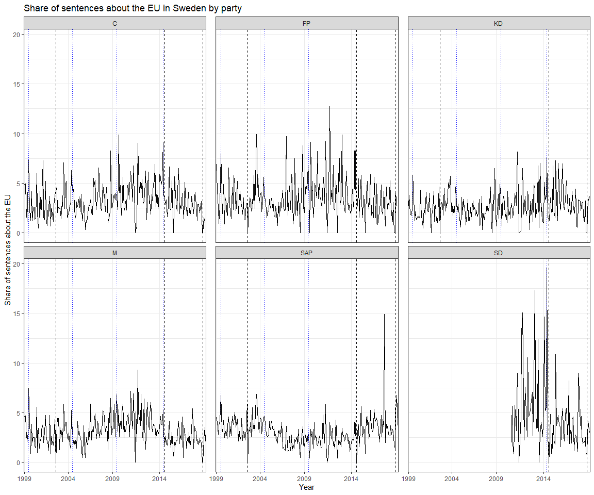<!-- -->

``` r
data |>
  group_by(country, name_short, year_month) |> 
  summarise(
    n = n(),
    prop_eu = 100*mean(eu_stance)
  ) |> 
  ungroup() |>
  ggplot(aes(x = reorder(name_short, prop_eu),
             y = prop_eu,
             colour = country,
             fill = country)) +
  geom_boxplot(alpha = 0.2) +
  #facet_wrap(~ country, scales = "free")
  coord_flip() +
  scale_color_brewer(name = "", palette = "Dark2") +
  scale_fill_brewer(name = "", palette = "Dark2") +
  labs(x = "", y = "Share of sentences about the EU",
       title = "Monthly share of sentences about the EU by party")
```

    ## `summarise()` has grouped output by 'country', 'name_short'. You can override
    ## using the `.groups` argument.

<!-- -->

``` r
data |>
  group_by(country, name_short, year) |> 
  summarise(
    n = n(),
    prop_eu = 100*mean(eu_stance)
  ) |> 
  ungroup() |>
  ggplot(aes(x = reorder(name_short, prop_eu),
             y = prop_eu,
             colour = country,
             fill = country)) +
  geom_boxplot(alpha = 0.2) +
  #facet_wrap(~ country, scales = "free")
  coord_flip() +
  scale_color_brewer(name = "", palette = "Dark2") +
  scale_fill_brewer(name = "", palette = "Dark2") +
  labs(x = "", y = "Share of sentences about the EU",
       title = "Yearly share of sentences about the EU by party")
```

    ## `summarise()` has grouped output by 'country', 'name_short'. You can override
    ## using the `.groups` argument.

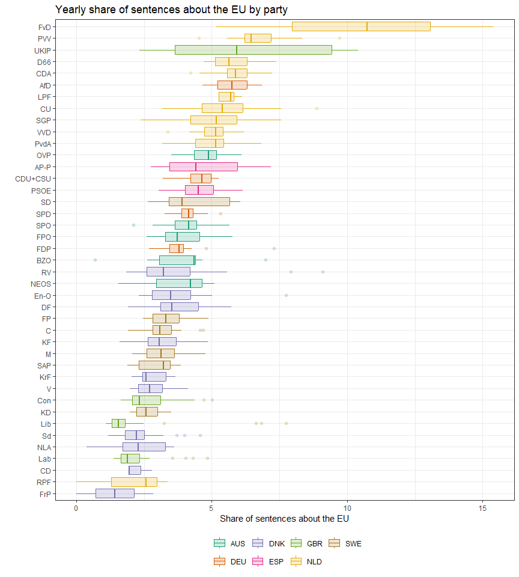<!-- -->

## Cleaning Eurobarometer data

``` r
eb70_02 <- haven::read_dta("ZA3521_v2-0-1.dta") |> 
  filter(year >= 1998 & nation2 %in% c(3, 4, 7, 9, 12, 17, 18)) |>
  mutate(
    nation2 = case_when(
      nation2 == 3 ~ "NLD",
      nation2 == 4 ~ "DEU",
      nation2 == 7 ~ "DNK",
      nation2 == 9 ~ "GBR", 
      nation2 == 12 ~ "ESP",
      nation2 == 17 ~ "SWE",
      nation2 == 18 ~ "AUS" 
    ) |> as.character()
  )
```

``` r
eb04_21 <- haven::read_dta("harmonised_EB_2004-2021_v3-0-0.dta") |> 
  filter(country %in% c(3, 4, 7, 9, 12, 17, 18)) |>
  mutate(
    country = case_when(
      country == 3 ~ "NLD",
      country == 4 ~ "DEU",
      country == 7 ~ "DNK",
      country == 9 ~ "GBR", 
      country == 12 ~ "ESP",
      country == 17 ~ "SWE",
      country == 18 ~ "AUS" 
    ),
    date = as.Date(as.character(intdate_end), format = "%Y%m%d"),
    year_moth = as.factor(format(date, "%Y-%m"))
  )
```

``` r
ebjoint_mem <- eb70_02 |>
    mutate(
    mem = case_when(
      membrshp == 1 ~ "Good",
      membrshp == 2 ~ "Neither",
      membrshp == 3 ~ "Bad",
      TRUE ~ NA_character_
    ) |> 
      factor(levels = c("Good", "Neither", "Bad"))
  ) |>
  dplyr::select(nation2, year, mem) |>
  rename(country = nation2) |>
  bind_rows(
    eb04_21 |>
    mutate(
    mem = case_when(
      mem == 1 ~ "Good",
      mem == 2 ~ "Neither",
      mem == 3 ~ "Bad",
      TRUE ~ NA_character_) |> 
      factor(levels = c("Good", "Neither", "Bad"))
    ) |>
      dplyr::select(country, year, mem)
  )

ebjoint_mem |>
  filter(!is.na(mem)) |>
  group_by(year, country, mem) |>
  summarise(
    count = n()
  ) |> 
  ungroup() |>
  ggplot(aes(fill = mem, y = count, x = year)) +
  geom_bar(position = "fill", stat = "identity") +
  facet_wrap(~ country) +
  scale_fill_manual(values = c("Good" = "green4", "Neither" = "gold", "Bad" = "red3"), name = "") +
  labs(x = "Year",
       y = "Proportion of responses",
       title = "Membership perception by country",
       subtitle = "Eurobarometer data")
```

    ## `summarise()` has grouped output by 'year', 'country'. You can override using
    ## the `.groups` argument.

<!-- -->

``` r
ebjoint_trust <- eb70_02 |>
    mutate(
    trustec = case_when(
      trustec == 1 ~ "Trust",
      trustec == 2 ~ "No Trust",
      TRUE ~ NA_character_
    ) |> as.factor()
  ) |>
  dplyr::select(nation2, year, trustec) |>
  rename(country = nation2) |>
  bind_rows(
    eb04_21 |>
    mutate(
    trustec = case_when(
      treu_com == 1 ~ "Trust",
      treu_com == 2 ~ "No Trust",
      TRUE ~ NA_character_) |> as.factor()
    ) |>
      dplyr::select(country, year, trustec)
  )

ebjoint_trust |>
  filter(!is.na(trustec)) |>
  group_by(year, country, trustec) |>
  # Now to get a count of each response to mem:
  summarise(
    count = n()
  ) |> 
  ungroup() |>
  ggplot(aes(fill = trustec, y = count, x = year)) +
  geom_bar(position = "fill", stat = "identity") +
  facet_wrap(~ country) +
  scale_fill_manual(values = c("Trust" = "green4", "No Trust" = "red3"), name = "") +
  labs(x = "Year",
       y = "Proportion of responses",
       title = "Trust in the European Commission by country",
       subtitle = "Eurobarometer data")
```

    ## `summarise()` has grouped output by 'year', 'country'. You can override using
    ## the `.groups` argument.

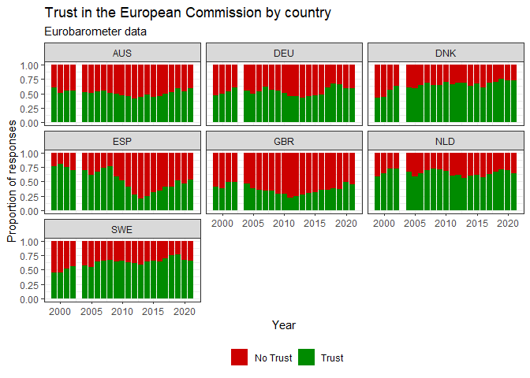<!-- -->

``` r
ebjoin <- eb70_02 |>
    mutate(
    mem = case_when(
      membrshp == 1 ~ "Good",
      membrshp == 2 ~ "Neither",
      membrshp == 3 ~ "Bad",
      TRUE ~ NA_character_) |> 
      factor(levels = c("Good", "Neither", "Bad")),
    trustec = case_when(
      trustec == 1 ~ "Trust",
      trustec == 2 ~ "No Trust",
      TRUE ~ NA_character_) |> 
      as.factor()
  ) |>
  dplyr::select(nation2, year, mem, trustec) |>
  rename(country = nation2) |>
  bind_rows(
    eb04_21 |>
    mutate(
    mem = case_when(
      mem == 1 ~ "Good",
      mem == 2 ~ "Neither",
      mem == 3 ~ "Bad",
      TRUE ~ NA_character_) |> 
      factor(levels = c("Good", "Neither", "Bad")),
    trustec = case_when(
      treu_com == 1 ~ "Trust",
      treu_com == 2 ~ "No Trust",
      TRUE ~ NA_character_) |> 
      as.factor()
    ) |>
      dplyr::select(country, year, mem, trustec)
  )

# Calculate the cronbach's alpha for the trust and membership variables
psych::alpha(ebjoin |>
               dplyr::select(mem, trustec) |>
  mutate(
    mem = as.numeric(mem),
    trustec = as.numeric(trustec)
  ) |>
  na.omit(),
  check.keys = T)
```

    ## Warning in psych::alpha(na.omit(mutate(dplyr::select(ebjoin, mem, trustec), : Some items were negatively correlated with the first principal component and were automatically reversed.
    ##  This is indicated by a negative sign for the variable name.

    ## 
    ## Reliability analysis   
    ## Call: psych::alpha(x = na.omit(mutate(dplyr::select(ebjoin, mem, trustec), 
    ##     mem = as.numeric(mem), trustec = as.numeric(trustec))), check.keys = T)
    ## 
    ##   raw_alpha std.alpha G6(smc) average_r S/N    ase mean   sd median_r
    ##        0.6      0.65    0.48      0.48 1.8 0.0021    2 0.55     0.48
    ## 
    ##     95% confidence boundaries 
    ##          lower alpha upper
    ## Feldt      0.6   0.6  0.61
    ## Duhachek   0.6   0.6  0.61
    ## 
    ##  Reliability if an item is dropped:
    ##         raw_alpha std.alpha G6(smc) average_r  S/N alpha se var.r med.r
    ## mem-         0.76      0.48    0.23      0.48 0.92       NA     0  0.48
    ## trustec      0.30      0.48    0.23      0.48 0.92       NA     0  0.48
    ## 
    ##  Item statistics 
    ##              n raw.r std.r r.cor r.drop mean   sd
    ## mem-    114025  0.92  0.86   0.6   0.48  2.4 0.78
    ## trustec 114025  0.78  0.86   0.6   0.48  1.6 0.49
    ## 
    ## Non missing response frequency for each item
    ##            1    2    3 miss
    ## mem     0.57 0.24 0.19    0
    ## trustec 0.42 0.58 0.00    0

## Cleaning Coalition Inclusion Probabilities

``` r
cip <- read.csv("CIP_dynamic_Austria_1995-2019.csv", sep = ";") |> 
  mutate(country = "AUS",
         date = str_replace_all(date, "\\.", "-"),
         date = as.Date(date, "%d-%m-%Y"),
         year_month = as.factor(format(date, "%Y-%m"))
         ) |>
  filter(is.na(excluding_parlgov_id)) |>
  dplyr::select(-c(excluding_parlgov_id, excluding)) |>
  bind_rows(
    read.csv("CIP_dynamic_Spain_1980-2019.csv", sep = ";") |> 
      mutate(country = "ESP",
             date = str_replace_all(date, "\\.", "-"),
             date = as.Date(date, "%d-%m-%Y"),
             year_month = as.factor(format(date, "%Y-%m"))
             ) |>
      filter(is.na(excluding_parlgov_id)) |>
      dplyr::select(-c(excluding_parlgov_id, excluding))
  ) |> 
  bind_rows(
    read.csv("CIP_dynamic_Sweden_1970-2019.csv", sep = ";") |> 
      mutate(country = "SWE",
             date = str_replace_all(date, "\\.", "-"),
             date = as.Date(date, "%d-%m-%Y"),
             year_month = as.factor(format(date, "%Y-%m"))
             ) |>
      filter(is.na(excluding_parlgov_id)) |>
      dplyr::select(-c(excluding_parlgov_id, excluding))
  ) |> 
  bind_rows(
    read.csv("CIP_dynamic_Denmark_1970-2019.csv", sep = ";") |> 
      mutate(country = "DNK",
             date = str_replace_all(date, "\\.", "-"),
             date = as.Date(date, "%d-%m-%Y"),
             year_month = as.factor(format(date, "%Y-%m"))
             ) |>
      filter(is.na(excluding_parlgov_id)) |>
      dplyr::select(-c(excluding_parlgov_id, excluding))
  ) |> 
  bind_rows(
    read.csv("CIP_dynamic_Germany_1970-2019.csv", sep = ";") |> 
      mutate(country = "DEU",
             date = str_replace_all(date, "\\.", "-"),
             date = as.Date(date, "%d-%m-%Y"),
             year_month = as.factor(format(date, "%Y-%m"))
             ) |>
      filter(is.na(excluding_parlgov_id)) |>
      dplyr::select(-c(excluding_parlgov_id, excluding))
  ) |> 
  bind_rows(
    read.csv("CIP_dynamic_Netherlands_1970-2019.csv", sep = ";") |> 
      mutate(country = "NLD",
             date = str_replace_all(date, "\\.", "-"),
             date = as.Date(date, "%d-%m-%Y"),
             year_month = as.factor(format(date, "%Y-%m"))
             ) |>
      filter(is.na(excluding_parlgov_id)) |>
      dplyr::select(-c(excluding_parlgov_id, excluding))
  ) |> 
  dplyr::select(-c(X, germany))
```
