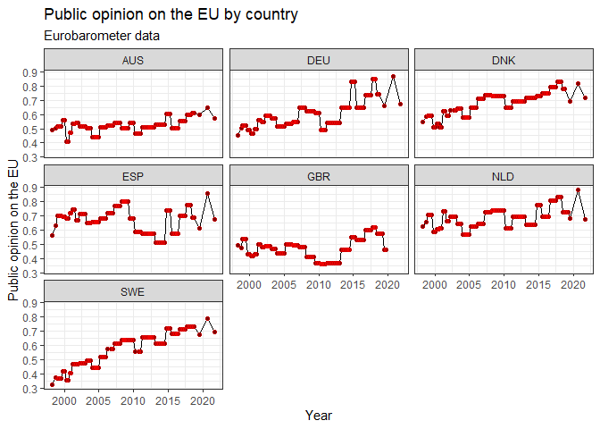

Regression Prep
================
Duarte Amaro
2026-03-09

# Getting Monthly Data

## Cleaning LLM-Classified Speeches

The following code is commented out because importing and reading the
entire data set only to properly assemble it is slow and inexpedient.

``` r
# eu_mentions <- read_csv("EU_Speeches_classified.csv") |>
#   mutate(
#     year = as.numeric(format(date, "%Y")),
#     year_month = as.factor(format(date, "%Y-%m")),
#     month = as.factor(format(date, "%m"))
#   ) |>
#   rename(country = iso3country,
#          eu_mention = EU_2,
#          partyfacts_id = party.facts.id) |>
#   dplyr::select(-"...1") |>
#   distinct()
# 
# summary(eu_mentions)
# 
# sum(is.na(eu_mentions$eu_mention)) ## Confirming all speeches have been assigned EU stance
# 
# nonEU_speeches <- read_csv("NonEU_Speeches.csv") |>
#   mutate(
#     eu_mention = 0,
#     year = as.numeric(format(date, "%Y")),
#     year_month = as.factor(format(date, "%Y-%m")),
#     month = as.factor(format(date, "%m"))
#   ) |>
#   rename(country = iso3country,
#          partyfacts_id = party.facts.id) |>
#   dplyr::select(-c("...1", "Unnamed: 0")) |>
#   distinct()
# 
# nonEU_speeches_UK <- read_csv("UK_NonEU.csv") |>
#   mutate(
#     eu_mention = 0,
#     year = as.numeric(format(date, "%Y")),
#     year_month = as.factor(format(date, "%Y-%m")),
#     month = as.factor(format(date, "%m"))
#   ) |>
#   rename(country = iso3country,
#          partyfacts_id = party.facts.id) |>
#   dplyr::select(-"...1") |>
#   distinct()
# 
# eu_stance <- read_csv("Final_Classified_Speeches.csv") |>
#   mutate(
#     Stance = as.factor(Stance),
#     year = as.numeric(format(date, "%Y")),
#     year_month = as.factor(format(date, "%Y-%m")),
#     month = as.factor(format(date, "%m"))
#   ) |>
#   rename(country = iso3country,
#          eu_mention = EU_2,
#          eu_stance = Stance,
#          partyfacts_id = party.facts.id) |>
#   #dplyr::select(-"Unnamed: 0") |>
#   distinct()
# 
# data0 <- eu_mentions |>
#   bind_rows(
#     nonEU_speeches
#   ) |>
#   bind_rows(
#     nonEU_speeches_UK
#   ) |>
#   left_join(eu_stance)
# 
# write.csv(data0, "data0.csv", row.names = FALSE)
```

``` r
data0 <- read_csv("data0.csv") |>
  mutate(year_month = as.factor(year_month))
```

    ## Rows: 30800030 Columns: 22
    ## ── Column specification ────────────────────────────────────────────────────────
    ## Delimiter: ","
    ## chr   (8): speaker, party, parliament, country, sentence, year_month, month,...
    ## dbl  (12): speechnumber, partyfacts_id, terms, speech_ID, EU, eu_mention, ye...
    ## lgl   (1): chair
    ## date  (1): date
    ## 
    ## ℹ Use `spec()` to retrieve the full column specification for this data.
    ## ℹ Specify the column types or set `show_col_types = FALSE` to quiet this message.

``` r
data_individual_positions_year <- data0 |>
  group_by(country, partyfacts_id, speaker, year) |>
  summarise(
    count = n(),
    count_mention = sum(eu_mention == 1, na.rm = TRUE),
    count_support = sum(Support == 1, na.rm = TRUE),
    count_neutral = sum(Neutral == 1, na.rm = TRUE),
    count_oppose = sum(Opposition == 1, na.rm = TRUE),
    prop_eu_mention = 100*mean(eu_mention, na.rm = TRUE),
    prop_support = 100*count_support/count_mention,
    prop_neutral = 100*count_neutral/count_mention,
    prop_oppose = 100*count_oppose/count_mention,
    net_position = prop_support - prop_oppose
  ) |>
  ungroup()
```

    ## `summarise()` has grouped output by 'country', 'partyfacts_id', 'speaker'. You
    ## can override using the `.groups` argument.

``` r
data_sd_year <- data_individual_positions_year |>
  group_by(country, partyfacts_id, year) |>
  summarise(
    sd_eu_mention = sd(prop_eu_mention, na.rm = TRUE),
    sd_position = sd(net_position, na.rm = TRUE)
  ) |>
  ungroup()
```

    ## `summarise()` has grouped output by 'country', 'partyfacts_id'. You can
    ## override using the `.groups` argument.

``` r
data_yearly <- data0 |>
  group_by(country, partyfacts_id, year) |>
  summarise(
    count = n(),
    count_mention = sum(eu_mention == 1, na.rm = TRUE),
    count_support = sum(Support == 1, na.rm = TRUE),
    count_neutral = sum(Neutral == 1, na.rm = TRUE),
    count_oppose = sum(Opposition == 1, na.rm = TRUE),
    prop_eu_mention = 100*mean(eu_mention, na.rm = TRUE),
    prop_support = 100*count_support/count_mention,
    prop_neutral = 100*count_neutral/count_mention,
    prop_oppose = 100*count_oppose/count_mention,
    net_position = prop_support - prop_oppose
  ) |>
  ungroup() |>
  left_join(data_sd_year)
```

    ## `summarise()` has grouped output by 'country', 'partyfacts_id'. You can
    ## override using the `.groups` argument.
    ## Joining with `by = join_by(country, partyfacts_id, year)`

``` r
#write.csv(data_yearly, "data_yearly.csv", row.names = FALSE)
```

# Getting Trimester Data

## Cleaning LLM-Classified Speeches

``` r
df_trimester <- data0 %>%
  mutate(
    year_month_chr = as.character(year_month),
    ym_date = date,
    year = year(ym_date),
    month = month(ym_date),
    # 2) compute trimester number (1..4 where 1 = Jan-Mar, 2 = Apr-Jun, ...)
    trimester = ((month - 1) %/% 3) + 1,
    # a convenient label
    tri = paste0(year, "-T", trimester),
    tri_month = (trimester - 1) * 3 + 1,
    # make a Date for the first day of the trimester
    tri_date = as.Date(paste(year, tri_month, "01", sep = "-"))
  ) %>%
  # 3) aggregate by country, party and trimester
  group_by(country, partyfacts_id, tri, tri_date) %>%
  summarise(
    n_sentences = n(),                            # total sentences in the trimester-cell
    n_eu = sum(eu_mention == 1, na.rm = TRUE),    # number of EU-mentioning sentences
    share_eu = ifelse(n_sentences > 0, n_eu / n_sentences, NA_real_),
    # shares among EU mentions -> use mean on Support/Opposition which are NA for non-eu rows
    share_support = ifelse(n_eu > 0, mean(Support, na.rm = TRUE), NA_real_),
    share_opposition = ifelse(n_eu > 0, mean(Opposition, na.rm = TRUE), NA_real_),
    net_position = ifelse(n_eu > 0, share_support - share_opposition, NA_real_),
    .groups = "drop"
  )

# View(df_trimester)
```

``` r
data_individual_positions <- data0 |>
  mutate(
    year_month_chr = as.character(year_month),
    ym_date = date,
    year = year(ym_date),
    month = month(ym_date),
    # 2) compute trimester number (1..4 where 1 = Jan-Mar, 2 = Apr-Jun, ...)
    trimester = ((month - 1) %/% 3) + 1,
    # a convenient label
    tri = paste0(year, "-T", trimester),
    tri_month = (trimester - 1) * 3 + 1,
    # make a Date for the first day of the trimester
    tri_date = as.Date(paste(year, tri_month, "01", sep = "-"))
  ) |>
  group_by(country, partyfacts_id, speaker, tri, tri_date) |>
  summarise(
    count = n(),
    count_mention = sum(eu_mention == 1, na.rm = TRUE),
    count_support = sum(Support == 1, na.rm = TRUE),
    count_neutral = sum(Neutral == 1, na.rm = TRUE),
    count_oppose = sum(Opposition == 1, na.rm = TRUE),
    prop_eu_mention = 100*mean(eu_mention, na.rm = TRUE),
    prop_support = 100*count_support/count_mention,
    prop_neutral = 100*count_neutral/count_mention,
    prop_oppose = 100*count_oppose/count_mention,
    net_position = prop_support - prop_oppose
  ) |>
  ungroup()
```

    ## `summarise()` has grouped output by 'country', 'partyfacts_id', 'speaker',
    ## 'tri'. You can override using the `.groups` argument.

``` r
data_sd_0 <- data_individual_positions |>
  group_by(country, partyfacts_id, tri, tri_date) |>
  summarise(
    sd_eu_mention_0 = sd(prop_eu_mention, na.rm = TRUE),
    sd_position_0 = sd(net_position, na.rm = TRUE)
  ) |>
  ungroup()
```

    ## `summarise()` has grouped output by 'country', 'partyfacts_id', 'tri'. You can
    ## override using the `.groups` argument.

``` r
data_sd_1 <- data_individual_positions |>
  filter(prop_eu_mention > 1) |>
  group_by(country, partyfacts_id, tri, tri_date) |>
  summarise(
    sd_eu_mention_1 = sd(prop_eu_mention, na.rm = TRUE),
    sd_position_1 = sd(net_position, na.rm = TRUE)
  ) |>
  ungroup()
```

    ## `summarise()` has grouped output by 'country', 'partyfacts_id', 'tri'. You can
    ## override using the `.groups` argument.

``` r
data_sd_5 <- data_individual_positions |>
  filter(prop_eu_mention > 5) |>
  group_by(country, partyfacts_id, tri, tri_date) |>
  summarise(
    sd_eu_mention_5 = sd(prop_eu_mention, na.rm = TRUE),
    sd_position_5 = sd(net_position, na.rm = TRUE)
  ) |>
  ungroup()
```

    ## `summarise()` has grouped output by 'country', 'partyfacts_id', 'tri'. You can
    ## override using the `.groups` argument.

``` r
df_trimester_0 <- df_trimester |>
  left_join(data_sd_0, by = c("country", "partyfacts_id", "tri", "tri_date")) |>
  left_join(data_sd_1, by = c("country", "partyfacts_id", "tri", "tri_date")) |>
  left_join(data_sd_5, by = c("country", "partyfacts_id", "tri", "tri_date"))
```

## Cleaning ParlGov and Merging

``` r
## Getting parlgov and partyfacts codes:

partyfacts_to_parlgov <- read_csv("partyfacts-external-parties.csv") |>
  filter((partyfacts_id %in% unique(df_trimester_0$partyfacts_id) | partyfacts_id == 540) & # For some reason, PartyFacts codes LibDems differently for ParlGov
           dataset_key == "parlgov" &
           year_last >= 1998) |>
  rename(parlgov_id = dataset_party_id,
         parlgov_country = country)
```

    ## Warning: One or more parsing issues, call `problems()` on your data frame for details,
    ## e.g.:
    ##   dat <- vroom(...)
    ##   problems(dat)

    ## Rows: 45385 Columns: 17
    ## ── Column specification ────────────────────────────────────────────────────────
    ## Delimiter: ","
    ## chr  (8): country, dataset_key, dataset_party_id, name_short, name, name_eng...
    ## dbl  (6): year_first, year_last, share, share_year, external_id, partyfacts_id
    ## dttm (3): created, modified, linked
    ## 
    ## ℹ Use `spec()` to retrieve the full column specification for this data.
    ## ℹ Specify the column types or set `show_col_types = FALSE` to quiet this message.

``` r
## Merging partyfacts and parlgov codes with speeches

df_trimester_1 <- df_trimester_0 |>
  dplyr::select(country, partyfacts_id) |>
  distinct() |>
  mutate(partyfacts_id = case_when(partyfacts_id == 1388 ~ 540, # LibDems in ParlGov
                                   .default = partyfacts_id)) |>
  full_join(partyfacts_to_parlgov, by = "partyfacts_id") |>
  dplyr::select(country,
                partyfacts_id,
                parlgov_id,
                name_short,
                name,
                name_english) |>
  full_join(
    df_trimester_0 |>
      mutate(
        partyfacts_id = case_when(partyfacts_id == 1388 ~ 540, # LibDems in ParlGov
                                  .default = partyfacts_id)
      ),
    by = c("country", "partyfacts_id")
  ) |>
  mutate(parlgov_id = as.numeric(parlgov_id))

nrow(df_trimester_1) == nrow(df_trimester_0) # Confirming we don't have a many-to-many relationship and we keep the same number of rows
```

    ## [1] TRUE

``` r
## Getting election results from parlgov

parlgov_elections <- read_csv("view_election.csv") |>
  filter(country_name_short %in% c("AUT", "DEU", "DNK", "ESP", "GBR", "NLD", "SWE") &
           election_date > as.Date("1990-01-01")) |>
  mutate(
    country = case_when(
      country_name_short == "AUT" ~ "AUS",
      is.na(country_name_short) ~ NA,
      .default = country_name_short
    )
  ) |>
  dplyr::select(c(country, election_type, election_date, 
                  vote_share, seats, seats_total, party_name_short, party_name, 
                  party_name_english, party_id)) |>
  bind_rows(read_csv("view_election.csv") |>           ## ParlGov for some reason disagreggates between CDU and CSU 
                                                       ## in terms of election results.
              filter(party_id %in% c(808, 1180) & election_date > as.Date("1990-01-01")) |> 
              dplyr::select(election_type, election_date, vote_share, seats) |>
              group_by(election_type, election_date) |>
              mutate(
                vote_share = sum(vote_share, na.rm = TRUE),
                seats = sum(seats, na.rm = TRUE)
                ) |> 
              distinct() |> 
              bind_cols(read_csv("view_party.csv") |>
                          filter(party_id == 1727) |>
                          dplyr::select(party_name_short, party_name, party_name_english, party_id) |>
                          slice(rep(1, 15))
                        ) |>
              mutate(country = "DEU")
            ) |>
  mutate(election_year = format(election_date, "%Y"))
```

    ## Rows: 9016 Columns: 16
    ## ── Column specification ────────────────────────────────────────────────────────
    ## Delimiter: ","
    ## chr  (6): country_name_short, country_name, election_type, party_name_short,...
    ## dbl  (9): vote_share, seats, seats_total, left_right, country_id, election_i...
    ## date (1): election_date
    ## 
    ## ℹ Use `spec()` to retrieve the full column specification for this data.
    ## ℹ Specify the column types or set `show_col_types = FALSE` to quiet this message.
    ## Rows: 9016 Columns: 16
    ## ── Column specification ────────────────────────────────────────────────────────
    ## Delimiter: ","
    ## chr  (6): country_name_short, country_name, election_type, party_name_short,...
    ## dbl  (9): vote_share, seats, seats_total, left_right, country_id, election_i...
    ## date (1): election_date
    ## 
    ## ℹ Use `spec()` to retrieve the full column specification for this data.
    ## ℹ Specify the column types or set `show_col_types = FALSE` to quiet this message.
    ## Rows: 1707 Columns: 23
    ## ── Column specification ────────────────────────────────────────────────────────
    ## Delimiter: ","
    ## chr  (8): country_name_short, country_name, party_name_short, party_name_eng...
    ## dbl (15): left_right, state_market, liberty_authority, eu_anti_pro, cmp, eup...
    ## 
    ## ℹ Use `spec()` to retrieve the full column specification for this data.
    ## ℹ Specify the column types or set `show_col_types = FALSE` to quiet this message.

``` r
## Getting right-wing populist parties

rrp_results <- parlgov_elections |>
  left_join(read_csv("view_party.csv") |>
              filter(country_name_short %in% c("AUT", "DEU", "DNK", "ESP", "GBR", "NLD", "SWE")) |>
              mutate(
                country = case_when(
                  country_name_short == "AUT" ~ "AUS",
                  is.na(country_name_short) ~ NA,
                  .default = country_name_short)
                ) |>
              dplyr::select(c(country, family_name, party_id))
            ) |>
  filter(family_name == "Right-wing") 
```

    ## Rows: 1707 Columns: 23
    ## ── Column specification ────────────────────────────────────────────────────────
    ## Delimiter: ","
    ## chr  (8): country_name_short, country_name, party_name_short, party_name_eng...
    ## dbl (15): left_right, state_market, liberty_authority, eu_anti_pro, cmp, eup...
    ## 
    ## ℹ Use `spec()` to retrieve the full column specification for this data.
    ## ℹ Specify the column types or set `show_col_types = FALSE` to quiet this message.
    ## Joining with `by = join_by(country, party_id)`

``` r
tibble(rrp_results |> 
         dplyr::select(country, party_name_short, party_name_english) |>
         distinct())
```

    ## # A tibble: 25 × 3
    ##    country party_name_short party_name_english                                  
    ##    <chr>   <chr>            <chr>                                               
    ##  1 AUS     FPO              Freedom Party of Austria                            
    ##  2 AUS     BZO              Alliance for the Future of Austria                  
    ##  3 DEU     Rep              The Republicans                                     
    ##  4 DEU     BFB              Confederation of free citizens -- Offensive for Ger…
    ##  5 DEU     DVU              German People's Union                               
    ##  6 DEU     NPD              National Democratic Party                           
    ##  7 DEU     AfD              Alternative for Germany                             
    ##  8 DNK     DF               Danish People's Party                               
    ##  9 DNK     NB               The New Right                                       
    ## 10 DNK     SK               Hard Line                                           
    ## # ℹ 15 more rows

``` r
## Getting election dates

election_dates <- parlgov_elections |>
  dplyr::select(country, election_type, election_date) |>
  mutate(
    election_year_month = as.factor(format(election_date, "%Y-%m"))
  ) |>
  distinct()

## Merging with election results to have sum RRP voteshare

parlgov_elections <- election_dates |>
  left_join(
    rrp_results |> 
      group_by(election_date, election_type, country) |>
      mutate(rrp_voteshare = sum(vote_share, na.rm = TRUE),
             rrp_seats = sum(seats, na.rm = TRUE),
             rrp_seatshare = (rrp_seats*100)/seats_total) |>
      ungroup() |> 
      dplyr:::select(country, election_type, election_date, rrp_voteshare, rrp_seats, rrp_seatshare) |>
      distinct(),
    by = c("country", "election_type", "election_date")
    ) |>
      mutate(
        rrp_voteshare = case_when(
          is.na(rrp_voteshare) ~ 0,
          .default = rrp_voteshare
        ),
        rrp_seats = case_when(
          is.na(rrp_seats) ~ 0,
          .default = rrp_seats
        ),
        rrp_seatshare = case_when(
          is.na(rrp_seatshare) ~ 0,
          .default = rrp_seatshare
        )
      ) |>
      group_by(country) |>
  right_join(parlgov_elections) 
```

    ## Joining with `by = join_by(country, election_type, election_date)`

``` r
parlgov_elections <- parlgov_elections |>
  left_join(parlgov_elections |> 
              filter(election_type == "parliament") |> 
              dplyr::select(country, election_year, rrp_voteshare, rrp_seats, rrp_seatshare) |> 
              distinct() |> 
              group_by(country) |> 
              mutate(
                rrp_lag = dplyr::lag(rrp_voteshare, order_by = election_year),
                rrp_seat_lag = dplyr::lag(rrp_seats, order_by = election_year),
                rrp_seatshare_lag = dplyr::lag(rrp_seatshare, order_by = election_year),
                rrp_lag2 = dplyr::lag(rrp_voteshare, order_by = election_year, 2)
                )
            )
```

    ## Joining with `by = join_by(country, rrp_voteshare, rrp_seats, rrp_seatshare,
    ## election_year)`

``` r
## Getting cabinet composition data

parlgov_cab <- read_csv("view_cabinet.csv") |>
      filter(country_name_short %in% c("AUT", "DEU", "DNK", "ESP", "GBR", "NLD", "SWE") &
               election_date > as.Date("1990-01-01")) |>
      mutate(
        country = case_when(
        country_name_short == "AUT" ~ "AUS",
        is.na(country_name_short) ~ NA,
        .default = country_name_short
        )
        ) |>
      dplyr::select(c(country, election_date, start_date, 
                      cabinet_name, cabinet_party, party_id,
                      cabinet_id)) 
```

    ## Rows: 12659 Columns: 19
    ## ── Column specification ────────────────────────────────────────────────────────
    ## Delimiter: ","
    ## chr   (6): country_name_short, country_name, cabinet_name, party_name_short,...
    ## dbl  (11): caretaker, cabinet_party, prime_minister, seats, election_seats_t...
    ## date  (2): election_date, start_date
    ## 
    ## ℹ Use `spec()` to retrieve the full column specification for this data.
    ## ℹ Specify the column types or set `show_col_types = FALSE` to quiet this message.

``` r
## Calculating time to next election

data_election_dates <- df_trimester_1 |>
  dplyr::select(country, tri_date) |>
  distinct() |> # I now want to match the dates to the next closest election:
  left_join(election_dates |> 
              filter(election_type == "parliament") |>
              dplyr::select(country, election_date), 
            by = "country") |>
  mutate(
    time_from_last = round(as.numeric(difftime(tri_date,
                                             election_date,
                                             units = "days"))/30)
    ) |>
  filter(time_from_last >= 0) |> 
  group_by(country, tri_date) |>
  filter(time_from_last == min(time_from_last)) |>
  ungroup() |>
  rename(last_election_date = election_date) |>
  #dplyr::select(-time_to_last) |>
  left_join(
    df_trimester_1 |>
      dplyr::select(country, tri_date) |>
      distinct() |> # I now want to match the dates to the next closest election:
      left_join(election_dates |> 
                  filter(election_type == "parliament") |>
                  dplyr::select(country, election_date), 
                by = "country") |>
      mutate(
        time_to_next = round(as.numeric(difftime(election_date,
                                             tri_date,
                                                 units = "days"))/30)
        ) |>
      filter(time_to_next >= 0) |> 
      group_by(country, tri_date) |>
      filter(time_to_next == min(time_to_next)) |>
      ungroup() |>
      rename(next_election_date = election_date)) |>
  left_join(election_dates |> 
              filter(election_type == "ep") |>
              rename(election_date_ep = election_date) |>
              dplyr::select(country, election_date_ep) |>
              bind_rows(tibble(country = c("NLD", "GBR"), 
                               election_date_ep = c(as.Date("2024-06-06"), as.Date("2024-06-06")))), 
            by = "country") |> 
  mutate(
    time_to_next_ep = round(as.numeric(difftime(election_date_ep,
                                                tri_date,
                                                units = "days")
                                  ) / 30)
  ) |> 
  filter(time_to_next_ep >= 0) |>
  group_by(country, tri_date) |>
  filter(time_to_next_ep == min(time_to_next_ep)) |>
  ungroup() |>
  mutate(
    time_to_next_ep = case_when(
      country == "GBR" & election_date_ep == as.Date("2024-06-06") ~ NA,
      .default = time_to_next_ep
    ),
    election_year_month_ep = case_when(
      country == "GBR" & election_date_ep == as.Date("2024-06-06") ~ NA,
      .default = election_date_ep
    ),
  ) |>
  rename(next_election_date_ep = election_date_ep)
```

    ## Warning in left_join(distinct(dplyr::select(df_trimester_1, country, tri_date)), : Detected an unexpected many-to-many relationship between `x` and `y`.
    ## Detected an unexpected many-to-many relationship between `x` and `y`.
    ## ℹ Row 1 of `x` matches multiple rows in `y`.
    ## ℹ Row 1 of `y` matches multiple rows in `x`.
    ## ℹ If a many-to-many relationship is expected, set `relationship =
    ##   "many-to-many"` to silence this warning.

    ## Joining with `by = join_by(country, tri_date)`

    ## Warning in left_join(left_join(rename(ungroup(filter(group_by(filter(mutate(left_join(distinct(dplyr::select(df_trimester_1, : Detected an unexpected many-to-many relationship between `x` and `y`.
    ## ℹ Row 1 of `x` matches multiple rows in `y`.
    ## ℹ Row 1 of `y` matches multiple rows in `x`.
    ## ℹ If a many-to-many relationship is expected, set `relationship =
    ##   "many-to-many"` to silence this warning.

``` r
## Doing the same for cabinets (but we're only interested in keeping the current cabinet)

cab_dates <- parlgov_cab |>
  dplyr::select(country, start_date, cabinet_id) |>
  distinct()

data_cab_dates <- df_trimester_1 |>
  dplyr::select(country, tri_date) |>
  distinct() |> # I now want to match the dates to the next closest cabinet:
  left_join(cab_dates |> 
              dplyr::select(country, start_date, cabinet_id), 
            by = "country") |>
  mutate(
    time_to_next_cab = round(as.numeric(difftime(start_date,
                                                  tri_date,
                                                  units = "days")
                                    )/30)
  ) |> 
  filter(time_to_next_cab <= 0) |> # We only want cabinets whose start date is in the past
  group_by(country, tri_date) |>
  filter(time_to_next_cab == max(time_to_next_cab)) |> # But for any given date we just want to closest past cabinet
  ungroup() |> 
  dplyr::select(-time_to_next_cab) # The time difference variable isn't of interest
```

    ## Warning in left_join(distinct(dplyr::select(df_trimester_1, country, tri_date)), : Detected an unexpected many-to-many relationship between `x` and `y`.
    ## ℹ Row 1 of `x` matches multiple rows in `y`.
    ## ℹ Row 1 of `y` matches multiple rows in `x`.
    ## ℹ If a many-to-many relationship is expected, set `relationship =
    ##   "many-to-many"` to silence this warning.

``` r
## Now to get a single data_dates dataframe:

data_dates <- data_election_dates |>
  full_join(data_cab_dates, by = c("country", "tri_date"))

## Merging speeches with election results

vote_changes <- parlgov_elections |>  # Calculating change in voteshare
              filter(election_type == "parliament") |>
              dplyr::select(country, election_date, 
                            party_name_short, vote_share, 
                            party_id, rrp_voteshare, rrp_lag, rrp_lag2, rrp_seats, rrp_seat_lag, rrp_seatshare, rrp_seatshare_lag) |>
              group_by(party_id) |>
              mutate(
                change_voteshare = vote_share - lag(vote_share, order_by = election_date)
                ) |>
              ungroup() |>
              mutate(last_election_date = election_date) |>
              rename(parlgov_id = party_id)

data_trimester <- df_trimester_1 |>
  left_join(data_dates, 
            by = c("country", "tri_date")) |> 
  left_join(vote_changes,
            by = c("country", "parlgov_id", "last_election_date")
            ) |>
  left_join(parlgov_cab |>
              rename(parlgov_id = party_id) |>
              dplyr::select(country, start_date, cabinet_id, cabinet_name, cabinet_party, parlgov_id),
            by = c("country", "start_date", "cabinet_id", "parlgov_id"))

nrow(data_trimester) == nrow(df_trimester_1)
```

    ## [1] TRUE

``` r
write.csv(data_trimester, "data_trimester.csv", row.names = FALSE)
```

## Cleaning Eurobarometer Data

``` r
eb <- haven::read_dta("EB_1973_2022_2025_JAN.dta")


eb98_2021 <- eb |>
  filter(YEAR >= 1998 & YEAR <= 2021 & NATION2 %in% c(3, 4, 7, 9, 11, 14, 15)) |>
  mutate(
    nation2 = case_when(
      NATION2 == 3 ~ "NLD",
      NATION2 == 4 ~ "DEU",
      NATION2 == 7 ~ "DNK",
      NATION2 == 9 ~ "GBR",
      NATION2 == 11 ~ "ESP",
      NATION2 == 14 ~ "SWE",
      NATION2 == 15 ~ "AUS"
    ) |> as.character(),
    month_chr = str_replace(as.character(round(month, digits = 2)), "\\.", "-"),
    month_chr = case_when(
      month_chr == "9-1" ~ "10", # This is a hack to deal with the fact that some months are coded as 9.10 
                                  # but rounding leaves it as 1
      .default = month_chr
    ),
    month_2 = sapply(str_split(month_chr, "-"), function(x) tail(x, 1)),
    year_month = paste(as.character(YEAR), sprintf("%02d", as.numeric(month_2)), sep = "-") |>
      as.factor(),
    date = paste(as.character(year_month), "01", sep = "-") |>
      as.Date()
  ) 

eb_final <- eb98_2021 |>
  dplyr::select(
    nation2, year_month, date, MEMBRSHP, BENEFIT, EUSPEED1, EUSPEED2, TRUSTEC, TRUSTEP, SATISDEU, FEEL
  ) |>
    mutate(
    mem = case_when(
      MEMBRSHP == 1 ~ "Good",
      MEMBRSHP == 0 ~ "Neither",
      MEMBRSHP == -1 ~ "Bad",
      TRUE ~ NA_character_
    ) |>
      factor(levels = c("Good", "Neither", "Bad")),
    std_mem = (as.numeric(MEMBRSHP) + 1)/2,
    
    benefit = case_when(
      BENEFIT == 1 ~ "Benefited",
      BENEFIT == 0 ~ "Not benefited",
      TRUE ~ NA_character_
    ) |>
      factor(levels = c("Benefited", "Not benefited")),
    std_ben = as.numeric(BENEFIT),
    
    trust_ec = case_when(
      TRUSTEC == 1 ~ "Trust",
      TRUSTEC == 0 ~ "No Trust",
      TRUE ~ NA_character_
    ) |>
      as.factor(),
    std_trust_ec = as.numeric(TRUSTEC),
    
    trust_ep = case_when(
      TRUSTEP == 1 ~ "Trust",
      TRUSTEP == 0 ~ "No Trust",
      TRUE ~ NA_character_
    ) |>
      as.factor(),
    std_trust_ep = as.numeric(TRUSTEP),
    
    sat_deu = case_when(
      SATISDEU == 3 ~ "Very satisfied",
      SATISDEU == 2 ~ "Fairly satisfied",
      SATISDEU == 1 ~ "Not very satisfied",
      SATISDEU == 0 ~ "Not at all satisfied",
      TRUE ~ NA_character_
    ) |>
      factor(),
    std_sat_deu = as.numeric(SATISDEU)/3,
    
    feel = case_when(
      FEEL == 2 ~ "European",
      FEEL == 1 ~ "Shared",
      FEEL == 0 ~ "National",
      TRUE ~ NA_character_
    ),
    std_feel = as.numeric(FEEL)/2
    )

eb_means_tri <- eb_final |>
  #mutate(tri_date = as.Date(paste(year_month, "-01", sep = ""))) |>
  mutate(
    year_month_chr = as.character(year_month),
    ym_date = date,
    year = year(ym_date),
    month = month(ym_date),
    # 2) compute trimester number (1..4 where 1 = Jan-Mar, 2 = Apr-Jun, ...)
    trimester = ((month - 1) %/% 3) + 1,
    # a convenient label
    tri = paste0(year, "-T", trimester),
    tri_month = (trimester - 1) * 3 + 1,
    # make a Date for the first day of the trimester
    tri_date = as.Date(paste(year, tri_month, "01", sep = "-"))
  ) |>
  group_by(nation2, tri_date, tri) |>
  summarise(
    std_mem = mean(std_mem, na.rm = TRUE),
    std_ben = mean(std_ben, na.rm = TRUE),
    std_trust_ec = mean(std_trust_ec, na.rm = TRUE),
    std_trust_ep = mean(std_trust_ep, na.rm = TRUE),
    std_sat_deu = mean(std_sat_deu, na.rm = TRUE),
    std_feel = mean(std_feel, na.rm = TRUE)
  ) |>
  ungroup() |>
  mutate(std_mem = case_when(is.nan(std_mem) ~ NA_real_,
                             .default = std_mem),
         std_ben = case_when(is.nan(std_ben) ~ NA_real_,
                             .default = std_ben),
         std_trust_ec = case_when(is.nan(std_trust_ec) ~ NA_real_,
                                  .default = std_trust_ec),
         std_trust_ep = case_when(is.nan(std_trust_ep) ~ NA_real_,
                                  .default = std_trust_ep),
         std_sat_deu = case_when(is.nan(std_sat_deu) ~ NA_real_,
                                 .default = std_sat_deu),
         std_feel = case_when(is.nan(std_feel) ~ NA_real_,
                              .default = std_feel)
  )
```

    ## `summarise()` has grouped output by 'nation2', 'tri_date'. You can override
    ## using the `.groups` argument.

``` r
eu_public_opinion_0 <- rowMeans(eb_means_tri |> 
                                  dplyr::select(std_mem, std_ben, 
                                                std_trust_ep, std_trust_ec, 
                                                std_sat_deu, std_feel), na.rm = TRUE)

eu_public_opinion_0[is.nan(eu_public_opinion_0)] <- NA_real_ # Replace NaN with NA

eb_tri <- eb_means_tri |>
  mutate(eu_public_opinion_0 = eu_public_opinion_0) |>
  dplyr::select(nation2, tri, tri_date, std_mem, std_trust_ec, std_sat_deu, eu_public_opinion_0) |>
  rename(country = nation2) |>
  full_join(data_trimester |> 
              dplyr::select(country, tri, tri_date) |> 
              distinct()) |>
  arrange(country, tri_date) |>
  group_by(country) |>
  mutate(
    eu_public_opinion = zoo::na.locf0(eu_public_opinion_0, fromLast = FALSE),
    lag_eu_public_opinion = dplyr::lag(eu_public_opinion, order_by = tri_date),
    lag_eu_public_opinion_2 = dplyr::lag(eu_public_opinion, n = 2, order_by = tri_date),
    lag_eu_public_opinion_3 = dplyr::lag(eu_public_opinion, n = 3, order_by = tri_date),
    std_mem = zoo::na.locf0(std_mem, fromLast = FALSE),
    std_trust_ec = zoo::na.locf0(std_trust_ec, fromLast = FALSE),
    std_sat_deu = zoo::na.locf0(std_sat_deu, fromLast = FALSE)
  )
```

    ## Joining with `by = join_by(country, tri, tri_date)`

``` r
eb_tri |>
  #mutate(date = as.Date(paste(year_month, "-01", sep = ""))) |>
  #filter(!is.na(eu_public_opinion)) |>
  arrange(country, tri_date) |>
  ggplot(aes(x = tri_date, y = eu_public_opinion, group = country)) +
  geom_point() +
  geom_path() +
  geom_point(aes(x = tri_date, y = eu_public_opinion), color = "red", alpha = 0.5) +
  #geom_point(aes(x = tri_date, y = lag_eu_public_opinion), color = "blue", alpha = 0.5) +
  facet_wrap(~ country) +
  labs(x = "Year",
       y = "Public opinion on the EU",
       title = "Public opinion on the EU by country",
       subtitle = "Eurobarometer data")
```

<!-- -->

## Cleaning Polling Data

``` r
polls_aus <- read_excel("austria_monthly.xlsx") |>
  dplyr::select(c(3, 2, 5, 8, 10)) 
  
colnames(polls_aus)[4:5] <- c("FPO", "BZO")

polls_aus <- polls_aus |> 
  mutate(date = as.Date(survey_date),
         year = year(date),
         month = month(date),
        # 2) compute trimester number (1..4 where 1 = Jan-Mar, 2 = Apr-Jun, ...)
        trimester = ((month - 1) %/% 3) + 1,
        # a convenient label
        tri = paste0(year, "-T", trimester),
        tri_month = (trimester - 1) * 3 + 1,
        # make a Date for the first day of the trimester
        tri_date = as.Date(paste(year, tri_month, "01", sep = "-")),
        country = "AUS",
         BZO = case_when(
           is.na(BZO) ~ 0,
           TRUE ~ BZO
         ),
         FPO = case_when(
           is.na(FPO) ~ 0,
           TRUE ~ FPO
         ),
         rrp_sum = FPO + BZO) |>
  group_by(tri_date) |>
  mutate(
    rrp_voteshare = mean(rrp_sum, na.rm = TRUE)
  ) |>
  dplyr::select(country, tri, tri_date, rrp_voteshare) |>
  distinct()

polls_swe <- read_excel("sweden_monthly.xlsx") |>
  dplyr::select(survey_date, year, month, NyD, SD) |> 
  mutate(date = as.Date(survey_date),
         year = year(date),
         month = month(date),
        # 2) compute trimester number (1..4 where 1 = Jan-Mar, 2 = Apr-Jun, ...)
        trimester = ((month - 1) %/% 3) + 1,
        # a convenient label
        tri = paste0(year, "-T", trimester),
        tri_month = (trimester - 1) * 3 + 1,
        # make a Date for the first day of the trimester
        tri_date = as.Date(paste(year, tri_month, "01", sep = "-")),
         country = "SWE",
         NyD = case_when(
           is.na(NyD) ~ 0,
           TRUE ~ NyD
         ),
         SD = case_when(
           is.na(SD) ~ 0,
           TRUE ~ SD
         ),
         rrp_sum = NyD + SD) |>
  group_by(tri_date) |>
  mutate(
    rrp_voteshare = mean(rrp_sum, na.rm = TRUE)
  ) |>
  dplyr::select(country, tri, tri_date, rrp_voteshare) |>
  distinct()

polls_dnk <- read_excel("denmark_monthly.xlsx") |>
  dplyr::select(survey_date, year, month, DF, HardLine) |> 
  mutate(date = as.Date(survey_date),
         year = year(date),
         month = month(date),
        # 2) compute trimester number (1..4 where 1 = Jan-Mar, 2 = Apr-Jun, ...)
        trimester = ((month - 1) %/% 3) + 1,
        # a convenient label
        tri = paste0(year, "-T", trimester),
        tri_month = (trimester - 1) * 3 + 1,
        # make a Date for the first day of the trimester
        tri_date = as.Date(paste(year, tri_month, "01", sep = "-")),
         country = "DNK",
         DF = case_when(
           is.na(DF) ~ 0,
           TRUE ~ DF
         ),
         HardLine = case_when(
           is.na(HardLine) ~ 0,
           TRUE ~ HardLine
         ),
         rrp_sum = DF + HardLine) |>
  group_by(tri_date) |>
  mutate(
    rrp_voteshare = mean(rrp_sum, na.rm = TRUE)
  ) |>
  dplyr::select(country, tri, tri_date, rrp_voteshare) |>
  distinct()

polls_deu <- read_excel("germany_monthly.xlsx", col_types = c("text", "numeric", "date", "numeric", "numeric", "numeric", "numeric", "numeric", "numeric", "numeric", "numeric", "numeric", "text", "text", "numeric")) |>
  dplyr::select(survey_date, year, month, AfD) |> 
  mutate(date = as.Date(survey_date),
         year = year(date),
         month = month(date),
        # 2) compute trimester number (1..4 where 1 = Jan-Mar, 2 = Apr-Jun, ...)
        trimester = ((month - 1) %/% 3) + 1,
        # a convenient label
        tri = paste0(year, "-T", trimester),
        tri_month = (trimester - 1) * 3 + 1,
        # make a Date for the first day of the trimester
        tri_date = as.Date(paste(year, tri_month, "01", sep = "-")),
         country = "DEU",
         AfD = case_when(
           is.na(AfD) ~ 0,
           TRUE ~ AfD
         )) |>
  group_by(tri_date) |>
  mutate(
    rrp_voteshare = mean(AfD, na.rm = TRUE)
  ) |>
  dplyr::select(country, tri, tri_date, rrp_voteshare) |>
  distinct()

polls_nld <- read_excel("netherlands_monthly.xlsx", col_types = c(rep("guess", 5), rep("numeric", 29), rep("guess", 3))) |>
  dplyr::select(survey_date, year, month, CD, CP, LPF, LN, PVV, FvD) |> 
  mutate(date = as.Date(survey_date),
         year = year(date),
         month = month(date),
        # 2) compute trimester number (1..4 where 1 = Jan-Mar, 2 = Apr-Jun, ...)
        trimester = ((month - 1) %/% 3) + 1,
        # a convenient label
        tri = paste0(year, "-T", trimester),
        tri_month = (trimester - 1) * 3 + 1,
        # make a Date for the first day of the trimester
        tri_date = as.Date(paste(year, tri_month, "01", sep = "-")),
         country = "NLD",
         CD = case_when(
           is.na(CD) ~ 0,
           TRUE ~ CD
         ),
         CP = case_when(
           is.na(CP) ~ 0,
           TRUE ~ CP
         ),
         LPF = case_when(
           is.na(LPF) ~ 0,
           TRUE ~ LPF
         ),
         LN = case_when(
           is.na(LN) ~ 0,
           TRUE ~ LN
         ),
         PVV = case_when(
           is.na(PVV) ~ 0,
           TRUE ~ PVV
         ),
         FvD = case_when(
           is.na(FvD) ~ 0,
           TRUE ~ FvD
         ),
         rrp_sum = CD + CP + LPF + LN + PVV + FvD
         ) |>
  group_by(tri_date) |>
  mutate(
    rrp_voteshare = mean(rrp_sum, na.rm = TRUE)
  ) |>
  dplyr::select(country, tri, tri_date, rrp_voteshare) |>
  distinct()
```

    ## Warning: Expecting logical in AJ1454 / R1454C36: got 'Nieuw Haags Peil'

    ## Warning: Expecting logical in AJ1455 / R1455C36: got 'Nieuw Haags Peil'

    ## Warning: Expecting logical in AJ1456 / R1456C36: got 'Nieuw Haags Peil'

    ## Warning: Expecting logical in AJ1457 / R1457C36: got 'Nieuw Haags Peil'

    ## Warning: Expecting logical in AJ1458 / R1458C36: got 'Nieuw Haags Peil'

    ## Warning: Expecting logical in AJ1459 / R1459C36: got 'Nieuw Haags Peil'

    ## Warning: Expecting logical in AJ1460 / R1460C36: got 'Nieuw Haags Peil'

    ## Warning: Expecting logical in AJ1461 / R1461C36: got 'Nieuw Haags Peil'

    ## Warning: Expecting logical in AJ1462 / R1462C36: got 'Nieuw Haags Peil'

    ## Warning: Expecting logical in AJ1463 / R1463C36: got 'Nieuw Haags Peil'

    ## Warning: Expecting logical in AJ1464 / R1464C36: got 'Nieuw Haags Peil'

    ## Warning: Expecting logical in AJ1465 / R1465C36: got 'Nieuw Haags Peil'

    ## Warning: Expecting logical in AJ1466 / R1466C36: got 'Nieuw Haags Peil'

    ## Warning: Expecting logical in AJ1467 / R1467C36: got 'Nieuw Haags Peil'

    ## Warning: Expecting logical in AJ1468 / R1468C36: got 'Nieuw Haags Peil'

    ## Warning: Expecting logical in AJ1469 / R1469C36: got 'Nieuw Haags Peil'

    ## Warning: Expecting logical in AJ1470 / R1470C36: got 'Nieuw Haags Peil'

    ## Warning: Expecting logical in AJ1471 / R1471C36: got 'Nieuw Haags Peil'

    ## Warning: Expecting logical in AJ1472 / R1472C36: got 'Nieuw Haags Peil'

    ## Warning: Expecting logical in AJ1473 / R1473C36: got 'Nieuw Haags Peil'

    ## Warning: Expecting logical in AJ1474 / R1474C36: got 'Nieuw Haags Peil'

    ## Warning: Expecting logical in AJ1476 / R1476C36: got 'Nieuw Haags Peil'

    ## Warning: Expecting logical in AJ1477 / R1477C36: got 'Nieuw Haags Peil'

    ## Warning: Expecting logical in AJ1478 / R1478C36: got 'Nieuw Haags Peil'

    ## Warning: Expecting logical in AJ1479 / R1479C36: got 'Nieuw Haags Peil'

    ## Warning: Expecting logical in AJ1480 / R1480C36: got 'Nieuw Haags Peil'

    ## Warning: Expecting logical in AJ1481 / R1481C36: got 'Nieuw Haags Peil'

    ## Warning: Expecting logical in AJ1482 / R1482C36: got 'Nieuw Haags Peil'

    ## Warning: Expecting logical in AJ1483 / R1483C36: got 'Nieuw Haags Peil'

    ## Warning: Expecting logical in AJ1484 / R1484C36: got 'Nieuw Haags Peil'

    ## Warning: Expecting logical in AJ1485 / R1485C36: got 'Nieuw Haags Peil'

    ## Warning: Expecting logical in AJ1486 / R1486C36: got 'Nieuw Haags Peil'

    ## Warning: Expecting logical in AJ1487 / R1487C36: got 'Nieuw Haags Peil'

    ## Warning: Expecting logical in AJ1488 / R1488C36: got 'Nieuw Haags Peil'

    ## Warning: Expecting logical in AJ1489 / R1489C36: got 'Nieuw Haags Peil'

    ## Warning: Expecting logical in AJ1490 / R1490C36: got 'Nieuw Haags Peil'

    ## Warning: Expecting logical in AJ1491 / R1491C36: got 'Nieuw Haags Peil'

    ## Warning: Expecting logical in AJ1492 / R1492C36: got 'Nieuw Haags Peil'

    ## Warning: Expecting logical in AJ1493 / R1493C36: got 'Nieuw Haags Peil'

    ## Warning: Expecting logical in AJ1494 / R1494C36: got 'Nieuw Haags Peil'

    ## Warning: Expecting logical in AJ1495 / R1495C36: got 'Nieuw Haags Peil'

    ## Warning: Expecting logical in AJ1496 / R1496C36: got 'Nieuw Haags Peil'

    ## Warning: Expecting logical in AJ1497 / R1497C36: got 'Nieuw Haags Peil'

    ## Warning: Expecting logical in AJ1498 / R1498C36: got 'Nieuw Haags Peil'

    ## Warning: Expecting logical in AJ1499 / R1499C36: got 'Nieuw Haags Peil'

    ## Warning: Expecting logical in AJ1500 / R1500C36: got 'Nieuw Haags Peil'

    ## Warning: Expecting logical in AJ1501 / R1501C36: got 'Nieuw Haags Peil'

    ## Warning: Expecting logical in AJ1502 / R1502C36: got 'Nieuw Haags Peil'

    ## Warning: Expecting logical in AJ1503 / R1503C36: got 'Nieuw Haags Peil'

    ## Warning: Expecting logical in AJ1504 / R1504C36: got 'Nieuw Haags Peil'

    ## Warning: Expecting logical in AJ1505 / R1505C36: got 'Nieuw Haags Peil'

    ## Warning: Expecting logical in AJ1506 / R1506C36: got 'Nieuw Haags Peil'

    ## Warning: Expecting logical in AJ1507 / R1507C36: got 'Nieuw Haags Peil'

    ## Warning: Expecting logical in AJ1508 / R1508C36: got 'Nieuw Haags Peil'

    ## Warning: Expecting logical in AJ1509 / R1509C36: got 'Nieuw Haags Peil'

    ## Warning: Expecting logical in AJ1510 / R1510C36: got 'Nieuw Haags Peil'

    ## Warning: Expecting logical in AJ1511 / R1511C36: got 'Nieuw Haags Peil'

    ## Warning: Expecting logical in AJ1512 / R1512C36: got 'Nieuw Haags Peil'

    ## Warning: Expecting logical in AJ1513 / R1513C36: got 'Nieuw Haags Peil'

    ## Warning: Expecting logical in AJ1514 / R1514C36: got 'Nieuw Haags Peil'

    ## Warning: Expecting logical in AJ1515 / R1515C36: got 'Nieuw Haags Peil'

    ## Warning: Expecting logical in AJ1516 / R1516C36: got 'Nieuw Haags Peil'

    ## Warning: Expecting logical in AJ1517 / R1517C36: got 'Nieuw Haags Peil'

    ## Warning: Expecting logical in AJ1518 / R1518C36: got 'Nieuw Haags Peil'

    ## Warning: Expecting logical in AJ1519 / R1519C36: got 'Nieuw Haags Peil'

    ## Warning: Expecting logical in AJ1520 / R1520C36: got 'Nieuw Haags Peil'

    ## Warning: Expecting logical in AJ1521 / R1521C36: got 'Nieuw Haags Peil'

    ## Warning: Expecting logical in AJ1522 / R1522C36: got 'Nieuw Haags Peil'

    ## Warning: Expecting logical in AJ1523 / R1523C36: got 'Nieuw Haags Peil'

    ## Warning: Expecting logical in AJ1524 / R1524C36: got 'Nieuw Haags Peil'

    ## Warning: Expecting logical in AJ1525 / R1525C36: got 'Nieuw Haags Peil'

    ## Warning: Expecting logical in AJ1526 / R1526C36: got 'Nieuw Haags Peil'

    ## Warning: Expecting logical in AJ1527 / R1527C36: got 'Nieuw Haags Peil'

    ## Warning: Expecting logical in AJ1528 / R1528C36: got 'Nieuw Haags Peil'

    ## Warning: Expecting logical in AJ1529 / R1529C36: got 'Nieuw Haags Peil'

    ## Warning: Expecting logical in AJ1530 / R1530C36: got 'Nieuw Haags Peil'

    ## Warning: Expecting logical in AJ1531 / R1531C36: got 'Nieuw Haags Peil'

    ## Warning: Expecting logical in AJ1532 / R1532C36: got 'Nieuw Haags Peil'

    ## Warning: Expecting logical in AJ1533 / R1533C36: got 'Nieuw Haags Peil'

    ## Warning: Expecting logical in AJ1534 / R1534C36: got 'Nieuw Haags Peil'

    ## Warning: Expecting logical in AJ1535 / R1535C36: got 'Nieuw Haags Peil'

    ## Warning: Expecting logical in AJ1536 / R1536C36: got 'Nieuw Haags Peil'

    ## Warning: Expecting logical in AJ1537 / R1537C36: got 'Nieuw Haags Peil'

    ## Warning: Expecting logical in AJ1538 / R1538C36: got 'Nieuw Haags Peil'

    ## Warning: Expecting logical in AJ1539 / R1539C36: got 'Nieuw Haags Peil'

    ## Warning: Expecting logical in AJ1540 / R1540C36: got 'Nieuw Haags Peil'

    ## Warning: Expecting logical in AJ1541 / R1541C36: got 'Nieuw Haags Peil'

    ## Warning: Expecting logical in AJ1542 / R1542C36: got 'Nieuw Haags Peil'

    ## Warning: Expecting logical in AJ1543 / R1543C36: got 'Nieuw Haags Peil'

    ## Warning: Expecting logical in AJ1544 / R1544C36: got 'Nieuw Haags Peil'

    ## Warning: Expecting logical in AJ1545 / R1545C36: got 'Nieuw Haags Peil'

    ## Warning: Expecting logical in AJ1546 / R1546C36: got 'Nieuw Haags Peil'

    ## Warning: Expecting logical in AJ1547 / R1547C36: got 'Nieuw Haags Peil'

    ## Warning: Expecting logical in AJ1548 / R1548C36: got 'Nieuw Haags Peil'

    ## Warning: Expecting logical in AJ1549 / R1549C36: got 'Nieuw Haags Peil'

    ## Warning: Expecting logical in AJ1550 / R1550C36: got 'Nieuw Haags Peil'

    ## Warning: Expecting logical in AJ1551 / R1551C36: got 'Nieuw Haags Peil'

    ## Warning: Expecting logical in AJ1552 / R1552C36: got 'Nieuw Haags Peil'

    ## Warning: Expecting logical in AJ1553 / R1553C36: got 'Nieuw Haags Peil'

    ## Warning: Expecting logical in AJ1554 / R1554C36: got 'Nieuw Haags Peil'

    ## Warning: Expecting logical in AJ1555 / R1555C36: got 'Nieuw Haags Peil'

    ## Warning: Expecting logical in AJ1556 / R1556C36: got 'Nieuw Haags Peil'

    ## Warning: Expecting logical in AJ1557 / R1557C36: got 'Nieuw Haags Peil'

    ## Warning: Expecting logical in AJ1558 / R1558C36: got 'Nieuw Haags Peil'

    ## Warning: Expecting logical in AJ1559 / R1559C36: got 'Nieuw Haags Peil'

    ## Warning: Expecting logical in AJ1560 / R1560C36: got 'Nieuw Haags Peil'

    ## Warning: Expecting logical in AJ1561 / R1561C36: got 'Nieuw Haags Peil'

    ## Warning: Expecting logical in AJ1562 / R1562C36: got 'Nieuw Haags Peil'

    ## Warning: Expecting logical in AJ1563 / R1563C36: got 'Nieuw Haags Peil'

    ## Warning: Expecting logical in AJ1564 / R1564C36: got 'Nieuw Haags Peil'

    ## Warning: Expecting logical in AJ1565 / R1565C36: got 'Nieuw Haags Peil'

    ## Warning: Expecting logical in AJ1566 / R1566C36: got 'Nieuw Haags Peil'

    ## Warning: Expecting logical in AJ1567 / R1567C36: got 'Nieuw Haags Peil'

    ## Warning: Expecting logical in AJ1568 / R1568C36: got 'Nieuw Haags Peil'

    ## Warning: Expecting logical in AJ1569 / R1569C36: got 'Nieuw Haags Peil'

    ## Warning: Expecting logical in AJ1570 / R1570C36: got 'Nieuw Haags Peil'

    ## Warning: Expecting logical in AJ1571 / R1571C36: got 'Nieuw Haags Peil'

    ## Warning: Expecting logical in AJ1572 / R1572C36: got 'Nieuw Haags Peil'

    ## Warning: Expecting logical in AJ1573 / R1573C36: got 'Nieuw Haags Peil'

    ## Warning: Expecting logical in AJ1574 / R1574C36: got 'Nieuw Haags Peil'

    ## Warning: Expecting logical in AJ1575 / R1575C36: got 'Nieuw Haags Peil'

    ## Warning: Expecting logical in AJ1576 / R1576C36: got 'Nieuw Haags Peil'

    ## Warning: Expecting logical in AJ1577 / R1577C36: got 'Nieuw Haags Peil'

    ## Warning: Expecting logical in AJ1578 / R1578C36: got 'Nieuw Haags Peil'

    ## Warning: Expecting logical in AJ1579 / R1579C36: got 'Nieuw Haags Peil'

    ## Warning: Expecting logical in AJ1580 / R1580C36: got 'Nieuw Haags Peil'

    ## Warning: Expecting logical in AJ1581 / R1581C36: got 'Nieuw Haags Peil'

    ## Warning: Expecting logical in AJ1582 / R1582C36: got 'Nieuw Haags Peil'

    ## Warning: Expecting logical in AJ1583 / R1583C36: got 'Nieuw Haags Peil'

    ## Warning: Expecting logical in AJ1584 / R1584C36: got 'Nieuw Haags Peil'

    ## Warning: Expecting logical in AJ1585 / R1585C36: got 'Nieuw Haags Peil'

    ## Warning: Expecting logical in AJ1586 / R1586C36: got 'Nieuw Haags Peil'

    ## Warning: Expecting logical in AJ1587 / R1587C36: got 'Nieuw Haags Peil'

    ## Warning: Expecting logical in AJ1588 / R1588C36: got 'Nieuw Haags Peil'

    ## Warning: Expecting logical in AJ1589 / R1589C36: got 'Nieuw Haags Peil'

    ## Warning: Expecting logical in AJ1590 / R1590C36: got 'Nieuw Haags Peil'

    ## Warning: Expecting logical in AJ1591 / R1591C36: got 'Nieuw Haags Peil'

    ## Warning: Expecting logical in AJ1592 / R1592C36: got 'Nieuw Haags Peil'

    ## Warning: Expecting logical in AJ1593 / R1593C36: got 'Nieuw Haags Peil'

    ## Warning: Expecting logical in AJ1594 / R1594C36: got 'Nieuw Haags Peil'

    ## Warning: Expecting logical in AJ1595 / R1595C36: got 'Nieuw Haags Peil'

    ## Warning: Expecting logical in AJ1596 / R1596C36: got 'Nieuw Haags Peil'

    ## Warning: Expecting logical in AJ1597 / R1597C36: got 'Nieuw Haags Peil'

    ## Warning: Expecting logical in AJ1598 / R1598C36: got 'Nieuw Haags Peil'

    ## Warning: Expecting logical in AJ1599 / R1599C36: got 'Nieuw Haags Peil'

    ## Warning: Expecting logical in AJ1600 / R1600C36: got 'Nieuw Haags Peil'

    ## Warning: Expecting logical in AJ1601 / R1601C36: got 'Nieuw Haags Peil'

    ## Warning: Expecting logical in AJ1602 / R1602C36: got 'Nieuw Haags Peil'

    ## Warning: Expecting logical in AJ1603 / R1603C36: got 'Nieuw Haags Peil'

    ## Warning: Expecting logical in AJ1604 / R1604C36: got 'Nieuw Haags Peil'

    ## Warning: Expecting logical in AJ1605 / R1605C36: got 'Nieuw Haags Peil'

    ## Warning: Expecting logical in AJ1606 / R1606C36: got 'Nieuw Haags Peil'

    ## Warning: Expecting logical in AJ1607 / R1607C36: got 'Nieuw Haags Peil'

    ## Warning: Expecting logical in AJ1608 / R1608C36: got 'Nieuw Haags Peil'

    ## Warning: Expecting logical in AJ1609 / R1609C36: got 'Nieuw Haags Peil'

    ## Warning: Expecting logical in AJ1610 / R1610C36: got 'Nieuw Haags Peil'

    ## Warning: Expecting logical in AJ1611 / R1611C36: got 'Nieuw Haags Peil'

    ## Warning: Expecting logical in AJ1612 / R1612C36: got 'Nieuw Haags Peil'

    ## Warning: Expecting logical in AJ1613 / R1613C36: got 'Nieuw Haags Peil'

    ## Warning: Expecting logical in AJ1614 / R1614C36: got 'Nieuw Haags Peil'

    ## Warning: Expecting logical in AJ1615 / R1615C36: got 'Nieuw Haags Peil'

    ## Warning: Expecting logical in AJ1616 / R1616C36: got 'Nieuw Haags Peil'

    ## Warning: Expecting logical in AJ1617 / R1617C36: got 'Nieuw Haags Peil'

    ## Warning: Expecting logical in AJ1618 / R1618C36: got 'Nieuw Haags Peil'

    ## Warning: Expecting logical in AJ1619 / R1619C36: got 'Nieuw Haags Peil'

    ## Warning: Expecting logical in AJ1620 / R1620C36: got 'Nieuw Haags Peil'

    ## Warning: Expecting logical in AJ1621 / R1621C36: got 'Nieuw Haags Peil'

    ## Warning: Expecting logical in AJ1622 / R1622C36: got 'Nieuw Haags Peil'

    ## Warning: Expecting logical in AJ1623 / R1623C36: got 'Nieuw Haags Peil'

    ## Warning: Expecting logical in AJ1624 / R1624C36: got 'Nieuw Haags Peil'

    ## Warning: Expecting logical in AJ1625 / R1625C36: got 'Nieuw Haags Peil'

    ## Warning: Expecting logical in AJ1626 / R1626C36: got 'Nieuw Haags Peil'

    ## Warning: Expecting logical in AJ1627 / R1627C36: got 'Nieuw Haags Peil'

    ## Warning: Expecting logical in AJ1628 / R1628C36: got 'Nieuw Haags Peil'

    ## Warning: Expecting logical in AJ1629 / R1629C36: got 'Nieuw Haags Peil'

    ## Warning: Expecting logical in AJ1630 / R1630C36: got 'Nieuw Haags Peil'

    ## Warning: Expecting logical in AJ1631 / R1631C36: got 'Nieuw Haags Peil'

    ## Warning: Expecting logical in AJ1632 / R1632C36: got 'Nieuw Haags Peil'

    ## Warning: Expecting logical in AJ1633 / R1633C36: got 'Nieuw Haags Peil'

    ## Warning: Expecting logical in AJ1634 / R1634C36: got 'Nieuw Haags Peil'

    ## Warning: Expecting logical in AJ1635 / R1635C36: got 'Nieuw Haags Peil'

    ## Warning: Expecting logical in AJ1636 / R1636C36: got 'Nieuw Haags Peil'

    ## Warning: Expecting logical in AJ1637 / R1637C36: got 'Nieuw Haags Peil'

    ## Warning: Expecting logical in AJ1638 / R1638C36: got 'Nieuw Haags Peil'

    ## Warning: Expecting logical in AJ1639 / R1639C36: got 'Nieuw Haags Peil'

    ## Warning: Expecting logical in AJ1640 / R1640C36: got 'Nieuw Haags Peil'

    ## Warning: Expecting logical in AJ1641 / R1641C36: got 'Nieuw Haags Peil'

    ## Warning: Expecting logical in AJ1642 / R1642C36: got 'Nieuw Haags Peil'

    ## Warning: Expecting logical in AJ1643 / R1643C36: got 'Nieuw Haags Peil'

    ## Warning: Expecting logical in AJ1644 / R1644C36: got 'Nieuw Haags Peil'

    ## Warning: Expecting logical in AJ1645 / R1645C36: got 'Nieuw Haags Peil'

    ## Warning: Expecting logical in AJ1646 / R1646C36: got 'Nieuw Haags Peil'

    ## Warning: Expecting logical in AJ1647 / R1647C36: got 'Nieuw Haags Peil'

    ## Warning: Expecting logical in AJ1648 / R1648C36: got 'Nieuw Haags Peil'

    ## Warning: Expecting logical in AJ1649 / R1649C36: got 'Nieuw Haags Peil'

    ## Warning: Expecting logical in AJ1650 / R1650C36: got 'Nieuw Haags Peil'

    ## Warning: Expecting logical in AJ1651 / R1651C36: got 'Nieuw Haags Peil'

    ## Warning: Expecting logical in AJ1652 / R1652C36: got 'Nieuw Haags Peil'

    ## Warning: Expecting logical in AJ1653 / R1653C36: got 'Nieuw Haags Peil'

    ## Warning: Expecting logical in AJ1654 / R1654C36: got 'Nieuw Haags Peil'

    ## Warning: Expecting logical in AJ1655 / R1655C36: got 'Nieuw Haags Peil'

    ## Warning: Expecting logical in AJ1656 / R1656C36: got 'Nieuw Haags Peil'

    ## Warning: Expecting logical in AJ1657 / R1657C36: got 'Nieuw Haags Peil'

    ## Warning: Expecting logical in AJ1658 / R1658C36: got 'Nieuw Haags Peil'

    ## Warning: Expecting logical in AJ1659 / R1659C36: got 'Nieuw Haags Peil'

    ## Warning: Expecting logical in AJ1660 / R1660C36: got 'Nieuw Haags Peil'

    ## Warning: Expecting logical in AJ1661 / R1661C36: got 'Nieuw Haags Peil'

    ## Warning: Expecting logical in AJ1662 / R1662C36: got 'Nieuw Haags Peil'

    ## Warning: Expecting logical in AJ1663 / R1663C36: got 'Nieuw Haags Peil'

    ## Warning: Expecting logical in AJ1664 / R1664C36: got 'Nieuw Haags Peil'

    ## Warning: Expecting logical in AJ1665 / R1665C36: got 'Nieuw Haags Peil'

    ## Warning: Expecting logical in AJ1667 / R1667C36: got 'Nieuw Haags Peil'

    ## Warning: Expecting logical in AJ1668 / R1668C36: got 'Nieuw Haags Peil'

    ## Warning: Expecting logical in AJ1669 / R1669C36: got 'Nieuw Haags Peil'

    ## Warning: Expecting logical in AJ1670 / R1670C36: got 'Nieuw Haags Peil'

    ## Warning: Expecting logical in AJ1671 / R1671C36: got 'Nieuw Haags Peil'

    ## Warning: Expecting logical in AJ1672 / R1672C36: got 'Nieuw Haags Peil'

    ## Warning: Expecting logical in AJ1673 / R1673C36: got 'Nieuw Haags Peil'

    ## Warning: Expecting logical in AJ1674 / R1674C36: got 'Nieuw Haags Peil'

    ## Warning: Expecting logical in AJ1675 / R1675C36: got 'Nieuw Haags Peil'

    ## Warning: Expecting logical in AJ1676 / R1676C36: got 'Nieuw Haags Peil'

    ## Warning: Expecting logical in AJ1677 / R1677C36: got 'Nieuw Haags Peil'

    ## Warning: Expecting logical in AJ1678 / R1678C36: got 'Nieuw Haags Peil'

    ## Warning: Expecting logical in AJ1679 / R1679C36: got 'Nieuw Haags Peil'

    ## Warning: Expecting logical in AJ1680 / R1680C36: got 'Nieuw Haags Peil'

    ## Warning: Expecting logical in AJ1681 / R1681C36: got 'Nieuw Haags Peil'

    ## Warning: Expecting logical in AJ1682 / R1682C36: got 'Nieuw Haags Peil'

    ## Warning: Expecting logical in AJ1683 / R1683C36: got 'Nieuw Haags Peil'

    ## Warning: Expecting logical in AJ1684 / R1684C36: got 'Nieuw Haags Peil'

    ## Warning: Expecting logical in AJ1685 / R1685C36: got 'Nieuw Haags Peil'

    ## Warning: Expecting logical in AJ1686 / R1686C36: got 'Nieuw Haags Peil'

    ## Warning: Expecting logical in AJ1687 / R1687C36: got 'Nieuw Haags Peil'

    ## Warning: Expecting logical in AJ1688 / R1688C36: got 'Nieuw Haags Peil'

    ## Warning: Expecting logical in AJ1689 / R1689C36: got 'Nieuw Haags Peil'

    ## Warning: Expecting logical in AJ1690 / R1690C36: got 'Nieuw Haags Peil'

    ## Warning: Expecting logical in AJ1691 / R1691C36: got 'Nieuw Haags Peil'

    ## Warning: Expecting logical in AJ1692 / R1692C36: got 'Nieuw Haags Peil'

    ## Warning: Expecting logical in AJ1693 / R1693C36: got 'Nieuw Haags Peil'

    ## Warning: Expecting logical in AJ1694 / R1694C36: got 'Nieuw Haags Peil'

    ## Warning: Expecting logical in AJ1695 / R1695C36: got 'Nieuw Haags Peil'

    ## Warning: Expecting logical in AJ1696 / R1696C36: got 'Nieuw Haags Peil'

    ## Warning: Expecting logical in AJ1697 / R1697C36: got 'Nieuw Haags Peil'

    ## Warning: Expecting logical in AJ1698 / R1698C36: got 'Nieuw Haags Peil'

    ## Warning: Expecting logical in AJ1699 / R1699C36: got 'Nieuw Haags Peil'

    ## Warning: Expecting logical in AJ1700 / R1700C36: got 'Nieuw Haags Peil'

    ## Warning: Expecting logical in AJ1701 / R1701C36: got 'Nieuw Haags Peil'

    ## Warning: Expecting logical in AJ1702 / R1702C36: got 'Nieuw Haags Peil'

    ## Warning: Expecting logical in AJ1703 / R1703C36: got 'Nieuw Haags Peil'

    ## Warning: Expecting logical in AJ1704 / R1704C36: got 'Nieuw Haags Peil'

    ## Warning: Expecting logical in AJ1705 / R1705C36: got 'Nieuw Haags Peil'

    ## Warning: Expecting logical in AJ1706 / R1706C36: got 'Nieuw Haags Peil'

    ## Warning: Expecting logical in AJ1707 / R1707C36: got 'Nieuw Haags Peil'

    ## Warning: Expecting logical in AJ1708 / R1708C36: got 'Nieuw Haags Peil'

    ## Warning: Expecting logical in AJ1709 / R1709C36: got 'Nieuw Haags Peil'

    ## Warning: Expecting logical in AJ1710 / R1710C36: got 'Nieuw Haags Peil'

    ## Warning: Expecting logical in AJ1711 / R1711C36: got 'Nieuw Haags Peil'

    ## Warning: Expecting logical in AJ1712 / R1712C36: got 'Nieuw Haags Peil'

    ## Warning: Expecting logical in AJ1713 / R1713C36: got 'Nieuw Haags Peil'

    ## Warning: Expecting logical in AJ1714 / R1714C36: got 'Nieuw Haags Peil'

    ## Warning: Expecting logical in AJ1715 / R1715C36: got 'Nieuw Haags Peil'

    ## Warning: Expecting logical in AJ1716 / R1716C36: got 'Nieuw Haags Peil'

    ## Warning: Expecting logical in AJ1717 / R1717C36: got 'Nieuw Haags Peil'

    ## Warning: Expecting logical in AJ1718 / R1718C36: got 'Nieuw Haags Peil'

    ## Warning: Expecting logical in AJ1719 / R1719C36: got 'Nieuw Haags Peil'

    ## Warning: Expecting logical in AJ1720 / R1720C36: got 'Nieuw Haags Peil'

    ## Warning: Expecting logical in AJ1721 / R1721C36: got 'Nieuw Haags Peil'

    ## Warning: Expecting logical in AJ1722 / R1722C36: got 'Nieuw Haags Peil'

    ## Warning: Expecting logical in AJ1723 / R1723C36: got 'Nieuw Haags Peil'

    ## Warning: Expecting logical in AJ1724 / R1724C36: got 'Nieuw Haags Peil'

    ## Warning: Expecting logical in AJ1725 / R1725C36: got 'Nieuw Haags Peil'

    ## Warning: Expecting logical in AJ1726 / R1726C36: got 'Nieuw Haags Peil'

    ## Warning: Expecting logical in AJ1727 / R1727C36: got 'Nieuw Haags Peil'

    ## Warning: Expecting logical in AJ1728 / R1728C36: got 'Nieuw Haags Peil'

    ## Warning: Expecting logical in AJ1729 / R1729C36: got 'Nieuw Haags Peil'

    ## Warning: Expecting logical in AJ1730 / R1730C36: got 'Nieuw Haags Peil'

    ## Warning: Expecting logical in AJ1731 / R1731C36: got 'Nieuw Haags Peil'

    ## Warning: Expecting logical in AJ1732 / R1732C36: got 'Nieuw Haags Peil'

    ## Warning: Expecting logical in AJ1733 / R1733C36: got 'Nieuw Haags Peil'

    ## Warning: Expecting logical in AJ1734 / R1734C36: got 'Nieuw Haags Peil'

    ## Warning: Expecting logical in AJ1735 / R1735C36: got 'Nieuw Haags Peil'

    ## Warning: Expecting logical in AJ1736 / R1736C36: got 'Nieuw Haags Peil'

    ## Warning: Expecting logical in AJ1737 / R1737C36: got 'Nieuw Haags Peil'

    ## Warning: Expecting logical in AJ1738 / R1738C36: got 'Nieuw Haags Peil'

    ## Warning: Expecting logical in AJ1739 / R1739C36: got 'Nieuw Haags Peil'

    ## Warning: Expecting logical in AJ1740 / R1740C36: got 'Nieuw Haags Peil'

    ## Warning: Expecting logical in AJ1741 / R1741C36: got 'Nieuw Haags Peil'

    ## Warning: Expecting logical in AJ1742 / R1742C36: got 'Nieuw Haags Peil'

    ## Warning: Expecting logical in AJ1743 / R1743C36: got 'Nieuw Haags Peil'

    ## Warning: Expecting logical in AJ1744 / R1744C36: got 'Nieuw Haags Peil'

    ## Warning: Expecting logical in AJ1745 / R1745C36: got 'Nieuw Haags Peil'

    ## Warning: Expecting logical in AJ1746 / R1746C36: got 'Nieuw Haags Peil'

    ## Warning: Expecting logical in AJ1747 / R1747C36: got 'Nieuw Haags Peil'

    ## Warning: Expecting logical in AJ1748 / R1748C36: got 'Nieuw Haags Peil'

    ## Warning: Expecting logical in AJ1749 / R1749C36: got 'Nieuw Haags Peil'

    ## Warning: Expecting logical in AJ1750 / R1750C36: got 'Nieuw Haags Peil'

    ## Warning: Expecting logical in AJ1751 / R1751C36: got 'Nieuw Haags Peil'

    ## Warning: Expecting logical in AJ1752 / R1752C36: got 'Nieuw Haags Peil'

    ## Warning: Expecting logical in AJ1753 / R1753C36: got 'Nieuw Haags Peil'

    ## Warning: Expecting logical in AJ1754 / R1754C36: got 'Nieuw Haags Peil'

    ## Warning: Expecting logical in AJ1755 / R1755C36: got 'Nieuw Haags Peil'

    ## Warning: Expecting logical in AJ1756 / R1756C36: got 'Nieuw Haags Peil'

    ## Warning: Expecting logical in AJ1757 / R1757C36: got 'Nieuw Haags Peil'

    ## Warning: Expecting logical in AJ1758 / R1758C36: got 'Nieuw Haags Peil'

    ## Warning: Expecting logical in AJ1759 / R1759C36: got 'Nieuw Haags Peil'

    ## Warning: Expecting logical in AJ1760 / R1760C36: got 'Nieuw Haags Peil'

    ## Warning: Expecting logical in AJ1761 / R1761C36: got 'Nieuw Haags Peil'

    ## Warning: Expecting logical in AJ1762 / R1762C36: got 'Nieuw Haags Peil'

    ## Warning: Expecting logical in AJ1763 / R1763C36: got 'Nieuw Haags Peil'

    ## Warning: Expecting logical in AJ1764 / R1764C36: got 'Nieuw Haags Peil'

    ## Warning: Expecting logical in AJ1765 / R1765C36: got 'Nieuw Haags Peil'

    ## Warning: Expecting logical in AJ1766 / R1766C36: got 'Nieuw Haags Peil'

    ## Warning: Expecting logical in AJ1767 / R1767C36: got 'Nieuw Haags Peil'

    ## Warning: Expecting logical in AJ1768 / R1768C36: got 'Nieuw Haags Peil'

    ## Warning: Expecting logical in AJ1769 / R1769C36: got 'Nieuw Haags Peil'

    ## Warning: Expecting logical in AJ1770 / R1770C36: got 'Nieuw Haags Peil'

    ## Warning: Expecting logical in AJ1771 / R1771C36: got 'Nieuw Haags Peil'

    ## Warning: Expecting logical in AJ1772 / R1772C36: got 'Nieuw Haags Peil'

    ## Warning: Expecting logical in AJ1773 / R1773C36: got 'Nieuw Haags Peil'

    ## Warning: Expecting logical in AJ1774 / R1774C36: got 'Nieuw Haags Peil'

    ## Warning: Expecting logical in AJ1775 / R1775C36: got 'Nieuw Haags Peil'

    ## Warning: Expecting logical in AJ1776 / R1776C36: got 'Nieuw Haags Peil'

    ## Warning: Expecting logical in AJ1777 / R1777C36: got 'Nieuw Haags Peil'

    ## Warning: Expecting logical in AJ1778 / R1778C36: got 'Nieuw Haags Peil'

    ## Warning: Expecting logical in AJ1779 / R1779C36: got 'Nieuw Haags Peil'

    ## Warning: Expecting logical in AJ1780 / R1780C36: got 'Nieuw Haags Peil'

    ## Warning: Expecting logical in AJ1781 / R1781C36: got 'Nieuw Haags Peil'

    ## Warning: Expecting logical in AJ1782 / R1782C36: got 'Nieuw Haags Peil'

    ## Warning: Expecting logical in AJ1783 / R1783C36: got 'Nieuw Haags Peil'

    ## Warning: Expecting logical in AJ1784 / R1784C36: got 'Nieuw Haags Peil'

    ## Warning: Expecting logical in AJ1785 / R1785C36: got 'Nieuw Haags Peil'

    ## Warning: Expecting logical in AJ1786 / R1786C36: got 'Nieuw Haags Peil'

    ## Warning: Expecting logical in AJ1787 / R1787C36: got 'Nieuw Haags Peil'

    ## Warning: Expecting logical in AJ1788 / R1788C36: got 'Nieuw Haags Peil'

    ## Warning: Expecting logical in AJ1789 / R1789C36: got 'Nieuw Haags Peil'

    ## Warning: Expecting logical in AJ1790 / R1790C36: got 'Nieuw Haags Peil'

    ## Warning: Expecting logical in AJ1791 / R1791C36: got 'Nieuw Haags Peil'

    ## Warning: Expecting logical in AJ1792 / R1792C36: got 'Nieuw Haags Peil'

    ## Warning: Expecting logical in AJ1793 / R1793C36: got 'Nieuw Haags Peil'

    ## Warning: Expecting logical in AJ1794 / R1794C36: got 'Nieuw Haags Peil'

    ## Warning: Expecting logical in AJ1795 / R1795C36: got 'Nieuw Haags Peil'

    ## Warning: Expecting logical in AJ1796 / R1796C36: got 'Nieuw Haags Peil'

    ## Warning: Expecting logical in AJ1797 / R1797C36: got 'Nieuw Haags Peil'

    ## Warning: Expecting logical in AJ1798 / R1798C36: got 'Nieuw Haags Peil'

    ## Warning: Expecting logical in AJ1799 / R1799C36: got 'Nieuw Haags Peil'

    ## Warning: Expecting logical in AJ1800 / R1800C36: got 'Nieuw Haags Peil'

    ## Warning: Expecting logical in AJ1801 / R1801C36: got 'Nieuw Haags Peil'

    ## Warning: Expecting logical in AJ1802 / R1802C36: got 'Nieuw Haags Peil'

    ## Warning: Expecting logical in AJ1803 / R1803C36: got 'Nieuw Haags Peil'

    ## Warning: Expecting logical in AJ1804 / R1804C36: got 'Nieuw Haags Peil'

    ## Warning: Expecting logical in AJ1805 / R1805C36: got 'Nieuw Haags Peil'

    ## Warning: Expecting logical in AJ1806 / R1806C36: got 'Nieuw Haags Peil'

    ## Warning: Expecting logical in AJ1807 / R1807C36: got 'Nieuw Haags Peil'

    ## Warning: Expecting logical in AJ1808 / R1808C36: got 'Nieuw Haags Peil'

    ## Warning: Expecting logical in AJ1809 / R1809C36: got 'Nieuw Haags Peil'

    ## Warning: Expecting logical in AJ1810 / R1810C36: got 'Nieuw Haags Peil'

    ## Warning: Expecting logical in AJ1811 / R1811C36: got 'Nieuw Haags Peil'

    ## Warning: Expecting logical in AJ1812 / R1812C36: got 'Nieuw Haags Peil'

    ## Warning: Expecting logical in AJ1813 / R1813C36: got 'Nieuw Haags Peil'

    ## Warning: Expecting logical in AJ1814 / R1814C36: got 'Nieuw Haags Peil'

    ## Warning: Expecting logical in AJ1815 / R1815C36: got 'Nieuw Haags Peil'

    ## Warning: Expecting logical in AJ1816 / R1816C36: got 'Nieuw Haags Peil'

    ## Warning: Expecting logical in AJ1817 / R1817C36: got 'Nieuw Haags Peil'

    ## Warning: Expecting logical in AJ1818 / R1818C36: got 'Nieuw Haags Peil'

    ## Warning: Expecting logical in AJ1819 / R1819C36: got 'Nieuw Haags Peil'

    ## Warning: Expecting logical in AJ1820 / R1820C36: got 'Nieuw Haags Peil'

    ## Warning: Expecting logical in AJ1821 / R1821C36: got 'Nieuw Haags Peil'

    ## Warning: Expecting logical in AJ1822 / R1822C36: got 'Nieuw Haags Peil'

    ## Warning: Expecting logical in AJ1823 / R1823C36: got 'Nieuw Haags Peil'

    ## Warning: Expecting logical in AJ1824 / R1824C36: got 'Nieuw Haags Peil'

    ## Warning: Expecting logical in AJ1825 / R1825C36: got 'Nieuw Haags Peil'

    ## Warning: Expecting logical in AJ1826 / R1826C36: got 'Nieuw Haags Peil'

    ## Warning: Expecting logical in AJ1827 / R1827C36: got 'Nieuw Haags Peil'

    ## Warning: Expecting logical in AJ1828 / R1828C36: got 'Nieuw Haags Peil'

    ## Warning: Expecting logical in AJ1829 / R1829C36: got 'Nieuw Haags Peil'

    ## Warning: Expecting logical in AJ1830 / R1830C36: got 'Nieuw Haags Peil'

    ## Warning: Expecting logical in AJ1831 / R1831C36: got 'Nieuw Haags Peil'

    ## Warning: Expecting logical in AJ1832 / R1832C36: got 'Nieuw Haags Peil'

    ## Warning: Expecting logical in AJ1833 / R1833C36: got 'Nieuw Haags Peil'

    ## Warning: Expecting logical in AJ1834 / R1834C36: got 'Nieuw Haags Peil'

    ## Warning: Expecting logical in AJ1835 / R1835C36: got 'Nieuw Haags Peil'

    ## Warning: Expecting logical in AJ1836 / R1836C36: got 'Nieuw Haags Peil'

    ## Warning: Expecting logical in AJ1837 / R1837C36: got 'Nieuw Haags Peil'

    ## Warning: Expecting logical in AJ1838 / R1838C36: got 'Nieuw Haags Peil'

    ## Warning: Expecting logical in AJ1839 / R1839C36: got 'Nieuw Haags Peil'

    ## Warning: Expecting logical in AJ1840 / R1840C36: got 'Nieuw Haags Peil'

    ## Warning: Expecting logical in AJ1841 / R1841C36: got 'Nieuw Haags Peil'

    ## Warning: Expecting logical in AJ1842 / R1842C36: got 'Nieuw Haags Peil'

    ## Warning: Expecting logical in AJ1843 / R1843C36: got 'Nieuw Haags Peil'

    ## Warning: Expecting logical in AJ1844 / R1844C36: got 'Nieuw Haags Peil'

    ## Warning: Expecting logical in AJ1845 / R1845C36: got 'Nieuw Haags Peil'

    ## Warning: Expecting logical in AJ1846 / R1846C36: got 'Nieuw Haags Peil'

    ## Warning: Expecting logical in AJ1847 / R1847C36: got 'Nieuw Haags Peil'

    ## Warning: Expecting logical in AJ1848 / R1848C36: got 'Nieuw Haags Peil'

    ## Warning: Expecting logical in AJ1849 / R1849C36: got 'Nieuw Haags Peil'

    ## Warning: Expecting logical in AJ1850 / R1850C36: got 'Nieuw Haags Peil'

    ## Warning: Expecting logical in AJ1851 / R1851C36: got 'Nieuw Haags Peil'

    ## Warning: Expecting logical in AJ1852 / R1852C36: got 'Nieuw Haags Peil'

    ## Warning: Expecting logical in AJ1853 / R1853C36: got 'Nieuw Haags Peil'

    ## Warning: Expecting logical in AJ1854 / R1854C36: got 'Nieuw Haags Peil'

    ## Warning: Expecting logical in AJ1856 / R1856C36: got 'Nieuw Haags Peil'

    ## Warning: Expecting logical in AJ1857 / R1857C36: got 'Nieuw Haags Peil'

    ## Warning: Expecting logical in AJ1858 / R1858C36: got 'Nieuw Haags Peil'

    ## Warning: Expecting logical in AJ1859 / R1859C36: got 'Nieuw Haags Peil'

    ## Warning: Expecting logical in AJ1860 / R1860C36: got 'Nieuw Haags Peil'

    ## Warning: Expecting logical in AJ1861 / R1861C36: got 'Nieuw Haags Peil'

    ## Warning: Expecting logical in AJ1862 / R1862C36: got 'Nieuw Haags Peil'

    ## Warning: Expecting logical in AJ1863 / R1863C36: got 'Nieuw Haags Peil'

    ## Warning: Expecting logical in AJ1864 / R1864C36: got 'Nieuw Haags Peil'

    ## Warning: Expecting logical in AJ1865 / R1865C36: got 'Nieuw Haags Peil'

    ## Warning: Expecting logical in AJ1866 / R1866C36: got 'Nieuw Haags Peil'

    ## Warning: Expecting logical in AJ1867 / R1867C36: got 'Nieuw Haags Peil'

    ## Warning: Expecting logical in AJ1868 / R1868C36: got 'Nieuw Haags Peil'

    ## Warning: Expecting logical in AJ1869 / R1869C36: got 'Nieuw Haags Peil'

    ## Warning: Expecting logical in AJ1870 / R1870C36: got 'Nieuw Haags Peil'

    ## Warning: Expecting logical in AJ1871 / R1871C36: got 'Nieuw Haags Peil'

    ## Warning: Expecting logical in AJ1872 / R1872C36: got 'Nieuw Haags Peil'

    ## Warning: Expecting logical in AJ1873 / R1873C36: got 'Nieuw Haags Peil'

    ## Warning: Expecting logical in AJ1874 / R1874C36: got 'Nieuw Haags Peil'

    ## Warning: Expecting logical in AJ1875 / R1875C36: got 'Nieuw Haags Peil'

    ## Warning: Expecting logical in AJ1876 / R1876C36: got 'Nieuw Haags Peil'

    ## Warning: Expecting logical in AJ1877 / R1877C36: got 'Nieuw Haags Peil'

    ## Warning: Expecting logical in AJ1878 / R1878C36: got 'Nieuw Haags Peil'

    ## Warning: Expecting logical in AJ1879 / R1879C36: got 'Nieuw Haags Peil'

    ## Warning: Expecting logical in AJ1880 / R1880C36: got 'Nieuw Haags Peil'

    ## Warning: Expecting logical in AJ1881 / R1881C36: got 'Nieuw Haags Peil'

    ## Warning: Expecting logical in AJ1882 / R1882C36: got 'Nieuw Haags Peil'

    ## Warning: Expecting logical in AJ1883 / R1883C36: got 'Nieuw Haags Peil'

    ## Warning: Expecting logical in AJ1884 / R1884C36: got 'Nieuw Haags Peil'

    ## Warning: Expecting logical in AJ1885 / R1885C36: got 'Nieuw Haags Peil'

    ## Warning: Expecting logical in AJ1886 / R1886C36: got 'Nieuw Haags Peil'

    ## Warning: Expecting logical in AJ1887 / R1887C36: got 'Nieuw Haags Peil'

    ## Warning: Expecting logical in AJ1888 / R1888C36: got 'Nieuw Haags Peil'

    ## Warning: Expecting logical in AJ1889 / R1889C36: got 'Nieuw Haags Peil'

    ## Warning: Expecting logical in AJ1890 / R1890C36: got 'Nieuw Haags Peil'

    ## Warning: Expecting logical in AJ1891 / R1891C36: got 'Nieuw Haags Peil'

    ## Warning: Expecting logical in AJ1892 / R1892C36: got 'Nieuw Haags Peil'

    ## Warning: Expecting logical in AJ1893 / R1893C36: got 'Nieuw Haags Peil'

    ## Warning: Expecting logical in AJ1894 / R1894C36: got 'Nieuw Haags Peil'

    ## Warning: Expecting logical in AJ1895 / R1895C36: got 'Nieuw Haags Peil'

    ## Warning: Expecting logical in AJ1896 / R1896C36: got 'Nieuw Haags Peil'

    ## Warning: Expecting logical in AJ1897 / R1897C36: got 'Nieuw Haags Peil'

    ## Warning: Expecting logical in AJ1898 / R1898C36: got 'Nieuw Haags Peil'

    ## Warning: Expecting logical in AJ1899 / R1899C36: got 'Nieuw Haags Peil'

    ## Warning: Expecting logical in AJ1900 / R1900C36: got 'Nieuw Haags Peil'

    ## Warning: Expecting logical in AJ1901 / R1901C36: got 'Nieuw Haags Peil'

    ## Warning: Expecting logical in AJ1902 / R1902C36: got 'Nieuw Haags Peil'

    ## Warning: Expecting logical in AJ1903 / R1903C36: got 'Nieuw Haags Peil'

    ## Warning: Expecting logical in AJ1904 / R1904C36: got 'Nieuw Haags Peil'

    ## Warning: Expecting logical in AJ1905 / R1905C36: got 'Nieuw Haags Peil'

    ## Warning: Expecting logical in AJ1906 / R1906C36: got 'Nieuw Haags Peil'

    ## Warning: Expecting logical in AJ1907 / R1907C36: got 'Nieuw Haags Peil'

    ## Warning: Expecting logical in AJ1908 / R1908C36: got 'Nieuw Haags Peil'

    ## Warning: Expecting logical in AJ1909 / R1909C36: got 'Nieuw Haags Peil'

    ## Warning: Expecting logical in AJ1910 / R1910C36: got 'Nieuw Haags Peil'

    ## Warning: Expecting logical in AJ1911 / R1911C36: got 'Nieuw Haags Peil'

    ## Warning: Expecting logical in AJ1912 / R1912C36: got 'Nieuw Haags Peil'

    ## Warning: Expecting logical in AJ1913 / R1913C36: got 'Nieuw Haags Peil'

    ## Warning: Expecting logical in AJ1914 / R1914C36: got 'Nieuw Haags Peil'

    ## Warning: Expecting logical in AJ1915 / R1915C36: got 'Nieuw Haags Peil'

    ## Warning: Expecting logical in AJ1916 / R1916C36: got 'Nieuw Haags Peil'

    ## Warning: Expecting logical in AJ1917 / R1917C36: got 'Nieuw Haags Peil'

    ## Warning: Expecting logical in AJ1918 / R1918C36: got 'Nieuw Haags Peil'

    ## Warning: Expecting logical in AJ1919 / R1919C36: got 'Nieuw Haags Peil'

    ## Warning: Expecting logical in AJ1920 / R1920C36: got 'Nieuw Haags Peil'

    ## Warning: Expecting logical in AJ1921 / R1921C36: got 'Nieuw Haags Peil'

    ## Warning: Expecting logical in AJ1922 / R1922C36: got 'Nieuw Haags Peil'

    ## Warning: Expecting logical in AJ1923 / R1923C36: got 'Nieuw Haags Peil'

    ## Warning: Expecting logical in AJ1924 / R1924C36: got 'Nieuw Haags Peil'

    ## Warning: Expecting logical in AJ1925 / R1925C36: got 'Nieuw Haags Peil'

    ## Warning: Expecting logical in AJ1926 / R1926C36: got 'Nieuw Haags Peil'

    ## Warning: Expecting logical in AJ1927 / R1927C36: got 'Nieuw Haags Peil'

    ## Warning: Expecting logical in AJ1928 / R1928C36: got 'Nieuw Haags Peil'

    ## Warning: Expecting logical in AJ1929 / R1929C36: got 'Nieuw Haags Peil'

    ## Warning: Expecting logical in AJ1930 / R1930C36: got 'Nieuw Haags Peil'

    ## Warning: Expecting logical in AJ1931 / R1931C36: got 'Nieuw Haags Peil'

    ## Warning: Expecting logical in AJ1932 / R1932C36: got 'Nieuw Haags Peil'

    ## Warning: Expecting logical in AJ1933 / R1933C36: got 'Nieuw Haags Peil'

    ## Warning: Expecting logical in AJ1934 / R1934C36: got 'Nieuw Haags Peil'

    ## Warning: Expecting logical in AJ1935 / R1935C36: got 'Nieuw Haags Peil'

    ## Warning: Expecting logical in AJ1936 / R1936C36: got 'Nieuw Haags Peil'

    ## Warning: Expecting logical in AJ1937 / R1937C36: got 'Nieuw Haags Peil'

    ## Warning: Expecting logical in AJ1938 / R1938C36: got 'Nieuw Haags Peil'

    ## Warning: Expecting logical in AJ1939 / R1939C36: got 'Nieuw Haags Peil'

    ## Warning: Expecting logical in AJ1940 / R1940C36: got 'Nieuw Haags Peil'

    ## Warning: Expecting logical in AJ1941 / R1941C36: got 'Nieuw Haags Peil'

    ## Warning: Expecting logical in AJ1942 / R1942C36: got 'Nieuw Haags Peil'

    ## Warning: Expecting logical in AJ1943 / R1943C36: got 'Nieuw Haags Peil'

    ## Warning: Expecting logical in AJ1944 / R1944C36: got 'Nieuw Haags Peil'

    ## Warning: Expecting logical in AJ1945 / R1945C36: got 'Nieuw Haags Peil'

    ## Warning: Expecting logical in AJ1946 / R1946C36: got 'Ipsos Neth.'

    ## Warning: Expecting logical in AJ1947 / R1947C36: got 'Nieuw Haags Peil'

    ## Warning: Expecting logical in AJ1948 / R1948C36: got 'Nieuw Haags Peil'

    ## Warning: Expecting logical in AJ1949 / R1949C36: got 'Ipsos Neth.'

    ## Warning: Expecting logical in AJ1950 / R1950C36: got 'Nieuw Haags Peil'

    ## Warning: Expecting logical in AJ1951 / R1951C36: got 'Nieuw Haags Peil'

    ## Warning: Expecting logical in AJ1952 / R1952C36: got 'Ipsos Neth.'

    ## Warning: Expecting logical in AJ1953 / R1953C36: got 'Nieuw Haags Peil'

    ## Warning: Expecting logical in AJ1954 / R1954C36: got 'Ipsos Neth.'

    ## Warning: Expecting logical in AJ1955 / R1955C36: got 'Nieuw Haags Peil'

    ## Warning: Expecting logical in AJ1956 / R1956C36: got 'Ipsos Neth.'

    ## Warning: Expecting logical in AJ1957 / R1957C36: got 'Nieuw Haags Peil'

    ## Warning: Expecting logical in AJ1958 / R1958C36: got 'Ipsos Neth.'

    ## Warning: Expecting logical in AJ1959 / R1959C36: got 'Nieuw Haags Peil'

    ## Warning: Expecting logical in AJ1960 / R1960C36: got 'Ipsos Neth.'

    ## Warning: Expecting logical in AJ1961 / R1961C36: got 'Nieuw Haags Peil'

    ## Warning: Expecting logical in AJ1962 / R1962C36: got 'Ipsos Neth.'

    ## Warning: Expecting logical in AJ1963 / R1963C36: got 'Nieuw Haags Peil'

    ## Warning: Expecting logical in AJ1964 / R1964C36: got 'Ipsos Neth.'

    ## Warning: Expecting logical in AJ1965 / R1965C36: got 'Nieuw Haags Peil'

    ## Warning: Expecting logical in AJ1966 / R1966C36: got 'Nieuw Haags Peil'

    ## Warning: Expecting logical in AJ1967 / R1967C36: got 'Ipsos Neth.'

    ## Warning: Expecting logical in AJ1968 / R1968C36: got 'Nieuw Haags Peil'

    ## Warning: Expecting logical in AJ1969 / R1969C36: got 'Nieuw Haags Peil'

    ## Warning: Expecting logical in AJ1970 / R1970C36: got 'Ipsos Neth.'

    ## Warning: Expecting logical in AJ1971 / R1971C36: got 'Nieuw Haags Peil'

    ## Warning: Expecting logical in AJ1972 / R1972C36: got 'Ipsos Neth.'

    ## Warning: Expecting logical in AJ1973 / R1973C36: got 'Nieuw Haags Peil'

    ## Warning: Expecting logical in AJ1974 / R1974C36: got 'Ipsos Neth.'

    ## Warning: Expecting logical in AJ1975 / R1975C36: got 'Nieuw Haags Peil'

    ## Warning: Expecting logical in AJ1976 / R1976C36: got 'Nieuw Haags Peil'

    ## Warning: Expecting logical in AJ1977 / R1977C36: got 'Ipsos Neth.'

    ## Warning: Expecting logical in AJ1978 / R1978C36: got 'Nieuw Haags Peil'

    ## Warning: Expecting logical in AJ1979 / R1979C36: got 'Nieuw Haags Peil'

    ## Warning: Expecting logical in AJ1980 / R1980C36: got 'Ipsos Neth.'

    ## Warning: Expecting logical in AJ1981 / R1981C36: got 'Nieuw Haags Peil'

    ## Warning: Expecting logical in AJ1982 / R1982C36: got 'Ipsos Neth.'

    ## Warning: Expecting logical in AJ1983 / R1983C36: got 'Nieuw Haags Peil'

    ## Warning: Expecting logical in AJ1984 / R1984C36: got 'Ipsos Neth.'

    ## Warning: Expecting logical in AJ1985 / R1985C36: got 'Nieuw Haags Peil'

    ## Warning: Expecting logical in AJ1986 / R1986C36: got 'Ipsos Neth.'

    ## Warning: Expecting logical in AJ1987 / R1987C36: got 'Ipsos Neth.'

    ## Warning: Expecting logical in AJ1988 / R1988C36: got 'Nieuw Haags Peil'

    ## Warning: Expecting logical in AJ1989 / R1989C36: got 'Nieuw Haags Peil'

    ## Warning: Expecting logical in AJ1990 / R1990C36: got 'Ipsos Neth.'

    ## Warning: Expecting logical in AJ1991 / R1991C36: got 'Nieuw Haags Peil'

    ## Warning: Expecting logical in AJ1992 / R1992C36: got 'Nieuw Haags Peil'

    ## Warning: Expecting logical in AJ1993 / R1993C36: got 'Nieuw Haags Peil'

    ## Warning: Expecting logical in AJ1994 / R1994C36: got 'Ipsos Neth.'

    ## Warning: Expecting logical in AJ1995 / R1995C36: got 'Nieuw Haags Peil'

    ## Warning: Expecting logical in AJ1996 / R1996C36: got 'Ipsos Neth.'

    ## Warning: Expecting logical in AJ1998 / R1998C36: got 'De Stemming'

    ## Warning: Expecting logical in AJ1999 / R1999C36: got 'Ipsos'

    ## Warning: Expecting logical in AJ2000 / R2000C36: got 'Nieuw Haags Peil'

    ## Warning: Expecting logical in AJ2001 / R2001C36: got 'Peil'

    ## Warning: Expecting logical in AJ2002 / R2002C36: got 'Ipsos'

    ## Warning: Expecting logical in AJ2003 / R2003C36: got 'Peil'

    ## Warning: Expecting logical in AJ2004 / R2004C36: got 'De Stemming'

    ## Warning: Expecting logical in AJ2005 / R2005C36: got 'Peil'

    ## Warning: Expecting logical in AJ2006 / R2006C36: got 'Ipsos'

    ## Warning: Expecting logical in AJ2007 / R2007C36: got 'De Stemming'

    ## Warning: Expecting logical in AJ2008 / R2008C36: got 'Peil'

    ## Warning: Expecting logical in AJ2009 / R2009C36: got 'TNS NIPO'

    ## Warning: Expecting logical in AJ2010 / R2010C36: got 'Peil'

    ## Warning: Expecting logical in AJ2011 / R2011C36: got 'Ipsos'

    ## Warning: Expecting logical in AJ2012 / R2012C36: got 'Peil'

    ## Warning: Expecting logical in AJ2013 / R2013C36: got 'De Stemming'

    ## Warning: Expecting logical in AJ2014 / R2014C36: got 'Nieuw Haags Peil'

    ## Warning: Expecting logical in AJ2015 / R2015C36: got 'Ipsos'

    ## Warning: Expecting logical in AJ2016 / R2016C36: got 'Nieuw Haags Peil'

    ## Warning: Expecting logical in AJ2017 / R2017C36: got 'Nieuw Haags Peil'

    ## Warning: Expecting logical in AJ2018 / R2018C36: got 'Ipsos'

    ## Warning: Expecting logical in AJ2019 / R2019C36: got 'Nieuw Haags Peil'

    ## Warning: Expecting logical in AJ2020 / R2020C36: got 'De Stemming'

    ## Warning: Expecting logical in AJ2021 / R2021C36: got 'TNS NIPO'

    ## Warning: Expecting logical in AJ2022 / R2022C36: got 'Ipsos'

    ## Warning: Expecting logical in AJ2023 / R2023C36: got 'Nieuw Haags Peil'

    ## Warning: Expecting logical in AJ2024 / R2024C36: got 'Peil'

    ## Warning: Expecting logical in AJ2025 / R2025C36: got 'Ipsos'

    ## Warning: Expecting logical in AJ2026 / R2026C36: got 'Peil'

    ## Warning: Expecting logical in AJ2027 / R2027C36: got 'De Stemming'

    ## Warning: Expecting logical in AJ2028 / R2028C36: got 'Ipsos'

    ## Warning: Expecting logical in AJ2029 / R2029C36: got 'Ipsos'

    ## Warning: Expecting logical in AJ2030 / R2030C36: got 'Ipsos'

    ## Warning: Expecting logical in AJ2031 / R2031C36: got 'De Stemming'

    ## Warning: Expecting logical in AJ2032 / R2032C36: got 'Ipsos'

    ## Warning: Expecting logical in AJ2033 / R2033C36: got 'Ipsos'

    ## Warning: Expecting logical in AJ2034 / R2034C36: got 'De Stemming'

    ## Warning: Expecting logical in AJ2035 / R2035C36: got 'Peil'

    ## Warning: Expecting logical in AJ2036 / R2036C36: got 'Peil'

    ## Warning: Expecting logical in AJ2037 / R2037C36: got 'TNS NIPO'

    ## Warning: Expecting logical in AJ2038 / R2038C36: got 'Ipsos'

    ## Warning: Expecting logical in AJ2039 / R2039C36: got 'De Stemming'

    ## Warning: Expecting logical in AJ2040 / R2040C36: got 'Peil'

    ## Warning: Expecting logical in AJ2041 / R2041C36: got 'Peil'

    ## Warning: Expecting logical in AJ2042 / R2042C36: got 'Peil'

    ## Warning: Expecting logical in AJ2043 / R2043C36: got 'Ipsos'

    ## Warning: Expecting logical in AJ2044 / R2044C36: got 'Ipsos'

    ## Warning: Expecting logical in AJ2045 / R2045C36: got 'Ipsos'

    ## Warning: Expecting logical in AJ2046 / R2046C36: got 'Peil'

    ## Warning: Expecting logical in AJ2047 / R2047C36: got 'Peil'

    ## Warning: Expecting logical in AJ2048 / R2048C36: got 'Ipsos'

    ## Warning: Expecting logical in AJ2049 / R2049C36: got 'Peil'

    ## Warning: Expecting logical in AJ2050 / R2050C36: got 'Ipsos'

    ## Warning: Expecting logical in AJ2051 / R2051C36: got 'De Stemming'

    ## Warning: Expecting logical in AJ2052 / R2052C36: got 'TNS NIPO'

    ## Warning: Expecting logical in AJ2053 / R2053C36: got 'Ipsos'

    ## Warning: Expecting logical in AJ2054 / R2054C36: got 'De Stemming'

    ## Warning: Expecting logical in AJ2055 / R2055C36: got 'Peil'

    ## Warning: Expecting logical in AJ2056 / R2056C36: got 'Peil'

    ## Warning: Expecting logical in AJ2057 / R2057C36: got 'Ipsos'

    ## Warning: Expecting logical in AJ2058 / R2058C36: got 'Peil'

    ## Warning: Expecting logical in AJ2059 / R2059C36: got 'Peil'

    ## Warning: Expecting logical in AJ2060 / R2060C36: got 'De Stemming'

    ## Warning: Expecting logical in AJ2061 / R2061C36: got 'Ipsos'

    ## Warning: Expecting logical in AJ2062 / R2062C36: got 'TNS NIPO'

    ## Warning: Expecting logical in AJ2063 / R2063C36: got 'De Stemming'

    ## Warning: Expecting logical in AJ2064 / R2064C36: got 'Ipsos'

    ## Warning: Expecting logical in AJ2065 / R2065C36: got 'Ipsos'

    ## Warning: Expecting logical in AJ2066 / R2066C36: got 'Ipsos'

    ## Warning: Expecting logical in AJ2067 / R2067C36: got 'De Stemming'

    ## Warning: Expecting logical in AJ2068 / R2068C36: got 'Ipsos'

    ## Warning: Expecting logical in AJ2069 / R2069C36: got 'Ipsos'

    ## Warning: Expecting logical in AJ2070 / R2070C36: got 'Peil'

    ## Warning: Expecting logical in AJ2071 / R2071C36: got 'Ipsos'

    ## Warning: Expecting logical in AJ2072 / R2072C36: got 'De Stemming'

    ## Warning: Expecting logical in AJ2073 / R2073C36: got 'Peil'

    ## Warning: Expecting logical in AJ2074 / R2074C36: got 'TNS NIPO'

    ## Warning: Expecting logical in AJ2075 / R2075C36: got 'Ipsos'

    ## Warning: Expecting logical in AJ2076 / R2076C36: got 'De Stemming'

    ## Warning: Expecting logical in AJ2077 / R2077C36: got 'Ipsos'

    ## Warning: Expecting logical in AJ2078 / R2078C36: got 'Peil'

    ## Warning: Expecting logical in AJ2079 / R2079C36: got 'Peil'

    ## Warning: Expecting logical in AJ2080 / R2080C36: got 'Ipsos'

    ## Warning: Expecting logical in AJ2081 / R2081C36: got 'De Stemming'

    ## Warning: Expecting logical in AJ2082 / R2082C36: got 'Peil'

    ## Warning: Expecting logical in AJ2083 / R2083C36: got 'Ipsos'

    ## Warning: Expecting logical in AJ2084 / R2084C36: got 'Peil'

    ## Warning: Expecting logical in AJ2085 / R2085C36: got 'TNS NIPO'

    ## Warning: Expecting logical in AJ2086 / R2086C36: got 'Peil'

    ## Warning: Expecting logical in AJ2087 / R2087C36: got 'Ipsos'

    ## Warning: Expecting logical in AJ2088 / R2088C36: got 'Peil'

    ## Warning: Expecting logical in AJ2089 / R2089C36: got 'De Stemming'

    ## Warning: Expecting logical in AJ2090 / R2090C36: got 'Peil'

    ## Warning: Expecting logical in AJ2091 / R2091C36: got 'Ipsos'

    ## Warning: Expecting logical in AJ2092 / R2092C36: got 'TNS NIPO'

    ## Warning: Expecting logical in AJ2093 / R2093C36: got 'Ipsos'

    ## Warning: Expecting logical in AJ2094 / R2094C36: got 'Peil'

    ## Warning: Expecting logical in AJ2095 / R2095C36: got 'De Stemming'

    ## Warning: Expecting logical in AJ2096 / R2096C36: got 'Peil'

    ## Warning: Expecting logical in AJ2097 / R2097C36: got 'Ipsos'

    ## Warning: Expecting logical in AJ2098 / R2098C36: got 'Peil'

    ## Warning: Expecting logical in AJ2099 / R2099C36: got 'TNS NIPO'

    ## Warning: Expecting logical in AJ2100 / R2100C36: got 'Ipsos'

    ## Warning: Expecting logical in AJ2101 / R2101C36: got 'Peil'

    ## Warning: Expecting logical in AJ2102 / R2102C36: got 'De Stemming'

    ## Warning: Expecting logical in AJ2103 / R2103C36: got 'Peil'

    ## Warning: Expecting logical in AJ2104 / R2104C36: got 'Ipsos'

    ## Warning: Expecting logical in AJ2105 / R2105C36: got 'Ipsos'

    ## Warning: Expecting logical in AJ2106 / R2106C36: got 'Peil'

    ## Warning: Expecting logical in AJ2107 / R2107C36: got 'Ipsos'

    ## Warning: Expecting logical in AJ2108 / R2108C36: got 'Peil'

    ## Warning: Expecting logical in AJ2109 / R2109C36: got 'TNS NIPO'

    ## Warning: Expecting logical in AJ2110 / R2110C36: got 'De Stemming'

    ## Warning: Expecting logical in AJ2111 / R2111C36: got 'Peil'

    ## Warning: Expecting logical in AJ2112 / R2112C36: got 'Ipsos'

    ## Warning: Expecting logical in AJ2113 / R2113C36: got 'Peil'

    ## Warning: Expecting logical in AJ2114 / R2114C36: got 'Peil'

    ## Warning: Expecting logical in AJ2115 / R2115C36: got 'Ipsos'

    ## Warning: Expecting logical in AJ2116 / R2116C36: got 'Peil'

    ## Warning: Expecting logical in AJ2117 / R2117C36: got 'De Stemming'

    ## Warning: Expecting logical in AJ2118 / R2118C36: got 'Peil'

    ## Warning: Expecting logical in AJ2119 / R2119C36: got 'Ipsos'

    ## Warning: Expecting logical in AJ2120 / R2120C36: got 'Peil'

    ## Warning: Expecting logical in AJ2121 / R2121C36: got 'Peil'

    ## Warning: Expecting logical in AJ2122 / R2122C36: got 'De Stemming'

    ## Warning: Expecting logical in AJ2123 / R2123C36: got 'Ipsos'

    ## Warning: Expecting logical in AJ2124 / R2124C36: got 'Peil'

    ## Warning: Expecting logical in AJ2125 / R2125C36: got 'Peil'

    ## Warning: Expecting logical in AJ2126 / R2126C36: got 'Peil'

    ## Warning: Expecting logical in AJ2127 / R2127C36: got 'TNS NIPO'

    ## Warning: Expecting logical in AJ2128 / R2128C36: got 'De Stemming'

    ## Warning: Expecting logical in AJ2129 / R2129C36: got 'Ipsos'

    ## Warning: Expecting logical in AJ2130 / R2130C36: got 'Peil'

    ## Warning: Expecting logical in AJ2131 / R2131C36: got 'Peil'

    ## Warning: Expecting logical in AJ2132 / R2132C36: got 'Ipsos'

    ## Warning: Expecting logical in AJ2133 / R2133C36: got 'Peil'

    ## Warning: Expecting logical in AJ2134 / R2134C36: got 'TNS NIPO'

    ## Warning: Expecting logical in AJ2135 / R2135C36: got 'Peil'

    ## Warning: Expecting logical in AJ2136 / R2136C36: got 'De Stemming'

    ## Warning: Expecting logical in AJ2137 / R2137C36: got 'Ipsos'

    ## Warning: Expecting logical in AJ2138 / R2138C36: got 'Peil'

    ## Warning: Expecting logical in AJ2139 / R2139C36: got 'Peil'

    ## Warning: Expecting logical in AJ2140 / R2140C36: got 'Ipsos'

    ## Warning: Expecting logical in AJ2141 / R2141C36: got 'Peil'

    ## Warning: Expecting logical in AJ2142 / R2142C36: got 'Peil'

    ## Warning: Expecting logical in AJ2143 / R2143C36: got 'Ipsos'

    ## Warning: Expecting logical in AJ2144 / R2144C36: got 'Peil'

    ## Warning: Expecting logical in AJ2145 / R2145C36: got 'De Stemming'

    ## Warning: Expecting logical in AJ2146 / R2146C36: got 'Peil'

    ## Warning: Expecting logical in AJ2147 / R2147C36: got 'Ipsos'

    ## Warning: Expecting logical in AJ2148 / R2148C36: got 'Peil'

    ## Warning: Expecting logical in AJ2149 / R2149C36: got 'Peil'

    ## Warning: Expecting logical in AJ2150 / R2150C36: got 'Ipsos'

    ## Warning: Expecting logical in AJ2151 / R2151C36: got 'Peil'

    ## Warning: Expecting logical in AJ2152 / R2152C36: got 'De Stemming'

    ## Warning: Expecting logical in AJ2153 / R2153C36: got 'Peil'

    ## Warning: Expecting logical in AJ2154 / R2154C36: got 'TNS NIPO'

    ## Warning: Expecting logical in AJ2155 / R2155C36: got 'Ipsos'

    ## Warning: Expecting logical in AJ2156 / R2156C36: got 'Peil'

    ## Warning: Expecting logical in AJ2157 / R2157C36: got 'Peil'

    ## Warning: Expecting logical in AJ2158 / R2158C36: got 'Ipsos'

    ## Warning: Expecting logical in AJ2159 / R2159C36: got 'Peil'

    ## Warning: Expecting logical in AJ2160 / R2160C36: got 'De Stemming'

    ## Warning: Expecting logical in AJ2161 / R2161C36: got 'Peil'

    ## Warning: Expecting logical in AJ2162 / R2162C36: got 'Ipsos'

    ## Warning: Expecting logical in AJ2163 / R2163C36: got 'Peil'

    ## Warning: Expecting logical in AJ2164 / R2164C36: got 'TNS NIPO'

    ## Warning: Expecting logical in AJ2165 / R2165C36: got 'Peil'

    ## Warning: Expecting logical in AJ2166 / R2166C36: got 'Ipsos'

    ## Warning: Expecting logical in AJ2167 / R2167C36: got 'Peil'

    ## Warning: Expecting logical in AJ2168 / R2168C36: got 'De Stemming'

    ## Warning: Expecting logical in AJ2169 / R2169C36: got 'I&O Research'

    ## Warning: Expecting logical in AJ2170 / R2170C36: got 'Peil'

    ## Warning: Expecting logical in AJ2171 / R2171C36: got 'Ipsos'

    ## Warning: Expecting logical in AJ2172 / R2172C36: got 'Peil'

    ## Warning: Expecting logical in AJ2173 / R2173C36: got 'Ipsos'

    ## Warning: Expecting logical in AJ2174 / R2174C36: got 'Peil'

    ## Warning: Expecting logical in AJ2175 / R2175C36: got 'De Stemming'

    ## Warning: Expecting logical in AJ2176 / R2176C36: got 'Ipsos'

    ## Warning: Expecting logical in AJ2177 / R2177C36: got 'Peil'

    ## Warning: Expecting logical in AJ2178 / R2178C36: got 'I&O Research'

    ## Warning: Expecting logical in AJ2179 / R2179C36: got 'TNS NIPO'

    ## Warning: Expecting logical in AJ2180 / R2180C36: got 'Ipsos'

    ## Warning: Expecting logical in AJ2181 / R2181C36: got 'Peil'

    ## Warning: Expecting logical in AJ2182 / R2182C36: got 'Ipsos'

    ## Warning: Expecting logical in AJ2183 / R2183C36: got 'Peil'

    ## Warning: Expecting logical in AJ2184 / R2184C36: got 'Peil'

    ## Warning: Expecting logical in AJ2185 / R2185C36: got 'Ipsos'

    ## Warning: Expecting logical in AJ2186 / R2186C36: got 'Peil'

    ## Warning: Expecting logical in AJ2187 / R2187C36: got 'De Stemming'

    ## Warning: Expecting logical in AJ2188 / R2188C36: got 'Peil'

    ## Warning: Expecting logical in AJ2189 / R2189C36: got 'Ipsos'

    ## Warning: Expecting logical in AJ2190 / R2190C36: got 'Peil'

    ## Warning: Expecting logical in AJ2191 / R2191C36: got 'Peil'

    ## Warning: Expecting logical in AJ2192 / R2192C36: got 'Ipsos'

    ## Warning: Expecting logical in AJ2193 / R2193C36: got 'Peil'

    ## Warning: Expecting logical in AJ2194 / R2194C36: got 'De Stemming'

    ## Warning: Expecting logical in AJ2195 / R2195C36: got 'Peil'

    ## Warning: Expecting logical in AJ2196 / R2196C36: got 'Ipsos'

    ## Warning: Expecting logical in AJ2197 / R2197C36: got 'Peil'

    ## Warning: Expecting logical in AJ2198 / R2198C36: got 'Peil'

    ## Warning: Expecting logical in AJ2199 / R2199C36: got 'Ipsos'

    ## Warning: Expecting logical in AJ2200 / R2200C36: got 'Peil'

    ## Warning: Expecting logical in AJ2201 / R2201C36: got 'De Stemming'

    ## Warning: Expecting logical in AJ2202 / R2202C36: got 'Peil'

    ## Warning: Expecting logical in AJ2203 / R2203C36: got 'Ipsos'

    ## Warning: Expecting logical in AJ2204 / R2204C36: got 'Peil'

    ## Warning: Expecting logical in AJ2205 / R2205C36: got 'Peil'

    ## Warning: Expecting logical in AJ2206 / R2206C36: got 'Ipsos'

    ## Warning: Expecting logical in AJ2207 / R2207C36: got 'Peil'

    ## Warning: Expecting logical in AJ2208 / R2208C36: got 'TNS NIPO'

    ## Warning: Expecting logical in AJ2209 / R2209C36: got 'Peil'

    ## Warning: Expecting logical in AJ2210 / R2210C36: got 'De Stemming'

    ## Warning: Expecting logical in AJ2211 / R2211C36: got 'Ipsos'

    ## Warning: Expecting logical in AJ2212 / R2212C36: got 'Peil'

    ## Warning: Expecting logical in AJ2213 / R2213C36: got 'I&O Research'

    ## Warning: Expecting logical in AJ2214 / R2214C36: got 'Peil'

    ## Warning: Expecting logical in AJ2215 / R2215C36: got 'De Stemming'

    ## Warning: Expecting logical in AJ2216 / R2216C36: got 'Ipsos'

    ## Warning: Expecting logical in AJ2217 / R2217C36: got 'Peil'

    ## Warning: Expecting logical in AJ2218 / R2218C36: got 'TNS NIPO'

    ## Warning: Expecting logical in AJ2219 / R2219C36: got 'Peil'

    ## Warning: Expecting logical in AJ2220 / R2220C36: got 'Ipsos'

    ## Warning: Expecting logical in AJ2221 / R2221C36: got 'Peil'

    ## Warning: Expecting logical in AJ2222 / R2222C36: got 'De Stemming'

    ## Warning: Expecting logical in AJ2223 / R2223C36: got 'Peil'

    ## Warning: Expecting logical in AJ2224 / R2224C36: got 'I&O Research'

    ## Warning: Expecting logical in AJ2225 / R2225C36: got 'Ipsos'

    ## Warning: Expecting logical in AJ2226 / R2226C36: got 'Peil'

    ## Warning: Expecting logical in AJ2227 / R2227C36: got 'Peil'

    ## Warning: Expecting logical in AJ2228 / R2228C36: got 'Ipsos'

    ## Warning: Expecting logical in AJ2229 / R2229C36: got 'Peil'

    ## Warning: Expecting logical in AJ2230 / R2230C36: got 'De Stemming'

    ## Warning: Expecting logical in AJ2231 / R2231C36: got 'Peil'

    ## Warning: Expecting logical in AJ2232 / R2232C36: got 'Ipsos'

    ## Warning: Expecting logical in AJ2233 / R2233C36: got 'Peil'

    ## Warning: Expecting logical in AJ2234 / R2234C36: got 'TNS NIPO'

    ## Warning: Expecting logical in AJ2235 / R2235C36: got 'Peil'

    ## Warning: Expecting logical in AJ2236 / R2236C36: got 'Ipsos'

    ## Warning: Expecting logical in AJ2237 / R2237C36: got 'Peil'

    ## Warning: Expecting logical in AJ2238 / R2238C36: got 'De Stemming'

    ## Warning: Expecting logical in AJ2239 / R2239C36: got 'Peil'

    ## Warning: Expecting logical in AJ2240 / R2240C36: got 'Ipsos'

    ## Warning: Expecting logical in AJ2241 / R2241C36: got 'Peil'

    ## Warning: Expecting logical in AJ2242 / R2242C36: got 'Peil'

    ## Warning: Expecting logical in AJ2243 / R2243C36: got 'Ipsos'

    ## Warning: Expecting logical in AJ2244 / R2244C36: got 'Peil'

    ## Warning: Expecting logical in AJ2245 / R2245C36: got 'De Stemming'

    ## Warning: Expecting logical in AJ2246 / R2246C36: got 'Peil'

    ## Warning: Expecting logical in AJ2247 / R2247C36: got 'I&O Research'

    ## Warning: Expecting logical in AJ2248 / R2248C36: got 'Ipsos'

    ## Warning: Expecting logical in AJ2249 / R2249C36: got 'Peil'

    ## Warning: Expecting logical in AJ2250 / R2250C36: got 'Peil'

    ## Warning: Expecting logical in AJ2251 / R2251C36: got 'TNS NIPO'

    ## Warning: Expecting logical in AJ2252 / R2252C36: got 'Ipsos'

    ## Warning: Expecting logical in AJ2253 / R2253C36: got 'Peil'

    ## Warning: Expecting logical in AJ2254 / R2254C36: got 'De Stemming'

    ## Warning: Expecting logical in AJ2255 / R2255C36: got 'Peil'

    ## Warning: Expecting logical in AJ2256 / R2256C36: got 'Peil'

    ## Warning: Expecting logical in AJ2257 / R2257C36: got 'Ipsos'

    ## Warning: Expecting logical in AJ2258 / R2258C36: got 'Peil'

    ## Warning: Expecting logical in AJ2259 / R2259C36: got 'De Stemming'

    ## Warning: Expecting logical in AJ2260 / R2260C36: got 'I&O Research'

    ## Warning: Expecting logical in AJ2261 / R2261C36: got 'Peil'

    ## Warning: Expecting logical in AJ2262 / R2262C36: got 'Ipsos'

    ## Warning: Expecting logical in AJ2263 / R2263C36: got 'Peil'

    ## Warning: Expecting logical in AJ2264 / R2264C36: got 'I&O Research'

    ## Warning: Expecting logical in AJ2265 / R2265C36: got 'Peil'

    ## Warning: Expecting logical in AJ2266 / R2266C36: got 'Ipsos'

    ## Warning: Expecting logical in AJ2267 / R2267C36: got 'Peil'

    ## Warning: Expecting logical in AJ2268 / R2268C36: got 'De Stemming'

    ## Warning: Expecting logical in AJ2269 / R2269C36: got 'TNS NIPO'

    ## Warning: Expecting logical in AJ2270 / R2270C36: got 'Peil'

    ## Warning: Expecting logical in AJ2271 / R2271C36: got 'Ipsos'

    ## Warning: Expecting logical in AJ2272 / R2272C36: got 'Peil'

    ## Warning: Expecting logical in AJ2273 / R2273C36: got 'I&O Research'

    ## Warning: Expecting logical in AJ2274 / R2274C36: got 'Peil'

    ## Warning: Expecting logical in AJ2275 / R2275C36: got 'Ipsos'

    ## Warning: Expecting logical in AJ2276 / R2276C36: got 'Peil'

    ## Warning: Expecting logical in AJ2277 / R2277C36: got 'Peil'

    ## Warning: Expecting logical in AJ2278 / R2278C36: got 'De Stemming'

    ## Warning: Expecting logical in AJ2279 / R2279C36: got 'Ipsos'

    ## Warning: Expecting logical in AJ2280 / R2280C36: got 'TNS NIPO'

    ## Warning: Expecting logical in AJ2281 / R2281C36: got 'Peil'

    ## Warning: Expecting logical in AJ2282 / R2282C36: got 'Peil'

    ## Warning: Expecting logical in AJ2283 / R2283C36: got 'Ipsos'

    ## Warning: Expecting logical in AJ2284 / R2284C36: got 'Peil'

    ## Warning: Expecting logical in AJ2285 / R2285C36: got 'Peil'

    ## Warning: Expecting logical in AJ2286 / R2286C36: got 'Ipsos'

    ## Warning: Expecting logical in AJ2287 / R2287C36: got 'Peil'

    ## Warning: Expecting logical in AJ2288 / R2288C36: got 'De Stemming'

    ## Warning: Expecting logical in AJ2289 / R2289C36: got 'Peil'

    ## Warning: Expecting logical in AJ2290 / R2290C36: got 'Ipsos'

    ## Warning: Expecting logical in AJ2291 / R2291C36: got 'Peil'

    ## Warning: Expecting logical in AJ2292 / R2292C36: got 'Peil'

    ## Warning: Expecting logical in AJ2293 / R2293C36: got 'Ipsos'

    ## Warning: Expecting logical in AJ2294 / R2294C36: got 'Peil'

    ## Warning: Expecting logical in AJ2295 / R2295C36: got 'De Stemming'

    ## Warning: Expecting logical in AJ2296 / R2296C36: got 'TNS NIPO'

    ## Warning: Expecting logical in AJ2297 / R2297C36: got 'Peil'

    ## Warning: Expecting logical in AJ2298 / R2298C36: got 'I&O Research'

    ## Warning: Expecting logical in AJ2299 / R2299C36: got 'Ipsos'

    ## Warning: Expecting logical in AJ2300 / R2300C36: got 'Peil'

    ## Warning: Expecting logical in AJ2301 / R2301C36: got 'Peil'

    ## Warning: Expecting logical in AJ2302 / R2302C36: got 'Ipsos'

    ## Warning: Expecting logical in AJ2303 / R2303C36: got 'Peil'

    ## Warning: Expecting logical in AJ2304 / R2304C36: got 'De Stemming'

    ## Warning: Expecting logical in AJ2305 / R2305C36: got 'Peil'

    ## Warning: Expecting logical in AJ2306 / R2306C36: got 'Ipsos'

    ## Warning: Expecting logical in AJ2307 / R2307C36: got 'Peil'

    ## Warning: Expecting logical in AJ2308 / R2308C36: got 'Peil'

    ## Warning: Expecting logical in AJ2309 / R2309C36: got 'De Stemming'

    ## Warning: Expecting logical in AJ2310 / R2310C36: got 'Ipsos'

    ## Warning: Expecting logical in AJ2311 / R2311C36: got 'Peil'

    ## Warning: Expecting logical in AJ2312 / R2312C36: got 'Peil'

    ## Warning: Expecting logical in AJ2313 / R2313C36: got 'Ipsos'

    ## Warning: Expecting logical in AJ2314 / R2314C36: got 'Peil'

    ## Warning: Expecting logical in AJ2315 / R2315C36: got 'De Stemming'

    ## Warning: Expecting logical in AJ2316 / R2316C36: got 'Peil'

    ## Warning: Expecting logical in AJ2317 / R2317C36: got 'I&O Research'

    ## Warning: Expecting logical in AJ2318 / R2318C36: got 'Ipsos'

    ## Warning: Expecting logical in AJ2319 / R2319C36: got 'Peil'

    ## Warning: Expecting logical in AJ2320 / R2320C36: got 'TNS NIPO'

    ## Warning: Expecting logical in AJ2321 / R2321C36: got 'Peil'

    ## Warning: Expecting logical in AJ2322 / R2322C36: got 'Ipsos'

    ## Warning: Expecting logical in AJ2323 / R2323C36: got 'De Stemming'

    ## Warning: Expecting logical in AJ2324 / R2324C36: got 'Peil'

    ## Warning: Expecting logical in AJ2325 / R2325C36: got 'Peil'

    ## Warning: Expecting logical in AJ2326 / R2326C36: got 'Ipsos'

    ## Warning: Expecting logical in AJ2327 / R2327C36: got 'Peil'

    ## Warning: Expecting logical in AJ2328 / R2328C36: got 'TNS NIPO'

    ## Warning: Expecting logical in AJ2329 / R2329C36: got 'Peil'

    ## Warning: Expecting logical in AJ2330 / R2330C36: got 'De Stemming'

    ## Warning: Expecting logical in AJ2331 / R2331C36: got 'Ipsos'

    ## Warning: Expecting logical in AJ2332 / R2332C36: got 'Peil'

    ## Warning: Expecting logical in AJ2333 / R2333C36: got 'I&O Research'

    ## Warning: Expecting logical in AJ2334 / R2334C36: got 'Peil'

    ## Warning: Expecting logical in AJ2335 / R2335C36: got 'Ipsos'

    ## Warning: Expecting logical in AJ2336 / R2336C36: got 'Peil'

    ## Warning: Expecting logical in AJ2337 / R2337C36: got 'Peil'

    ## Warning: Expecting logical in AJ2338 / R2338C36: got 'I&O Research'

    ## Warning: Expecting logical in AJ2339 / R2339C36: got 'Ipsos'

    ## Warning: Expecting logical in AJ2340 / R2340C36: got 'Peil'

    ## Warning: Expecting logical in AJ2341 / R2341C36: got 'De Stemming'

    ## Warning: Expecting logical in AJ2342 / R2342C36: got 'Peil'

    ## Warning: Expecting logical in AJ2343 / R2343C36: got 'TNS NIPO'

    ## Warning: Expecting logical in AJ2344 / R2344C36: got 'Ipsos'

    ## Warning: Expecting logical in AJ2345 / R2345C36: got 'Peil'

    ## Warning: Expecting logical in AJ2346 / R2346C36: got 'Peil'

    ## Warning: Expecting logical in AJ2347 / R2347C36: got 'De Stemming'

    ## Warning: Expecting logical in AJ2348 / R2348C36: got 'TNS NIPO'

    ## Warning: Expecting logical in AJ2349 / R2349C36: got 'I&O Research[4]'

    ## Warning: Expecting logical in AJ2350 / R2350C36: got 'Ipsos'

    ## Warning: Expecting logical in AJ2351 / R2351C36: got 'Peil'

    ## Warning: Expecting logical in AJ2352 / R2352C36: got 'Peil'

    ## Warning: Expecting logical in AJ2353 / R2353C36: got 'De Stemming'

    ## Warning: Expecting logical in AJ2354 / R2354C36: got 'I&O Research'

    ## Warning: Expecting logical in AJ2355 / R2355C36: got 'TNS NIPO'

    ## Warning: Expecting logical in AJ2356 / R2356C36: got 'Ipsos'

    ## Warning: Expecting logical in AJ2357 / R2357C36: got 'Peil'

    ## Warning: Expecting logical in AJ2358 / R2358C36: got 'Peil'

    ## Warning: Expecting logical in AJ2359 / R2359C36: got 'De Stemming'

    ## Warning: Expecting logical in AJ2360 / R2360C36: got 'I&O Research'

    ## Warning: Expecting logical in AJ2361 / R2361C36: got 'TNS NIPO'

    ## Warning: Expecting logical in AJ2362 / R2362C36: got 'Ipsos'

    ## Warning: Expecting logical in AJ2363 / R2363C36: got 'Peil'

    ## Warning: Expecting logical in AJ2364 / R2364C36: got 'Peil'

    ## Warning: Expecting logical in AJ2365 / R2365C36: got 'De Stemming'

    ## Warning: Expecting logical in AJ2366 / R2366C36: got 'TNS NIPO'

    ## Warning: Expecting logical in AJ2367 / R2367C36: got 'I&O Research'

    ## Warning: Expecting logical in AJ2368 / R2368C36: got 'Ipsos'

    ## Warning: Expecting logical in AJ2369 / R2369C36: got 'Peil'

    ## Warning: Expecting logical in AJ2370 / R2370C36: got 'TNS NIPO'

    ## Warning: Expecting logical in AJ2371 / R2371C36: got 'Ipsos'

    ## Warning: Expecting logical in AJ2372 / R2372C36: got 'Peil'

    ## Warning: Expecting logical in AJ2373 / R2373C36: got 'TNS NIPO'

    ## Warning: Expecting logical in AJ2374 / R2374C36: got 'De Stemming'

    ## Warning: Expecting logical in AJ2375 / R2375C36: got 'I&O Research'

    ## Warning: Expecting logical in AJ2376 / R2376C36: got 'Peil'

    ## Warning: Expecting logical in AJ2377 / R2377C36: got 'Ipsos'

    ## Warning: Expecting logical in AJ2378 / R2378C36: got 'Peil'

    ## Warning: Expecting logical in AJ2379 / R2379C36: got 'Peil'

    ## Warning: Expecting logical in AJ2380 / R2380C36: got 'De Stemming'

    ## Warning: Expecting logical in AJ2381 / R2381C36: got 'Peil'

    ## Warning: Expecting logical in AJ2382 / R2382C36: got 'I&O Research'

    ## Warning: Expecting logical in AJ2383 / R2383C36: got 'Ipsos'

    ## Warning: Expecting logical in AJ2384 / R2384C36: got 'TNS NIPO'

    ## Warning: Expecting logical in AJ2385 / R2385C36: got 'Peil'

    ## Warning: Expecting logical in AJ2386 / R2386C36: got 'Peil'

    ## Warning: Expecting logical in AJ2387 / R2387C36: got 'Peil'

    ## Warning: Expecting logical in AJ2388 / R2388C36: got 'I&O Research'

    ## Warning: Expecting logical in AJ2389 / R2389C36: got 'De Stemming'

    ## Warning: Expecting logical in AJ2390 / R2390C36: got 'TNS NIPO'

    ## Warning: Expecting logical in AJ2391 / R2391C36: got 'Ipsos'

    ## Warning: Expecting logical in AJ2392 / R2392C36: got 'Peil'

    ## Warning: Expecting logical in AJ2393 / R2393C36: got 'I&O Research'

    ## Warning: Expecting logical in AJ2395 / R2395C36: got 'Ipsos'

    ## Warning: Expecting logical in AJ2396 / R2396C36: got 'Ipsos'

    ## Warning: Expecting logical in AJ2397 / R2397C36: got 'Ipsos'

    ## Warning: Expecting logical in AJ2398 / R2398C36: got 'Ipsos'

    ## Warning: Expecting logical in AJ2399 / R2399C36: got 'Ipsos'

    ## Warning: Expecting logical in AJ2400 / R2400C36: got 'Ipsos'

    ## Warning: Expecting logical in AJ2401 / R2401C36: got 'I&O Research'

    ## Warning: Expecting logical in AJ2402 / R2402C36: got 'Ipsos'

    ## Warning: Expecting logical in AJ2403 / R2403C36: got 'Ipsos'

    ## Warning: Expecting logical in AJ2404 / R2404C36: got 'Ipsos'

    ## Warning: Expecting logical in AJ2405 / R2405C36: got 'I&O Research'

    ## Warning: Expecting logical in AJ2406 / R2406C36: got 'Ipsos'

    ## Warning: Expecting logical in AJ2407 / R2407C36: got 'Ipsos'

    ## Warning: Expecting logical in AJ2408 / R2408C36: got 'I&O Research'

    ## Warning: Expecting logical in AJ2409 / R2409C36: got 'I&O Research'

    ## Warning: Expecting logical in AJ2410 / R2410C36: got 'Ipsos'

    ## Warning: Expecting logical in AJ2411 / R2411C36: got 'Ipsos'

    ## Warning: Expecting logical in AJ2412 / R2412C36: got 'Ipsos'

    ## Warning: Expecting logical in AJ2413 / R2413C36: got 'Ipsos'

    ## Warning: Expecting logical in AJ2414 / R2414C36: got 'I&O Research'

    ## Warning: Expecting logical in AJ2415 / R2415C36: got 'Ipsos'

    ## Warning: Expecting logical in AJ2416 / R2416C36: got 'I&O Research'

    ## Warning: Expecting logical in AJ2417 / R2417C36: got 'Ipsos'

    ## Warning: Expecting logical in AJ2418 / R2418C36: got 'Ipsos'

    ## Warning: Expecting logical in AJ2419 / R2419C36: got 'Ipsos'

    ## Warning: Expecting logical in AJ2420 / R2420C36: got 'Ipsos'

    ## Warning: Expecting logical in AJ2421 / R2421C36: got 'I&O Research'

    ## Warning: Expecting logical in AJ2422 / R2422C36: got 'Ipsos'

    ## Warning: Expecting logical in AJ2423 / R2423C36: got 'Ipsos'

    ## Warning: Expecting logical in AJ2424 / R2424C36: got 'I&O Research'

    ## Warning: Expecting logical in AJ2425 / R2425C36: got 'Ipsos'

    ## Warning: Expecting logical in AJ2426 / R2426C36: got 'Peil.nl'

    ## Warning: Expecting logical in AJ2427 / R2427C36: got 'Peil.nl'

    ## Warning: Expecting logical in AJ2428 / R2428C36: got 'Ipsos'

    ## Warning: Expecting logical in AJ2429 / R2429C36: got 'Peil.nl'

    ## Warning: Expecting logical in AJ2430 / R2430C36: got 'Peil.nl'

    ## Warning: Expecting logical in AJ2431 / R2431C36: got 'I&O Research'

    ## Warning: Expecting logical in AJ2432 / R2432C36: got 'Kantar Public'

    ## Warning: Expecting logical in AJ2433 / R2433C36: got 'Peil.nl'

    ## Warning: Expecting logical in AJ2434 / R2434C36: got 'Peil.nl'

    ## Warning: Expecting logical in AJ2435 / R2435C36: got 'Ipsos'

    ## Warning: Expecting logical in AJ2436 / R2436C36: got 'Peil.nl'

    ## Warning: Expecting logical in AJ2437 / R2437C36: got 'Peil.nl'

    ## Warning: Expecting logical in AJ2438 / R2438C36: got 'I&O Research'

    ## Warning: Expecting logical in AJ2439 / R2439C36: got 'Kantar Public'

    ## Warning: Expecting logical in AJ2440 / R2440C36: got 'Peil.nl'

    ## Warning: Expecting logical in AJ2441 / R2441C36: got 'Peil.nl'

    ## Warning: Expecting logical in AJ2442 / R2442C36: got 'Peil.nl'

    ## Warning: Expecting logical in AJ2443 / R2443C36: got 'Ipsos'

    ## Warning: Expecting logical in AJ2444 / R2444C36: got 'Peil.nl'

    ## Warning: Expecting logical in AJ2445 / R2445C36: got 'Kantar Public'

    ## Warning: Expecting logical in AJ2446 / R2446C36: got 'Peil.nl'

    ## Warning: Expecting logical in AJ2447 / R2447C36: got 'Peil.nl'

    ## Warning: Expecting logical in AJ2448 / R2448C36: got 'I&O Research'

    ## Warning: Expecting logical in AJ2449 / R2449C36: got 'Ipsos'

    ## Warning: Expecting logical in AJ2450 / R2450C36: got 'Peil.nl'

    ## Warning: Expecting logical in AJ2451 / R2451C36: got 'Peil.nl'

    ## Warning: Expecting logical in AJ2452 / R2452C36: got 'Peil.nl'

    ## Warning: Expecting logical in AJ2453 / R2453C36: got 'Ipsos'

    ## Warning: Expecting logical in AJ2454 / R2454C36: got 'Peil.nl'

    ## Warning: Expecting logical in AJ2455 / R2455C36: got 'I&O Research'

    ## Warning: Expecting logical in AJ2456 / R2456C36: got 'Peil.nl'

    ## Warning: Expecting logical in AJ2457 / R2457C36: got 'Peil.nl'

    ## Warning: Expecting logical in AJ2458 / R2458C36: got 'Ipsos'

    ## Warning: Expecting logical in AJ2459 / R2459C36: got 'Peil.nl'

    ## Warning: Expecting logical in AJ2460 / R2460C36: got 'Peil.nl'

    ## Warning: Expecting logical in AJ2461 / R2461C36: got 'Peil.nl'

    ## Warning: Expecting logical in AJ2462 / R2462C36: got 'Peil.nl'

    ## Warning: Expecting logical in AJ2463 / R2463C36: got 'Peil.nl'

    ## Warning: Expecting logical in AJ2464 / R2464C36: got 'Ipsos'

    ## Warning: Expecting logical in AJ2465 / R2465C36: got 'Peil.nl'

    ## Warning: Expecting logical in AJ2466 / R2466C36: got 'I&O Research'

    ## Warning: Expecting logical in AJ2467 / R2467C36: got 'Peil.nl'

    ## Warning: Expecting logical in AJ2468 / R2468C36: got 'Peil.nl'

    ## Warning: Expecting logical in AJ2469 / R2469C36: got 'Ipsos'

    ## Warning: Expecting logical in AJ2470 / R2470C36: got 'Peil.nl'

    ## Warning: Expecting logical in AJ2471 / R2471C36: got 'Kantar Public'

    ## Warning: Expecting logical in AJ2472 / R2472C36: got 'I&O Research'

    ## Warning: Expecting logical in AJ2473 / R2473C36: got 'Peil.nl'

    ## Warning: Expecting logical in AJ2474 / R2474C36: got 'Peil.nl'

    ## Warning: Expecting logical in AJ2475 / R2475C36: got 'Peil.nl'

    ## Warning: Expecting logical in AJ2476 / R2476C36: got 'Peil.nl'

    ## Warning: Expecting logical in AJ2477 / R2477C36: got 'Peil.nl'

    ## Warning: Expecting logical in AJ2478 / R2478C36: got 'Ipsos'

    ## Warning: Expecting logical in AJ2479 / R2479C36: got 'I&O Research'

    ## Warning: Expecting logical in AJ2480 / R2480C36: got 'Peil.nl'

    ## Warning: Expecting logical in AJ2481 / R2481C36: got 'I&O Research'

    ## Warning: Expecting logical in AJ2482 / R2482C36: got 'Peil.nl'

    ## Warning: Expecting logical in AJ2483 / R2483C36: got 'Peil.nl'

    ## Warning: Expecting logical in AJ2484 / R2484C36: got 'I&O Research'

    ## Warning: Expecting logical in AJ2485 / R2485C36: got 'Ipsos'

    ## Warning: Expecting logical in AJ2486 / R2486C36: got 'Peil.nl'

    ## Warning: Expecting logical in AJ2487 / R2487C36: got 'Peil.nl'

    ## Warning: Expecting logical in AJ2488 / R2488C36: got 'Kantar Public'

    ## Warning: Expecting logical in AJ2489 / R2489C36: got 'Peil.nl'

    ## Warning: Expecting logical in AJ2490 / R2490C36: got 'Peil.nl'

    ## Warning: Expecting logical in AJ2491 / R2491C36: got 'Ipsos'

    ## Warning: Expecting logical in AJ2492 / R2492C36: got 'Peil.nl'

    ## Warning: Expecting logical in AJ2493 / R2493C36: got 'I&O Research'

    ## Warning: Expecting logical in AJ2494 / R2494C36: got 'Peil.nl'

    ## Warning: Expecting logical in AJ2495 / R2495C36: got 'Peil.nl'

    ## Warning: Expecting logical in AJ2496 / R2496C36: got 'Kantar Public'

    ## Warning: Expecting logical in AJ2497 / R2497C36: got 'Ipsos'

    ## Warning: Expecting logical in AJ2498 / R2498C36: got 'Peil.nl'

    ## Warning: Expecting logical in AJ2499 / R2499C36: got 'Kantar Public'

    ## Warning: Expecting logical in AJ2500 / R2500C36: got 'Peil.nl'

    ## Warning: Expecting logical in AJ2501 / R2501C36: got 'Peil.nl'

    ## Warning: Expecting logical in AJ2502 / R2502C36: got 'I&O Research'

    ## Warning: Expecting logical in AJ2503 / R2503C36: got 'Ipsos'

    ## Warning: Expecting logical in AJ2504 / R2504C36: got 'Peil.nl'

    ## Warning: Expecting logical in AJ2505 / R2505C36: got 'Peil.nl'

    ## Warning: Expecting logical in AJ2506 / R2506C36: got 'Peil.nl'

    ## Warning: Expecting logical in AJ2507 / R2507C36: got 'Peil.nl'

    ## Warning: Expecting logical in AJ2508 / R2508C36: got 'Ipsos'

    ## Warning: Expecting logical in AJ2509 / R2509C36: got 'Peil.nl'

    ## Warning: Expecting logical in AJ2510 / R2510C36: got 'Peil.nl'

    ## Warning: Expecting logical in AJ2511 / R2511C36: got 'Peil.nl'

    ## Warning: Expecting logical in AJ2512 / R2512C36: got 'Peil.nl'

    ## Warning: Expecting logical in AJ2513 / R2513C36: got 'Peil.nl'

``` r
polls_esp <- read_excel("spain_monthly.xlsx", col_types = c(rep("guess", 38), "numeric", rep("guess", 8))) |>
  dplyr::select(survey_date, year, month, VOX) |> 
  mutate(date = as.Date(survey_date),
         year = year(date),
         month = month(date),
        # 2) compute trimester number (1..4 where 1 = Jan-Mar, 2 = Apr-Jun, ...)
        trimester = ((month - 1) %/% 3) + 1,
        # a convenient label
        tri = paste0(year, "-T", trimester),
        tri_month = (trimester - 1) * 3 + 1,
        # make a Date for the first day of the trimester
        tri_date = as.Date(paste(year, tri_month, "01", sep = "-")),
         country = "ESP",
         VOX = case_when(
           is.na(VOX) ~ 0,
           TRUE ~ VOX
         )) |>
  group_by(tri_date) |>
  mutate(
    rrp_voteshare = mean(VOX, na.rm = TRUE)
  ) |>
  dplyr::select(country, tri, tri_date, rrp_voteshare) |>
  distinct()

polls_uk <- read_excel("uk_polling_data.xlsx") |> unique() |>
  pivot_wider(names_from = Party, values_from = Polling) |>
  mutate(date = as.Date(Date),
         year = year(date),
         month = month(date),
         trimester = ((month - 1) %/% 3) + 1,
         tri = paste0(year, "_T", trimester),
         tri_month = (trimester - 1)*3 + 1,
         tri_date = as.Date(paste(year, tri_month, "01", sep = "-")),
         country = "GBR",
         `UKIP/Reform` = case_when(
           is.na(`UKIP/Reform`) ~ 0,
           TRUE ~ `UKIP/Reform`
         ),
         BNP = case_when(
           is.na(BNP) ~ 0,
           TRUE ~ BNP
         ),
         `Brexit Party` = case_when(
           is.na(`Brexit Party`) ~ 0,
           TRUE ~ `Brexit Party`
         ),
         rrp_sum = `UKIP/Reform` + BNP + `Brexit Party`) |>
  group_by(tri_date) |>
  mutate(
    rrp_voteshare = mean(rrp_sum, na.rm = TRUE)) |>
    dplyr::select(country, tri, tri_date, rrp_voteshare) |>
  distinct()


polls_tri <- bind_rows(polls_aus, polls_swe, polls_dnk, polls_deu, polls_nld, polls_esp, polls_uk) |>
              rename(rrp_polled_voteshare = rrp_voteshare) |>
  full_join(data_trimester |> 
              dplyr::select(country, tri, tri_date) |> 
              distinct(),
        by = c("country", "tri", "tri_date")) |>
  arrange(country, tri_date) |>
  group_by(country) |>
  mutate(rrp_polled_voteshare = zoo::na.locf0(rrp_polled_voteshare, fromLast = FALSE),
    rrp_polled_voteshare_moving_avg_3 = slider::slide_index_dbl(
      .x = rrp_polled_voteshare,
      .i = tri_date,
      mean,
      .before = 1,
      .after = 1,
      .complete = FALSE),
    rrp_polled_voteshare_moving_avg_5 = slider::slide_index_dbl(
      .x = rrp_polled_voteshare,
      .i = tri_date,
      mean,
      .before = 2,
      .after = 2,
      .complete = FALSE),
    lag_rrp_polled_voteshare = dplyr::lag(rrp_polled_voteshare, order_by = tri_date),
    lag_rrp_polled_voteshare2 = dplyr::lag(rrp_polled_voteshare, n = 2, order_by = tri_date),
    lag_rrp_polled_voteshare_moving_avg_3 = lag(rrp_polled_voteshare_moving_avg_3, n = 3, order_by = tri_date),
    lag_rrp_polled_voteshare_moving_avg_5 = lag(rrp_polled_voteshare_moving_avg_5, n = 5, order_by = tri_date)
  ) |>
  ungroup()
```

## Cleaning Lehmann (2023) on EU events

``` r
l_data <- haven::read_dta("sj-dta-2-eup-10.1177_14651165221143962.dta") |>
  filter(country %in% c(1, 11, 7, 26, 28, 20, 27)) |>
  mutate(
    country = case_when(
      country == 1 ~ "AUS",
      country == 11 ~ "DEU",
      country == 7 ~ "DNK",
      country == 26 ~ "ESP",
      country == 28 ~ "GBR",
      country == 20 ~ "NLD",
      country == 27 ~ "SWE"
    ),
    trimester = ((month - 1) %/% 3) + 1,
    tri = paste0(year, "-T", trimester),
    tri_month = (trimester - 1) * 3 + 1,
    tri_date = as.Date(paste(year, tri_month, "01", sep = "-")),
  ) |>
  dplyr::select(
    country, tri, tri_date, 
    treaty, #                 0 until the Lisbon Treaty entered into force, 1 afterwards
    emu_inv, #                EMU integration: 3 = membership in Fiscal Compact, Six-Pack, 
             #                and Eurozone, 0 = no involvement
    directives, #             Moving average of EU directives
    prop_leg, #               Proposed EU legislation
    treaty_neg, #             Lisbon treaty ratification: 1 in the month of ratification, 
                #             0.5 in the month before and after.
    emu_neg, #                EMU ratification: idem
    referendum, #             Domestic EU referendum
    referendum_other, #       EU referendum elsewhere
    council_pres, #           Council presidency: 1 if country holds the Presidency of the 
    #                         Council of the EU
    summit, #                 EU/Euro Summit: 1 in the month of the summit, 
    #                         0.5 a month before and after
    comm_app, #               Commission appointment: 1 in the month the EC President is 
    #                         confirmed and until the entire commission is inaugurated
    
  )
```

## Bringing it all together

``` r
reg_data_tri <- data_trimester |>
  filter(parlgov_id %in% c(1013, 973, ## OVP and SPO
                           558, 1727, ## SPD and CDU
                           1629, 1605, ## Danish SDs and Venstre
                           902, 645, ## PSOE and PP
                           1556, 773, ## Labour and Conservatives
                           1409, 742, 235, ## VVD, PvdA, and CDA
                           657, 904 ## SAP and Moderates
                           )) |>
  dplyr::select(country, parlgov_id, name_short, name, name_english, 
                tri, tri_date,
                n_sentences, n_eu, share_eu, share_support, share_opposition, net_position,
                sd_position_0, sd_position_1, sd_position_5,
                time_from_last, time_to_next, time_to_next_ep, vote_share, 
                rrp_voteshare, rrp_lag, rrp_lag2, rrp_seats, rrp_seat_lag, rrp_seatshare, rrp_seatshare_lag,
                change_voteshare, cabinet_party) |>
  rename(count = n_sentences,
         eu_count = n_eu,
         prop_eu_mention = share_eu,
         prop_support = share_support,
         prop_oppose = share_opposition) |>
  mutate(
    date_numeric = as.numeric(tri_date),
    rrp_in_parliament = case_when(
      rrp_seats > 0 ~ 1,
      rrp_seats == 0 ~ 0,
      .default = NA
    ),
    log_net_position = log(net_position + 0.1),
    log_prop_support = log(prop_support + 0.01),
    log_prop_eu_mention = log(prop_eu_mention + 0.01)
  ) |>
  distinct() |>
  group_by(country, name_short) |>
  mutate(
    lag_prop_eu_mention = dplyr::lag(prop_eu_mention, order_by = tri_date),
    lag_log_prop_eu_mention = dplyr::lag(log_prop_eu_mention, order_by = tri_date),
    change_eu_mention = prop_eu_mention - lag_prop_eu_mention,
    
    lag_net_position = dplyr::lag(net_position, order_by = tri_date),
    lag_log_net_position = dplyr::lag(log_net_position, order_by = tri_date),
    change_position = net_position - lag_net_position,
    
    lag_prop_support = dplyr::lag(prop_support, order_by = tri_date),
    lag_log_prop_support = dplyr::lag(log_prop_support, order_by = tri_date),
    change_support = prop_support - lag_prop_support,
    
    lag_prop_oppose = dplyr::lag(prop_oppose, order_by = tri_date),
    change_oppose = prop_oppose - lag_prop_oppose
  ) |>
  ungroup() |>
  left_join(read_csv("view_party.csv") |>
              filter(country_name_short %in% c("AUT", "DEU", "DNK", "ESP", "GBR", "NLD", "SWE")) |>
              mutate(
                country = case_when(
                  country_name_short == "AUT" ~ "AUS",
                  is.na(country_name_short) ~ NA,
                  .default = country_name_short)
                ) |>
              rename(parlgov_id = party_id) |>
              dplyr::select(c(country, family_name, parlgov_id))
            ) |>
  mutate(
    family_name = case_when(
      family_name %in% c("Conservative", "Christian democracy") ~ "Con/CD",
      family_name == "Liberal" ~ "Lib",
      family_name == "Social democracy" ~ "SocDem",
      .default = NA
    ) |> as.factor(),
    family_2 = case_when(
      family_name %in% c("Con/CD", "Lib") ~ "Centre-right",
      family_name %in% c("SocDem") ~ "Centre-left",
      .default = NA
    ) |> as.factor()
  ) |>
  left_join(polls_tri, 
            by = c("country", "tri", "tri_date")) |>
  mutate(parlgov_id = as.factor(parlgov_id)) |>
  left_join(eb_tri |>
              dplyr::select(-eu_public_opinion_0),
            by = c("country", "tri", "tri_date"))
```

    ## Warning: There was 1 warning in `mutate()`.
    ## ℹ In argument: `log_net_position = log(net_position + 0.1)`.
    ## Caused by warning in `log()`:
    ## ! NaNs produced

    ## Rows: 1707 Columns: 23
    ## ── Column specification ────────────────────────────────────────────────────────
    ## Delimiter: ","
    ## chr  (8): country_name_short, country_name, party_name_short, party_name_eng...
    ## dbl (15): left_right, state_market, liberty_authority, eu_anti_pro, cmp, eup...
    ## 
    ## ℹ Use `spec()` to retrieve the full column specification for this data.
    ## ℹ Specify the column types or set `show_col_types = FALSE` to quiet this message.
    ## Joining with `by = join_by(country, parlgov_id)`

``` r
write.csv(reg_data_tri, "reg_data_tri.csv", row.names = FALSE)
```

The variables are in the `reg_data` dataframe.

The dependent variables are the share of sentences about the EU and the
share of Eurosceptic sentences (out of all sentences about the EU).

The controls are RRP voteshare, RRP vote intention according to opinion
polls (per month) own party vote loss, time to the next parliamentary
election, time to the next European election, party size (in terms of
vote share), current government participation, a proxy for public
support for the EU in the country, a recession dummy variable, and
coalition inclusion probabilities.

| Variable                                   | Variable name              |
|--------------------------------------------|----------------------------|
| RRP vote share in the last election        | `rrp_voteshare`            |
| Polled RRP vote share in the last month    | `lag_rrp_polled_voteshare` |
| Own party vote share in the last election  | `vote_share`               |
| Change in own party vote share             | `change_voteshare`         |
| Time to the next parliamentary election    | `time_to_next`             |
| Time to the next European election         | `time_to_next_ep`          |
| Current government participation           | `cabinet_party`            |
| Party family (Cons/CD, Lib, or SocDem)     | `family_name`              |
| Party family (Centre-Right or Centre-Left) | `family_2`                 |
| Lag Pro EU public opinion                  | `lag_eu_public_opinion`    |

Variable names in the dataset
